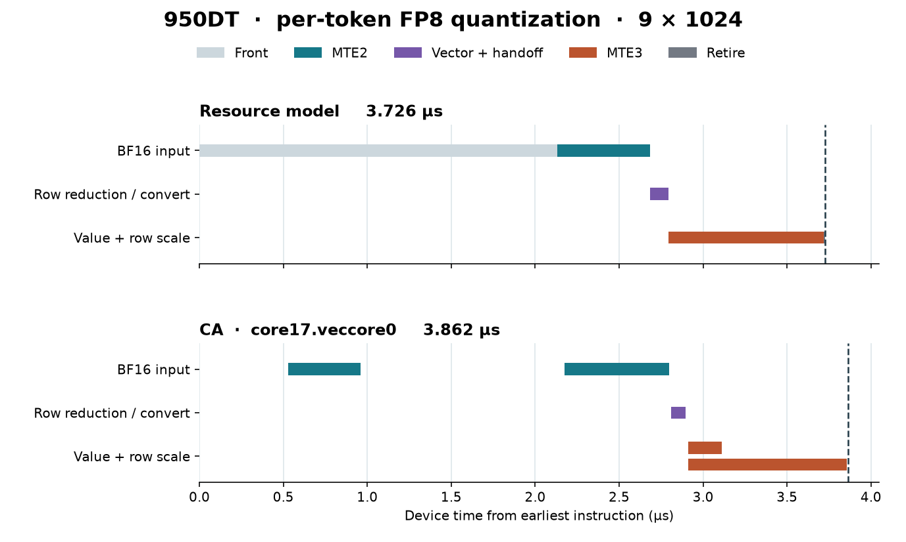

# 逐 token 动态 FP8 量化

以本卡连续 BF16 输入 `[9,1024]` 为例。每一行独立取绝对值的最大值，用它确定 E4M3FN 的对称 scale，再缩放并转换 1,024 个值。一次调用输出 9,216 个 E4M3FN 和 9 个 FP32。系统捕获有 8,253 个这类参考节点。这里选择 CANN 9.2.1 的独立 `aclnnDynamicQuantV2`，无 offset、无 smoothing；系统导出的参考节点没有派发记录。与 MX 量化对接时应先核对 scale 张量，逐 token FP32 与 block32 E8M0 的分块和写回量不同。

```python
from operator_model import estimate

r = estimate("quant_token_fp8", [9, 1024], dtype="bf16", chip="Ascend950DT_9582")
print(r.latency_us, r.active_aiv, r.work["logical_read_bytes"], r.work["logical_write_bytes"])
# 3.7261655011655015 9 18432 9252
```

## 从行分配到设备时间

设行数为 R、行宽为 D、目标芯片有 A 个 Vector 核。全行可放入 UB 时，启用 P=min(R,A) 个核，最忙核处理 ⌈R/P⌉ 行。本例 P=9，每核 1 行。以 h 表示该核一个 UB 块内的行数，n=hD 是元素数。全片逻辑读量为 2RD 字节，写量为 RD+4R 字节。末核上 2n 字节的 BF16 读就绪后才能完成归约，输出值和 scale 从同一个计算结果分别写回。

下面每个阶段以 **950DT 周期** 计价。1.65 GHz 对应 1,650 cycles/µs。系数显示时作了取整，程序用完整精度。log₂(P) 是同时启动更多核时的有效到达或等待增量。

| 阶段 | 公式和本例代入 | 周期 |
|---|---|---:|
| 第一条有效数据读发起 | 2,790.97 + 228.64 log₂(P)，包括发起、tiling 读取和控制 | 3,515.75 |
| 数据到达 | 901.62 + 2n/198.69，常数为有效读响应，分母是每核读 B/cycle | 911.92 |
| 归约、转换、交给写队列 | 106.25 + 0.0771484 n s，包含向量循环与交接。s 是参考芯片与目标芯片每 AIV 单周期 FP32 吞吐之比，DT 取 1 | 185.25 |
| 写回 | 两路从同一就绪时刻出发，取 max(307.85 + n/90.56, 723.51 + 252.59 log₂(P) + 4h/90.56)。分别为值和 scale 的退休约束 | 1,524.25 |
| 尾部退休 | 最后一个输出描述符完成至末核退休的间隔 | 11.00 |

这五项之和除以 1,650 得 **3.726 µs**。多 UB 块时首块充满流水，剩余双缓冲块以读、算、写的最大阶段需求推进，单缓冲块则计阶段和。模型再将核内服务与全片 HBM/L2 传输下界取最大。行宽超过全行路径的 UB 预算，或显式传入非连续步长时，工作量仍可计算，耗时留空。UB 行数参考 ops-nn 固定版 `quant/dynamic_quant/op_host/dynamic_quant_tiling_arch35.cpp`，在 1,024 B 预留和 16 元素行对齐后分别检查单缓冲和双缓冲可容纳的行数。[价格实现](../../src/operator_model/operators/quant/token_fp8.py)

## 参数如何从 CA 取得

开发样本是连续 `[9,512]`、`[9,7168]` 和 `[144,1024]`，每形在 DT、PR 各测一次。每次以全片最早指令为零，选最后退休核，记录两条 MTE2（tiling 和输入）、输出值及 scale 两条 MTE3、首末 Vector 和 END。首先同芯片配对固定 9 行的窄/宽样本，取阶段耗时差除以**该核**载荷差，得到读、写和向量的单位价格，再合并两端斜率并从各窗扣除字节/元素项取中位数。对首读发起与 scale 尾延迟，按 9 核和全核两档的对数核数差求斜率及截距。两档并发只能辨识一个有效斜率，内存控制器排队和核到达离散尚不能分别辨识。终止残差取末次 DMA 完成到 END 的中位数。未来芯片以目标的每核吞吐、频率、核数和共享带宽重算，未知端口响应沿用开发值。[提取和拟合](../../calibration/token_quant/fit.py) · [完整精度参数](../../src/operator_model/data/parameters/token_quant_fp8.json)



上栏是模型关键路径，下栏为独立验证的最后退休核 `core17.veccore0`，时间零点均为全片最早指令。下栏输入行包含早到的 256 B tiling 描述符；Vector 条包含首末指令之间的间隔；输出行上、下两条分别为载荷和 scale 描述符的完整在途时间。模型把向写队列交接算进 Vector 项。CA 实际输入发起/完成于 3,587/4,617 周期，1,024 B 值写和 4 B scale 写分别完成于 5,132 和 6,362 周期。全窗 6,373 周期即 **3.862 µs**，预测低约 3.53%。PR 同形模型 **3.727 µs**、CA **3.442 µs**，970DT 外推 **3.416 µs**。这组输入在拟合和冻结后才采集。两个 SKU 的实际 kernel 均为 ops-nn `DynamicQuantV2_bf16_float8_e4m3fn_high_performance_65_mix_aiv`。探针用可精确编码的有符号数和随行变化的二次幂 scale 逐元素核对两个输出。[逐窗误差与实现](../errors/quant_token_fp8.md) · [原生驱动](../../calibration/token_quant/native.cpp)
