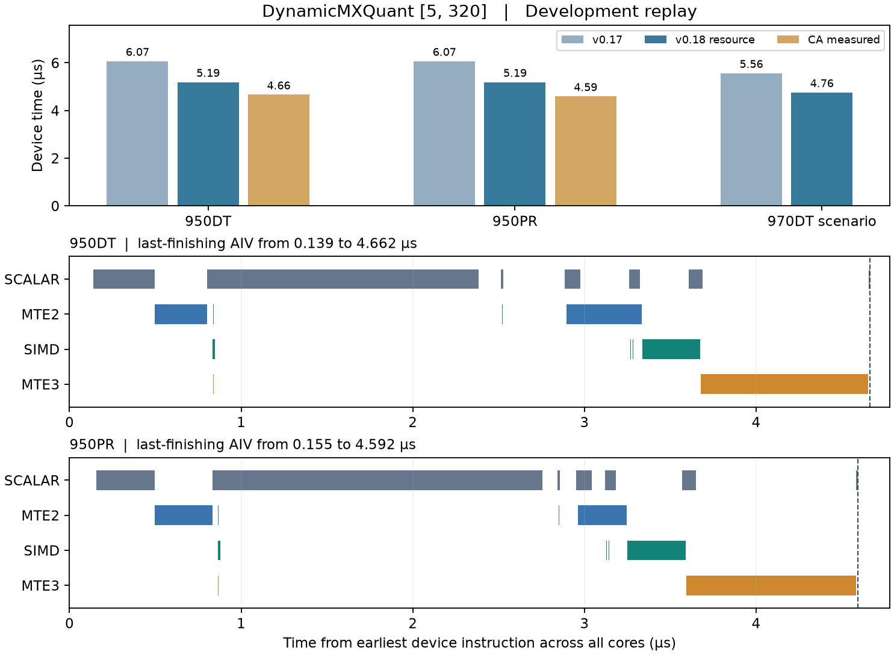

# DynamicMXQuant 算例：本卡 5 行 × 320 列

**开发回放。** 本例复用已归档的两个 950 SKU 的合格 CA 窗口，定位 v0.17 的误差。970DT 的两列模型时间均为架构情景外推。新的独立 shape 单列于[总误差报告](../error-analysis.md)。

公开调用为 CANN 9.2.1 ops-nn 的 `aclnnDynamicMxQuant`，输入 BF16。公共接口统计 3,150 次有用 Vector 标量等价运算、0 次 Cube 运算。逻辑输入与输出分别为 3,200 和 1,650 B。向量计数包含绝对值和分组最大值比较；scale 编码未展开。

```python
from operator_model import estimate

for chip in ('Ascend950DT_9582', 'Ascend950PR_957b', 'Ascend970DT'):
    r = estimate('quant', [5, 320], dtype='bf16', chip=chip, timing_mode='resource')
    print(r.latency_us, r.active_aiv, r.projection['stages_us'])
```

## 同一输入的设备窗口

| 平台 | v0.17 µs | v0.18 µs | CA µs | v0.17 / v0.18 有符号误差 | v0.18 / CA 活跃 AIV |
|---|---:|---:|---:|---:|---:|
| Ascend950DT_9582 | 6.06892 | 5.18810 | 4.66242 | +30.17% / +11.27% | 10 / 10 |
| Ascend950PR_957b | 6.06896 | 5.18814 | 4.59152 | +32.18% / +12.99% | 10 / 10 |
| Ascend970DT | 5.56316 | 4.75575 | N/A | N/A | 10 / N/A |

v0.17、v0.18 都显式使用资源路径。
误差以 (预测−实测)/实测 计算。



下方两幅时间线各选该次 kernel 最晚结束的 AIV，横轴以全核最早指令为零。每条色带合并同一队列有有效持续时间的指令，跳过 duration-excluded 记录。两条色带在同一时刻出现表示流水重叠。虚线是全核窗口终点。

| 实测平台 | 实际 kernel / trace SHA 前 12 位 | 尾核起点 µs | SCALAR / MTE2 / SIMD / MTE3 在途并集，各 µs | 输出校验 |
|---|---|---:|---|---|
| Ascend950DT_9582 | `DynamicMxQuant_bf16toe4m3_high_performance_33_mix_aiv` / `bd4ce2a72af1` | 0.1388 | 2.1945 / 0.7509 / 0.3552 / 0.9800 | `correctness quant_elements=1600 scale_elements=50 bad=0 comparison=exact_bytes` |
| Ascend950PR_957b | `DynamicMxQuant_bf16toe4m3_high_performance_33_mix_aiv` / `6327b3a578fe` | 0.1552 | 2.5206 / 0.6273 / 0.3606 / 0.9909 | `correctness quant_elements=1600 scale_elements=50 bad=0 comparison=exact_bytes` |

DT 与 PR 各用 10 个 AIV，行内分成 256 列和 64 列两片。两次实测最晚完成的都是 64 列尾片，分别位于 scale 偏移 48 和 38，只读 128 B、写 2 B scale。模型选中了偏移 30 的 256 列跨段写者，因此仍高估 PR 12.99%。图中画的是实测尾核；下方公式从模型选中的核推导。

## 从输入到预测

BF16 [5,320] 读 3,200 B，E4M3FN 数据写 1,600 B，E8M0 scale 写 50 B。每 32 个数一组，偶数个 scale 槽构成一行。

**Ascend950DT_9582** 频率 1.65 GHz，AIV 64 个，下列时间是资源模型预测。

分核的基础列宽 256，每核最多 1×256，实际 10 核。UB tile 1×256，最大 1 轮。

关键首块读/数据写/scale 写 512/256/8 B。读端每核 48.36 B/cycle、整片有效上限 2424.24 B/cycle，首响应=max(983.11, 1.32)=983.11 cycles，相邻发读间隔 7.43 cycles。VF 工作 2 轮 × 3469.52 等效操作/轮，目标每核 511.36 操作/cycle。

短 scale 描述符共享 2 个 32 B 粒度。各核提交顺序用行列坐标的秩近似。关键核起点在行 3、列 0，秩 6，它在首个核之后 328.72 cycles 发读。前端准备与读并行，较慢者就绪才开始 SIMD。按 DT 指令间隔估计的前端 1285.75 cycles，读完后到数据写发起 475.96 cycles。

关键 scale 请求所触粒度的生产者数 [7, 4]。先在每个粒度上按 344.75 cycles 发起节拍排队，再将各描述符按最早可完成时刻排序，按共享返回节拍 61.50 cycles 排队。该请求单独可在 2115.09 cycles 完成，排队后为 3854.86，增加 1739.78。两笔写窗口 2067.07 cycles。时间原点是最早的 payload 读，候选关键核是模型选择。

整片冷读写下限 2.00 cycles。设备预测=(启动 4689.50 + 流水与全片下限取大 3854.86 + 排空 16.00)/1650 = **5.18810 µs**。

**Ascend950PR_957b** 频率 1.65 GHz，AIV 56 个，下列时间是资源模型预测。

分核的基础列宽 256，每核最多 1×256，实际 10 核。UB tile 1×256，最大 1 轮。

关键首块读/数据写/scale 写 512/256/8 B。读端每核 48.36 B/cycle、整片有效上限 848.48 B/cycle，首响应=max(983.11, 3.77)=983.11 cycles，相邻发读间隔 7.43 cycles。VF 工作 2 轮 × 3469.52 等效操作/轮，目标每核 508.66 操作/cycle。

短 scale 描述符共享 2 个 32 B 粒度。各核提交顺序用行列坐标的秩近似。关键核起点在行 3、列 0，秩 6，它在首个核之后 328.72 cycles 发读。前端准备与读并行，较慢者就绪才开始 SIMD。按 DT 指令间隔估计的前端 1285.75 cycles，读完后到数据写发起 476.03 cycles。

关键 scale 请求所触粒度的生产者数 [7, 4]。先在每个粒度上按 344.75 cycles 发起节拍排队，再将各描述符按最早可完成时刻排序，按共享返回节拍 61.50 cycles 排队。该请求单独可在 2115.16 cycles 完成，排队后为 3854.94，增加 1739.78。两笔写窗口 2067.07 cycles。时间原点是最早的 payload 读，候选关键核是模型选择。

整片冷读写下限 5.72 cycles。设备预测=(启动 4689.50 + 流水与全片下限取大 3854.94 + 排空 16.00)/1650 = **5.18814 µs**。

**Ascend970DT** 频率 1.8 GHz，AIV 120 个，970DT 为无目标 CA 的情景外推。

分核的基础列宽 256，每核最多 1×256，实际 10 核。UB tile 1×256，最大 1 轮。

关键首块读/数据写/scale 写 512/256/8 B。读端每核 48.36 B/cycle、整片有效上限 8000.00 B/cycle，首响应=max(983.11, 0.40)=983.11 cycles，相邻发读间隔 7.43 cycles。VF 工作 2 轮 × 3469.52 等效操作/轮，目标每核 512.00 操作/cycle。

短 scale 描述符共享 2 个 32 B 粒度。各核提交顺序用行列坐标的秩近似。关键核起点在行 3、列 0，秩 6，它在首个核之后 328.72 cycles 发读。前端准备与读并行，较慢者就绪才开始 SIMD。按 DT 指令间隔估计的前端 1285.75 cycles，读完后到数据写发起 475.94 cycles。

关键 scale 请求所触粒度的生产者数 [7, 4]。先在每个粒度上按 344.75 cycles 发起节拍排队，再将各描述符按最早可完成时刻排序，按共享返回节拍 61.50 cycles 排队。该请求单独可在 2115.07 cycles 完成，排队后为 3854.85，增加 1739.78。两笔写窗口 2067.07 cycles。时间原点是最早的 payload 读，候选关键核是模型选择。

整片冷读写下限 0.61 cycles。设备预测=(启动 4689.50 + 流水与全片下限取大 3854.85 + 排空 16.00)/1800 = **4.75575 µs**。

周期参数来源为 950DT 阶段观测。常规路径的首读、写启动、排空分别为 972.53、242.51、16.00 cycles，来自 13 个 shape。共享短写路径还从 10 个不同 shape 提取首核启动 4689.50、每核发起跨度斜率 148.43、前端准备 1285.75、SIMD 固定部分 159.75、每粒度/共享返回节拍 344.75/61.50 cycles；各 shape 等权取中位数。实际端口调度、核顺序随芯片改变时可覆盖这六个参数。

[v0.17 双 SKU 测量清单和冻结预测](../../results/v0.17/sku/pairs.json) · [v0.18 参数、机制与误差来源](../../results/v0.18/quant-method.md) · [复现程序](../../development/validation/sku18/worked_examples.py)
