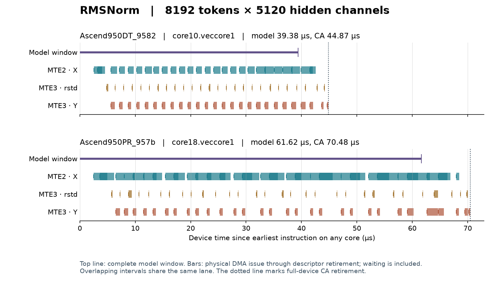

# RMSNorm 大形算例 · Flash prefill 的 8192 个已调度 token

DeepSeek-V4.1-Flash 的文本 hidden size 是 5120。单卡本次调度 4 个请求、每个请求 2048 个 token，得到 `X[8192,5120]`；8 个请求各调度 1024 个 token 的本次算子几何相同。一个请求的完整上下文仍可长达 32Ki、128Ki 或 256Ki。若 B8 一次计算完整 32Ki，输入会是 `[262144,5120]`，本例只验证前述 8192 行。[模型 config](../../configs/models/DeepSeek-V4.1-Flash.json) · [既有采样登记](../../results/v0.29/large/vector/freeze.json)

```python
from operator_model import estimate

pred = estimate("rmsnorm", [8192, 5120], dtype="bf16", chip="Ascend950PR_957b")
print(pred.latency_us, pred.active_aiv)
print(pred.work, pred.projection["target_plan"])
```

算子逐行求平方和、均值和倒数平方根，乘回原行与 gamma。这里 `X`、`gamma[5120]`、`Y` 采用 BF16，`rstd[8192,1]` 采用 FP32，`epsilon=10⁻⁶`。R 表示行数、D 表示通道数。每行输入 D 项，归约产生一个 rstd。逻辑读字节 $2RD+2D=83{,}896{,}320$，逻辑写字节 $2RD+4R=83{,}918{,}848$。其中大输出 Y 为 83,886,080 字节，rstd 为 32,768 字节。公开模型记作 $4RD+2R=167{,}788{,}544$ 个等价 Vector 运算。实际 HBM 流量需要进一步观测；逻辑字节包含可由片上存储交付的数据。全域数值验证初始化交错 ±1 的输入、全 1 的 gamma、哨兵 Y 和 rstd，逐个检查 41,943,040 个 Y 及 8192 个 rstd。[实际 ACLNN 宿主与金标](../../smoke/large_vector.cpp)

## 分核、尾块与流水

DT 启动 64 个 AIV，所有核各做 128 行。每个占满的 UB 工作块计算 5 行，得到 25 个满块再加 3 行尾块，26 次迭代。PR 的分核把 147 行分给前 55 个核，每核 29 个满块加 2 行尾块，第 56 个核做剩余 107 行，21 个满块加 2 行尾块。最慢核在 DT 为 core10.veccore1，PR 为 core18.veccore1。这些计数来自物理 MTE3 对 Y 的每条写描述符；按 PC 聚合的指令 CSV 会把首个满块的字节量显示在同 PC 的尾块上。[DT 全核字节、行数与退休](../../results/v0.33/large/rms-8192-5120-dt.json) · [PR 全核字节、行数与退休](../../results/v0.33/large/rms-8192-5120-pr.json)



紫线是同一公开模型的整窗估计。下方三行来自最后结束核的物理指令，时间零点为全设备最早的指令；细刻度为发起，横条到该描述符退休，包含依赖等待。每个芯片的点线是完整设备窗。模型成本只能给整窗时，上方只画这个可复算量。[图数据、逐指令起止与发起间隔](../../results/v0.33/large/rms-critical.json)

| 临界核的满块中位数 | 950DT | 950PR |
|---|---:|---:|
| X 读描述符持续周期 | 1847 | 4551 |
| 相邻满块 X 读发起间隔（周期） | 2551 | 3248 |
| Y 写描述符持续周期 | 934 | 821 |
| 相邻满块 Y 写发起间隔（周期） | 2551 | 3248 |

这里 1650 个周期等于 1 µs。PR 的满块 X 读在前条退休前就可以发起；把 4551 周期读等待全额乘 30 次会重复累计可重叠区间。另一方面，DT/PR 核数差可以解释最忙核 26 对 30 块，两侧每个满块的平均供数情况仍有差异。最后结束核的发起间隔受依赖、并行读取与竞争共同影响，上表不能单独推算 HBM 端口服务率。

## 设备时间与误差

原 CA 整窗分别为 44.868 / 70.485 µs，墙钟 68.9 / 69.3 分钟。作为复核前的基准，v0.32 对未知驻留状态估计 39.379 / 61.622 µs，误差 −12.23% / −12.57%；同版 970DT 21.582 µs 属于外推。[当前安装版同形估计、误差和 970DT 结果](../../results/v0.33/large/report.md#rmsnorm-大形)

等元素形状 [32768,1280] 的真实设备窗为 44.585 / 69.729 µs。两形的 Y 都含 41,943,040 项，但后者每条满块有 24 行，DT 每核 22 块，PR 最忙核 25 块。四个设备窗口说明这两种较大几何在固定元素数下耗时相近，不能单凭两点拟合线性斜率，或用 1280 通道替代整模型 5120 通道。两个 SKU 采同一个库目录的 ops-nn RMSNorm 对象，采集二进制的 .text 与安装版一致。[等元素 DT 回执](../../results/v0.33/large/rms-32768-1280-dt.json) · [等元素 PR 回执](../../results/v0.33/large/rms-32768-1280-pr.json)
