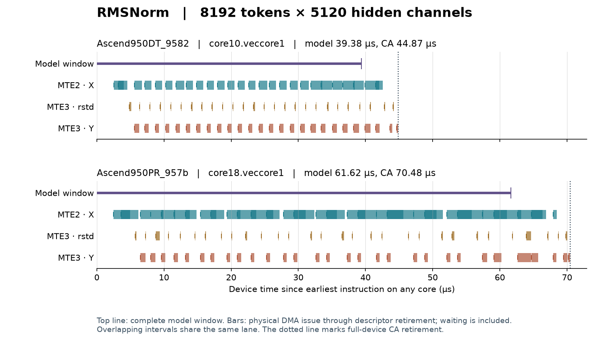

# RMSNorm · 每卡 8192 个 Flash token

Flash 每卡按 4 个请求、每请求 2048 个已调度 token 计算。输入元素 8192×5120=41,943,040。共享 γ 有 5120 个 BF16。Y 有 83,886,080 B，另输出 8192×4=32,768 B 的 rstd。

## 单卡输入与调用

```python
from operator_model import estimate

shape = [8192, 5120]
attrs = {}
result = estimate('rmsnorm', shape, attrs, chip='Ascend950PR_957b')
print(result.latency_us, result.active_aic, result.active_aiv)
print(result.work["logical_read_bytes"], result.work["logical_write_bytes"])
```

## 从工作量到设备时间

DT 每个 AIV 分到 128 行，按 5 行/块得到 25 个满块和 3 行尾块。PR 最忙核 147 行，分 29 个满块和 2 行尾块。每块读、归约、乘 γ、写 rstd 和 Y，写描述符可以与邻块向量运算重叠。

公开工作量统计为 Cube **0**、Vector **167,788,544** 个有用标量等效操作。逻辑读 **83,896,320 B**、写 **83,918,848 B**。片外实际流量取决于重用与缓存。

分块时先将 D 补齐到 16，并按整行双缓冲、γ 与归约临时区核算 UB。写回还区分按 128 列计价的向量工作和按 KiB 计价的 Y 描述符。有效竞争窗口 128 B 是 950 上相邻 FP32 统计量写者的经验粒度。多个块连续时核对实际采用的共享读写约束。 [参数及单位](../../src/operator_model/data/parameters/rms_writeback.json)

下表取 950PR 的公开阶段分账。各段已处理模型可辨识的重叠，数值保留三位小数。

| 阶段字段 | 暴露时间 µs |
|---|---:|
| `arrival` | 0.563 |
| `SCALAR` | 1.626 |
| `other` | 0.004 |
| `MTE2` | 1.288 |
| `SIMD` | 41.573 |
| `MTE3` | 0.377 |
| `shared_io` | 16.191 |
| **整窗** | **61.622** |

## 本例各阶段怎样定价

**一次处理哪些行。** [8192,5120] 输入 BF16、gamma 为 BF16，输出 y 为 BF16、rstd 为每行一个 FP32。PR 有 56 AIV，忙核 r=⌈8192/56⌉=147 行，活跃数 ⌈8192/147⌉=56。令对齐宽 D=5120，归约辅助量按前一 2 的幂 4096 计算：辅助项为 32⌈⌈4096/64⌉/32⌉=64 B/行。用固定保留、gamma 和每行双缓冲求 UB 上限：⌊(253952−1024−2048−2D)/(8D+12+64)⌋=5 行，故 29 满块加 2 行尾块。每行有 ⌈D/128⌉=40 个归约单位，G=147×40=5880。参考与目标每核 FP32 吞吐的时间倍率为 s=(27000/(64×1.65))/(23000/(56×1.65))=1.027174。以下 1650 cycles=1 µs。

### 计算怎样掩盖写回

这里的 UB tile 指一次放进 UB 的几整行，后一个 tile 的行可以独立进行平方和归约。前一 tile 写出时，后一个 tile 可以占用另一个缓冲槽并执行 SIMD。同一 tile 的 `rstd` 写出要等行归约，`y` 写出还需等归一化完成。

每个 n 行块做 40n 组。开发 CA 提供标记点之间的固定 cycles 和每组斜率。块间 reduce 为 `270.86866+4.49056×40n×s`，normalize 为 `75.45798+6.04932×40n×s`。满块两者为 1193.386、1318.199 cycles，尾块为 639.876、572.554 cycles。以首块的 rstd 写发起为局部零点。每块在上一块 normalize 结束后加本块 reduce（首块跳过），得到 rstd 写起点 `u`。y 写起点为 `v=u+normalize`。有效邻写数 `max(0,min(56,128/(4×147))−1)=0`，故 rstd 窗为 `[u,u+133]`。y 窗为 `[v,max(u+133,v+302.49624+16.01826×2Dn/1024)]`，末项按输出 KiB 定价。

满块 y 写 50 KiB，持续 1103.409 cycles，加独立 rstd 的 133 得 1236.409 cycles。下个满块的 reduce 需要 1193.386 cycles，前后两块的写窗互不相接。尾块 rstd 在上一满块 y 写后 639.876 cycles 便发起，133 cycles 全部与之重叠；尾块 y 在 1212.430 cycles 后才发起，20 KiB 单独占用 622.861 cycles。全序列描述符并集=29×1236.409+622.861=36478.729，可藏在最后 y 发起之前的部分为 35855.868。还须检查端口下界 147×(2D+4)/1024×16.01826=23556.04 cycles；它小于整个 SIMD 时间。因此暴露写回=max(36478.729−min(SIMD,35855.868),23556.04−SIMD)/1650=**0.37749 µs**。这里按实际发起依赖求并集，描述符的整个在途时长并非独占写端时间。

从图上看，先合并两种写描述符互相覆盖的部分，再扣掉可由 SIMD 覆盖的写窗口。前面还有 tile 可算时，一部分 MTE3 活动会藏在这些 SIMD 窗内。最后一个 y 写发起后，已没有后续 tile 的 SIMD 可覆盖它，因此尾部还剩约 622.861 cycles。公开阶段表中的 MTE3 记录这部分暴露时间。归约组的 CA 价格涵盖了这条实现的实际发射与数据依赖，对目标按每核 FP32 参考吞吐比缩放。[写区间并集与端口下界](../../src/operator_model/operators/rmsnorm/writeback.py)

**每个历史状态，再求全片完成。** 首次、扩核和复用各有终端 AIV 的到达及 Scalar 预算。下表前三列按这个顺序给出；统计项的截距来自 950 开发阶段窗口。PR 单独校准了首次 Scalar 和首笔 payload 释放。称 r0 为该状态的首读固定 cycles、向量时间记 V。

| 阶段 | cycles 方程、取值与含义 |
|---|---|
| 到达、Scalar、退休 | 首次到达 14.625×55=804.375 cycles；扩核、复用到达按参考标记为 0.649274、0.013661 µs。首次 Scalar=2580.5 cycles，扩核/复用为 1.701812/0.946147 µs。三态相同的末端余量为 0.003821 µs。 |
| SIMD | V=c+11.287692×G×s，c 依次为 515.3772、324.3920、302.7731 cycles。得到 41.63066、41.51491、41.50181 µs。该斜率合并平方、归约和归一化的实际向量服务。 |
| MTE2 | 首 tile 输入 2×5D=50 KiB，本地读总量 2D(147+1)=1,515,520 B，含 gamma。令 a=r0+50×18.39635，本地暴露取 max(a,27226.598−V)。首次 r0=1388.654 cycles，扩核/复用 r0=0.623167/0.522318 µs×1650。复用可在前序运行中提前发起 228 cycles，仍守住相同本地读下界。因此三个 MTE2 阶段分别是 1.39907、1.18063、0.94160 µs。 |
| 共享 IO | 输入 2D(8192+1)=83,896,320 B，输出 (2D+4)×8192=83,918,848 B；L2 给输入预留 2D(1+2×5×56)=5,744,640 B，余量 117,440,512−5,744,640 超过输出，允许全部输出暂留。HBM 下界=83,896,320×1.65/1400=98877.806 cycles；本 PR 配置缺独立 L2 带宽价。首次释放为 2776 cycles，其余为 2970×该态Scalar cycles/2933.5。补足 max(0,释放+98877.806−已计到达、Scalar、MTE2、SIMD、MTE3及退休)。得到 16.14588、16.22099、17.09933 µs。 |

三种状态各段相加为 F=61.60837、E=61.64893、H=60.88386 µs。未知前序在已启动流中假设前一批使用的核数均匀落在 1…56，需扩核的权重 p=(56−1)/56，运行中 R=pE+(1−p)H=61.63527 µs。点估计为 2FR/(F+R)=**61.62181 µs**；公共表逐阶段使用相同权重。缓存留存比例与未知前序规则都会影响跨代解释。[双缓冲写窗](../../src/operator_model/operators/rmsnorm/writeback.py) · [归约及 DMA 价格](../../src/operator_model/data/parameters/rms_writeback.json) · [状态截距](../../src/operator_model/data/parameters/vector_wide_rows.json) · [首发与流状态](../../src/operator_model/operators/rmsnorm/dispatch.py) · [PR 两项首发校准](../../src/operator_model/data/chips/Ascend950PR_957b.json)

## 如何从 CA 得到这些参数

**来源边界。** 行分块、y/rstd 大小和同步来自该 BF16 实现。缓存与频率来自芯片配置；脏输出留存、未知前序核数均匀分布、两端点调和中心属于估算假设。

**DT 本地价。** 隔离首次调用以全核最早指令为零，最后完成核的起点除以 (活跃核−1)，9 个有效样本的中位数给 14.625 cycles/核。取各个只含单笔 x 读的核：有效 MTE2 并集减按 KiB 计的传输服务，再取中位数得首读截距 1388.65374 cycles。对 9 笔单次输入读和 28 笔未被 rstd 明显遮挡的 y 写，分别枚举 (KiB,持续时长) 的两点斜率，仅留 KiB 距离在上半部分的形状对，再取中位数得 18.39635262、16.01826484 cycles/KiB。8 个单写者 rstd 的描述符时长中位为 133 cycles，5 个有邻居形状的 (时长−133)/邻居数中位为 147.58824。128 B 是统计写者的有效共享粒度。[DT 首发、互斥队列记录](https://github.com/Runze-Lin/operator_sim/blob/2059edce197af60ddee6cfbc7c78d40c715ed76f/results/v0.19/rms-startup.json) · [rstd、y 描述符数据库摘录](https://github.com/Runze-Lin/operator_sim/blob/2059edce197af60ddee6cfbc7c78d40c715ed76f/results/v0.12/rms/development-evidence.json) · [逐项所得样本数与估计量](https://github.com/Runze-Lin/operator_sim/blob/2059edce197af60ddee6cfbc7c78d40c715ed76f/development/validation/sku19/rms_calibrate.py)

**PR 首次派发为何是 2580.5 和 2776。** DT 尾核互斥 Scalar、全片首次 x/gamma payload 发起的中位数分别为 2933.49976、2969.99992 cycles。11 对 DT/PR 中，仅 7 对的有效核、每核行数、UB 列表相同且二进制一致。以 [1,5504] 为例，末核 Scalar 的 PR−DT=(1.74484833−1.85393990)×1650=−180 cycles，最早输入发起的差=(1.86909056−1.98666668)×1650≈−194。7 个 Scalar 差为 −180、−26、−478、−353、−366、−331、−408；读发起差为 −194、127、−246、−277、−118、71、−322。于是 2933.5+median(Scalar差)=2580.5，2970+median(发起差)=2776。[双端核、时刻和 SHA](https://github.com/Runze-Lin/operator_sim/blob/2059edce197af60ddee6cfbc7c78d40c715ed76f/results/v0.19/rms-followup/old-paired-phases.json) · [筛选和七组形状](https://github.com/Runze-Lin/operator_sim/blob/2059edce197af60ddee6cfbc7c78d40c715ed76f/results/v0.19/rms-followup/evidence.md)

**归约与历史。** 43 个旧 DT 关键 AIV 时间线的输入列为 UB tile 行数、归约组数与前序状态。目标分别为互斥 SIMD cycles、同块 rstd→y 发起差（normalize）、单 tile 的剩余 SIMD（reduce），以及可分开辨认的 y 写时间。用非负 soft-L1、转折尺度 80 cycles 拟合，得到 11.287692 cycles/组及三态 SIMD 截距，和 normalize/reduce 两条固定项/斜率。发布版本对 y 持续价格、rstd 固定项及相邻写者部分使用上面的端口复核值。扩核和复用基础到达/Scalar/MTE2/退休截距来自历史分类的互斥阶段拟合；复用输入能提前 228 cycles 来自 19 个已驻留关键核的暴露读时剩余量中位数，作用于复用分支。[归约与写窗目标列及拟合](https://github.com/Runze-Lin/operator_sim/blob/2059edce197af60ddee6cfbc7c78d40c715ed76f/development/validation/rms12/freeze.py) · [各价格训练数](https://github.com/Runze-Lin/operator_sim/blob/2059edce197af60ddee6cfbc7c78d40c715ed76f/results/v0.12/rms/profile.json) · [历史分组截距](https://github.com/Runze-Lin/operator_sim/blob/2059edce197af60ddee6cfbc7c78d40c715ed76f/scripts/wide-v10-freeze.py) · [复用读开发诊断](https://github.com/Runze-Lin/operator_sim/blob/2059edce197af60ddee6cfbc7c78d40c715ed76f/results/rms-unknown23/resource-diagnostic.json)

## 与完整 CA 核对

| 目标 | 公开预测 µs | 完整 CA µs | 有符号误差 | 预测有效 AIC / AIV |
|---|---:|---:|---:|---:|
| Ascend950DT_9582 | 39.379 | 44.868 | -12.23% | 0 / 64 |
| Ascend950PR_957b | 61.622 | 70.485 | -12.57% | 0 / 56 |
| Ascend970DT（外推） | 21.582 | N/A | N/A | 0 / 119 |

两端都低估大形全窗。图中末核的读发起间隔与一次读描述符占用时长可分别测量，实际发起会因 UB 槽位和共享写路径延后。上栏整窗只说明模型预算，对未辨识的逐 tile 时刻保持空缺。

示例收据的调用为 `aclnnRmsNorm`，provider 为 CANN 9.2.1 ops-nn，实际记录的 kernel 为 `RmsNorm_normal_all_bf16_high_performance_5000`。



上方只标出可识别的模型整窗。单条 CA 横杠为在途描述符，下方数据支持逐条读出发起与退休。 [图上使用的数值](assets/rmsnorm.json)

复核时，在逐窗记录中筛选 `contract=rmsnorm · msopprof`、此页 shape 和属性。有多个前序的样本逐窗保留。示例用于解释该次计算。校准统计、冻结后独立样本数及完整误差范围以总报告为准。[逐窗数据](../../calibration/reference/windows.jsonl) · [模型实现](../../src/operator_model/operators/rmsnorm/pipeline.py) · [总建模方法](../modeling-strategy.md) · [误差分析](../error-analysis.md)
