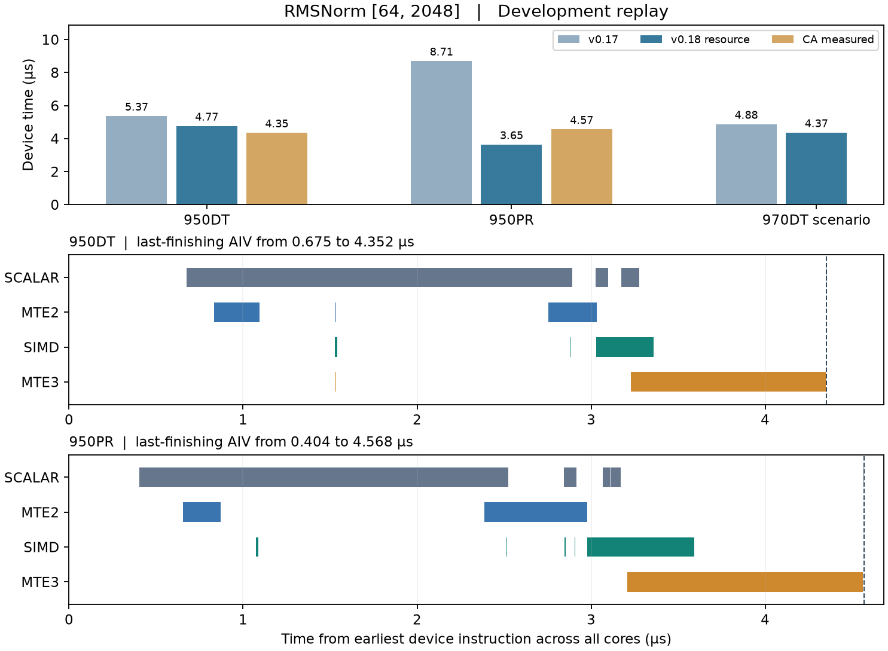

# RMSNorm 算例：本卡 64 行 × 2048 列

**开发回放。** 本例复用已归档的两个 950 SKU 的合格 CA 窗口，定位 v0.17 的误差。970DT 的两列模型时间均为架构情景外推。新的独立 shape 单列于[总误差报告](../error-analysis.md)。

公开调用为 CANN 9.2.1 ops-nn 的 `aclnnRmsNorm`，输入 BF16。公共接口统计 524,416 次有用 Vector 标量等价运算、0 次 Cube 运算。逻辑输入与输出分别为 266,240 和 262,400 B。导出每行 FP32 rstd，归约与乘法按 FP32 计数。

```python
from operator_model import estimate

for chip in ('Ascend950DT_9582', 'Ascend950PR_957b', 'Ascend970DT'):
    r = estimate('rmsnorm', [64, 2048], dtype='bf16', chip=chip, timing_mode='resource')
    print(r.latency_us, r.active_aiv, r.projection['stages_us'])
```

## 同一输入的设备窗口

| 平台 | v0.17 µs | v0.18 µs | CA µs | v0.17 / v0.18 有符号误差 | v0.18 / CA 活跃 AIV |
|---|---:|---:|---:|---:|---:|
| Ascend950DT_9582 | 5.37142 | 4.76581 | 4.35212 | +23.42% / +9.51% | 64 / 64 |
| Ascend950PR_957b | 8.70858 | 3.64501 | 4.56788 | +90.65% / -20.20% | 32 / 32 |
| Ascend970DT | 4.87561 | 4.36860 | N/A | N/A | 64 / N/A |

v0.17 使用当时的公共默认 auto（DT 校准，PR/970 为 DT 阶段投影）；v0.18 三端都显式使用 resource，表中默认未传 resident_aiv。
误差以 (预测−实测)/实测 计算。



下方两幅时间线各选该次 kernel 最晚结束的 AIV，横轴以全核最早指令为零。每条色带合并同一队列有有效持续时间的指令，跳过 duration-excluded 记录。两条色带在同一时刻出现表示流水重叠。虚线是全核窗口终点。

| 实测平台 | 实际 kernel / trace SHA 前 12 位 | 尾核起点 µs | SCALAR / MTE2 / SIMD / MTE3 在途并集，各 µs | 输出校验 |
|---|---|---:|---|---|
| Ascend950DT_9582 | `entry_kernel_1388` / `5e8f2515de36` | 0.6752 | 2.3915 / 0.5467 / 0.3406 / 1.1230 | `correctness count=131072 bad=0 max_abs_error=0.00179999 atol=0.015625 rtol=0.015625 hard_limit=1`；`correctness count=64 bad=0 max_abs_error=1.44554e-07 atol=1.52588e-05 rtol=0.000976562 hard_limit=0.01` |
| Ascend950PR_957b | `RmsNorm_normal_all_bf16_high_performance_5000` / `6a6e5a8c34b8` | 0.4036 | 2.2964 / 0.8103 / 0.6382 / 1.3576 | `correctness count=131072 bad=0 max_abs_error=0.00179999 atol=0.015625 rtol=0.015625 hard_limit=1`；`correctness count=64 bad=0 max_abs_error=1.44554e-07 atol=1.52588e-05 rtol=0.000976562 hard_limit=0.01` |

[64,2048] 在 PR 分给 32 核，每核两行。CA 的 MTE3 在途 1.3576 µs，扣除 SIMD 重叠 0.3891 µs 后，净暴露 0.9685 µs。v0.17 把该项估为 4.6404 µs，新版为 1.1011 µs；总时间仍低估 20.2%，主要差在临界核启动错峰与 SCALAR。

DT 的 compact DB 使用运行时入口 `entry_kernel_1388`；PR 官方 CA 导出包内专有 kernel 名。两个平台都已检查 y 与 rstd。

## 从输入到预测

本卡 BF16 输入 64 行，每行 2048 列，输出包含每行 1 个 FP32 rstd。冷输入和 gamma 共 2×2048×(64+1)=266240 B，输出 2×64×2048+4×64=262400 B。每行先规约求逆均方根，再归一化并乘 gamma，因此统计量写与主输出写可以部分重叠。

| 芯片 | AIV预算 / 活跃 | 最忙核行数 / UB 各轮 | SIMD组 | 邻近统计量写者代理 | 写在途 / 可隐藏周期 | 首次 / 扩核 / 热态（µs） | 返回 µs |
|---|---:|---|---:|---:|---:|---|---:|
| Ascend950DT_9582 | 64 / 64 | 1 / [1] | 16 | 31.000 | 3963.46 / 172.25 | 5.7355 / 5.5818 / 4.0766 | 4.7658 |
| Ascend950PR_957b | 56 / 32 | 2 / [2] | 32 | 15.000 | 2091.16 / 274.30 | 4.6543 / 4.5007 / 2.9954 | 3.6450 |
| Ascend970DT | 120 / 64 | 1 / [1] | 16 | 31.000 | 3963.46 / 172.13 | 5.2575 / 5.1166 / 3.7368 | 4.3686 |

未提供 resident_aiv 时以三种条件时间的最小值 l、最大值 u 计算 2lu/(l+u)，使两个端点的相对误差对称；给出状态时直接选择对应条件。

**Ascend950DT_9582**。W=⌈64/64⌉=1，A=⌈64/1⌉=64，组数 W⌈2048/128⌉=16。统计量写描述符服务为 335.886+117.018×31.000 周期，主输出写按最忙核各轮字节计价。变动的向量服务按同频每核峰值比 1.00000 缩放。全片冷 I/O 窗口下界 218.06 周期。本次状态为 unknown_relative_minimax，互斥阶段（µs）为 arrival 0.02411 + SCALAR 1.36349 + other 0.00382 + MTE2 0.73020 + SIMD 0.34649 + MTE3 2.29770 + shared_io 0.00000 = 4.76581。

**Ascend950PR_957b**。W=⌈64/56⌉=2，A=⌈64/2⌉=32，组数 W⌈2048/128⌉=32。统计量写描述符服务为 335.886+117.018×15.000 周期，主输出写按最忙核各轮字节计价。变动的向量服务按同频每核峰值比 1.02717 缩放。全片冷 I/O 窗口下界 623.04 周期。本次状态为 unknown_relative_minimax，互斥阶段（µs）为 arrival 0.02351 + SCALAR 1.33949 + other 0.00382 + MTE2 0.71825 + SIMD 0.45881 + MTE3 1.10113 + shared_io 0.00000 = 3.64501。

**Ascend970DT**。W=⌈64/120⌉=1，A=⌈64/1⌉=64，组数 W⌈2048/128⌉=16。统计量写描述符服务为 335.886+117.018×31.000 周期，主输出写按最忙核各轮字节计价。变动的向量服务按同频每核峰值比 0.99876 缩放。全片冷 I/O 窗口下界 66.08 周期。本次状态为 unknown_relative_minimax，互斥阶段（µs）为 arrival 0.02210 + SCALAR 1.24986 + other 0.00350 + MTE2 0.66935 + SIMD 0.31749 + MTE3 2.10630 + shared_io 0.00000 = 4.36860。

阶段截距和 128 B 统计量写者模型来自 DT 临界核 trace。32/56/120 等活跃核数均由输入分区计算；970 只有情景预测。

### 两笔写是怎样重叠的

以统计量写的发起时刻为 0。令 Δ 为依赖归一化工作完成后主输出写的发起时刻，s₁、s₂ 分别为两笔写的服务周期。主输出的完成时刻为 max(s₁,Δ+s₂)。各相交区间合并计一次。以下三端均只有一个 UB tile。

| 平台 | s₁ = 固定周期 + 邻近写者项 | Δ = 固定周期 + 归一化组工作 | s₂ = 固定周期 + 写 KiB × 斜率 | 写并集 / 隐藏 / 暴露（周期） |
|---|---|---|---|---|
| Ascend950DT_9582 | 335.89+117.02×31=3963.46 | 75.46+6.0493×16×1.00000=172.25 | 302.50+4.00×6.6102=328.94 | 3963.46 / 172.25 / 3791.21 |
| Ascend950PR_957b | 335.89+117.02×15=2091.16 | 75.46+6.0493×32×1.02717=274.30 | 302.50+8.00×6.6102=355.38 | 2091.16 / 274.30 / 1816.87 |
| Ascend970DT | 335.89+117.02×31=3963.46 | 75.46+6.0493×16×0.99876=172.13 | 302.50+4.00×6.6102=328.94 | 3963.46 / 172.13 / 3791.33 |

对于同一形状，启动状态改变关键核的到达、控制、投入读和向量发射时间。以下给出未知 H 时实际进入总预测的两个端点及权重。

- Ascend950DT_9582 的 reuse 与 first 各为 4.07661、5.73548 µs；权重为 0.58453、0.41547。例如 SCALAR 对应 DT 截距 0.94615、1.95066 µs，按此权重混合并乘 1.65/1.65，得 1.36349 µs。
- Ascend950PR_957b 的 reuse 与 first 各为 2.99544、4.65431 µs；权重为 0.60843、0.39157。例如 SCALAR 对应 DT 截距 0.94615、1.95066 µs，按此权重混合并乘 1.65/1.65，得 1.33949 µs。
- Ascend970DT 的 reuse 与 first 各为 3.73683、5.25747 µs；权重为 0.58453、0.41547。例如 SCALAR 对应 DT 截距 0.94615、1.95066 µs，按此权重混合并乘 1.65/1.8，得 1.24986 µs。

[v0.17 双 SKU 测量清单和冻结预测](../../results/v0.17/sku/pairs.json) · [v0.18 参数、机制与误差来源](../../results/v0.18/rms-method.md) · [复现程序](../../development/validation/sku18/worked_examples.py)
