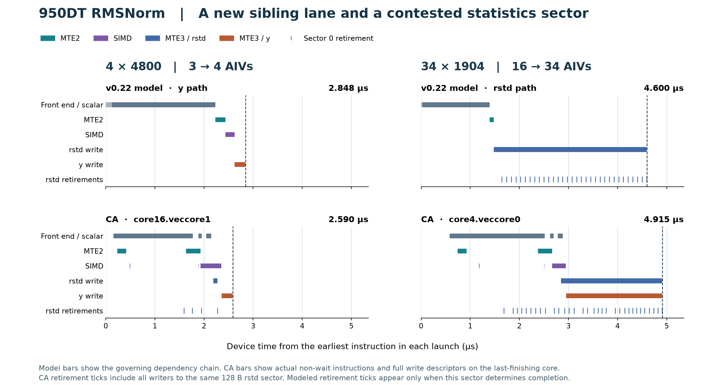
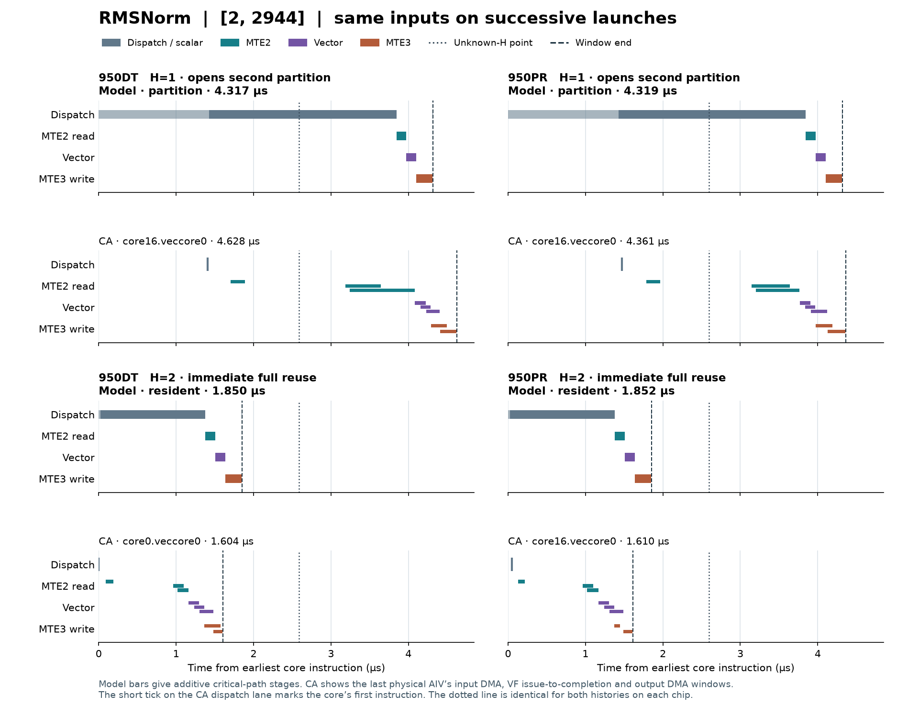

# RMSNorm 算例 · 从派发历史计算归约与写回时间

950PR `[4,688]` 使用相同输入地址，末核读取 x 的 1,376 B 在扩核时于 3.444～3.812 µs 完成该段读，立即重复时于 1.036～1.150 µs。全核整窗分别为 4.557 和 1.742 µs。给定前序的模型为 4.174 和 1.671 µs，未知前序候选则两次都给 2.387 µs。[算例的同一行读写时序](../../results/v0.27/rms/pr-second-partition.png) · [公式、依据与独立十形](../../results/v0.27/rms/report.md)

RMSNorm 对每行计算 $r_t=(D^{-1}\sum_d x_{td}^2+\epsilon)^{-1/2}$，输出 $y_{td}=x_{td}\,r_t\,\gamma_d$ 和每行一个 FP32 逆均方根 $r_t$。本例输入是单卡的 BF16 `x[T,D]`、BF16 `gamma[D]`，输出是 BF16 `y[T,D]`、FP32 `rstd[T,1]`。在 950DT 的同一流上，前序用过 3 个 AIV，再以 4 个 AIV 执行 `[4,4800]`，v0.22 预测 **2.848 µs**，CA 实测 **2.590 µs**。换成 `[34,1904]`、前序 16 个 AIV，预测 **4.600 µs**，此时写入同一个 128 B 扇区的 32 笔统计量成为关键路径。



两列共用设备时间刻度，各次启动均从全核最早指令计零。上方只画正式 API 返回的关键依赖链，空白行表示该项没有决定预测窗。下方横条是最后结束的实际 AIV 的非等待指令及读写描述符区间，写描述符会包括等待完成的时间。最下方竖线覆盖向该地址扇区写 rstd 的**所有核**。算例直接取独立有序验证的第 4 和第 6 次派发，两组数值金标通过，包内 kernel 都是 `RmsNorm_normal_all_bf16_high_performance_5000`。完整设备窗按每核首末时间、END 指令和供应商各核 duration 表核实。原 10 次宿主任务曾触及整批导出预算，这里使用其中完整且已独立核对的两个窗口。[图中各阶段、退休时刻与 trace 指纹](../../results/v0.22/rms-lane-example.json) · [逐形完整性回执](../../results/rms-dispatch-audit/verified-ordered-Ascend950DT_9582.json) · [重绘脚本](../../development/validation/rms_lane_example/figure.py)

## 同一个 tile，在纯 Cube 调用前后变了多少


输入是 BF16 的两行，每行 2944 列。两个 AIV 各负责一行、一个 UB 块。每行需读取 5888 B 的 x 和 5888 B 的 gamma，写 5888 B 的 y 和 4 B 的 rstd。图中三次都用同一个安装包 `aclnnRmsNorm`。两次中间穿插的 `aclnnAddmm` 使用列偏置，实际窗口只有一个 AIC。模型从已执行的 RMS 决定下一次进入哪个通道状态。这里 $H$ 是这个流此前覆盖的 RMS AIV 数，取值来自调度记录，使用前序不需要目标芯片的 CA。

| 本次 RMS 的前序 | H | 950DT 模型 / CA µs | 950PR 模型 / CA µs |
|---|---:|---:|---:|
| 新流只执行过 Addmm | 0 | 3.405 / 4.107 | 3.195 / 4.090 |
| 刚执行过同一个 RMS | 2 | 1.850 / 1.605 | 1.852 / 1.607 |
| 两个 RMS 中间执行过纯 AIC Addmm | 2 | 1.850 / 1.717 | 1.852 / 1.744 |

后两次在 DT 上归一化 VF 的实测发起只差 0.006 µs。隔开 Addmm 后，末核写 y 的描述符占用从 0.109 拉长到 0.224 µs，解释了整窗多出的 0.112 µs。模型复用同一热态，能解释首发到热态的变化，仍缺少这两次写响应的差别。首发还低估 0.702 µs；上栏是暴露在关键路径上的阶段预算，下栏能看见实际两路输入和两笔写之间的重叠。这三个固定顺序的观测不能单独识别 Addmm 对缓存、地址和写队列的各自影响。[950PR 对照图](../../results/v0.25/mixed-stream/pr-rms-tile.png) · [逐条指令时间和哈希](../../results/v0.25/mixed-stream/dt-rms-tile.json) · [另十形的冻结报告](../../results/v0.25/mixed-stream/README.md)

```python
from operator_model import OperatorStream

stream = OperatorStream('Ascend950DT_9582')
stream.advance('rmsnorm', [2, 2944])
# 系统仿真器已知这次列偏置实现只发 AIC。
stream.advance('addmm', [16, 64, 256], {'self_shape': [64]}, aic_only=True)
print(stream.advance('rmsnorm', [2, 2944]).latency_us)  # 1.850 µs
```

## 两个输出在同一逻辑行上的写回


[34,1664] 在两个 950 上均为 34 核、每核一行。给真实前序 H=17，模型预测 DT/PR 均为 4.589 µs，完整 CA 分别为 4.819 / 4.776 µs。这张图取 8 个行号，底层数据保留全部 34 行和核名。每行的蓝色统计量写按同一 128 B 扇区中的队列递推完成时刻，橙色输出写按该行归一化后发起和自身响应计算。PR 行 31 的两笔实际写入在 4.586 和 4.587 µs 结束，模型只给橙色写到 3.470 µs。行 32 写到下一个扇区，实际两次完成隔了 0.174 µs。同组各行的模型发起先后使用同类通道的区间排序；单靠最后总时延无法校准每行退出先后。[DT 同图](../../results/v0.24/rms-prefix/dt-rms-output-rows.png) · [全部 PR 读数和 trace 指纹](../../results/v0.24/rms-prefix/pr-rms-output-rows.json)

## 调用并读取结果

```python
from operator_model import estimate, OperatorStream

chip = 'Ascend950DT_9582'
call = estimate('rmsnorm', [4, 4800], {'resident_aiv': 3}, chip=chip, dtype='bf16')
print(call.latency_us, call.active_aiv)                       # 2.84837… µs，4 个核
print(call.work['logical_read_bytes'], call.work['logical_write_bytes'])  # 48000, 38416 B
print(call.projection['stages_us'])                          # 关键路径各段，可求和
print(call.projection['timing_diagnostics']['lane_schedule']['critical_path'])  # y

stream = OperatorStream(chip)
for shape in ([1, 7040], [2, 6688], [3, 5440]):
    stream.advance('rmsnorm', shape, dtype='bf16')
assert stream.advance('rmsnorm', [4, 4800], dtype='bf16').latency_us == call.latency_us
```

`resident_aiv=H` 是这条流此前同类派发已覆盖的 AIV 高水位，0 表示已知首发。省略它会使用前序未知时的估计，这个 shape 在 DT 为 **2.767 µs**。忽略前序会丢失新通道何时加入的信息。单个模型调用只依赖 shape、dtype、芯片配置和可选前序信息。`work` 还返回有用操作数，例如本例 76,808 个 FP32 等价 Vector 操作、0 个 Cube 操作。读量 $2D(T+1)$ 包含输入及 gamma，写量 $2TD+4T$ 包含 y 及 rstd；真实片外流量还会受缓存驻留影响。

## 四个 AIV，最后一笔 y 写如何定价

芯片有 $C=64$ 个 AIV。每核最多 $R=\lceil T/C\rceil=1$ 行，活跃核数 $A=\lceil T/R\rceil=4$。该宽度的一行装得进 UB。两个派发分区各应接收两个核，已热前缀原为 2 和 1 个，第四个块落在此前已启用物理核的第二条 AIV 通道上。该通道到达和准备延迟分开计价。下表给出正式模型选中的 y 写路径及各参数来源。换成微秒时，950DT 每微秒有 1,650 个周期。

|阶段|本例的计算|时间 µs|
|---|---|---:|
|到达|同核新通道的首指令到达中位数 212 周期|0.128|
|前端准备|新通道的第一笔 rstd 发起扣除到达和读/规约工作后，剩余中位数 3465.6219 周期；本扇区只有一条该类通道，排序偏移为 0|2.100|
|输入读或规约中较慢者|gamma 和 x 共 $2D(1+R)=19{,}200$ B，本地读服务 $(19200/1024)\times18.39635=344.93$ 周期，超过规约服务|0.209|
|归一化|工作组数 $G=R\lceil D/128\rceil=38$，服务为 $75.46+6.0493G$ 周期|0.185|
|写 y|一行 $2D=9600$ B，服务为 $314.25+(9600/1024)\times5.1923=362.93$ 周期|0.220|
|退休|末笔写完成后 9 周期|0.005|

未取整的阶段合计为 **2.848 µs**。这里的 212、3465.6219、9 等周期数分别来自原有 DT 开发 trace 的对应里程碑；归一化和读端口来自已校准的 RMS 资源阶段。y 写的字节斜率由实际描述符的字节和响应时长估计，配置显式 MTE3 带宽时改用目标芯片的速率。模型还检查本核 MTE2/MTE3、全片 L2 与片外带宽下界。CA 中末核 core16.veccore1 的 rstd 在 2.187 µs 发起，y 在 2.358 µs 发起、2.584 µs 完成。模型的 y 发起约 2.623 µs，主要偏差在写之前已经出现。[冻结的发起及退休参数](../../results/v0.22/rms-lane-parameters.json) · [参数训练与全量误差](../../results/rms-dispatch-audit/report.md)

## 34 个 AIV，统计写为什么决定整窗

第二列使用 `[34,1904]`，仍为每核一行。每行一笔 4 B 的 rstd 写，输出的前 32 行恰好填满一个 128 B 扇区，另两行属于下一个扇区。对同一扇区的第 $j$ 笔写，模型按发起时间 $I_j$ 排序，计算

$$F_j=\max(I_j+L,\; F_{j-1}+J).$$

$F_j$ 是第 $j$ 笔完成时间。单笔响应 $L=273$ 周期来自单个写者占用的扇区，拥挤时完成间隔 $J=157$ 周期来自所有请求已发出后相邻两次退休。此例第一条决定关键链的请求约在 1.480 µs 发起，单写响应占 0.165 µs，之后连续退休 31 笔占 $31\times157/1650=2.950$ µs，再加末端 9 周期，得到 **4.600 µs**。因此图中顶部 rstd 的蓝条覆盖一串依赖完成时间，每根蓝色刻度代表其中一笔退休。

实际末核 core4.veccore0 的 rstd 写描述符窗口为 2.850–4.908 µs，同核 y 写为 2.950–4.909 µs，两者高度重叠。全扇区 32 笔写的实际退休分布在 1.683–4.908 µs；各核发起有离散性，单一 157 周期间隔无法精确描出全部位置，最终完整窗为 4.915 µs。

|shape 与前序|950DT 模型 / CA µs|950PR 模型 / CA µs|970DT 模型 µs · 外推|
|---|---:|---:|---:|
|[4,4800]，H=3|2.848 / 2.590|2.852 / 2.511|3.166|
|[34,1904]，H=16|4.600 / 4.915|4.600 / 5.044|4.217|

970DT 配置的 AIV:AIC 为 1:1。首例扩出的通道按新物理核定价，因此频率虽更高，估计比两个 950 还慢。两分区布局、争用及发起参数在 970 上仍是继承假设。独立有序十形的 DT WAPE / 最大误差为 **6.02% / 15.64%**，PR 为 **7.03% / 14.47%**。历史完全未知时，此集合的当前数值为 DT **20.36% / 37.80%**、PR **17.97% / 38.10%**。前序变化或每核需要多个 UB 块时应使用相应路径。[有序十形双端同集比较](../../results/rms-dispatch-audit/prefix-recovery/comparison.json) · [总误差分析](../error-analysis.md)

## 保持通道宽度 1280，行数增到 32,768


在 950PR 的末核 core5.veccore0 上，用输出地址归属了 25 笔张量读、25 笔 rstd 写和 25 笔 y 写。满块之间 rstd 的发起间隔中位数是模型 1.785 µs、CA 2.561 µs，22 至 25 轮时这类间隔的误差会积累。950DT 的对应间隔是 1.743 / 1.842 µs。图上整窗用全核第一条指令作原点；局部图的模型与实测各自从第一笔 rstd 发起对齐，因为当前模型无法确定这笔写的绝对发起时刻。[950DT 的 22 轮对照](figures/rms-wide-tiles-dt.png) · [两端块边界的推导与原始写回记录](../../results/v0.21/wide-rms/report.md)

这里固定 1280 列，用来分辨数据量与每核轮数的影响。模型真实 hidden 的整批输入另见 [Flash、Pro 与 Kimi 的逐节点形状](../prefill-shapes.md)。四个 shape 都有相同宿主、相同 dtype、各自单独启动的 DT 和 PR 完整测量；表中预测使用 v0.21 默认入口。一次调用同时返回 y 和 FP32 统计量 rstd。轮次表示模型中最忙 AIV 需要处理的 UB 块数。

| 行数 | DT 轮次 | DT 预测 / CA（µs） | PR 轮次 | PR 预测 / CA（µs） |
|---:|---:|---:|---:|---:|
| 32 | 1 | 5.602 / 6.392 | 1 | 5.573 / 6.309 |
| 512 | 1 | 4.463 / 4.827 | 1 | 4.507 / 5.047 |
| 2,048 | 2 | 6.553 / 6.981 | 2 | 6.945 / 9.008 |
| 32,768 | 22 | 39.393 / 44.585 | 25 | 61.616 / 69.729 |

从 32 到 512 行，元素数增加 16 倍，实测耗时反而下降；只按字节定价就解释不了两次调用的先后。从 2,048 到 32,768 行，元素数再次增加 16 倍，实测耗时在 DT 增长 6.39 倍、PR 增长 7.74 倍。最后一个 shape 已连续处理许多完整块，整窗仍包含启动、首块和尾块。只凭这个多轮点，还无法确定继续加倍行数后的渐近斜率。它在 970DT 的 21.436 µs 是外推。[四形同合同的双端 CA](../../results/v0.20/rms/pairs.json) · [大形的全量校验和宿主成本](../../results/v0.21/wide-rms/receipt.json)


## 一个完整 prefill chunk 和一个整批外推

在每卡实际交付 2,048 个 token、通道 5,120 的 chunk 上，单独首发应传 `resident_aiv=0`。DT 启动 64 个 AIV，32 行/核按 5+5+5+5+5+5+2 行分块，模型 13.186 µs，CA 14.337 µs。PR 启动 56 个 AIV，最忙的核处理 37 行，共 8 轮，模型 16.669 µs，CA 17.820 µs。此形状使用多 UB 波次模型，当前 API 省略历史时的点估计分别为 13.011 和 16.683 µs。真实单次 kernel 的 token 数由 prefill 调度器给出。[950PR 模型与真实分块](figures/rmsnorm-chunk-pr-pipeline.png) · [对应 950DT 流水](figures/rmsnorm-chunk-dt-pipeline.png) · [完整开发回放](../../results/v0.19/prefill/capture-analysis.md)

如果将每卡 8 条、每条 32k 的输入全部一次送入 RMSNorm，并假设 D=7168，则 T=262,144，逻辑读 3,758,110,720 B，逻辑写 3,759,144,960 B。DT 每核最多 4,096 行、每轮 4 行，共 1,024 轮。PR 最忙核为 4,682 行，最后一轮 2 行，共 1,171 轮。970DT 为 2,185 行，共 547 轮。这三个独立首发情景估计分别为 **1849.398 / 5291.862 / 770.881 µs**。表中的 [32768,1280] 才是本节多轮研究有完整双端 CA 的最大样本，两个 shape 的通道数及每卡 token 数均不同。重复轮以增量定价，因此预测不会逐个展开 1,024 轮。[大 shape 的证据边界](../../results/v0.21/wide-rms/report.md)

## 与早期的扩核例子核对


这张历史图取 950DT [4,4608]、H=3，图上的 **2.924 µs** 来源于剔除整个被测进程及同 shape 后重新校准的交叉回放。v0.22 正式参数包含开发阶段的全部训练样本，对该条归档给出 **2.831 µs**；图中的真实 CA 为 **2.633 µs**。它可用于检查四个 rstd 地址和核间先后。独立留出应使用本页开头的 [4,4800] 等十形。v0.21 对 [3,6656] 的旧三状态图也保留作复核；实际前序 H=4 时，v0.21 为 2.341 µs，v0.22 为 2.172 µs，CA 为 2.119 µs。[早期逐块数据](../../results/rms-dispatch-audit/expanding-sibling.json) · [v0.21 三状态图](figures/rmsnorm-v21-state.png)


## 看同一输入在不同前序下的偏差



在 [2,2944]，最晚核在 950DT 从已有一核扩到两核时，第一笔 x 读为 3.243–4.083 µs；立即复跑为 1.018–1.160 µs。两次实际核数、ELF、每次 5,888 B 读负载均相同。在完整设备窗上分别为 4.628 和 1.604 µs，PR 则为 4.361 和 1.610 µs。只知道 shape 的单点估计对两窗必有至少 (L−S)/(L+S) 的最大相对误差；L 为较长的窗，S 为较短的窗。两端下界分别达 48.52% 和 46.07%。这解释了某些输入上仅调带宽系数无法满足 40% 的最大误差目标。[数据、逐形误差和来源](../../results/rms-unknown23/independent.md)

```python
from operator_model import estimate_rms_history_band
band = estimate_rms_history_band([2,2944], chip="Ascend950DT_9582")
print(band.by_resident_aiv_us)  # H=0,1,2，约 (3.405,4.317,1.850) µs
```
