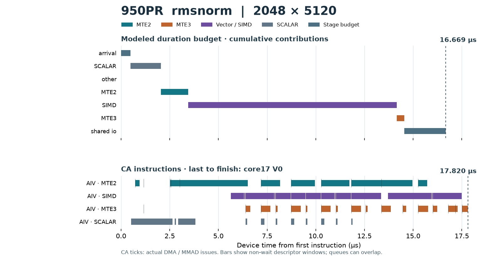

# RMSNorm 算例 · 每卡 57 行、1536 列

## 大 prefill chunk 的真实写回



本卡 shape 为 `[2048, 5120]`，950PR 模型 **16.669 µs**，完整 CA **17.820 µs**，有符号误差 -6.46%。上栏累计临界核的暴露阶段和全片共享总线增加的尾段；每段长度代表它对总时长的贡献。下栏使用最晚 AIV 上的原始起止，读、算、写可以重叠。模型的阶段分摊只识别持续时间，图中横向位置适合比较首尾和瓶颈。 [图上每段的时间与 trace 指纹](../../results/v0.20/examples/rmsnorm-chunk-pr.json) · [同一 shape 的 950DT 图](figures/rmsnorm-chunk-dt-pipeline.png)

这一例能把分核和芯片峰值的影响分开看。950DT 的库让 57 个核各处理一行；950PR 有 56 个 AIV，库选择 29 个核，每个核最多两行。同一行内做平方和归约、求 rsqrt、乘输入与 gamma。输出 BF16 y 及每行一个 FP32 rstd。两端实测来自 v0.18，属于开发回放。970DT 使用配置外推。[新留出集](../error-analysis.md)

```python
from operator_model import estimate

for chip in ('Ascend950DT_9582', 'Ascend950PR_957b', 'Ascend970DT'):
    r = estimate('rmsnorm', [57,1536], dtype='bf16', chip=chip, timing_mode='resource')
    print(r.chip_name, r.latency_us, r.active_aiv, r.work['logical_read_bytes'])
    print(r.projection['stages_us'])
    print(r.projection['timing_diagnostics']['conditional_us'])
```

输入是两维每卡 shape [T,D]、芯片配置、dtype。此处省略 `resident_aiv`，采用独立首次调用假设。若系统已知前序同类 kernel 的驻留高水位 H，可传 `attrs={'resident_aiv': H}`；若不掌握上下文，返回的三态可用于敏感性分析。选择 resource 让三个芯片都使用这里的模型。

## 从输入计算时间

1. 逻辑工作量为 262,713 次乘、87,552 次加、57 次 rsqrt，共 350,322 个等价 Vector 标量操作、0 个 Cube 操作。输入与 gamma 逻辑读为 2×1536×58 = 178,176 B，两个输出的逻辑写为 2×1536×57 + 4×57 = 175,332 B。包含重复 gamma 和 tiling 头部的 MTE2 描述符实测总量在 DT/PR 分别为 353,856/266,048 B。
2. 令 C 为 AIV 总数，则每核最多 W=⌈57/C⌉ 行，实际活动 A=⌈57/W⌉ 核。由 UB 容量 253,952 B 算得每 tile 最多 20 行，三个芯片均只需一轮。最忙核的向量工作组数 G=W×⌈1536/128⌉，在 DT/PR/970 分别为 12、24、12。目标相对 DT 的每组计算周期比 ρ 由每核每周期 FP32 峰值反推，分别为 1.0000、1.0272、0.9988。
3. 初始到达错峰为 14.625(A−1) 周期，因此 DT 为 819、PR 为 409.5。参考 SCALAR 为 2933.5 周期，第一轮 MTE2 为 1388.654 + 18.39635×2×1536×W/1024 周期。先读一份 gamma 和首个 x 分块，读服务斜率取自 x 描述符，两个发起窗口可以重叠。SIMD 服务为 515.377 + 11.2877Gρ 周期。
4. 每核写连续 W 个行统计量，128 B 区段有 32 个 FP32 位置。预计其他写者 N=max(0,min(A,32/W)−1)，DT/PR 为 31/15。统计写完成周期 s=133+147.58824N，分别为 4708.24/2346.82。归一化完成后才可发主写，发起间隔 Δ=75.458+6.04932Gρ，分别为 148.05/224.59 周期。主写本身为 302.496+16.01826×2×1536×W/1024 周期，此例被较慢的统计写覆盖。暴露写周期为 s−min(Δ,SIMD)，折合 DT **2.764 µs**、PR **1.286 µs**。
5. 各阶段周期除以 1000×频率_GHz。再检查首个数据读发起后芯片共享带宽是否足以完成逻辑冷流量。本例中三端都由核内时间决定。当前第二次冻结的目标价格包含 PR 独立首次控制 2580.5 周期和首笔输入发起 2776 周期，DT 和 970 的两项参考价为 2933.5、2970 周期。PR 在 [57,1536] 的共享窗口仍未超过临界核窗口，因此设备时间只减少 (2933.5−2580.5)/1650=0.214 µs。实际返回的阶段之和如下，单位 µs。

| 平台 | A 核 × W 行（最多） | 到达 | SCALAR | 其余 | MTE2 | SIMD | 净 MTE3 | 共享等待 | 总设备时间 |
|---|---|---:|---:|---:|---:|---:|---:|---:|---:|
| 950DT | 57×1 | .496 | 1.778 | .004 | .875 | .394 | 2.764 | 0 | **6.311** |
| 950PR | 29×2 | .248 | 1.564 | .004 | .909 | .481 | 1.286 | 0 | **4.492** |
| 970DT 外推 | 57×1 | .455 | 1.630 | .004 | .802 | .361 | 2.533 | 0 | **5.785** |

周期常数来自归档 DT trace 的尾核到达、独占队列、实际发起和完成时间。共享区段的 128 B、并发写者数和热态启动比例属于模型假设。970 尚无对应库或 CA 验证。所有公式的单位、样本量、成本替换方式及 UB 推导见[方法及参数来源](../../results/v0.19/rms-method.md)。

## 真实流水与误差

两端的 CANN 9.2.1 安装包都实际执行 ops-nn 的 `aclnnRmsNorm`，CA 报告 kernel 为 `RmsNorm_normal_all_bf16_high_performance_5000`。DT/PR 全核均各发 3 笔 MTE2、2 笔 MTE3；两端对 87,552 个主输出和 57 个 rstd 做数值检查，均为 bad=0。图中各条为最后完成 AIV 的实际 DMA 指令窗口，紫线标记预测的整算子结束位置。


| 平台 | trace SHA 前缀 | CA µs | v0.18 µs | v0.19 第一次/第二次冻结 µs | 当前相对误差 | 到达模型/CA µs | MTE3 净暴露模型/CA µs |
|---|---|---:|---:|---:|---:|---:|---:|
| 950DT | 2476f8f23e52 | 6.085 | 4.753 | 6.311 / 6.311 | +3.72% | .496/.435 | 2.764/2.834 |
| 950PR | cd7e24e8ca64 | 4.451 | 3.513 | 4.706 / 4.492 | +0.92% | .248/.097 | 1.286/1.468 |

CA 的 MTE3 在途并集在 DT/PR 为 2.902/1.582 µs，与 SIMD 重叠 .068/.113 µs。PR 的终止核到达和 SIMD 仍分别高估约 .151、.181 µs，净写约低估 .182 µs；阶段误差部分抵消。这组的实际 DT/PR 加速比为 1.367，v0.18 为 1.353，v0.19 第一次冻结为 1.341，第二次冻结为 1.405。相同 shape 在热态时，模型的 DT/PR 时间分别降至 4.549/3.191 µs。本例没有对热态做 CA 实测。

## 每卡 8 条、每条 32k 输入的规模

若把所有 token 合并给单次连续 RMSNorm，假设模型通道 D=7168，T=8×32768=262144。逻辑读为 3,758,110,720 B，写为 3,759,144,960 B。DT 每核 4096 行、每轮 4 行，共 1024 轮。PR 的最忙核为 4682 行，即 1170 个整轮加 2 行尾轮。970DT 为 2185 行，546 个整轮加 1 行尾轮。模型通过重复轮的增量定价，并保留实际尾块。此场景的 DT/PR/970 外推为 **1849.398 / 5291.862 / 770.881 µs**。DT、PR 的预测受全片读入及超出 L2 可留容量的输出带宽下界约束；970 的预测由核内 SIMD 主导。实际请求经过 chunked prefill 时，单次 kernel 应传调度器交付的 token 数。上述整批数字没有全量 CA 计时，远离已测分块范围时 kernel 选择、缓存和拥塞均可能变化。

[归档双端 CA 与正确性](../../results/v0.18/sku/pairs.json) · [逐条 DMA 证据](../../results/v0.18/sku/trace-evidence.json) · [当前开发回放](../../results/v0.19/rms-replay.json) · [复现代码](../../development/validation/sku19/rms_replay.py)

**早期 [64,2048] 回归检查。** 该组 PR 的独立首次 CA 为 4.568 µs，32 核、每核两行的两次冻结预测为 4.781 和 4.567 µs（当前约 −0.03%）。DT 的历史来源是连续 compact 采集，CA 4.352 µs。当前在 DT 显式 resource 且不传 H 时给 6.397 µs（+47.0%），热态条件给 4.573 µs（+5.1%）。输入相同不能替代调用历史；这个旧 DT 样本暴露出跨调用驻留信息对准确性的影响。[双端既有数据的采集口径](../../results/v0.18/rms-paired-phases.json)

第二次冻结只替换 PR 已有芯片证据支持的首启阶段参数。写回冲突、MTE2 单核读服务、数据驻留和 970 继承规则详见[配对取证与留一验证](../../results/v0.19/rms-followup/evidence.md)。


## 有完整双端 CA 的大 prefill chunk

单次预算 2048 token，通道 5120。DT 的 64 个 AIV 各处理 32 行，每核按 5+5+5+5+5+5+2 行遍历，模型 13.186 µs，CA 14.337 µs。PR 共 56 个 AIV，55 个各处理 37 行，余下一个处理 13 行。最晚完成的是 core17.veccore0，真实 MTE2 有 7 次 51,200 B 和一次 20,480 B 的输入读，另含 gamma 和 tiling。对应 37 行的 7 个整块和 2 行尾块。

全片需要读取 20,981,760 B（x 和 gamma），写出 20,979,712 B（y 和 rstd）。PR 的两个活跃输入槽预留 5,744,640 B，112 MiB L2 仍容纳全部输出。以全保留情景计算，片外下界为 20,981,760 / (1400×1000) = 14.987 µs。从首次有效数据发起 2776/(1.65×1000) = 1.682 µs 算起，整片下界为 **16.669 µs**，超过 14.544 µs 的本核流水，于是成为预测窗口。CA 完整窗口 **17.820 µs**，误差 **−6.46%**。令 `rms_output_retained_fraction=0` 可重现 v0.19 的 **31.655 µs（+77.64%）**。两个版本的核数、字节、测得的写描述符和数值结果均相同。由此能识别的是全写回假设收费过高，无法从核心指令确定实际缓存命中率或目标硬件上精确的写回比例。970DT 外推 9.065 µs。[原始指令与全核数值检查](../../results/v0.19/prefill/capture-analysis.md) · [完整开发回放和新留出](../error-analysis.md)
