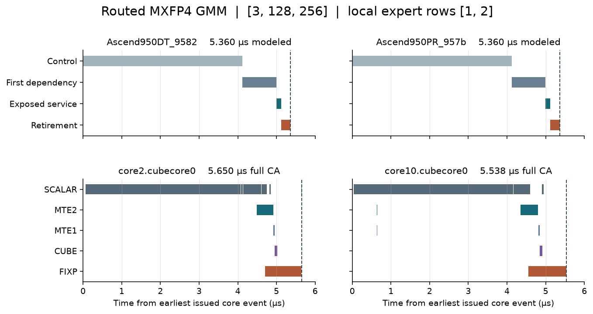

# A4W4 路由专家的单次分组矩阵乘

**DeepSeek-V4-Pro，TP8/EP8，rank 0，B=1，校验 Q=9。** 第 0 层 target 的 dispatch 为本卡专家保留 54 行容量，实际送入 gate/up 投影的有 48 行。本例计算这 48 行的 MXFP4 乘加数、激活和专家权重读量、BF16 输出写量。三个目标芯片共享数学工作量。系统默认保留工作量；调用方明确采用 CANN 分组乘 V5 时，可以传入 `implementation="aclnnGroupedMatmulV5"` 预测该实现的设备时间。950DT 和 950PR 均有完整 CA 证据，970DT 时延属于外推。

## 从原始图取得输入

`v4-pro/native/000_rank0_target.json.gz` 节点 118 的原始名为 `npu::npu_grouped_matmul`，组件为 `model.layers.0.mlp.experts.gate_up_proj`。其 `semantic.group_counts` 长度 48，每个元素为 1。前驱节点 117 的 `expert-routing.csv` 行独立给出相同的 48 个计数、`valid_rows=48`、`capacity_rows=54`。一个 token 可被发送给多个专家，多个 rank 又可向本卡发送，因而不能用本卡的 9 个查询 token 代替 48 条已路由行。[系统盘点与原始数据复核命令](../system-workload-coverage.md#复核与接入)

| 角色 | 本卡 GMM 逻辑张量 | 数据类型和布局依据 |
|---|---|---|
| A | [48,7168] | E2M1，两元素一个字节，K 内连续打包 |
| W | [48,7168,6144] | E2M1；捕获的 [G,K,N] 是底层按 [G,N,K] 每行打包的转置视图，逻辑 `logical_weight_shape=[48,6144,7168]` |
| W 的 scale | [48,112,6144,2] | E8M0，每 32 个 K 共用一个，存储以两个相邻 scale 为一对 |
| A 的 scale | [48,112,2] | 同样 E8M0/block32，按行持有 |
| Y | [48,6144] | FP32 累加后物化 BF16；gate 和 up 两半都在这个输出内 |

```python
from operator_model import estimate

result = estimate(
    "routed_grouped_matmul",
    (48, 6144, 7168),  # R, N, K
    {"expert_counts": [1] * 48, "dispatch_capacity_rows": 54},
    dtype="mxfp4", chip="Ascend950DT_9582",
)
print(result.work["cube_ops"])           # 4227858432
print(result.work["logical_read_bytes"]) # 1123207680
print(result.work["logical_write_bytes"])  # 589824
print(result.status, result.latency_us)  # unavailable None
```

## 分专家推导

设 `mₑ` 为本卡第 e 个专家收到的有效行数，`G=len(expert_counts)` 是本卡专家数，`E=count(mₑ>0)` 是实际用到权重的专家数，`R=Σmₑ`。令 N 为输出宽度，K 为缩并宽度。本例 G=E=R=48、K=7168、N=6144。输入 (R,N,K) 指已经打包并去掉未用路由容量的矩阵，未用行只在 `projection.unused_dispatch_capacity_rows=54−48=6` 中出现。没有上游容量时该字段为 null。

各专家做 `[mₑ,K] × [K,N] → [mₑ,N]`。一次乘加计两次有用运算，因此第 e 个专家工作量为 `2mₑNK`，整次投影为 `2RNK=2×48×6144×7168=4,227,858,432 ops`。FP32 是累加精度，计数归在执行这次乘加的 `cube_ops_by_dtype["mxfp4"]`。边界没有独立的 Vector 原语；实际 scale 处理、转换或调度所发出的指令数未观测。

编码后的 K 行载荷占 `L=K/2=3584 B`。该接口支持正偶数 K 的双值打包和无显式 K 补零合同。每行有 `g=⌈K/32⌉=224` 个有效 scale，成对保存占用 `S=2⌈g/2⌉=224 B`。若 g 为奇数，保留的最后一个配对槽位计入接口字节。每行输入读取一次；同一专家的所有行共用其一套权重及 scale，空专家的权重只属于模型存储容量。

| 输出字段 | 计算与本例代入 | 结果 |
|---|---|---:|
| `activation_bytes` | R×L = 48×3584 | 172,032 B |
| `activation_scale_bytes` | R×S = 48×224 | 10,752 B |
| `active_weight_bytes` | E×N×L = 48×6144×3584 | 1,056,964,608 B |
| `active_weight_scale_bytes` | E×N×S = 48×6144×224 | 66,060,288 B |
| `logical_read_bytes` | 以上四项之和 | **1,123,207,680 B** |
| `logical_write_bytes` | BF16 两字节，2×R×N = 2×48×6144 | **589,824 B** |
| `all_expert_weight_and_scale_storage_bytes` | G×N×(L+S) = 48×6144×3808 | 1,123,024,896 B |

最后一项用来报告本卡所有专家的**编码张量容量**，已含本例的权重和权重 scale，不加到读量上。对固定 R、N、K，专家行数从均匀变成集中时，数学乘加数保持不变；非空专家数若减少，边界上的唯一权重字节随之减少。即使非空专家数相同，直方图不同也可能改变核间调度，因而入口会保留整份 `expert_counts`。实际 HBM 访问还受分核、重读、L2 命中影响，`physical_hbm_bytes` 为 null。[工作量实现](../../src/operator_model/operators/moe/routed_grouped_matmul.py)

## 计时与覆盖边界

在系统旧基线的同一份 L1 账本中，节点 118 的预算是 **351.18672 µs**。之后节点 119 为独立 SwiGLU，120 为独立动态量化，121 为 down 投影，预算分别为 0.27648、0.10512、175.71216 µs。每个投影只接管自己的节点。跨卡 dispatch/combine、路由元数据、bias、SwiGLU、输出量化和全局专家权重均须另算。直方图在这个捕获合同中是主机属性，实际设备若读取 group list，还应由其实现模型补上该流量。

27 个常规 run 有 3,582 个 gate/up 或 down 的双 MXFP4 节点。其四个输入、BF16 输出、零 K 补齐、group32、FP32 累加、每专家计数与前驱 dispatch 的有效行和容量逐一核对；这批模拟路由恰好全部专家非空、每专家行数相同，且每次 dispatch 容量均大于有效行。通过公共 `estimate` 回放这 3,582 个节点，Cube 工作量均与逐专家求和一致，逻辑读写均与每个输入输出张量按编码宽度独立计算的字节数一致。本机每节点查询墙钟中位数 0.063 ms、P95 0.084 ms、最大 3.172 ms；读取和解压系统账本的时间另计。空组、热点和奇数个 scale 的配对尾槽只通过公式与单元测试检查。另有 963 个输出头分组的 A8W4 调用，使用逐 token FP32 激活 scale，接入时另行匹配。[系统分组统计](../system-workload-coverage.md)


## 显式计时的 V5 实现

同一个图节点可以由不同实现接管；本节的时间针对**单 kernel、转置 ND 权重**。驱动使用 `splitItem=3, groupType=0, groupListType=1, actType=0`，用 INT64 直方图计每专家的行数。MX 的 W、A scale 独立随 K 分组，FP32 累加、BF16 输出；W 打包在模型装载阶段已就绪。实际 V5 路线读设备上的 groupList，其固定控制和等待成本包含在 CA 时间中，语义工作量仍与原图相同。当前计时模型覆盖对齐 K 为 64 倍数的路径。物理 HBM 流量仍待计数器验证。[CANN GroupedMatmulV5 接口](https://gitcode.com/cann/ops-transformer/blob/14d022b1a4c3df263bf697534e3c25c7c992ff5d/gmm/grouped_matmul/docs/aclnnGroupedMatmulV5.md)

```python
timed = estimate("routed_grouped_matmul", (3, 128, 256),
                 {"expert_counts": [1, 2], "implementation": "aclnnGroupedMatmulV5"},
                 dtype="mxfp4", chip="Ascend950DT_9582")
print(timed.latency_us, timed.active_aic, timed.active_aiv)  # 5.3603… µs, 17, 0
```

**如何由专家行数得到正在工作的核。** 设 P 为目标 AIC 数（DT 为 32）。每个非空专家产生 `ceil(mₑ/BM)×ceil(N/BN)` 个基础输出块，核号在各专家之间连续轮转。默认 BN=256；BM 至多 128，受 L0C 容量按 FP32 输出块计算并按 16 行对齐。片内 K 粒度至多 256，受目标 L0B 容量限制。最后一波若尚有空闲核，把末专家的尾块沿 M、N 再切分；M 最小一行，N 切片按 16 列对齐。网上同族源码描述了不同专家之间的起始核轮转、尾波切分与空片剔除；具体切片粒度取本机 ELF 的实测指令。例如本例第一专家 1×128 在一个核，末专家 2×128 切成两个单行和八个 16 列分片，另 16 核工作。因此 17 个有效核，启动窗口还包含其余核。多波时近似把同一专家的首尾块均摊到基础网格，宽尾非均匀负载是误差来源。[同族尾波调度源码](https://gitcode.com/cann/ops-transformer/blob/14d022b1a4c3df263bf697534e3c25c7c992ff5d/gmm/common/cgmct/block/block_scheduler_gmm_aswt_with_tail_split.h) · [本工具调度实现](../../src/operator_model/operators/moe/routed_schedule.py)

**如何对一块定价。** 对高 h、宽 w 的输出块，编码读量为 `(h+w)×(K/2+K/32)` B；乘加按 16×16 向上对齐，工作量为 `2×align16(h)×align16(w)×K`。分别除以每核读口字节/cycle 和每核 FP4 ops/cycle；后者为 `1000×Cube4_TOPS/(f_GHz×P)`。读口有配置时由芯片总端口带宽除以核数和频率；未配置时继承 950 MX 连续读的 87.228 B/cycle。另两项为 K 片发起（每片 208 cycles）及 BF16 的 `2hw` B 写回（可覆写，默认每核 64 B/cycle）。取四项最大作为块的流水服务时间。各核串自己的块，得到最忙核的总服务。同时计算整片 HBM 对唯一编码输入及输出的一次冷读写，以及已知 L2 带宽对按实际分片展开搬运量的服务。三者最大作为暴露服务。此冷读场景不会利用跨层常驻权重；可重入的目标硬件参数和 tile 数会共同改变预测。[950 MX 读口价格](../../src/operator_model/operators/matmul/mx_native.py)

**六个开发整窗如何得到价格。** 使用 [1,2]×128×256、[2,2,2,2]×256×512、[0,11,0,23]×512×1024 三个不同局部直方图，各在 950DT 和 950PR 采一次。所有 6 个窗里，整窗零点都是所有物理核最早事件。先筛掉 wait/sync/duration_excluded 及未带 payload 字节的 MTE 描述符。`控制开销=median(首次 MTE2 时刻×1650)=6802 cycles`；六个原值取整依次为 DT 6856/7062/7209、PR 6654/6671/6748。每微秒 1650 cycles 来自两端 1.65 GHz。首个 MMAD 与首个 MTE2 的 issue 差按同法得到 **1442 cycles**（1252/1468/1626/943/1416/1703）。它含指令依赖和首读等待；占用不同物理核而复合观测，无法拆成纯硬件读延迟。整窗退休减去最晚 MMAD 退休得到 **392.5 cycles**（538/317/384/660/368/401）。对四个多 K 片开发窗，在最晚发 MMAD 结果的核上对相邻 MMAD 的 issue 间隔取中位数，四窗均约 **208 cycles**。这组控制和发起代理以目标周期缩放，换代后若调度或延迟发生变化，应改用新证据。

上述示例中，最忙核服务 208 cycles，DT 的共享 HBM 服务仅 14.847 cycles；未单列价格的 L2 不再重复计费。预测 `(6802+1442+208+392.5)/1650=5.360303 µs`。DT 真实 MMAD_MX 有 17 条，均为 FP4×FP4；第一条分片形状 1×128×256，另 16 条为 1×16×256。32 个启动 AIC 各有唯一 END，最晚退休给出 **5.649697 µs**。PR 启动 28 AIC、17 核有效，CA 为 **5.538182 µs**，相同预测的误差分别为 −5.12%、−3.21%。970DT 在继承相同调度与控制周期时预测 **4.913611 µs**。两端最早读、末次写回的等待有差异，混合池的启动/收尾价格没有为 SKU 单独回归。所有终点检查绑定同一实际 ELF `GroupedMatmul_40ca02eaeb01067b879dbc1dc766aa58_1`，每个 BF16 输出都按属于它的专家、正负值和两侧不同 scale 比对。[驱动与证据复核](../../calibration/routed_gmm/README.md)



两列共用同一设备时间尺度，以各次 kernel 的最早物理核指令为零点。上栏按模型的暴露阶段预算铺开；下栏保留最晚退休物理核内非 wait/sync 的正时长指令区间，同一流水线重叠部分取并集。FIXP 描述符包含等上游数据的时间，不能把有色区间直接当写带宽占用。两栏的虚线分别标出模型整窗和全核 CA 整窗。[重绘数据](../../calibration/routed_gmm/example-timeline.json) · [绘图脚本](../../calibration/routed_gmm/plot.py)

## 实图投影上的独立核验

Flash 的 DEP64、单卡 B=1、验证长度 9 的 target 节点 100 是一次 down 投影。6 个本地专家各得 9 行，(R,N,K)=(54,5120,2304)，有效工作为 2×54×5120×2304=1,274,019,840 ops。输出含 276,480 个 BF16。每张卡均完成全输出校验。DT 的 32 个有效 AIC 共发起 1,080 条 9×256×256 的 MMAD_MX。DT 模型 **14.789 µs**、CA **18.737 µs**，PR 模型 **32.534 µs**、CA **29.418 µs**；970DT 外推 **7.452 µs**。这两个 950 查询的状态仍是 `extrapolated`，因为价参来自三组小投影，当前例子是冻结后对该外推的独立检验。两端各 10 个新几何的 WAPE 为 9.82%/6.30%。大投影放大了共享内存价格对 DT/PR 快慢幅度的影响。[各形状的直方图和误差](../errors/routed_grouped_matmul_mxfp4_v5.md)
