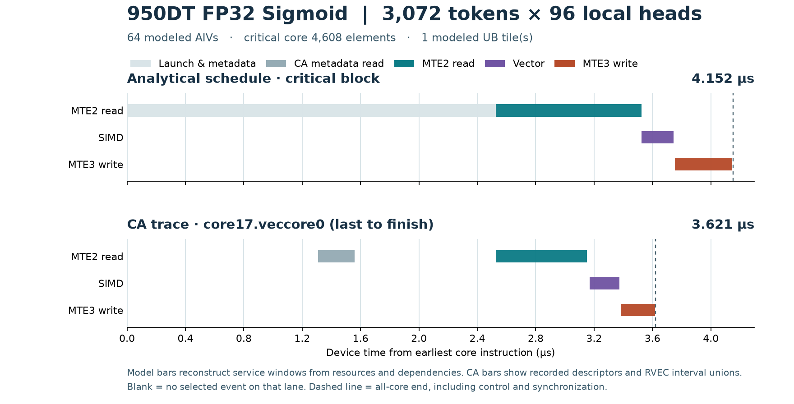
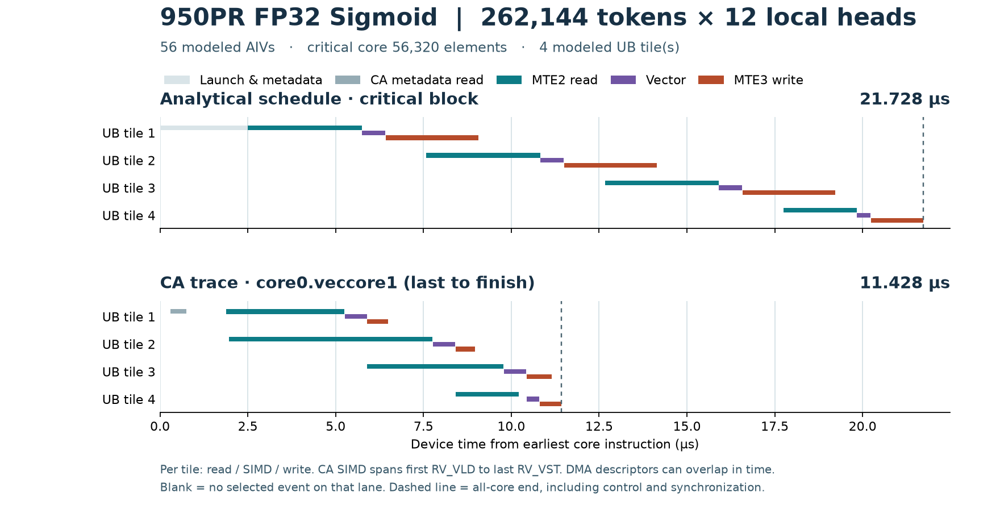

# Kimi K3 KDA 的 FP32 beta Sigmoid

Kimi K3 的 KDA 每个 token、每个本地 head 产生一个 beta。固定版本的 vLLM Ascend 在 `_prepare_beta` 或辅助流 `_postprocess_bfg` 里调用 `beta.float().sigmoid()`。若辅助流已处理 beta，主流直接使用其结果。KDA 配置有 96 个 head、每个 head 128 维。TP=8 时一个 rank 对应 12 个 beta 标量，单次 Sigmoid 的 shape 是 `[T,12]`。`T` 是本次提交的 token 数。转换与 Sigmoid 分开计价，连续 FP32 输入已就绪。图编译可能融合，两条流也可能重叠；整网实际下发的 kernel 边界仍需对应部署的 dispatch trace。[固定模型配置](../../configs/models/Kimi-K3.json) · [vLLM Ascend KDA 源码](https://github.com/vllm-project/vllm-ascend/blob/c09d3e20b9c45c80b34ae3781440d90904a44023/vllm_ascend/ops/kimi_kda.py#L168)

**独立验证已完成。** 固定这套方法后，两端分别跑 10 个新形状，全部 20 次数值与计时通过，活跃核数 20/20 正确。DT 的 WAPE 为 **28.49%**、PR 为 **75.37%**，各自最大误差为 **55.54%**、**120.50%**。把同 shape 的 DT 预测直接用于 PR 的 WAPE 为 27.17%。当前 PR 估时把双缓冲首轮的两个读和共享写流量定价过高；系统级用户应把该结果当作校准覆盖明确、跨芯片时延误差较大的阶段模型。下文给出实际时间窗和控制器证据。[10 个形状逐项计时](../../results/v0.20/newop/measurements.md)

```python
from operator_model import estimate

r = estimate('sigmoid_fp32', [8*32768, 96//8], dtype='fp32', chip='Ascend950DT_9582')
print(r.latency_us, r.active_aiv, r.work['vec_ops_by_class'])
print(r.projection['target_plan'], r.projection['timing_diagnostics']['schedule_us'])
```

## 一步算出 B8 × 32k prefill

假设 8 条 32,768-token prompt 在这个 rank 的同一次调用中全部提交，`T=262,144`。若系统按 chunk 发射，应传每次实际提交的 token 数，并在调度器里还原并发和顺序。

1. **工作量。** `N=T×12=3,145,728`。每个元素执行负号、exp、加一和除法，`y=1/(1+exp(-x))`。有 12,582,912 次标量等价 Vector 运算，没有 Cube 操作。输入读、输出写各 12,582,912 B；这两个数是逻辑张量字节，HBM 实际事务量未知。
2. **分核。** 令 `C` 是目标 AIV 数，候选数 `C′=min(C,⌈N/1024⌉)`。普通 block 的元素数 `b=512⌈N/(512C′)⌉`，实际非空数 `A=⌈N/b⌉`。1024 个 FP32 是每核至少 4 KiB 的目标粒度，512 是核间元素对齐。末核可能更短。DT 得到 64 核，各 49,152 个元素。换 970DT 同一个输入按 120 AIV 重新分块，119 个 block 有效。
3. **UB 循环。** 输入和输出各有两个 FP32 缓冲区。一个 tile 最多 `u=64⌊UB_bytes/(16×64)⌋` 个元素。16 是四份 FP32 缓冲的字节总和；64 是 256 B 向量寄存器容纳的 FP32 数量。DT 的 253,952 B UB 得 `u=15,872`，关键核处理三个 15,872 元素满 tile 和一个 1,536 元素尾 tile，共 768 个向量组。分核、UB 分配与循环来自 950 ATVOSS 逐元素策略及 CANN 包内 `sigmoid/arch35/sigmoid_f32.h`。
4. **单 tile 定价。** 下面的量用周期。`x` 是 tile 元素，`d=4x` 是一侧字节数，`f` 用 GHz，带宽均用十进制 GB/s。单核搬入/搬出传输分别为 `r=d f/B₂`、`w=d f/B₃`。`q=d A f/B_shared` 将所有活跃核同时使用共享链路的竞争计入每个核，`B_shared=min(B_external,B_L2)`，L2 速率缺失则只取外存。读依赖就绪 `R=1159+max(r,q)`，写退休 `W=159+max(w,q)`。指数/除法流水 `V=(79+4(⌈x/64⌉−1))s`；`s` 为参考与目标的单核每周期 FP32 峰值之比。这个比例是特殊函数吞吐的跨代代理参数。若未来芯片的 exp/div 流水独立升级，应更新该假设。DT 满 tile 的 `R,V,W` 分别是 1.718、0.647、1.112 µs。
5. **组合时间。** 全核最早指令至关键核首个数据读的时间是 `F=3012+193 log₂ A` 周期，在 DT 为 2.527 µs。后续满 tile 的发起间隔 `I=max(r,w,2q,V,(R+V)/2,(V+W)/2)`。`2q` 让读写共享总带宽，最后两项约束两个 UB 缓冲槽的复用。第 `i` 个 tile 的读从 `F+iI` 开始，Vector 等读完成，写在 Vector 完成后 17 周期发起。尾 tile 的 Vector 和写还要等前一 tile 占用的对应队列退休。最后写之后保留 10 周期完成控制。满 tile 间隔为 2.032 µs，尾 tile 的读起点 8.622 µs、Vector 起点 9.423 µs、写起点 10.078 µs，尾写 0.195 µs。DT 总计 **10.279 µs**，PR 同算法 **21.728 µs**，970DT **5.427 µs（外推）**。在线只计算首块、等间隔满块和尾块，查询复杂度 O(1)。

## 参数来自哪里

| 量 | 来源与外推含义 |
|---|---|
| 1024 元素最小粒度、512 元素核间对齐、64 元素寄存器、四缓冲 | 950 ATVOSS 逐元素分核参考、包内 FP32 实现；DT 三个开发样本分别命中 1、4、64 AIV。假设未来 CANN 保留分块模板，使用目标 UB 容量、目标核数重算。 |
| 3012 周期启动、每倍活跃核 +193 周期 | DT `[1,12]` 终止核第一个数据读在 3012 周期。`[3072,96]` 终止核第一个数据读从全核窗口起点数为 4170 周期，两端差除以 `log₂64`。这是发射错峰与前端控制的合计。 |
| 1159、159 周期 | 读首部来自 `[300,12]` 的 1233 周期读窗口扣 4 KiB × 18.39635 周期/KiB；写首部取 `[1,12]` 小载荷窗口。描述符会包含等待，缓存命中与固定延迟在三个开发 shape 上不能独立辨识。 |
| `B₂`、`B₃`、`B_shared` | 目标芯片 JSON 可显式传 `mte2_bandwidth_gbs`、`mte3_bandwidth_gbs`。缺失时继承 950 搬运服务的 18.39635/16.01826 周期/KiB；固定每周期字节数时按目标频率转换。DT/PR 外存额定分别 4000/1400 GB/s。争用模型假设同一批 block 全部读写都参与共享带宽竞争，未跟踪逐事务 L2 驻留、同相发射程度和脏行离芯片时间。 |
| 79 周期首组、4 周期/后续组、写前/后 17/10 周期 | DT `[1,12]` 数据读退休至最后 `RV_VST` 为 79 周期；`[300,12]` 与 `[3072,96]` 的 `RV_VEXP`/`RV_VST` 显示每 64 个元素的相邻非零发起间隔约 4 周期。两组短样本末 `RV_VST` 至 MTE3 发起均为 17 周期。 |
| II 与尾块 | 单核 TQue 双缓冲结构提供 overlap 的可能性。不同 tile 的具体相位以及目标 SKU 的 exp/div 速率需要多轮样本验证。 |

## 开发 trace 怎样检查误差

`[3072,96]` 是一个 TP1 的 96-head 分量输入。DT 的 64 个活跃 AIV 各处理 4,608 个元素，均为一个 UB tile。实际 `aclnnSigmoid` 的 ops-nn kernel 为 `Sigmoid_5c5e58e043224cccf51a06108010ae13_high_precision_300000000000100`。Host 检查全部 294,912 个 FP32 输出与 FP64 `1/(1+exp(-x))` 的绝对误差不超过 2×10⁻⁶。计时取所有 AIV 的最早开始至最晚完成，逐核对照 `msopprof simulator` 时间表。颜色图上半是模型重建的服务窗，下半来自结束最晚的 `core17.veccore0`，横轴相同。



模型 **4.152 µs**，CA **3.621 µs**，高估 **14.7%**。数据读均在 2.527 µs 发起。模型读到 3.525 µs，CA 在 3.152 µs 退休；模型写窗 0.391 µs，CA 为 0.233 µs。两项分别多算 0.373、0.158 µs，与总差 0.531 µs 一致。小载荷截距和共享带宽公平分摊是本模型的两个近似。当前证据能定位读写描述符的偏差，不能据此区分 L2 命中与多核错峰的贡献。此例用于定模型，独立误差看下面的冻结留出集。[三个开发 shape 的阶段周期](../../results/v0.20/newop/development-phases.json) · [开发 trace 账本](../../results/v0.20/newop/development.json) · [图表底层时间戳](../../results/v0.20/newop/timeline-development.json)

## 独立大 shape

冻结清单在首个留出 CA 启动前存下每个目标的耗时、核数和 UB 轮数。10 个不同 shape 分别在 DT、PR 调用同一个 `aclnnSigmoid` host，覆盖完整 B8×32k、128k、256k 及较小的 decode、chunk 和 TP 形状。下表入口包含每个独立 shape 的 DT/PR 模型与 CA 时间、相对误差和 970DT 外推。等待、失败、通过数值但缺少全核 trace 的记录均不进误差统计。[逐 shape 结果与采集进度](../../results/v0.20/newop/measurements.md) · [预注册冻结预测](../../results/v0.20/newop/holdout-freeze.json)

### B8 × 32k 的独立 CA 流水

所有 3,145,728 个结果逐值通过，DT/PR 都执行一个 ops-nn `Sigmoid_…_300000000000100` kernel。两端都预测对了活跃核数和满 tile 字节数（63,488 B）。DT 模型 10.279 µs、CA 7.759 µs（+32.5%）；PR 模型 21.728 µs、CA 11.428 µs（+90.1%）。DT/PR 耗时比实测 0.679，模型为 0.473。DT、PR 单次离线 CA 墙钟分别为 311 s、234 s，各保留约 0.85 GiB。




每一行一个 UB tile。上半图按目标带宽和双缓冲算读、SIMD 和写；下半图的 MTE2/MTE3 来自含实际字节数的 DMA 描述符，SIMD 从该 tile 首个正时长 `RV_VLD` 到最后一个 `RV_VST`。这些描述符可能同时挂起。DT 的前两个读在 2.545、2.681 µs 发起，间隔 **0.136 µs**；PR 在 1.883、1.965 µs 发起，间隔 **0.082 µs**。模型为这两次发起平均分配了稳态带宽，两端分别给 **2.032** 和 **5.079 µs** 的间隔，把首轮第二个可用 UB 缓冲槽承担的预取推迟了。这个偏差在数据上可直接定位。[DT 终止核时间戳](../../results/v0.20/newop/timeline-prefill32k.json) · [PR 终止核时间戳](../../results/v0.20/newop/timeline-prefill32k-pr.json)

另一处假设是写回边界。单核向 GM 发出 MTE3 写后，输出可能在 L2 驻留。本项目独立的 DT Cast 原生 CA 对 16 MiB 输入、32 MiB 输出记录了 128 个控制器、65,879 条读命令、0 条写命令。作为 **冻结后敏感性分析**，保留原分核、启动与 SIMD 定价，令写可驻留比例为 `ρ=min(1,max(0,(L2_bytes−4N)/(4N)))`。这是假设整个输入仍占用 L2，其余空间可用于输出。每核 MTE3 继续传 `4x` 字节，外存竞争从 `2q` 改为 `(2−ρ)q`，写端外存服务从 `q` 改为 `(1−ρ)q`；有显式 L2 速率的芯片仍受 L2 通路限制。32k 例上 DT、PR 都能容纳输入和输出，敏感性估计为 **8.126、13.047 µs**。它们分别比观察到的 CA 高 4.7%、14.2%。这组事后情景不计入留出分数，Cast 的观测也不能单独证明 Sigmoid 的所有写都命中 L2。[Cast 控制器证据](../../results/v0.20/large/cast_262144_32_native-dram.json) · [三种长序列的敏感性数据](../../results/v0.20/newop/l2-sensitivity.json)

PyTorch NPU 2.10 分支绑定的 op-plugin 配置把 `sigmoid(Tensor)` 的 eager OpAPI 映射到 `aclnnSigmoid`，同一条目还支持 DVM。这为独立 ACLNN 测量提供了框架侧来源。vLLM Ascend 在该固定版本要求 `torch-npu==2.10.0.post7`，实际部署使用哪个后端仍取决于开关与编译图。[固定 op-plugin 映射](https://github.com/Ascend/op-plugin/blob/219cd855b0973e1adc59b5994fac775270b76b4d/op_plugin/config/op_plugin_functions.yaml#L4603-L4612) · [vLLM Ascend 依赖](https://github.com/vllm-project/vllm-ascend/blob/c09d3e20b9c45c80b34ae3781440d90904a44023/requirements.txt#L17)

两端 profiler 导出的 `aicore_binary.o` 与安装包 `kernel/ascend950/ops_nn/sigmoid/..._high_precision.o` 的 SHA256 完全一致。安装包 manifest 的 `RT_DEV_BINARY_MAGIC_ELF_AIVEC` 与实测 0 个 AIC 一致。[包内文件与哈希核验](../../results/v0.20/newop/kernel-identity.json)

32k、128k、256k 三个完整调用的增长倍数和查询/离线成本，可对照每个 shape 的 UB 轮数。实测点随 CA 完成更新。[长 prefill 增长曲线与逐点读数](../../results/v0.20/newop/long-context.md)

12 个全新 Python 进程各做一次无查询缓存的公共 API 调用，覆盖 72 到 2,097,152 个 token 和 DT、PR、970DT。首次查询最大 **4.93 ms**（上取两位小数），包括第一次加载芯片 JSON 和资源计价代码；包导入时间另外统计，最大 49.70 ms。图表中的 µs 是设备估时，与这两项分开。[逐次冷查询记录](../../results/v0.20/newop/first-query.json)

### 128k 与 256k 的逐核核验

在 B8 × 128k 的 `[1,048,576,12]` 上，DT 真实 18.553 µs、冻结模型 28.858 µs（+55.5%），PR 真实 34.285 µs、冻结模型 75.597 µs（+120.5%）。关键核轮数分别为 13、15。两端分别验证了 12,582,912 个数值。DT 从各有 48 MiB 的输入和输出发出 MTE2/MTE3 描述符；额外保留的 128 份控制器日志在同一个 61,385 ns 时刻结束，总共记录 50,377,472 B DMC、相同的 DDR 字节、196,950 条读命令和 6 条写命令。控制器总量只比输入大 45,824 B，而此端逻辑读写合计 96 MiB。这个全进程口径直接支持写留在片上的解释，仍不能用来划分单核读写各自占用的周期。诊断情景在这里给出 DT 18.943 µs、PR 40.333 µs；PR 的控制器没有同口径原始计数。[控制器快照](../../results/v0.20/newop/controller-snapshots.json) · [128k、256k 的逐端终止核流水与全部 tile 时间戳](../../results/v0.20/newop/long-timelines.md)

这 10 个 shape 含 9 个不同的展平元素数。`[72,12]` 与 `[9,96]` 的输入形状不同，工作量均为 864 个元素；两端分别执行两个真实调用，模型的 shape 展平规则应使二者预测一致。

在 B8 × 256k 的 `[2,097,152,12]` 上，DT 关键核从 13 轮增至 25 轮，真实 **42.686 µs**，冻结预测 **54.185 µs**（+26.9%）；全部 25,165,824 个元素逐值通过。输出和输入各 96 MiB，合计超过 DT 的 128 MiB L2。128 个同止的控制器快照记录了 **132,268,160 B** 总 DMC、393,561 条读和 **184,186 条写命令**。工作量从 128k 到 256k 翻倍，设备耗时增到 2.30 倍；内存控制器能看到的写明显增加，这是随规模改变的实际工作，而固定每元素代价只能描述特定区间。容量敏感性取可留写比例 1/3，得 45.796 µs。图中前两个和末两个 tile 之外的 21 轮仍计入真实总时间。[256k DT 终止核 25 轮时间戳](../../results/v0.20/newop/timeline-prefill256k.json)

PR 的 256k 窗口为 **88.593 µs**，比 128k 增加 2.58 倍；冻结预测 147.417 µs（+66.4%）。终止核执行 29 个 UB tile，头两轮和末两轮与 DT 相同口径绘制。PR 的 L2 容量情景估计 135.430 µs，仍高出 52.9%；其误差表明仅用“输入全部存活，输出占剩余容量”来推定写驻留比例，也不足以补全 PR 的流水行为。两端合计六次长形状 CA 的完整图可从同一索引核对。[32k 至 256k 六张模型/CA 流水图](../../results/v0.20/newop/long-timelines.md)
