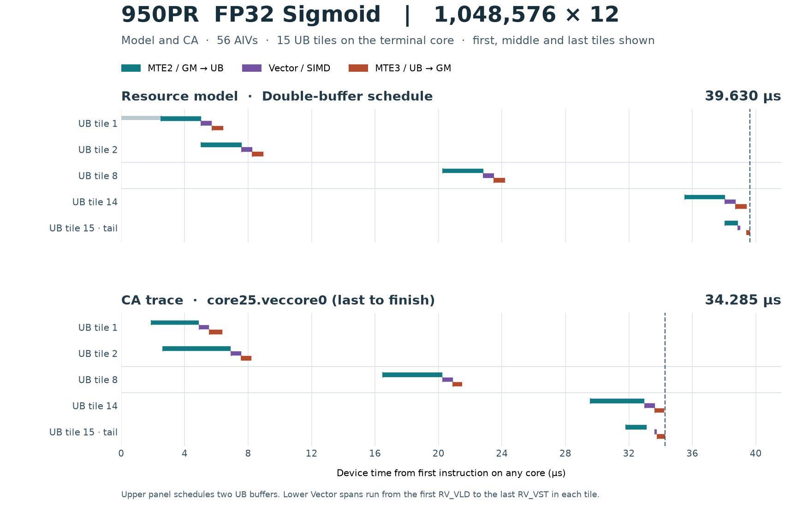
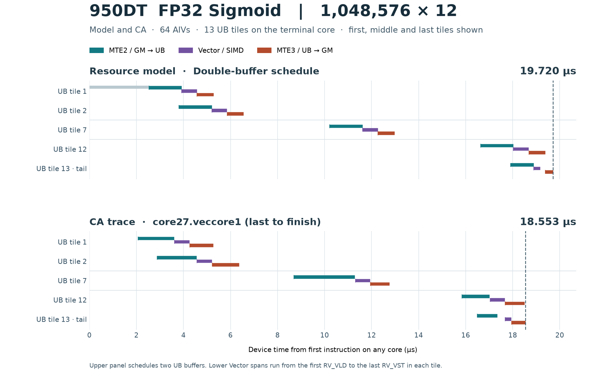

# Kimi K3 FP32 Sigmoid · 每卡 8 × 128ki prefill

单卡 batch=8，完整提交 131,072 token/请求，KDA 在 TP8 下有 96/8=12 个本地 head。beta 的输入 shape 因此为 [1,048,576,12]。固定版本的 vLLM Ascend 在 beta 准备阶段使用 FP32 Sigmoid。本例通过 CANN 9.2.1 的原生 aclnnSigmoid，profiler 二进制 SHA256 与包内 ops-nn 高精度 AIV 核一致。按 chunk 发起的系统应传当次调度 token 数。[库核与实现身份](../../results/v0.20/newop/kernel-identity.json)



**第 1 个 tile 的写回已很接近，第 8 个 tile 的发起已经明显偏晚。** PR 的模型耗时 39.630 µs，CA 34.285 µs，高估 15.6%。终止核的首个数据读在 1.906 µs，模型为 2.505 µs。前 14 个满 tile 的读发起中位间隔约 2.21 µs，模型为 2.540 µs，后段差距逐轮增加。单次读在途时间可超过发起间隔，图下半的头两条读因此重叠。DT 同形状模型为 19.720 µs，CA 18.553 µs，高估 6.3%；970DT 的 11.321 µs 是架构外推。该假设下，关键核的 13 个 DT tile 缩到 7 个，满块发起间隔从 1.283 变为 1.176 µs；首发与尾部仍需支付，整次调用预计加速 1.74 倍。[PR 图数据](../../results/v0.21/vector/sigmoid-128ki-pr.json) · [DT 图数据](../../results/v0.21/vector/sigmoid-128ki-dt.json)



## Kimi 的 72 MiB beta 输入在什么时间内返回

950PR 的 FP32 [1572864,12] 有 18,874,368 个输入元素，输出同形。全部 56 个 AIV 的 GM 读地址覆盖一遍连续的 72 MiB，首读在 1.599 µs 发起，最后一笔读在 53.010 µs 退休。相减为 51.411 µs，逻辑字节除以这个区间得到 1,468.5 GB/s，超过配置推定的 1,400 GB/s。模型预测 69.041 µs，完整 CA 为 54.379 µs。仅改变输出留驻无法同时解释输入全冷与按标称带宽服务全部读请求这两个假设。压力情景预测 57.465 µs，仍需配对新形独立检验。[全核地址与时标](../../results/v0.25/cache/sigmoid_fp32-1572864x12-Ascend950PR_957b-traffic.json) · [资源公式和冻结验证](../../results/v0.25/cache/README.md)


## 从调用参数算到设备时间

```python
from operator_model import estimate

r = estimate('sigmoid_fp32', [8*131072, 96//8], dtype='fp32', chip='Ascend950PR_957b')
print(r.latency_us, r.active_aiv, r.work['vec_ops_by_class'])
print(r.projection['target_plan'], r.projection['timing_diagnostics']['schedule_us'])
```

1. **工作量。** N=12,582,912 个元素，每个元素执行取负、exp、加一和除法，合计 50,331,648 次标量等价操作。两端各搬运 4N=48 MiB，Cube 工作量为零。
2. **分核和 UB。** C 是本卡 AIV 数。取候选 C′=min(C,⌈N/1024⌉)，普通块元素 b=512⌈N/(512C′)⌉，实际非空核数 A=⌈N/b⌉。1024 是最小 4 KiB 输入，512 为此内核的分核对齐。PR 得到 56 个 AIV、每核最多 224,768 元素。每边各两份 FP32 缓冲，整 tile 大小 u=64⌊UB/(16×64)⌋=15,872 元素，64 是一组 SIMD 的元素数。PR 最长核执行 14 个整块和 1 个 2,560 元素尾块。CA 验证实际为 56 核，终止核也有 15 轮。
3. **一次完整 tile。** 每侧 d=4u=63,488 B，频率 f=1.65 GHz。局部搬入、搬出周期为 r=df/B₂、w=df/B₃；B₂、B₃ 是单核目标端口带宽，缺省以 DT 18.39635、16.01826 周期/KiB 按频率转换。读的响应周期 R=max(1159+r, dAf/B_HBM)，写的响应 W=159+w。Vector 周期 V=(79+4(⌈u/64⌉−1))×s，s 是目标每核每周期 FP32 算力相对 DT 的倒数。PR 满块的三段约为 2.540、0.664、0.698 µs。1159、159 是 DT 小载荷描述符固定延迟；79、4 是 DT 的首组开销与后续 RV_VEXP/RV_VST 组间隔。密集 FP32 峰值只用于目标缩放，专用 exp/div 的实际跨代吞吐尚未验证。
4. **全片与发起。** 输入输出共 96 MiB，PR 的 112 MiB L2 可接收全部脏输出，模型 E=48 MiB 外存冷读。外存带宽取 min(1.4 TB/s, 56 核×1.65 GHz×30 B/周期)=1.4 TB/s。共享服务 H=59,319 周期。一轮的可持续间隔 I=max(r,w,AuH/N,V,(R+V)/2,(V+W)/2)，其中除二是复用两个槽的依赖约束。这里只有输入参加外存服务，满块 I=2.540 µs。字节、带宽和可并发核数对这个值各有作用。[缓存、发起率与校准推导](../../results/v0.21/vector/method.md)
5. **首尾。** 模型从全核窗口起点到关键核首次读等待 F=3012+193 log₂A 周期。两个系数来自 DT 单核与 64 核的首个有效载荷读。首个写前/后保留 17/10 个同步周期。最后一轮按实际有效元素重新计算 R、V、W，分别等待读完成、前轮 SIMD、前轮写退休。时间由首发 2.505、首轮读 2.540、首轮 Vector 0.664、首轮写和同步 0.715、其余暴露部分 33.207 µs 组成。

本例复用旧 trace 诊断误差，归入开发回放。冻结后另在 DT、PR 各登记 10 个新 shape，分别列出独立窗口与两版误差。[逐形状结果](../../results/v0.21/vector/report.md) · [v0.20 原始留出](../../results/v0.20/newop/measurements.md)

[冻结后的独立长 shape 逐块对照](../../results/v0.21/vector/independent-figures.md)


## 256k 时误差从哪轮开始累积

B8×256k、TP8 时输入为 [2097152,12]，FP32 读写各 96 MiB。PR 每个满块 15,872 个元素，最长核处理 28 个满块和 5,120 个尾部元素。模型首笔读发起晚 0.424 µs，到第 15 块晚 20.262 µs。最后预测 104.717 µs，CA 为 88.593 µs。图的每栏底部保留该核全部 29 次读发起。DT 走 25 轮，模型 / CA 为 45.897 / 42.686 µs。[950PR 逐块图](figures/prefill-kimi-256ki-pr.png) · [950DT 逐块图](figures/prefill-kimi-256ki-dt.png) · [阶段值与源码](../../results/v0.23/prefill/README.md)
