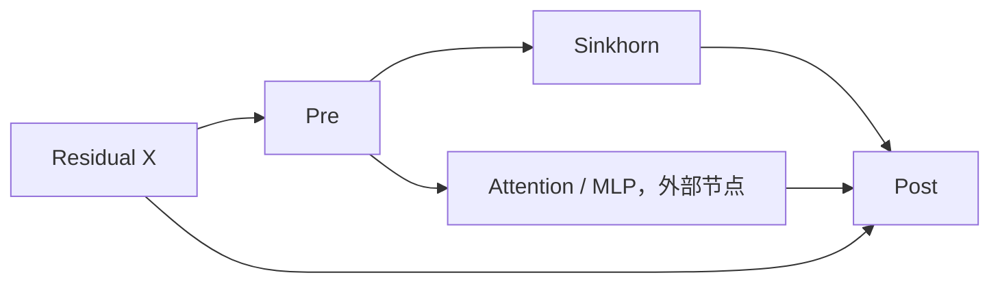

# LightningIndexer 与 mHC：950 结构建模扩展

## Summary

已加入普通 `aclnnLightningIndexer` 和 mHC 的四个 ACLNN 接口及组合链，目标为 **CANN 9.2.1 / Ascend950DT_9582**。本轮交付的是有来源的 shape、数学工作量、候选二进制身份和依赖关系，**没有运行这些新算子的 CA，预测耗时、利用率和误差均尚不可报告**。`plan()` 统一返回 `predicted_us=None`、`ca_measurements=0`，避免把未校准结构误作性能预测。已有 FA 校准不能直接用于 Indexer；已有 BF16 Matmul 的系数也不能直接用于 mHC 的 FP32/HF32 投影。

- LightningIndexer 是「点积 → ReLU → head 加权归约 → TopK」，不含 FA 的 softmax/乘 V。普通、QuantLightningIndexer、QuantLightningIndexerV2 是不同接口，不能仅按名称合并。
- mHC 有两条候选调用链：`MhcPre → MhcSinkhorn → 外部 Attention/MLP → MhcPost`，或 `MhcPreSinkhorn → 外部 Attention/MLP → MhcPost`。融合路径不能再加一次独立 Pre/Sinkhorn 的时间。
- 包内元数据将 MhcPost、MhcSinkhorn 标为 `VectorCore`，另外三个算子标为 `MIX`。数学公式中的矩阵乘并不证明它由 Cube 执行。
- 950 融合 PreSinkhorn 的文档约束为 `N=4, I=20, D∈{4096,7168}`；单独 Pre 支持更广的 `N∈{4,6,8}, D≤16384, D%16=0`。扩展明确返回不支持的路线，不偷偷换算法。

实现：[indexer_mhc.py](../../operator_model/extensions/indexer_mhc.py)；测试：[test_extension_indexer_mhc.py](../../tests/test_extension_indexer_mhc.py)；完整身份与检索记录：[indexer-mhc-evidence.json](indexer-mhc-evidence.json)。

## 证据身份和实际调用边界

本地官方源码文档来自 `third_party/ops-transformer`，commit `14d022b1a4c3df263bf697534e3c25c7c992ff5d`。现装 SDK 根为 `toolchains/cann/9.2.1/cann-9.2.1`。下表 kernel 目录均相对于 SDK 内 `opp/built-in/op_impl/ai_core/tbe/kernel/ascend950/ops_transformer/`。两段式调用先使用对应 `GetWorkspaceSize`，再使用表中的执行接口。

| 扩展名称 | 官方 ACLNN 接口 | 包内目录 / 候选文件数 | 官方源码文档 |
|---|---|---|---|
| lightning_indexer | aclnnLightningIndexer | lightning_indexer / 4 | attention/lightning_indexer/docs/aclnnLightningIndexer.md |
| mhc_pre | aclnnMhcPre | mhc_pre_apt / 2 | mhc/mhc_pre/docs/aclnnMhcPre.md |
| mhc_sinkhorn | aclnnMhcSinkhorn | mhc_sinkhorn_apt / 1 | mhc/mhc_sinkhorn/docs/aclnnMhcSinkhorn.md |
| mhc_pre_sinkhorn | aclnnMhcPreSinkhorn | mhc_pre_sinkhorn_apt / 4，含两个 relocatable | mhc/mhc_pre_sinkhorn/docs/aclnnMhcPreSinkhorn.md |
| mhc_post | aclnnMhcPost | mhc_post_apt / 2 | mhc/mhc_post/docs/aclnnMhcPost.md |

13 个 `.o` 的实际 SHA-256 均与相邻 JSON 的声明一致，清单保存每个文件路径、hash、kernelName、coreType。**这些是已安装的候选，不是本轮已实际执行的 kernel**；动态 `blockDim=-1` 也不能当作实际核数。现装 header 位于 `include/aclnnop/aclnn_<算子名>.h`，各自 hash 同样保存在清单。

知识检索按平台 950 完成。全文阅读了 `model/inference/concepts/modules/mhc.md` 与 `ops/ascendc/operators/aclnn/transformer/mhc/mhc_post_950.md`；普通 `aclnnLightningIndexer` 精确检索零命中，因此用本地官方 API 文档和已安装 header 补证，零命中不代表库不支持。检索索引 commit 为 `92dc260756e91e72e6dcd60f3996a4d54f43c8f5`。

MhcPost 知识卡对应 **CANN 9.1.0**、源码 commit `be33d95bb755cedec3108f70805c1874d1792540`，与当前版本有实质差异：旧卡要求 hRes 必选，现装包 JSON 与当前官方文档支持 950 hRes 可选。因此本文只把旧卡分核规则作为待核实参考。稀疏 checkout 没有当前这些算子的完整 host/kernel blob，尝试只读 `git show` 未能取到对象；没有把未读取的实现当成已验证证据。

## 接口和范围

```python
from operator_model.extensions.indexer_mhc import plan

# BSND query/key，Q=9 代表推测 8 个 token 后主模型校验 9 个。
index = plan('lightning_indexer', (1, 9, 32768, 32, 128), sparse_count=512)
chain = plan('mhc', (9, 4, 4096), implementation='fused')
pre = plan('mhc_pre', {'T': 9, 'N': 4, 'D': 4096})
```

| op | shape 约定 | 主要 attrs |
|---|---|---|
| lightning_indexer | `(B,Q,L,G,D)` | dtype=bf16/fp16；weights_dtype 默认跟随；layout=BSND；sparse_count=512；sparse_mode=3；return_values=False |
| mhc_pre | `(T,N,D)` | dtype；alpha_count=3 或 2；has_gamma=False；return_intermediates=False；norm_eps/hc_eps=1e-6 |
| mhc_sinkhorn | `(T,N)` | dtype=fp32；num_iters=20；eps=1e-6；return_intermediates=False |
| mhc_pre_sinkhorn | `(T,N,D)` | dtype；num_iters=20；need_backward=False；norm_eps/hc_eps=1e-6 |
| mhc_post | `(T,N,D)` | dtype；has_h_res=True |
| mhc | `(T,N,D)` | dtype；implementation=fused/split；num_iters=20 |

可用大写轴名 mapping 代替 tuple。`lightening_indexer`、`lightningindexer` 是输入别名，输出规范名始终为 `lightning_indexer`。形状正整数、标量类型和未知属性错误抛 `ValueError`；超出初版模型范围或文档支持范围返回 `status=unsupported` 和原因。该状态不一概意味着硬件不支持，例如 PA/TND 明明在库文档中受支持，但尚未建立其分块/打包结构模型。其他返回 `uncalibrated`。

所有张量按连续 ND/普通 BSND/TND 的逻辑视图计算。`T=B×S` 可由 mHC 的四维 BSND 展平；不能把已经按调度打包的实际 T 再乘一次 batch。初版不建模空输入、任意 stride、转换/copy、训练辅助路径的时延。

## LightningIndexer 的公式与计数

对每个 batch、query，令 query head 数为 G、head dimension 为 D、key head 数固定为 1：

\[
a_{qgk}=\sum_{d=0}^{D-1}Q_{qgd}K_{kd},\quad
s_{qk}=\sum_{g=0}^{G-1}W_{qg}\max(0,a_{qgk}),\quad
\mathrm{indices}_q=\operatorname{TopK}_k(s_{qk}).
\]

950 普通接口要求 D=128，G∈{8,16,24,32,64}，Q/K/W 都是相同 BF16 或 FP16；950 不允许 FP32 weights。`sparseCount` 支持 1..2048 或 3072/4096/5120/6144/7168/8192。`sparseMode=0` 为普通全覆盖，3 为右下对齐因果。窗口 preTokens/nextTokens 固定为 INT64_MAX。返回 values 的库路线只用于训练、非 PA；本扩展仅记录其逻辑输出，没有声称训练时延可用。

因果模式每个 query 的合法 key 数是 `max(0,min(L,L−Q+i+1))`。每 batch 的合法 query-key 对数 v 为：

\[
v(Q,L)=\begin{cases}
QL,&\text{mode}=0,\\
Q(L-Q)+Q(Q+1)/2,&\text{mode}=3,\ Q\le L,\\
L(L+1)/2,&\text{mode}=3,\ Q>L.
\end{cases}
\]

令 P=Bv，可在 O(1) 时间得到：

\[
F_\mathrm{dot}=2PGD,\quad N_\mathrm{ReLU}=PG,\quad
N_\mathrm{weight}=PG,\quad N_\mathrm{reduce}=P(G-1).
\]

2 FLOPs/FMA 是点积惯例，其余字段分别计逻辑标量比较、乘法、加法。另返回 dense 参照 `2BQLGD`，因为实际 mask/padding/tiling 可能计算多于合法元素。**P 不是 CA 指令数**。

TopK 的候选元素共 P 个，有 BQ 条列表、输出 BQk 个槽；算法、比较次数、局部选取/跨块合并次数目前未知。不能把 `k/L` 乘在点积工作量上，TopK 发生在打分以后。输入输出各只计算一次的逻辑字节下界为：

\[
B_\mathrm{unique}=2(BQGD+BLD+BQG)+BQk(4+2\mathbb1_\mathrm{returnValues}).
\]

它不包括全 score 中间量，因融合实现可能流式消费；也不包含重复访存、padding 或 workspace，不是 HBM 带宽计时公式。D、L 再大，结构计算仍是几个整数运算，不创建 BQGL 大张量。

## mHC 的公式与计数

记 X∈R^(T×N×D)，N 是 residual stream 数，M=N²+2N，x 是 X 展平后的 ND 维行。以下给出 alpha 长度为 3 的标准 residual 分支：

\[
r_t=(\operatorname{mean}(x_t^2)+\epsilon_n)^{-1/2},\quad
z_t=(x_t\odot\gamma)\Phi^T,\quad w_t=r_tz_t,
\]
\[
h^\mathrm{pre}=\sigma(\alpha_0 w_{:N}+b_{:N})+\epsilon_h,\quad
h^\mathrm{post}=2\sigma(\alpha_1w_{N:2N}+b_{N:2N}),
\]
\[
H'=\operatorname{reshape}(\alpha_2w_{2N:}+b_{2N:},N,N),\quad
h^\mathrm{in}_{td}=\sum_n h^\mathrm{pre}_{tn}X_{tnd}.
\]

无 gamma 时省略逐元素乘。独立 MhcPre 输出的 H' **还没有经过 Sinkhorn**；alpha 长度为 2 时 M=2N、没有 residual 分支，hPost 另加 epsilon，接口允许 hRes 空指针。模块采用该空输出方式并明确返回 shape=None。

主投影逻辑 FLOPs 是 `2T(ND)M`；RMS 包含 TND 次平方、T(ND−1) 次归约加法、T 次 mean scale、T 次 eps 加法与 T 次 rsqrt。输入加权汇聚包含 TND 次乘法和 T(N−1)D 次加法。模块独立列出 gamma、affine、sigmoid 和 post scale，避免把不同吞吐的特殊函数粗暴加成 FLOPs。

融合 PreSinkhorn 文档声明 Cube HF32 模式。它的归一化与投影可在实数代数上重排，但 FP32/HF32 舍入、归一化落在投影前后的位置和实际指令次数可能不同；模块的 pre-stage 数量是上述**规范代数展开**，不是断言它等于融合内核的执行计数。phi 值域须在 ±1/sqrt(ND)，950 文档将 eps 限定在 1e-6；shape 计划不能验证张量值域，未来 smoke 生成数据时必须满足。

### Sinkhorn

令 A0=row_softmax(H')+eps，第一次列归一化得到 A1；之后 I−1 轮每轮先按行、再按列归一化。每次除以对应轴求和再加 eps：

\[
A_1=A_0/(\operatorname{sum}_{row}A_0+\epsilon),\quad
A_{2i}=A_{2i-1}/(\operatorname{sum}_{col}A_{2i-1}+\epsilon),\quad
A_{2i+1}=A_{2i}/(\operatorname{sum}_{row}A_{2i}+\epsilon).
\]

这里 `sum_col` 表示沿列维求和，得到每行的和；`sum_row` 相反。返回 A_(2I−1)。softmax 后共有 2I−1 次归一化，连 softmax 的归一化一起按标量代数计数：

\[
N_\exp=TN^2,\quad N_\mathrm{div}=2ITN^2,\quad
N_\mathrm{reduceAdd}=2ITN(N-1).
\]

编译器可能使用 reciprocal+multiply 代替 divide，实际 ISA 必须采集或从代码确认。独立接口 N=4/6/8、I=1..100、dtype=FP32；可选 normOut/sumOut 按 flat buffer 表示，元素数分别 `2ITN align8(N)` 和 `2IT align8(N)`。融合接口的辅助输出契约不同，初版仅计划 needBackward=False，不能套用独立接口的辅助 buffer layout。

### Post

\[
Y_{tid}=h^\mathrm{out}_{td}h^\mathrm{post}_{ti}+\sum_{j=0}^{N-1}X_{tjd}H_{tji}.
\]

H 的下标是 j,i，即残差混合使用转置方向。有 H 时，混合乘法 TN²D 次、归约加法 TN(N−1)D 次，再加 post 乘法 TND 次、合并加法 TND 次。H 缺省时 residual 直接取 X，不做 N²D 混合。

尽管可将残差项写成小矩阵乘，现装 MhcPost 候选二进制标记 **VectorCore**。不能把 TN²D 除以 Cube 峰值。当前 950 文档不施加 A2/A3 的 N=4、D%128=0 限制；模块不伪造该限制，但极大 N/D 的 DMA 字段范围、UB 和整数溢出边界仍需 host 实现/实际调用补证，`uncalibrated` 不是执行可行性保证。

### 调用链、分核和流水的后续校准



融合路径把 P/S 两节点替换成 PreSinkhorn，两种路径互斥。模型返回各组件工作量，不简单相加各算子的 unique-byte 下界来冒充实际链路 GM traffic。一个 Transformer layer 可能有 Attention 和 MoE 两套 wrapper；本计划仅代表其中一套。

当前 `active_aic`、`active_aiv`、`tile_shape` 都是 None。旧 9.1 MhcPost 卡给出有用候选规则：初始 dOuter=1,dInner=D；若 `T*dOuter≤C/2` 或 `dInner≥U/24` 且 dInner>256，则持续二分 D，最后按 16 对齐。C 为平台 AIV 核数，U 为实际 UB 字节数。任务总数 T*dOuter 按核均分、末核收尾。若 `8(N+2)dInner≤U`，采用 X 常驻 UB；否则用逐行流式 X。两者的 X 重读与 Cast 次数不同。**这套旧版规则尚未移植到当前预测器**，避免拿 9.1 tiling 冒充 9.2.1 分核。

实际采集后应以 host tiling、kernel 身份和 trace 共同确认路线，然后建立阶段事件：

\[
s_{p,j}=\max(a_{p,j},s_{p,j-1}+II_p),\qquad e_{p,j}=s_{p,j}+L_p.
\]

p 是流水资源，j 是该资源上的任务，a 是输入依赖全部满足的时刻，II 是发起间隔，L 是结果延迟。这是**拟采用的模型结构**，本模块尚不输出其时间；L/II/同步/TopK 合并和框架开销都没有校准参数。CV 的活跃周期不能相加当作总时间，Post 的重读路线也不能仅用算术量区分。950 的参数在 A7/A8 上不能无条件复用。

## 少量验证计划与当前误差状态

| 类型 | 具体 shape / attrs | 目的 | 本轮 CA 状态 |
|---|---|---|---|
| 普通 Indexer | B=1,Q=1,L=64,G=8,D=128,k=16,mode=3 | 最小库接口/数值/trace smoke | 未执行 |
| 普通 Indexer | B=1,Q=9,L=256,G=32,D=128,k=64,mode=3 | 校验场景、多个 query、TopK merge 起点 | 未执行 |
| MhcSinkhorn | T=1,N=4,I=20,FP32 | 先独立确认最便宜的循环/归约数据 | 未执行 |
| MhcPre | T=1,N=4,D=128,alpha=3,BF16 | 独立接口最小投影 smoke | 未执行 |
| MhcPreSinkhorn | T=1,N=4,D=4096,I=20,BF16 | 融合支持下限；不可使用 D=128 代替 | 未执行 |
| MhcPost | T=1,N=4,D=4096,BF16,hRes 非空 | FP32 mixing、输出 cast、Vector 路线 | 未执行 |

优先完成以上短例的数值和 ABI 检查，再冻结首版可校准路线；不立即对长上下文 Indexer 做大规模 CA。每次只补能区分路线的一两个 shape，尽可能复用已采集指令/流水数据库。实际包可能为了可选输出设置占位 tensor，因此不能仅凭结构 plan 的 None 直接假定每个 C API 指针都可为空，必须按各接口文档构造调用。

误差表暂时没有可填写的预测或实测值，**不存在 MAPE、最大误差或 CA 开销数字**。本轮新增 CA 开销为零；9 项 Python 测试只检查语义、shape 约束、版本边界与 JSON 输出，不验证内核正确性或耗时准确性。对新算子的“真实根因”只确认接口/源码事实；以下均是待验证假设：TopK 合并开销、不同 G/Q/L 的 tiling 切换、小 T 的核利用率、HF32 投影及 Sinkhorn 与 Cube 重叠、Post X 常驻分支。

场景映射时，decode 投机 8 个 token 可先用每请求 Q=9、T=batch×9；用户 batch=1/4/16/32/128/256。prefill 的 T 是本次调度实际 token 数，可用 batch×chunk 作同长假设，不能总把 512k 总输入当作单次调用的 Q。32k/128k/256k/512k 映射到当步有效 key 长度 L；具体 Indexer key 是否压缩、paged cache 的形状要由调用点决定。

本地 DeepSeek-V4.1-Flash config 提供 index_n_heads=32、index_head_dim=128、index_topk=512；V4-Pro 为 64/128/1024。它们仅提供候选规格。注意：若简单按 TP=8 将 32 heads 切成 G=4，会落在普通 950 Indexer 文档支持集合之外；真实实现可能复制 Indexer heads 或选择另一接口，不能静默把 G 改为 8。要接入系统仿真仍需 workload/并行配置和实际 dispatcher 证据，通常不需要下载完整权重。
