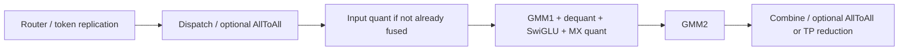

# KDA / MoE 扩展建模：接口核实与结构工作量

**Summary：本轮完成真实 950 库接口映射、shape/路由约束、逻辑工作量与依赖结构，新增 CA 实测为 0。所有耗时与效率均为 `null`，不能用于准确性排名。KDA 不是 FA；MoE 的 GMM1–SwiGLU–量化融合也不是完整 GMM1–SwiGLU–GMM2 FFN。** 用户投机 8 对应主模型 Q=9，超过本机 RecurrentKda 的 S≤8 约束，必须先确认框架的 chunk 或状态槽调度。

## 证据与真实库映射

目标为 `Ascend950DT_9582`，安装包 CANN 9.2.1，根目录 `toolchains/cann/9.2.1/cann-9.2.1`。以下均为 **ops-transformer**，不是自编简化算子。安装包提供公开 ACLNN 头文件、ascend950 配置和 arch35 kernel 源码；本轮没有调用，因此尚未获得运行时选中的具体 `.o`/tiling key。不能把某个目录存在等同于该 shape 已成功运行。

| 语义 | 公开入口（另有 GetWorkspaceSize） | 包内 ascend950 kernel 目录 | 前后依赖/边界 |
|---|---|---|---|
| KDA 短序列递推 | `aclnnRecurrentKda` | `ops_transformer/recurrent_kda_apt/` | q/k/v、gate/beta、初始 state；包含状态衰减、更新、输出 |
| KDA 分块前向 | `aclnnChunkKdaFwd` | `ops_transformer/chunk_kda_fwd/` | Gate/Prepare/Post-WU/FwdH/Finalize 是同一 kernel 内阶段 |
| KDA 投影 | `aclnnKdaInputProj` | `ops_transformer/kda_input_proj/` | X 到 beta/gate/g 与量化 QKV；含输入 dynamic MX quant，不能重复计一次独立 quant |
| GMM1 + SwiGLU + quant | `aclnnGroupedMatmulSwigluQuantV2` | `ops_transformer/grouped_matmul_swiglu_quant_v2_apt/` | 仅第一组投影到激活后量化输出 |
| 后续 GMM2 候选 | `aclnnGroupedMatmulV5` | `ops_transformer/grouped_matmul_apt/` | 还需连接量化尺度 ABI；本轮只计数学工作量，不声称完整可执行串联 |

目录共同前缀是 `opp/built-in/op_impl/ai_core/tbe/kernel/ascend950/`，头文件为 `aarch64-linux/include/aclnnop/aclnn_*.h`。精确相对路径、头文件/配置/kernel 源文件 SHA256 见 [kda-moe-evidence.json](kda-moe-evidence.json)。固定 ops-transformer 提交为 `14d022b1a4c3df263bf697534e3c25c7c992ff5d`；参考文档在 `third_party/ops-transformer/attention/{recurrent_kda,chunk_kda_fwd,kda_input_proj}/docs/` 及 `gmm/grouped_matmul_swiglu_quant_v2/docs/`。

已按 knowledge-query 检索并阅读全文：`ops/catlass-dsl/guides/operator_playbooks/linear_attention/kda/chunk_kda_fwd`（950、stable，相关上游实现）与 `ops/ascendc/operators/aclnn/transformer/gmm/grouped_matmul_swiglu_quant_950`（950、stable，但来源版本 9.1.0、未实测）。搜索回执在 `runs/extensions/kda-moe/`。知识卡仅辅助定位；9.2.1 的具体约束以本机头文件、固定源码文档和安装源为准，未把上游所有 fast flags 直接当成当前二进制的已确认选择。

## 可调用模型接口与范围

```python
from operator_model.extensions.kda_moe import plan

plan('kda_recurrent', (4, 8, 2, 4, 128, 128))
plan('kda_chunk', (1, 65, 1, 2, 128, 128), chunk_size=64)
plan('groupedmatmulswiglugmm', (8, 128, 128, 4),
     expert_counts=[1, 0, 7, 0])
```

KDA shape 为 `(B,S,Hq,Hv,K,V)` 或同名键字典，分别是本 rank 的序列数、当前 token 数、Q/K head 数、value head 数、key/value 维度。`kda` 别名必须显式 `mode='recurrent'/'chunk'`。当前模型仅覆盖 dense BSND，packed/varlen、accepted-token/state-slot 规则不接受隐式近似。所有未知属性返回 `unsupported`。

Recurrent 支持 BF16 q/k/v、K=128、V=128/256、S≤8、Hv 是 Hq 的倍数，state 为 BF16/FP32。Chunk 支持 BF16/FP16、K/V 为 16 的倍数且在 [16,256]、Hv≤128、C∈{64,128}、FP32 state。`gate_mode` 可为预激活、raw-safe、raw-unsafe，影响后续指令模型；当前只统计 gate 元素数，不赋予相同周期。`state_v_first` 改变公开 state 布局；`normalize_qk`、`export_intermediates` 记录语义但不把额外代价遗漏后声称总 FLOPs 完整。

MoE shape 为 `(M,K,F,E)`，M 是 dispatch 后本地 token 行容量，F 为 SwiGLU **后**宽度，第一组权重逻辑为 `[E,K,2F]`，E 是本 rank 专家组数，**不是 EP 大小**。必须提供 `expert_counts=[m_e]`，或 `group_list` 及 `group_list_type=0`（前缀和）/1（计数）；允许空专家、`sum(m_e)≤M`，多余容量行没有新输出保证。初版仅 ND MXFP8：X/W/Y 支持 E4M3FN/E5M2，尺度 E8M0，dequantMode=quantMode=2、dequantDtype=0，weight TensorList 长度 1，bias/assist/smooth/tuning 为空。FP4、NZ 和 per-token 有不同数据流，明确不混用。

`grouped_matmul_swiglu_quant_v2` 仅第一融合；`moe_ffn`/`groupedmatmulswiglugmm` 表示组成链，`output_dim` 默认 K。它们不是对已确认同名单库 kernel 的声明，也不是 ACLNN 执行包装器。调用示例和输出见 [kda-moe-examples.json](kda-moe-examples.json)。

## KDA 公式与分核解释

### Recurrent

对每个序列、value head、token，令 state \(S\in\mathbb R^{V\times K}\)，gate 的衰减向量为 \(d_t=\exp(\ell_t)\)，则

\[
\bar S_t=S_{t-1}\odot d_t,\quad
\delta_t=\beta_t(v_t-\bar S_tk_t),\quad
S_t=\bar S_t+\delta_t k_t^T,\quad o_t=S_tq_t.
\]

gate 沿 K 广播；q 可另有 scale/归一化。若 gate 在 kernel 内计算，还含 A_log、dtBias、safe/unsafe 激活，不能当作一个 exp 代替整个前处理。传统 MAC=2 FLOPs 的有用标量工作量代理为

\[
W_{rec}=BSH_v(7KV+2V).
\]

7KV 分别来自 state 衰减 1KV、预测 matvec 2KV、rank-one 更新 2KV 和输出 matvec 2KV；2V 是 residual 与 beta 乘法。不包含 gate/归一化、补齐、搬运和同步，也不是 ISA 指令数。过去上下文压缩进 state，因此不能加入 FA 的上下文长度 L 项。

安装源码 `recurrent_kda_arch35.h::Process/PrepareNextTask` 将 `B*Hv` 个任务以 `task=blockIdx+j*GetBlockNum()` 分配，`batch=task//Hv, head=task%Hv`。同一任务 token 串行，下一任务 state 有预取。当前仅返回该确定的任务关系；未从运行取得 blockDim，active AIC/AIV 留空。S=9 返回 unsupported；不能未经框架验证就拆 8+1，因为 speculative accepted-token/state-slot 可能改变可见状态。

### Chunk

对一个长度为 c≤C 的块，\(\gamma\) 为 chunk 内 gate 累积，简记

\[
q_g=q\exp(\gamma),\quad k_g=k\exp(\gamma_{last}-\gamma),\quad
A_{kk}=(I+L)^{-1},\quad W=A_{kk}W_0,\ U=A_{kk}U_0,
\]
\[
V_{new}=U-Wh_{prev},\quad
h_{next}=\exp(\gamma_{last})\odot h_{prev}+k_g^TV_{new},\quad
O=scale\cdot q_gh_{prev}+A_{qk}V_{new}.
\]

\(L\) 为严格下三角的带 beta/gate 的 K–K 点积；\(A_{qk}\) 为包含对角线的因果 Q–K 点积。实现可能用 base-2 gate 表示，不能重复乘 ln2。模型定义每序列块长度 \(c_j\)，\(P=\sum c_j(c_j+1)/2\)、\(P_-=P-S\)、\(D=\sum c_j^2\)。不逐块展开，利用满块数和尾块长度 O(1) 求和。

| 字段 | 每个 sequence/value-head 的工作量 | 含义 |
|---|---:|---|
| Aqk dots | \(2KP\) | 有效因果点积 |
| Akk dots | \(2KP_-\) | 严格下三角点积，不含逆/solve |
| Post-WU dense equivalent | \(2(K+V)D\) | 以完整 c×c GEMM 口径记录，非实际指令数 |
| FwdH GEMMs | \(4SKV\) | W@h、kgᵀ@Vnew |
| FwdH state decay | \(n_{chunk}KV\) | 每块 state 衰减乘法 |
| Finalize dense equivalent | \(2SKV+2VD\) | qg@h 和 Aqk@Vnew，含结构零的 dense 口径 |

全部乘 BHv。三角逆/solve、gate、dtype转换和实际 tile padding 未建模，故 `total_executed_flops=null`，不把上述代理相加充当精确总指令数。FwdH 每条 `(sequence, head)` chain 的 chunk 串行；Prepare/Finalize 可以按 chunk/head 并行。快路径还受 dtype、gate、tail、输出中间量约束。五个逻辑阶段只计一个融合 kernel 的依赖关系；不能直接加五次启动开销，或无条件取 Cube/Vector 时间最大值。

公开 Aqk/Akk 输出均为必选 `[B,Hv,S,C]`；不能因为关闭其他可选中间量而省掉它们的分配与输出语义。当前只给出这些 shape，不假装已经准确估计 workspace 峰值或 GM 流量。

## MoE 公式、量化与执行组成

\[
C_e=dequant(X_eW_{1,e}),\quad Z_e=SiLU(A_e)\odot G_e,
\quad (\hat Z_e,s_e)=MXQuant(Z_e),\quad Y_e=GMM2(\hat Z_e,W_{2,e};s_e).
\]

A/G 表示 SwiGLU 两个角色，具体权重半区顺序必须按实际接口保存，不能凭名称交换。第一融合输出 F，故 W1 宽 2F。对真实直方图 \(m_e\)，\(T=\sum m_e\)，有

\[
W_{GMM1}=\sum_e2m_eK(2F)=4TKF,\quad
W_{GMM2}=2TFO,\quad N_{SwiGLU}=TF.
\]

O 为 FFN 输出宽度。相同 T、不同直方图具有相同有用 FLOPs，但实际 tile、空专家跳过、尾块、调度不一样，不能共用同一利用率。报告额外给出 active experts、max(m_e)/(T/E)；此比率不是耗时公式。MX 逻辑每 32 元素一尺度，API 以一对尺度打包，输入尺度 `[M,ceil(K/64),2]`、输出尺度 `[M,ceil(F/64),2]`，不能把物理尾部 padding 当作有效 token。



F 的 950 MX 分支以 AIC↔AIV ready/done 交接 tile，量化/激活为真实流水消费者；per-token 路线另有全局量化和 GM 中间区，不能套用本计划。当前未移植完整 TCubeTiling / ASWT tail scheduler，不假设一个专家对应一个核。通信、输入量化、router、combine 尚未给耗时；它们也不会因为本地 GMM 计划成功而自动视为 0。

## 验证、误差边界与最小后续采样

本轮仅通过 6 个结构契约测试：Q=8/Q=9 边界、GQA 整除、chunk tail、计数/前缀和等价、不均衡/空专家/无效容量、零有效 FLOPs 不等于零耗时。**尚无 CA correctness、数值误差、周期、指令或分核验证。** 因此与旧版或固定耗时的误差对比均为 N/A；不可纳入本轮 FA 的独立留出准确率表。

已测 Python 计划开销（本机非独占，import 不计，1000 次平均、无缓存）：recurrent 7.18 µs，chunk 9.46 µs，4 专家 MoE 11.07 µs；对应首次调用 64.86/22.26/26.34 µs。原始记录在 examples JSON。这是计划函数开销，不能当 CA 仿真开销。KDA 复杂度 O(1)，MoE O(E)，没有随长上下文创建 token 级 DAG 或 trace。

建议后续串行最小验证，而非立即全面采样：

| 目标 | 最小 shape / 属性 | 需要拿到的证据 |
|---|---|---|
| Recurrent 状态链 | (1,1,1,2,128,128)，再 S=8 | BF16/FP32 state 数值，task/core、每token V/搬运重复与预取 |
| Chunk 融合/尾块分界 | (1,64,1,2,128,128)，独立留出 S=65 | 实际 key、gate/fusion flags、FwdH chain 和总周期；保持输出保留模式一致 |
| MX GMM1 融合 | (8,128,128,4)，counts=[2,2,2,2]；留出 [1,0,7,0] | runtime kernel、TCubeTiling、组调度、AIC↔AIV交接、scale/Y数值 |
| GMM2 串联 | 同一前级输出 + W2[E,F,K] | 首先验证 scale layout/分组 ABI，之后才做完整 FFN 周期 |

优先只采必要核/低开销数据库，首例获得命令和 tiling 后复用已有 trace 解析方法；新增 CA 预算由主线程统一决定，本模块没有启动任何 CA。后续应冻结每个 route 的参数再挑新形状留出。主要未决误差来源是实际 tiling/指令、state/UB流水、MX尺度搬运、组负载尾部与动态 fusion；这些是待检验假设，尚非已证实的误差归因。
