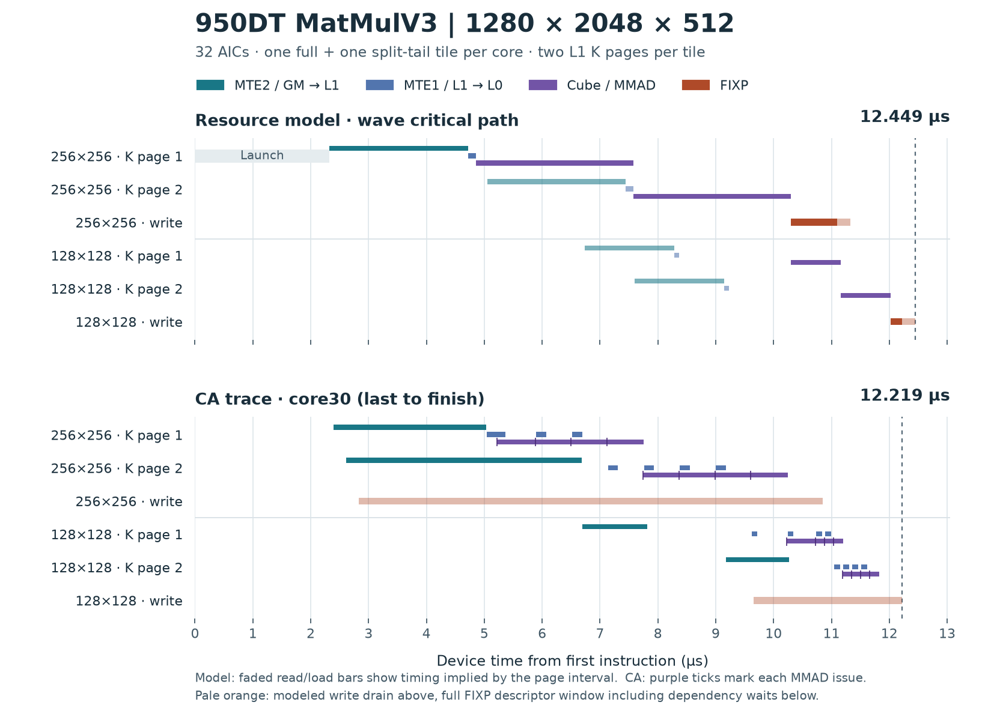

# 2　从张量到设备完成时间

系统给出“一次调用”时，模型首先要知道这一张卡在这一次调用中做什么。例如同样写着“32 Ki 输入、八个请求”，不分块时一次投影可能有 262,144 行，把每请求的 prefill 切成 4096 个位置时则是八次 32,768 行的投影。两种安排的总 token 数相同，末块、参数复用和启动次数都可能不同。沿头切分的注意力还要把本地头数和每请求的历史长度交给模型。所有后续公式都以这一次调度已经切好的输入为起点。

## 2.1　两本账与一张时间线

第一本账记录算法对外声称的工作。例如一个无 bias 的矩阵乘，A 的逻辑尺寸为 M×K，W 为 K×N，乘加按两次标量运算计，共 2MNK 个有用操作。输入、输出的物化字节分开计数。这一层使系统能在相同算法、布局和精度下比较算力与带宽。第二本账记录内核真正需要发出的工作。一个小于 16 行的输出块可能仍须按 16 行发矩阵指令；同一块 W 可能被不同核载入多次；A8W4 内核还需要先展开 W。用第一本账计算有用利用率，用第二本账安排设备事件，可以同时解释“有用运算很少”和“执行了相当多指令”。

从第二本账到时间，需要三个决定。首先根据 dtype、布局和属性选择具体实现，确认 scale 的粒度、缓存是否已经打包、输出是否要求再量化。然后用核数和片上容量列出可行的分块，得到每个活动核的工作顺序。最后给工作安排读、计算、写和交接。单个操作的开始时刻取其前驱交付数据、目标资源可再发起、目标缓冲槽可覆盖这几个时刻中的最晚者；再加响应时长，得到这次操作的退休时刻。通俗地说，“可以再下一个订单”和“上一个订单已到货”是两件事。流水硬件常在旧请求仍在途时发出新请求，建模时必须分别留出这两个时刻。

记第 $i$ 次操作的发起、退休、响应时长、发起间隔分别为 $s_i$、$e_i$、$L_i$、$J_i$。若下一条指令同时共享端口并消费本次结果，它必须满足两项约束。

$$
e_i=s_i+L_i,\qquad s_{i+1}\geq\max(s_i+J_i,\ e_i).
$$

首个块通常暴露较长的等待，中间块可以交叠，最后一个块即使只剩一次小写回也必须等退休。核间没有串行依赖时取最晚核结束；有多个核合并同一行时，还要等所有分片就绪并算合并。聚合带宽另检查全片字节服务下界。如果局部时间线已经涵盖该下界，就没有需要另加的总线延迟。

在线系统反复调用模型时，无须为每一条指令建立事件对象。同一种块重复数百次，只要资源、缓冲槽和分支不变，就可以用首块时间、重复次数、稳态间隔和末块排空来压缩表示。遇到块大小、工作分配或占用变化，再开始下一段。下文两个例子分别展示两槽 UB 如何交替使用、矩阵乘的第二波怎样在第一波尚未结束时开始。它们共享时间线规则，各自的工作量、分块策略与依赖来自各自的实现。

## 2.2　Vector 例一：九行量化怎样分核

考察 CANN 9.2.1 ops-nn 的 aclnnDynamicMxQuant，输入为 [9,5120] 的 BF16，量化输出为 MXFP8，每 32 个输入共享一个 E8M0 尺度。整批共 46,080 个值、1,440 组，输入为 92,160 B，值输出为 46,080 B；尺度按每 64 个位置存两个字节，另写 1,440 B。计入求绝对值和组内最大值比较的有用向量工作为 $46\,080+(46\,080-1440)=90\,720$ 个标量等效操作。实际内核还要计算尺度、转换、打包并写回。下文用实测循环服务来计这些动作的时间。

在 950PR 上有 56 个 AIV。按照 host 的行列切分策略，该例以 512 列为分配单位；每行有 10 个单位，九行共 90 个，超过 0.75×56 的分支阈值。行列网格给一个有效核分配一行内相邻的两个单位，即 1,024 个值。因而每行由五核并行，共 45 核。每个核持有 32 个量化组。UB 有 253,952 B，扣除 2,048 B 固定预留，并按该实现双缓冲、每八组所需 1,616 B 安排，最大容量为 $8\left\lfloor 251904/1616\right\rfloor=1240$ 组。32 组可以在一块内做完。这也说明九个 token 并不意味着九个向量核，更换通道宽度或有效核数就有可能跨过分支阈值。

下面从最慢核的视角逐段计数。全程用每核周期，PR 的 1.65 GHz 对应每微秒 1,650 周期。本段由公共查询的 PR 资源路径复算。DT 的缺省查询保留该芯片自己的参考路径，文中报告的跨芯片结果来自各自公共入口。

| 事件 | 关键核计算（周期） | 参数与依赖 |
|---|---|---|
| 最慢核开始读 | $4253+227.766\log_2 45$，得 5503.855 | 前一项是 PR 单块路线首发截距，后一项估计不同核开始工作的时间展宽。 |
| 输入可用 | $954.120+2048/48.363$，得 996.467 | 最慢核读 2,048 B。固定响应来自 PR 首笔有效读，持续服务率继承 DT 搬运标定。 |
| 向量函数开始 | $\max(1099.5,\,996.467+23)$，得 1099.5 | 以本核发读为零点。前端准备和输入到达都必须完成，23 是读退休到可用的依赖预算。 |
| 向量函数完成 | 再加 $208.188+5\times5962.693/508.658$，得 266.800 | 32 组产生 $\lceil32/8\rceil+\lceil32/128\rceil=5$ 个循环单位，固定控制与循环服务分开。 |
| 两类输出退休 | 再加 335.637 | 量化值与尺度分别发写，最后到达的是尺度写，下一小节展开。 |

其中 508.658 是 PR 的每 AIV 峰值，等于 $47\,000/(56\times1.65)$ ops/cycle。5962.693 是开发窗中向量函数从首发到输出发起的时长随循环数增加的斜率，再乘 DT 每核参考峰值得到的等效工作。这个数吸收了指令组合和依赖气泡，所以不能把 5×5962.693 计入算法有用运算。该模型据此假设相同编译路线在相近架构上保持相近的有效指令组合，未能识别的微架构变化将进入迁移误差。对 PR 单独取到的截距，须与仅在 DT 上得到的持续速率分别注明。[资源参数](../../src/operator_model/data/parameters/quant_resources.json) · [PR 配置与校准来源](../../src/operator_model/data/chips/Ascend950PR_957b.json)

最慢核的量化值写为 1,024 B，单条输出的响应 $D=242.510+1024/92.027=253.637$ 周期。尺度写 32 B，有自己约 307 周期的响应下界，而且从开发窗看可能比值写晚约 81 周期完成，因此取 $\max(307+32/92.027,D+81)=334.637$。这里的一个 32 B 物理粒度只有一个写者，故无跨核冲突附加项。尺度晚一个周期发起，两笔写以及端口服务量共给出 $\max(D,\,1+334.637,\,1056/92.027)=335.637$ 周期。若误把每个核都当作同一份尺度的写者，估计会随活动核数增长，即便各核实际写的是不同地址。

相对末核发读的局部流水长为 $1099.5+266.800+335.637=1701.937$ 周期。波内冷读服务及其最小尾部在本例已被到达展宽和局部计算覆盖。最后另有 16 周期的退出，将局部流水、启动和退出合并，得到整窗。

$$
T_{\mathrm{quant}}=\frac{5503.855+1701.937+16}{1650}=4.377\ \mathrm{\mu s}.
$$

该 PR 窗 CA 为 5.025 µs，模型低估 12.90%；DT 估计 4.980 µs、CA 为 4.867 µs，高估 2.31%。这组双端算对核数，却判反了设备快慢，说明小 shape 的启动和局部等待足以掩盖理论带宽的差别。

## 2.3　Vector 例二：多块量化如何共享同一条读通路

把行数增至 2,048，保留 5,120 列。PR 的 56 核均参与，最重的核处理 74 行×2,560 列，每块最多 15 行；于是队列是四个 15 行满块和一个 14 行尾块。满块先读 76,800 B，再写 38,400 B 值和 1,200 B 尺度。另一条同样重要的约束是各核同时读时对全片带宽的争用。全批元素数除以关键核元素数给出有效并发度 55.351，平均到该核的共享读份额约为 $(1400/1.65)/55.351=15.329$ B/cycle。第一块供数在扣除已计的到达展宽后约需 3687.372 周期；下一块可以在 76800/68.913=1114.453 周期后发起，届时第一块还没有读完。

双缓冲决定了后续三步的次序。读第 i 块要等读端口能再次发起，同时要等第 i−2 块的向量计算释放其输入槽。第 i 块计算要等本块数据就绪、上一块计算结束和上上块输出槽释放。写第 i 块要等本块计算结束和写端口可用。按这些规则递推，模型的前两笔读在 2.841 和 3.517 µs 发起，第三块须等第一块向量操作结束到 6.353 µs。关键核第五块写完成时模型时刻为 13.737 µs。此刻其余核和共享端口仍有工作，不能作为整片完成时刻。

全批输入的冷读至少要 $2\times2048\times5120\times1.65/1400=24\,716.434$ 周期。共享链路结束后还要完成最小末块的计算、写与依赖；加 1327.797 周期并扣去已计的到达展宽 1322.716 周期，净下界为 24721.515 周期。本例这项大于局部预测，故整窗为 $2.841+(24\,721.515+16)/1650=17.834$ µs，CA 为 18.504 µs。下图可直接对照模型推算的有效服务和末核指令；宽条若包含等待，不宜当成端口持续忙时。[分块实现](../../src/operator_model/scheduling/tiling.py) · [流水与共享下界](../../src/operator_model/operators/quant/resources.py)

![图 2.1｜950PR 动态量化 [2048,5120]。上下栏分别为模型与原生 CA，每行对应关键核的一个 UB 块。](../examples/assets/quant.png)

## 2.4　Cube 例：从 40 个输出母块到最后一个写回

以 CANN 9.2.1 ops-nn 的 aclnnMatmul 为例，输入约定 [M,N,K]=[1280,2048,512]，BF16 输入、输出。设备预测先得到 2,684,354,560 个有用操作、3,407,872 B 逻辑输入和 5,242,880 B 逻辑输出。若将输出划为 256×256 的母块，则 M 方向五块、N 方向八块，共 40 块。单个输出块沿 K 读若干页，在本地累加后写回。这个选择在两个 950 上有具体的容量依据。L0 两侧各有 65,536 B，双槽 BF16 的最大单片深度为 65536/(2×2×256)=64；双槽的 L1 预算和两侧操作数约束容许页深 256。因此每块沿 K 有两页，每页含四个 K64 乘加片段。

各核做多少工作取决于尾波如何拆。DT 首波 32 个整块，剩下八个母块沿 M、N 各一分为二，给尾波 32 个 128×128 子块。PR 首波 28 个整块，余下 12 个母块沿 M 一分为二，给尾波 24 个 128×256 子块。每个分得的输出块都须沿 K 走完八个片段，全片的 MMAD 数分别是 $(32+32)\times8=512$ 与 $(28+24)\times8=416$，归档的两端 CA 均有相同计数。减少发出的指令条数未必能够缩短设备时间；PR 最慢核的尾块面积是 DT 尾块的两倍。

### 页内的三个时钟

先算 PR 满波的第一个输出块。每核 BF16 峰值 $\pi=378\,000/(28\times1.65)=8181.818$ ops/cycle。一片 256×256×64 要 8,388,608 个操作，理想计算服务 F=1025.27 周期。用 DT 的 17 个开发窗考察已知工作量的 MMAD，把发起到退休的跨度扣去 F，得到这条内核的退休残差中位 99.92 周期；满足连续指令筛选条件的七窗给出相邻发起残差中位 97.92。两者有不同的观测事件。单页发四条指令，前三次按发起间隔算，末条等到退休。页内 Cube 窗为

$$
C=3\max\!\left(F+97.92,\ \frac{32768}{180.655}\right)+(F+99.92)=4494.78\ \mathrm{cycles}.
$$

第二项比较的是为下一片装入 L0 的时间。若装载来不及，即便 Cube 空闲也须等待。

首对输入从 GM 到 L1 的响应 R 包括参考固定项和当前工作量的服务。此波单核最大页 131,072 B，全波两侧输入合计 7,340,032 B。局部、全片 L2 和需要到 HBM 的读都要满足，服务时间取三者最大。本例依次为 2780.01、2621.44、1222.39 周期，主导项来自每核 47.148 B/cycle 的有效端口。加 1173.46 周期的首响应得到 R=3953.46。这里 L2 使用该路线的共享服务假设；核侧重复读取能否由驻留数据供应，决定有多少流量转到 HBM。首个 L0 片就绪另需 $L=32\,768/180.655+33.69=215.07$ 周期。

下一张 K 页到来时，尚有上一页在计算。相邻页的发起要同时满足两条读描述符的发起间隔、局部读服务、双缓冲槽复用和 Cube 占用四项约束。当前页的计算盖住了下一页的读。页间隔为

$$
I=\max\!\left(2\times15,\ 2780.01,\ \frac{3953.46}{2},\ C\right)=4494.78\ \mathrm{cycles}.
$$

如果读服务变为 5000 周期，模型就要额外暴露约 505 周期的等待，即 5000−4494.78=505.22。这个反事实计算说明，允许两项重叠仅意味着取较慢的一项，任何一边变慢到超过另一边都会改变瓶颈。

### 两波的关键路径

为看清重叠，暂以首波最慢核的读发起为零。PR 尾波子块的首读和首片装载仍受 256 的最长边限制，R、L 与首波相同。其页间隔变为 $P_t=2780.01$ 周期，每页计算窗缩短为 $C_t=2444.23$。首波读端在 7274.78 周期后可交给尾波，Cube 端的再发间隔则为 8987.56 周期。尾波开始计算的最早时刻要同时等数据和 Cube，$t_{\mathrm{C}}=\max(7274.78+R+L,\ R+L+8987.56)$，即 13156.09 周期。尾块写出还须等它的两页完成及首波写端口释放，得到 18380.33 周期。最后一波写尾 943.55 周期，退休时刻为 19323.87 周期。

全片读写服务下界为 10485.76 周期，已被这条关键路径吸收。此时补回首波启动和核间到达展宽 $3381.33+91.25\log_2 28=3820.01$ 周期，预测整窗 $(3820.01+19\,323.87)/1650=14.027$ µs。PR 原生 CA 为 13.218 µs，高估 6.12%；在 DT 按各自分核复算为 12.449 µs，CA 为 12.219 µs。图示 DT 的两页两波。浅色读条表达排程推得的服务窗口；长 FIXP 描述符还可能含等生产者的时间。用描述符的整段时长替换净写服务会把等待重复算进去。[分块搜索](../../src/operator_model/operators/matmul/tiling.py) · [波次与尾块](../../src/operator_model/operators/matmul/waves.py) · [阶段校准及整窗复算](../examples/matmul.md)

## 2.5　混合精度、状态链与专家组合

对同一线性层 [9,128,256]，A4W4 与 A8W4 都要完成 589,824 个有用 Cube 操作，最终 BF16 写出 2,304 B。若两个输入都已经按 MXFP4 打包并带 E8M0 scale，A4W4 可用原生带尺度的 4 位矩阵指令。A8W4 的激活已是 FP8，但 W 仍是 4 位，所验证的稠密实现由 AIV 先展开 W、交接到 L1，再由 AIC 做 8 位点积。取一个输出块的 w=16、K=256，AIV 须生产 4096 个 FP8 权重，约需 50+4096/23.24 周期，随后 4096 B 还要通过 UB→L1 接口。两段依赖出现在首个 MMAD 之前，多页允许后续 W 的生产与前一页计算交叠。DT 上该例 A4W4 和 A8W4 分别估 3.940 和 3.946 µs，CA 为 4.154 和 4.012 µs。若调用要求低精度输出，还须核实由哪个算子计算 scale、写打包值；当前这两条 BF16 输出合同的计时在 BF16 写完时结束。[精度路线和逐页分账](../examples/mxfp4-design.md)

还有两种从形状之外引入依赖的情形。第一种是跨调用或跨 token 的状态。mHC Post 在相同尺寸下可能首次启用、扩展已有核组或在热态复用资源，调用者若知道同流前序，可用有序入口选择路径；仅有 shape 时，模型在可能状态之间作近似，报告误差时需要分别给出两种入口的证据。KDA 单链更新更直接。三个 token 依次修改同一个 128×128 的 FP32 状态矩阵，状态占 65,536 B。更新必须遵守三步的因果顺序，增加 AIV 数不能使第三步越过第二步。该路线按状态元素与更新步数伸缩实测的关键核互斥阶段，因此属于阶段级近似，其系数没有逐条分离每一条递推指令。[KDA 单链的计算和证据](../examples/kda_recurrent.md)

第二种是按专家分组后的组合。在 8 个 token、两个专家、hidden=256、中间宽 128 的 MoE 中，给出每个专家的 token 数 [1,7] 后，才知道两端各有多少行需要填充和打包。上投影含 gate 与另一支投影，算术量 2×8×256×(2×128)=1,048,576 ops。下投影另有 2×8×128×256=524,288 ops。上段的 SwiGLU 和 MX 量化向下段提供输入；两份独立内核结束时序按先后累加。本例在 PR 估为 9.964+3.701=13.666 µs，两个 CA 核窗合计 11.056 µs，主要差别在上段。专家路由及跨卡通信在整张图中另设节点，只有包含这些动作的计时边界才能用来验证完整服务请求。[专家计算与组件归属](../examples/moe_ffn.md)

## 2.6　改变 Vector 定价时，究竟替换哪一步？

第一步仍是按输入、精度、分核和 tiling 找出一个核实际分到的任务。第二步才有两条路。上面量化算例的原法问：“这个库实现再做一组循环，会多占多少周期？”它保留 CA 中观察到的稳态服务和首尾成本。指令类别法则问：“这些行要装入多少组寄存器，各组发多少次转换、规约、指数与存储？”当形状超过一个寄存器时按有效位宽向上取整，独立发起受端口和吞吐限制，前后依赖还要等数据就绪。两种报价产生的是同一阶段的设备周期，随后使用同一个依赖调度器。

以稠密 BF16 FA 的 950DT 开发窗为例。Q=9、KV=32,768、D=64、单头，忙核负责五行；一个 256 B 寄存器装 64 个 FP32 元素，每页有 256 个 score。128 页的逐 score 指数需 $128\times5\times\lceil256/64\rceil=2560$ 次寄存器发起。另有 127 张续页，各做一次由行状态打包触发的重缩放，共 2,687 次，与 CA 的发起数相符。一条指数的持续发起间隔在该模板中取 4 周期；相互依赖的消费者等待结果约 18 周期，两者不能混算。把计数带回整段排程，得到约 32,571 周期，对应 CA 中同核正时长寄存器指令执行的区间并集为 35,796 周期；原法校准的是包含队列活动的更宽口径，不能将它拿来充当这个并集的真值。[发起计数与两个窗口定义](14-vector-transfer.md)

实际选择分三步：先确认所选精度是否有实现合同，再检查这一实现有无单独的 Vector 阶段，最后才在两种可用定价之间选择。无 VF 的原生 A4W4、纯通信和视图切换方法没有独立意义；只有指令设计的新精度不能比较一份不存在的同精度库校准模型。即使 VF 成本变化，Cube、搬运或通信仍可能控制整窗。[原生与系统合同的覆盖边界](15-vector-methods.md)
