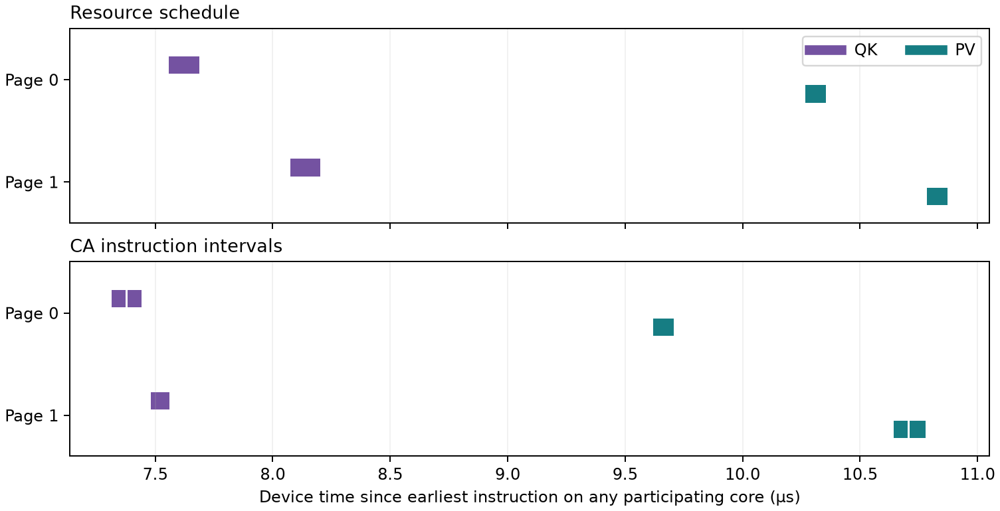

# 3　融合注意力：从一页工作量推到全芯片最后退休

## 3.1　把一次主模型校验还原为本卡任务

设主模型一次接收九行 query。计算采用稠密 BF16 FlashAttention，输入合同按 Q、KV、头宽、batch、头数依次为 [9, 131072, 64, 1, 1]，九行都看完整历史，未使用因果掩码。这是长上下文校验的一种算子形状。实际网络可能分头、压缩 KV 或只访问候选块，使用这些实现时需要先换工作量合同。此处只问一个具体问题：已知输入，每个引擎要做多少工作，最早何时能把九行结果全部交回？

先从调用方计数。共有 9×131072 个有效 query–key 对。一次长度 64 的点积按每次乘加两个标量操作记账，QK 和 PV 合计 $4\times9\times131\,072\times64=301\,989\,888$ ops。两个矩阵乘之间需要求权重。按缩放、找最大、相减、指数、求和与归一六类操作计算，每行的两次归约各少一个操作，得到 7,077,870 个 Vector 等价操作。K 与 V 各占 16 MiB；Q 再增加 1152 B。输出包括九行 BF16 结果和两份按行对齐的 FP32 统计量，共 1728 B。这组数用来回答“请求做了多少有用工作”。要回答设备花了多少时间，还需知道实现怎样填充、切块和重用同一批数据。

在 950PR 上把 batch、头、query 块组成一个任务网格。$B H\lceil Q/128\rceil = 1$，小于 28 个 AIC；当前路线选择每块最多 64 行 query，长 KV 每页读 n=256 个位置。实际行数 m=9，头宽 d=64，故只有一个 query 任务，使用 1 AIC 和 2 AIV。一个 AIV 分到五行，另一个四行。不能直接用全芯片的 378 TOP/s 除总操作数，因为本例没有足够独立的 query 任务用满全片。每页又按最多 128 个 KV 位置分两片，整次需做 512 页×两次矩阵乘×两片 = 2048 条 MMAD。对齐和分工的影响刚好不同：有用工作看九行，矩阵单元看对齐后的十六行，Vector 关键路径看较忙 AIV 上的五行。每一种计数都能在其对应的输出中核查。

## 3.2　阶段定价：同一满页的六个周期数怎样得到

以下公式的时间单位都是目标芯片周期，每微秒有 1000f 个周期，f 是以 GHz 表示的频率。PR 的 f=1.65。资源速率均以该队列的 B/cycle 或该核的 op/cycle 表示。若输入数据尚未到齐，最早发起时刻还要满足数据依赖；因此下列资源需求只给出每页在某一资源上占多少预算。第四章将从另一份 950DT trace 反算其中的服务速率和额外周期，本章先把这些值当作已知参数。

**Cube 矩阵运算。** 设 $m_{16}$、$n_{16}$、$d_{16}$ 为各维向上对齐到 16 的值。QK 或 PV 各自的填充后工作量为 $F=2m_{16}n_{16}d_{16}=524\,288$ ops。PR 每 AIC 的 BF16 峰值是 $378\times1000/(28\times1.65)=8181.818$ op/cycle，其中 1000 完成 TOP/s 和 GHz 的单位换算。理想算术服务为 64.080 周期。已发出的两片还各有启动和依赖成本；从参考指令间隔取得 QK 每片 73.460、PV 每片 40.460 周期。故该页 QK 为 211.00、PV 为 145.00 周期。同一颗 Cube 要做完两种工作，每页 Cube 服务合计 356.00 周期。

**Vector 分数与局部输出更新。** 在线 softmax 随着新页到达更新统计量和输出，处理每页的五份分数等价工作以及三份输出更新工作。令 $r=\lceil9/2\rceil=5$ 表示最忙 AIV 的行数，则两段分别要做 $5rn=6400$ 和 $3rd=960$ 份。5 与 3 是本实现的工作量权重，绝不意味着每个元素恰好发五条或三条 SIMD 指令。以目标有效速率 19.65112 份/(AIV·cycle) 计，两段分别为 325.68、48.85 周期。它们竞争同一 AIV，因此 Vector 需求为 374.53 周期。若将 AIV 团队改成只配一个核，分子里的 r 会从 5 变为 9；只改频率就会漏掉这个变化。

**K/V 搬运。** 一份 K 页有 256×64 个 BF16 元素，每元素两字节，K、V 合计 65536 B。参考单核连续读的局部有效速率是 80.06842 B/cycle。本算例 PR 的整片带宽约束换算成每周期 $1400/1.65=848.485$ B，只有一个团队读；取局部与共享两项中的较小值，所以 R=80.06842 B/cycle。每页读需求为 $65\,536/R=818.50$ 周期。首个 Q 的 1152 B 在本波只记一次。这里的字节是 kernel 要求读取的操作数；真正经过 HBM 控制器的字节还取决于命中和缓存状态。

**L1→L0 与 FIX 搬出。** 同一份 K/V 数据还要经过片上队列。按 BF16 输入计算 QK 的 Q、K 和 PV 的分数、V 四个操作数的对齐占用，L1→L0 字节为 $2[2n_{16}d+m_{16}(d+n_{16})]=75\,776$ B。以 163.42591 B/cycle 除，得到 463.67 周期。FIX 按两份 FP32 中间结果 $m_{16}n_{16}$ 和 $m_{16}d$ 计 $4m_{16}(n_{16}+d)=20\,480$ B，以 115.03598 B/cycle 除，为 178.03 周期。将这两项各记在本队列上，既说明一页如何流过片上缓冲，也避免在冷读写模型中重复收取片外流量。

**页发起节拍。** 在参考宽页路线中，用中段 K/V 描述符的发起时刻与页号估计整页节拍 J。测得 J=853.40471 周期/256 个位置。对本算例，一页含两片，乘以“片数/2”后仍得 853.40 周期。该量包含环槽复用、控制和队列回压等联合效果，很难从一条时间线唯一辨识各自占比。它与刚才 818.50 周期的差值也不是可随意移植的额外启动时间；当目标读带宽变慢时，读资源本身就可能成为最慢项。

| 单页的资源需求 | Cube | Vector | K/V 读 | L1→L0 | FIX | 发起节拍 |
|---|---:|---:|---:|---:|---:|---:|
| 周期数 | 356.00 | 374.53 | 818.50 | 463.67 | 178.03 | **853.40** |

## 3.3　合成整窗：先手算第一页，再引入稳态和排空

以 Q 首次读取发起为局部时间零点。设备开始到该点先付启动开销 10690 周期。令 $L=1106.181$ 为首读响应的固定部分，$g_{\mathrm{K}}=92$ 为首笔 K 相对 Q 的发起距离，$g_{\mathrm{V}}=1992.5$ 为首笔 V 相对 K 的发起距离。三个常数来自参考宽页开发窗的指令边界。将每笔读取的发起时刻、固定响应和字节服务相加，得到数据就绪时刻（周期）。

$$
t_{\mathrm{Q}}=L+\frac{1152}{R}=1120.569, \qquad t_{\mathrm{K}}=g_{\mathrm{K}}+L+\frac{32768}{R}=1607.431.
$$

$$
t_{\mathrm{V}}=g_{\mathrm{K}}+g_{\mathrm{V}}+L+\frac{32768}{R}=3599.931.
$$

三个读请求可以重叠，QK 只等 Q 和 K。对同一读口把 Q、K 的就绪时间与合计字节的服务下界取最大值，再加 174 周期的 L0 首发准备。V 此时仍未到齐。

$$
s_{\mathrm{QK}}=\max\!\left(t_{\mathrm{Q}},\,t_{\mathrm{K}},\,\frac{1152+32768}{R}\right)+174=1781.431.
$$

按上述服务，QK 与必要的第一段 Vector 工作在 $1781.431+211+325.681=2318.112$ 周期后就绪。PV 要等 QK 与前段 Vector 工作完成，也要等 V 到齐。令 $C_{\mathrm{QK}}$ 和 $C_{\mathrm{V},1}$ 分别为前两项的周期数，随后还有 2652.5 周期的队列交接。PV 占 145 周期，首轮跨度为 3.877 µs。

$$
s_{\mathrm{PV}}=\max\left(t_{\mathrm{V}},\,s_{\mathrm{QK}}+C_{\mathrm{QK}}+C_{\mathrm{V},1}\right)+2652.5=6252.431.
$$

若把 325.681 周期再加到 V 到达之后，就会重复计入已经藏在等 V 期间的工作。

图中上栏是模型、下栏是 950DT 原生 CA，两栏共用全设备最早指令零点，仅绘制前两页。每个有色模型区间表示一页同类矩阵指令的服务跨度，CA 则逐条画出两片实际指令；坐标以 µs 计。第 1 页的 QK 在第 0 页的 PV 之前已经推进，这直接解释为什么连续分页可以少付许多等待。图的横向空白只表示所选 Cube 指令之间的间隔，其他 DMA 或 AIV 可能正在执行。图中的 DT 数据与上面的 PR 手算用于对照同类路径，图下栏没有借用 PR 时间戳。

稳态时，同一资源的服务先相加，可由不同资源并行承担的需求再取最大值。因而每多推进一页，就支付下列间隔。第一页已算完，余下 511 页共需 $511I/1650=264.297$ µs。

$$
I=\max(356.00,\ 374.53,\ 818.50,\ 463.67,\ 178.03,\ 853.40471)=853.40471\ \mathrm{cycles}.
$$

针对这一工作量，若其他价格保持不变而读速率降到 $65\,536/853.40471=76.794$ B/cycle 以下，稳态瓶颈将转为读口。若最后一页不足 256 个位置，就按尾页的有效 n 重新求字节、对齐量与片数；当只有一页时，稳态项为零。这些边界正是按页合成优于按序列长度套一个固定倍率的原因。

最后，终端 AIV 还要完成输出更新和写回。输出为 1728 B，第二段 Vector 成本为 48.852 周期；末端剩余控制 482.359 周期，写端在此例取 80.06842 B/cycle，排空共 $(48.852+482.359+1728/80.06842)/1650=0.335$ µs。将启动、首页、续发和排空相加，可复算整窗。

$$
T_{\mathrm{FA}}=6.479+3.877+264.297+0.335=274.988\ \mathrm{\mu s}.
$$

此处只有一个团队；有多个任务波时要按每波最慢团队和实际行数再求首轮、续发与尾部，整个 kernel 只支付一次启动。本算例的目标输出由此可复算，下一章将倒过来追问这些价格的依据。

本节复核材料：[FA 调度实现](../../src/operator_model/operators/attention/resources.py)、[目标参数](../../src/operator_model/data/parameters/attention_resources.json)、[两个 950 的逐窗误差](../errors/fa.md)。
