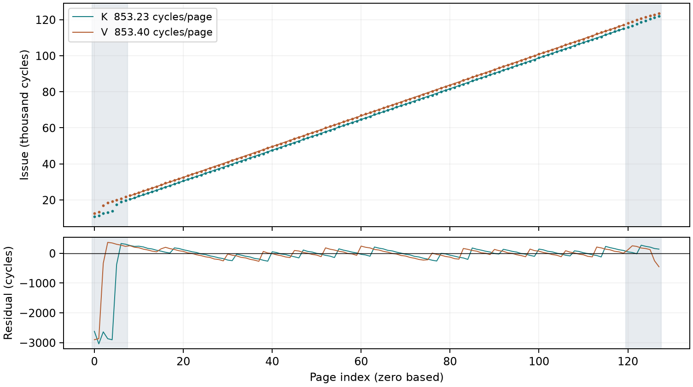

# 4　CA 校准：从原始指令时标到可以迁移的参数

## 4.1　先界定观测，才知道一个参数能回答什么

目标是求持续发起一页所需的周期。如果只拿一个 128Ki kernel 的总时间除以 512，得到的数同时包含启动、首轮等待和末尾排空。这样即使能复现长窗，也回答不了只有一页时该花多久。因此在看总误差之前，我们先规定观测对象：用 950DT 的完整开发指令窗提取局部服务与控制参数；对于 950PR 的 128Ki 算例，只把相同实现路线和新芯片资源代入，再对照 CA。FA 发布校准集在误差总表中归为开发回放；PR 128Ki 没有参与这次 DT 参数计算，并不意味着整个 FA 算子已获得一套冻结独立样本。

本例执行接口为 CANN 9.2.1 ops-transformer 的 aclnnFlashAttentionScoreV2。128Ki 归档中，DT 的记录入口为 entry_kernel_2050000040140220，PR 的记录入口以 FlashAttentionScore_50348df0 开头、以 mix_aic 结尾。两端名称分别来自各自采集链。为防止同名不同实现，收据同时保存芯片、shape、输入合同、入口和工件指纹。DT 128Ki 的数值校验有 576 个注意力输出、零个超差；划定时间窗时还要检查参与核的开始和最终退休。该窗最后结束的是 AIV，因此只截最后一条 Cube 指令会漏去尾部。端到端系统还可能有核外准备或多次 kernel 发射，是否计入应由调用图另行说明。

## 4.2　从数据库取出两条读流

用作稳态标定的是另一个 DT 输入 [9,32768,64,1,1]。每页 256 个位置，全程只有 128 页。本报告从归档的原始 SQLite 数据库按只读方式重提数据，核对文件 SHA-256 与证据记录一致。表 ExecutedInstructions 的 ExecInstrTickStart、ExecInstrTickEnd 分别给出整数发起刻度与退休刻度。先看所有核，取最早刻度 5938 为统一零点；再在物理 AIC 0 上保留计时有效的 MOV_OUT_TO_L1_MULTI_ND2NZ 指令，并核对扩展字段中的源为 OUT、目的为 L1、processed_bytes 为 32768。Q 的首次小读取由此自然排除，同一时刻的标量或同步事件也不会混进数据流。

这份已知缓冲布局的运行里，按源地址排序，前 128 条构成连续的 K 页，后 128 条构成连续的 V 页。排序使用地址是为了得到逻辑页号，并未丢弃指令的实际发起时序。换一次分配地址应重新识别 K/V 基址和页大小，不能把一次运行的绝对地址写成识别规则。下表是实际读取的少量原始时间戳，供手算。最后一列举 K 流，V 行按同样方式处理。

| 页号 i | K 发起／退休，绝对 tick | V 发起／退休，绝对 tick | K 发起减全局零点 |
|---:|---:|---:|---:|
| 0 | 16762／18164 | 18522／19752 | 10824 |
| 8 | 26472／27621 | 28505／29450 | 20534 |
| 19 | 35756／36675 | 37725／38650 | 29818 |
| 27 | 42304／43221 | 44273／45194 | 36366 |
| 119 | 121013／121932 | 122982／124307 | 115075 |

第 0 页 K 的响应耗时为 $18\,164-16\,762=1402$ 周期，V 为 1230 周期。相邻 K 的第一、二次发起只相距 $11\,257-10\,824=433$ 周期，第二次发起时第一次还没有完成。这里已经能看出为什么“读需要多久”和“多久能发下一次”必须分别建模。在本次复核中，两条流共 256 个发起时刻，扣除统一零点后与随仓发布的事件摘录逐项相等。原始数据库可安置在仓库外，随文的整数序列足以重算后面的服务率与斜率。

## 4.3　从同一条时间线区分服务速率和持续发起间隔

先估 K/V 在较顺畅阶段的局部读服务率。对候选起点 i=8…111，计算从 i 到 i+8 页两条流各自的发起跨度，取两者中较长的一个，再从这些八页区间选最短跨度。第 19→27 页满足这个条件，K 跨度 $36\,366-29\,818=6548$ 周期，V 跨度 $38\,335-31\,787$ 也是 6548 周期。其间推进了八个完整页，每页两份 32768 B 数据，据此估计局部读服务率。

$$
R=\frac{8\times65536}{6548}=80.06842\ \mathrm{B/cycle}.
$$

这是特定路线在该窗口的有效服务速率，包含真实地址和队列条件；作为局部参考价格时还需在目标芯片上检查每核端口与共享带宽。

接着允许流水中正常发生的等待也进入计量。在 128 页中预先去掉首尾各八页，避免用初始化与排空估计稳态。对第 $i=8,\ldots,119$ 页的每条流拟合 $t_i=a+bi$，其中 $t_i$ 是相对发起周期，$\bar i=63.5$。中心化后的页号之和为零，斜率可写成

$$
b=\frac{\sum_{i=8}^{119}(i-\bar{i})\,t_i}{\sum_{i=8}^{119}(i-\bar{i})^2}=\frac{\sum_{i=8}^{119}(i-63.5)\,t_i}{117\,068}.
$$

K、V 的分子为 99885909.5 和 99906383，除以同一分母，斜率分别为 853.22983 和 853.40471 cycles/页。两条流均需前进，模型取较慢的值 J=853.40471。去掉两端各八页是这个开发窗选定的截取规则；改变页大小、缓冲深度或出现明显阶段切换时，都应重新检查稳态区。112 个点能约束这里的斜率，误差统计仍只增加一个开发窗。

上图每个点对应一条真实 K 或 V 描述符，纵轴以千周期表示；下图以周期表示实际点减拟合值。灰色区域未参与拟合，着色直线只覆盖第 8 至 119 页。只看上图会觉得两条线几乎平直，下图可见队列的局部起伏。把这些微小起伏放回全局看，J 衡量长时间持续推进的节拍，R 衡量较顺畅的八页区间可以提供的字节速度。首例若把 818.50 与 853.40 相加，就把持续发起间隔里本已发生的供数工作再收了一遍。

## 4.4　识别其余参数，核查每一项的分子和分母

参考 DT 每核 BF16 峰值为 $432\times1000/(32\times1.65)=8181.818$ op/cycle。宽页路线的两个开发窗分别采用 KV=4096 和 32768。取首页同一类两片 MMAD 从首个发起到第二个退休的跨度，两窗 QK 都是 211，PV 都是 145 周期。按填充后算术量，每种乘法的理想服务是 $524\,288/8181.818=64.0796$ 周期。扣去理想服务后除以两片得到每片剩余 73.4602、40.4602 周期。这两个剩余量代表实现、发起和依赖的共同成本。用分形维度计算发出工作量可以跨 shape 迁移；继承两片之间的额外周期则需要同一执行路线。

MTE1 和 FIX 的价格采用队列忙时。将符合计时条件的区间按起止点排序，重叠区间只计一次，避免把重叠退休的指令持续时间反复加起来。在同一 DT 32Ki 窗，AIC 0 的 MTE1、FIXP 并集分别为 59350 和 22788 周期。以每页 75776、20480 B 乘 128 页再除以各自的并集，下式复算两种有效速率。

$$
R_{\mathrm{MTE1}}=\frac{128\times75\,776}{59\,350}=163.42591,\qquad R_{\mathrm{FIX}}=\frac{128\times20\,480}{22\,788}=115.03598\ \mathrm{B/cycle}.
$$

它们是各队列对应用途的有效速率。在同一算例中将两个不同硬件队列的忙时加起来，不能还原整窗，因为两者允许并发。

Vector 的解释尤其重要。DT 两路 AIV 的计时 SIMD 区间合并后是 45828、46672 周期。按较忙核每页 5 行、每行 5×256+3×64 份等价工作核算，有效速率为 $128\times5(5\times256+3\times64)/46672$，即 20.18512 份等价工作/周期。迁移到 PR 时，再乘目标与参考每 AIV 的 FP32 配置峰值比，得到 19.65112。这里仅有“等价工作/吞吐”的比值被时标约束；如果同时给所有等价工作权重和有效速率乘同一个系数，预测并不会改变。因此这项速度用于相同计数定义和指令路径，不应解释为芯片手册中的某条单指令吞吐。

最后校准固定边界。两份宽页开发窗中，全设备开始到 Q 首读发起分别为 10648 和 10732 周期，中位数 10690。首批 Q/K/V 各描述符的观测响应减去其字节数除以 R，剩余取非负，并在两窗的六项观察中取中位数，得到 1106.181 周期。类似地从 Q/K 均齐到 QK 发起读出 174 周期。对于 PV 交接，必须先扣掉上游等待期间还可见的 Vector 时间，两窗均因 V 到得晚而已覆盖第一段向量计算，最终得 (2516+2789)/2=2652.5 周期。末次 PV 退休到所有核结束分别是 530、573 周期；用其中位数减去已计入的 47.560 周期末段 Vector 服务和 21.582 周期输出传输，得到 482.359 周期的排空控制。这些参数说明即使某段当前数值近似常数，其计时边界也必须明确：以后若把某个写回移到 kernel 外，该参数的含义就会发生变化。

## 4.5　从阶段残差判断预测是否可信

固定上述参考价格，再对 128Ki 算例回放。DT 的模型第一条 QK 在 7.558 µs 发起，CA 在 7.315 µs，模型慢了 0.244 µs。到最后一页，模型 QK 在 271.855 µs，CA 在 273.460 µs，此时模型早了 1.605 µs。末页 PV 的预测退休为 274.653 µs，CA 两片中较迟的退休为 274.502 µs，偏差又换了方向。最后一个 AIV 退出时，模型整窗 274.987 µs，CA 274.821 µs，相差 0.166 µs。这个不足千分之一的总误差包含阶段抵消，不能当作各个阶段也精确到千分之一的证据。读取 CA 的指令维度时还要记录缺失信息；例如该窗部分 PV 片缺几何字段，可用本二进制的指令地址与每页两片时序分组核对，但不宜把这些字段记为直接观测。

PR 在相同 128Ki 输入上预测 274.988 µs，CA 为 265.893 µs，多估 9.095 µs，约 3.42%。两端总体时间的比值也有信息：预测的 DT/PR 约为 1.000，实测约为 1.034。两个 SKU 在这个稀疏任务网格中都只启用一个 AIC、两个 AIV，每核 Cube 吞吐相同，且共享带宽均未压过局部读约束，所以模型给出近乎相同的价格。这个双端对照支持算法和分核层面的迁移，也暴露了继承相同控制节拍时难以预测小幅芯片差异的局限。没有 PR 同口径的逐队列归因时，不能把这 9.095 µs 全归给 HBM、MTE2 或某个调度器。本例的任务是展示可复算的校准链路；完整精度判断还要结合全量跨 shape 的误差表。

复算路径为：从原始 DB 重提 K/V 时标时，给 [论文绘图脚本](../../calibration/examples/paper_fa_figures.py) 传入对应数据库路径；不带数据库则使用[归档原始点和开发窗观测](../../calibration/examples/fa-950dt.json)直接重绘。运行 [replay_fa.py](../../calibration/examples/replay_fa.py) 可重算七个共用资源价格和两条路线各九个固定价格，最后逐项比对发布参数。对 128Ki 核对阶段残差的每页指令时刻保存在[逐核图数据](../examples/assets/fa.json)，两个 SKU 的设备整窗、实现身份和数据角色可查[逐窗清单](../../calibration/reference/windows.jsonl)。
