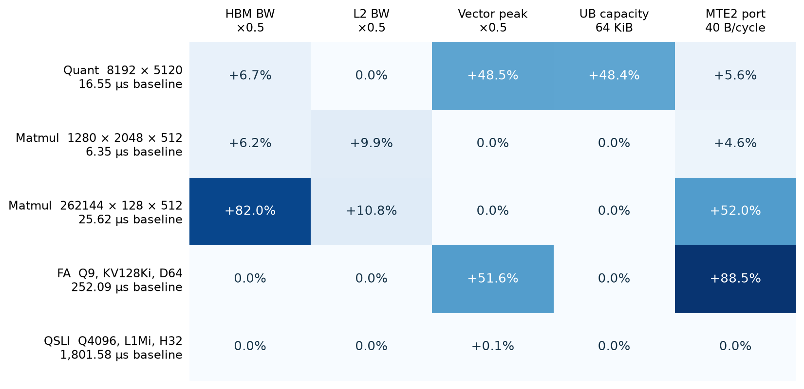

# 5　从 950 校准到 970 架构情景

同一个 BF16 矩阵乘在两张卡上做多少次有用乘加，可以从矩阵维度回答。它要搬几次输入、最后一批工作占几个核、相邻两条指令能否重叠，却要看采用哪一种实现。本文对 970DT 的预测建立在一个可检验的条件上：目标库继续使用与 950 相近的算法和数据通路，允许按目标资源重新选择分块与分核。在这个条件下，可以把已知工作重新分给目标硬件，并为每段工作重新计算服务时间。目标芯片还没有可用的整窗测量，以下 970DT 数字均为这个实现情景的外推。

## 5.1　哪些量可以带过去

把一次调用分成四层，迁移时逐层检查。第一层是数学工作，例如稠密 Matmul 的有效算术量为 2MNK，M、N、K 分别是输出行数、输出列数和归约长度，乘加算两次。第二层是实现附加的工作。同样的 2MNK，在窄尾块上可能要把操作数补齐；把 K 切成几页决定装载次数；混合精度还可能引入反量化和二次量化。第三层是资源定价，同样一页的数据在不同芯片上受到每核搬运口、共享缓存、HBM 以及并发核数的共同限制。第四层是依赖和同步。读入尚未退休时，依赖这批数据的首条 MMAD 需要等待；缓冲区足够时，下一页读入可以与当前页计算并行。因而保持第一层通常容易，第二、四层需要实现契约，第三层需要目标芯片配置。

这一区分也限定了能引用的架构证据。950 的 Mmad 接口规定 A/B 操作数经 L0A/L0B，累加写 L0C，并对布局、对齐和同步有要求。它使模型有理由分别计算 GM→L1、L1→L0、MMAD 和结果搬出，也解释了为什么首条指令前会出现空隙。这些资料覆盖 950；对于 970，页大小、缓冲槽数、发起间隔和同步代价仍假定沿用或按资源推导。若新库换用持久化调度、跨核归约、不同页布局或新的原生混合精度指令，必须替换相应的实现路径。[950 Mmad 接口](https://gitcode.com/cann/asc-devkit/blob/639b2b5c1031188107d23d785d52b935f1b4f13b/docs/zh/api/SIMD-API/basic_api/cube_compute_ISASI/mmad_compute/Mmad.md)

| 一个调度域的配置 | 950DT | 950PR | 970DT 情景 |
|---|---:|---:|---:|
| 频率 GHz；AIC / AIV 核数 | 1.65；32 / 64 | 1.65；28 / 56 | 1.80；120 / 120 |
| Cube 16 / 8 / 4 位，万亿操作/s | 432 / 865 / 1730 | 378 / 756 / 1513 | 1770 / 3540 / 14160 |
| Vector 16 位，万亿操作/s | 54 | 47 | 110.592 |
| HBM 容量 GB / 总带宽 TB/s | 103.079 / 4.0 | 120.259 / 1.4 | 288 / 14.4 |
| L2 容量 | 128 MiB | 112 MiB | 200 MB；总带宽 30 TB/s |
| 每核 UB / L1 容量 | 248 / 512 KiB | 248 / 512 KiB | 继承 248 / 512 KiB |

950 的核数、频率和容量来自 CANN 9.2.1 对应 SKU 的平台配置，峰值取与核数匹配的 950 白皮书档位。PR 的 1.4 TB/s 通过容量档位匹配得到。970 的核数、频率、Cube 峰值、HBM 和 L2 出自用户给定情景；Vector、每核缓存及 MTE 采用假设。GB 与 TB 按十进制，KiB 与 MiB 按二进制。配置允许的 HBM 容量主要决定工作集能否放入显存，容量本身无法推导一次读取的服务时间。分块器实际使用哪些层次的容量也与算子有关，配置中写有一个容量并不保证每条算子路径都据此重选分块。[DT 配置](../../src/operator_model/data/chips/Ascend950DT_9582.json)；[PR 配置](../../src/operator_model/data/chips/Ascend950PR_957b.json)；[970 情景及字段来源](../../src/operator_model/data/chips/Ascend970DT.json)

## 5.2　从整卡峰值还原一核一页的价格

设 P 为某种精度的全卡峰值（万亿操作/s），C 为该类核数，f 为 GHz。每核每周期可服务的操作数为 `r = 1000P/(Cf)`。BF16 Cube 在 950DT 上为 `432000/(32×1.65)=8181.82`，在 970DT 上为 `1770000/(120×1.8)=8194.44`。两数接近，说明在该情景下，一个同样大小、对齐方式相同的 BF16 块，在一核上的纯算术周期基本相当。更多核能让更多块同时开始，却无法让一个不可切分的小块占据整片芯片。给定整卡 P 后，核数和频率已经包含在峰值中，换算每核成本时应各除一次。

对 MXFP4，若每核每周期的 4 位服务密度再增一倍，`1730×(120/32)×(1.8/1.65)×2≈14154.55`。配置采用给定的舍入目标 14160，并由 1∶2∶8 得出 1770、3540。要享受 4 位的密度，需要目标实现真正执行 A4W4 原生计算。如果先将 W4 展开到 8 位再做 A8W8，则读权重可按 4 位定价，计算要用 8 位价格，还要计 scale 读取、解码及展开数据的片上服务。输出若有额外低精度转换，需依据接口契约单独计入。[混合精度算例](../examples/mxfp4-design.md)

Vector 的假设是每个 AIV 每次可完成 128 个 16 位乘加，每周期双发射。按 `120×1.8×128×2×2/1000=110.592` 得到整卡万亿操作/s。由此 Cube16/Vector16 从 8 变成约 16。这个比例描述全卡峰值；单个 FA 工作组能否得到两个 AIV，要另看核绑定以及剩余空闲核。独热归约、指数、排序、控制指令也各有自己的指令组合，它们相对 16 位乘加峰值的效率需要独立证据。默认 970 FA 把每个工作 AIC 配一个 AIV，未知 MTE 则继承相应 950 路径的有效 B/cycle 与响应周期。

还可以从搬运看出核数与整卡带宽怎样独立起作用。设一个波次共有 a 个活跃读核，每核持续端口上限为 b B/cycle，全片可用带宽为 H GB/s。若各核搬运相同字节、同时访问，各核平均分到的速率至多为 `min(b,H/(fa))`，所有核合计至多 `min(ab,H/f)` B/cycle。实际实现还要区分被缓存满足的字节和必须送到 HBM 的字节，首次响应与收尾则单独收费。以本章长 FA 为例，只有一个 AIC 读数据；即使把 970DT 的 HBM 总带宽从 14.4 减到 7.2 TB/s，单核所得的全片带宽上限仍远高于继承的本地端口，两次预测一致。相反，大投影铺开许多核时，它们会先后使共享链路饱和。看到一次搬运只用了很小比例的全卡带宽，应先看并发核和每核持续请求的数量，再解释为局部实现的效率损失。

## 5.3　950PR 能检验到哪一步

两张 950 在同频下具有相同的 BF16 每 AIC 峰值，核数、共享缓存容量和 HBM 带宽不同。可以利用同一 shape 同时检验整窗和快慢方向。表中 `S = T_DT/T_PR`，大于 1 表示 PR 更快。以下以 CA 整窗对应的 `ca_window` 为准，均为设备微秒数。同一列选取的几行用于解释机制，整套样本统计见误差章。

| BF16 输入，shape 顺序见算子名 | DT 预测 / CA | PR 预测 / CA | S 预测 / CA |
|---|---:|---:|---:|
| FA，Q9，KV131072，D64，B1 H1 | 274.987 / 274.821 | 274.988 / 265.893 | 1.000 / 1.034 |
| DynamicMXQuant，[行,列] = [9,5120] | 4.980 / 4.867 | 4.377 / 5.025 | 1.138 / 0.969 |
| Matmul，[M,N,K] = [1280,2048,512] | 12.449 / 12.219 | 14.027 / 13.218 | 0.888 / 0.924 |
| Matmul，[M,N,K] = [262144,128,512] | 85.246 / 85.993 | 176.124 / 174.953 | 0.484 / 0.492 |

长上下文 FA 是较干净的迁移试验。两卡都执行 512 页，用一个 AIC 和两个 AIV，页循环采用同一套 DT 校准的周期成本。两卡模型值几乎相同，PR 实际比 DT 快约 3.4%。这说明该方法捕捉到了共同的长循环成本，尚不能分辨这两台模拟目标上几微秒的差异。中等 Matmul 则因为分块改变而出现较大的、方向正确的变化：DT 的两批工作各占 32 核；PR 满波和尾波分别占 28 和 24 核，块尺寸和竞争共享端口的核数均要重算。若对整窗只乘 32/28，将错过尾波工作量的变化。[FA 算例](../examples/fa.md)；[Matmul 算例](../examples/matmul.md)

并非每一行都能作为只用 DT 校准的盲测。大 Matmul 的 PR 模型使用了从其他算子读取阶段取得的约 1562 GB/s 的初始逻辑读服务，它包含缓存服务；物理 HBM 仍是 1400 GB/s。Quant 的 PR 首发和读延迟也分别使用了该 SKU 旧 trace 中的 4253、954.12 周期。在 [9,5120] 上两端均用 45 个 AIV，PR 模型仍把实际放慢预测为加快。字段测准并不保证短窗内的核到达、读数据依赖和小写回同时预测准确。RMSNorm 的首发同样有来自 PR 的校准。故 950PR 可检验分核和资源模型，也揭示了部分跨 SKU 阶段价格需重估；它无法给未知代际提供一个保证成立的误差上界。[Quant 算例](../examples/quant.md)；[Matmul 全样本](../errors/matmul.md)

## 5.4　970 对哪些未知量敏感

为检验上述假设的实际影响，固定 shape、dtype 和 `cold_io` 口径，通过公共 `estimate` 入口对 970DT 配置一次改一个字段，每次重新规划。图中每行左侧是基准预测，格中百分数是替换该项后相对基准的延迟变化。MTE2 列将每个活跃端口设为 72 GB/s，在 1.8 GHz 下即 40 B/cycle。UB 列从每个 AIV 248 KiB 减到 64 KiB。两者都是用于辨认瓶颈的备选输入，改动幅度没有目标芯片的实测概率含义。

对大 Matmul [262144,128,512]，模型要求交付大量输入输出，HBM 带宽减半，耗时由 25.617 升至 46.622 µs，增加 82%。而 [1280,2048,512] 从 6.350 升至 6.745 µs，增加 6.2%；后者换到较低 HBM 带宽时，规划器还把活跃 AIC 从 117 改为 112。Quant [8192,5120] 则对 UB 敏感：64 KiB 使它从 16.551 增至 24.566 µs，分块容量影响片内循环，即使总元素数和 HBM 带宽完全相同，也会改变整窗。QSLI 一行采用 1Mi 上下文、4096 个查询、32 个头、D128、2048 个候选槽、保留 512 条结果和 8201 个表页的设计情景。它在上述扰动下的输出变化很小，这仅说明当前工作分配、候选页模型和控制间隔在这些输入下占主导。若候选集合、重复页分布或归并实现改变，需要重算候选工作及依赖。[敏感性复算脚本](../../calibration/examples/paper_transfer_sensitivity.py)

从分块记录可以分辨 Quant 曲线为什么会弯折。基准情景和小 UB 情景都分到 120 个 AIV，最忙核负责 683 行、每行 512 列。基准一次装入 76 行、每块 1216 个量化组，最多执行 9 轮。64 KiB 时一次只装下 19 行、304 个组，最多执行 36 轮。两次调用的逻辑输入均为 83,886,080 B，输出均为 43,253,760 B；差别出现在更频繁的片内循环、读写发起及缓冲槽周转上。派发段保持 2.926 µs，UB 流水暴露时间由 13.616 增至 21.632 µs。这个例子将容量假设引起的偏差定位到了可以日后复核的两个量：每块行数与忙核循环次数。仅按总字节数外推，两个情景会给出同一个答案。

长 FA 给出了一个能手算的阈值。每张 K/V 页共读 65536 B，DT 拟合的相邻页控制间隔为 853.405 周期。两项相等时端口速率为 `65536/853.405=76.79 B/cycle`。基准沿用 80.068 B/cycle，读服务只比控制间隔稍短。一旦改为 40 B/cycle，读服务增加到 1638.4 周期，511 个后续页反复付出差额。仅这一项增加 `511×(1638.4−853.405)/1800≈222.85 µs`，与公共 API 重排首尾后的增加量 223.08 µs 相符。由 950DT 的 274.987 µs 到 970DT 基准的 252.093 µs，速度约为 1.091 倍，与频率之比接近；同一 970 假设下将 Vector 峰值减半则升至 382.052 µs。整卡核数、整卡带宽或 Cube 峰值任何一项单独变化，都不足以决定这条流水线的快慢。

## 5.5　如何解释外推误差

给一个阶段换价格后，只有其暴露在关键路径的部分会改变整窗。若某阶段处理 B 字节，速率为 R B/cycle，且在当前排程中独占了整窗的比例 w，对很小的速率扰动可写成 `ΔT/T ≈ −w×ΔR/R`。相反，如果受限的是页发起间隔 J 周期，N 页的稳态部分对每周期误判的响应为 `ΔT ≈ (N−1)×ΔJ/(1000f)` 微秒。第一式来自对 B/R 求变化率，第二式来自直接对重复 N−1 次的页间隔求差。它们都要求关键路径与分块策略在扰动后保持不变。图中的大幅改动已允许换瓶颈或换分块，因此采用完整重算。

两个 SKU 的加速比还多一层不确定性。设模型在 DT 和 PR 的相对误差分别是 e₁、e₂，由加速比定义可得 `S预测/S实测 = (1+e₁)/(1+e₂)`。例如 Quant 的 DT 约高估 2.3%，PR 约低估 12.9%，两端误差方向相反，速度比便偏高约 17.4%。哪怕两个孤立的整窗看来都只有亚微秒残差，它们也足以反转约 3% 的真正变化。反之，若两个 SKU 同样缺了一段固定开销，孤立端点都可能偏快，而速度比仍接近观测。解读迁移必须保留双端绝对时间、相对误差和方向三项。对于未来的 970，尚无第二端观察值，图中可得的是输入假设改变时结论是否稳定，不能据此给出有统计覆盖保证的误差区间。

实际使用时，值得先问某项假设若错了，预测会向哪里偏。忽视额外解码、把低精度指令当作原生、假定页间复用比实际更多，均容易低估耗时；对已保留在 L2 的数据反复按冷 HBM 计费，则容易高估。复用 950 的固定周期数意味着同一延迟随频率变快，若目标电路受固定纳秒级延迟约束，外推也会偏快。启动、MTE 和缓存队列都混有实现与模拟器行为，误差可能相关，单因素百分数不能相加。应随预测一起保存芯片情景、精度路径、活跃核、页数、缓存条件和当前关键约束。若未来可取得目标测量，先用同一条流的首发延迟与连续发起差区分延迟和吞吐，再用高并发测共享端口、用接近容量边界的两侧测分块切换，最后另留整窗检验各阶段合成。970DT 在此之前能回答在给定设计下何种资源值得优先确认，绝对时间及世代加速比始终带有这些实现条件。
