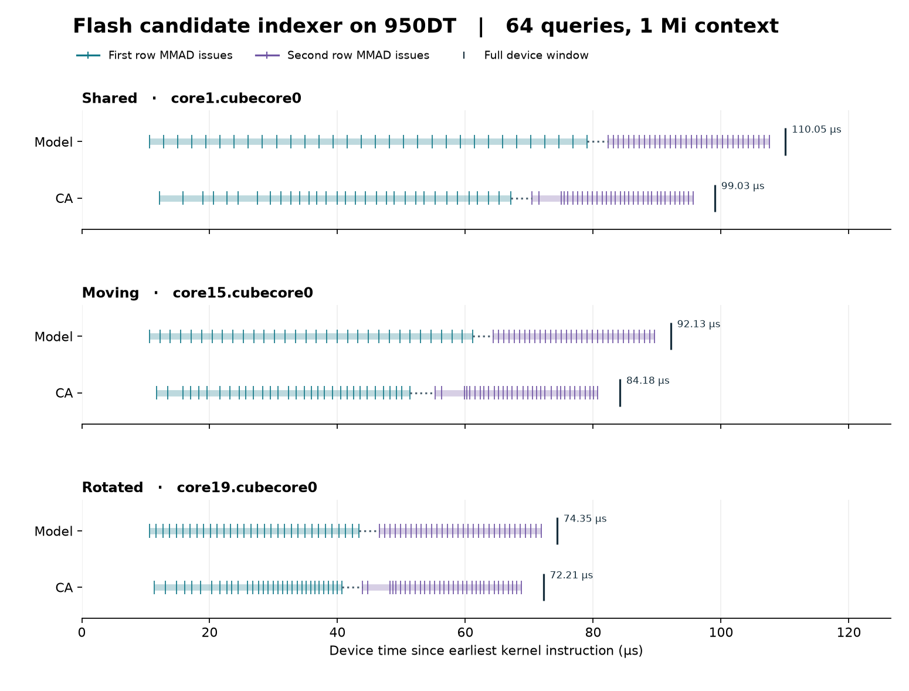

# 6　预测与 CA 相差多少

## 6.1　什么算作一个有效样本

假设两个预测器对同一条 CA 记录各预测一次，一次只接收 shape，另一次接收正确的前序。比较这两次预测可以衡量额外输入的价值，却不能说做了两次独立实测。本文的计数单位是“执行合同下的对照窗”。同 shape 的不同运行可有多窗，同一物理运行也可供不同输入合同复算。每张表同时注明形状、窗口和样本角色。没有完整计时的实现记 N/A；只有组件实测时，仅组件拥有计时资格。

对每项执行合同，令 $c_i$ 与 $p_i$ 分别为第 $i$ 个完整 CA 窗及其预测耗时。带符号误差为 $e_i=100(p_i-c_i)/c_i$，正值表示预测过长。下列指标的单位均为百分比。

$$
\mathrm{WAPE}=100\frac{\sum_i |p_i-c_i|}{\sum_i c_i},\qquad E_{\max}=100\max_i\frac{|p_i-c_i|}{c_i}.
$$

前者按设备时间加权，后者会暴露持续时间很短却预测偏得很远的窗。对系统图，还要用实际调用频次衡量代价；同一个 4 µs 偏差重复数万次，影响可能大于一个孤立的大窗。

模型开发中用于选机制和定参数的记录都归开发回放。冻结后才揭盲的新形状才有资格检验未见输入。当某组曾经的留出数据用于下一版选模型，便要改记为开发数据。本研究基础校准集共 2,060 条开发记录、120 条冻结独立记录；30 项合同有双端计分、28 项在各自计分集上达到双端各至少十种形状、WAPE 不超过 25%、最大绝对误差不超过 50% 的标准。28 项中的 5 项有双端冻结独立支持。第 6.3 节另列后来采集的同形状布局实验。[基础逐窗数据](../../calibration/reference/windows.jsonl) · [全部合同的证据索引](../errors/README.md)

## 6.2　从平均指标走到具体误差

| 输入合同 | DT WAPE / 最大 | PR WAPE / 最大 | 这组证据能回答的问题 |
|---|---|---|---|
| DynamicMXQuant，BF16→MXFP8 | 4.74% / 13.61% | 7.71% / 16.83% | 开发回放，分块、搬运、首发的联合解释 |
| BF16 Matmul | 3.66% / 29.01% | 5.20% / 15.06% | 开发回放，含不同核数和波数 |
| BF16 FA | 1.84% / 12.43% | 5.05% / 17.72% | 开发回放，长循环同形状的跨卡偏差见第 5 章 |
| A4W4 Matmul | 3.89% / 13.59% | 6.87% / 14.50% | 每端十个独立投影，原生乘加 |
| A8W4 Matmul | 8.80% / 35.73% | 11.32% / 56.67% | 每端十个独立投影，PR 有明显高估 |
| RMSNorm，默认 msopprof 窗 | 17.94% / 49.86% | 18.55% / 49.61% | 行归约、首发和写回重叠仍有较大差异 |
| RMSNorm，传可见前序 | 5.35% / 20.16% | 5.98% / 24.37% | 该合同的 120 个回放窗，样本集与上一行不同 |

DynamicMXQuant 对分组中的元素作局部取最大，再计算尺度、转换格式并写回。RMSNorm 则要等一行的平方和归约完成，才能把逆均方根用于归一化；一行被如何拆分以及中间状态能否留在 UB 都会改变依赖。前者拟合良好并不意味着可对后者照搬每元素价。RMSNorm 传前序的行与默认行并非同一完整样本集，不能用表中 WAPE 直接计算信息带来的净收益。mHC Post 有一个更干净的配对实验，适合回答这个问题。

在同一设备、同一形状、同一 CA 耗时上，给 mHC Post 分别喂 shape 或有序流输入，得到 239 对。短而宽的组按 token≤16 且通道≥2048 定义；该分组只用于分析误差。表内的 WAPE 是各组独立重算，最后一列是绝对误差严格减小的窗数。这避免了把不同测试分布的变化归给模型。

| 芯片与输入组 | 配对窗 | 只传 shape | 传有序流 | 改善窗 |
|---|---:|---:|---:|---:|
| DT，短而宽 | 32 | 34.41% | 7.55% | 28 |
| DT，其余 | 119 | 26.19% | 8.60% | 86 |
| PR，短而宽 | 9 | 37.29% | 8.77% | 9 |
| PR，其余 | 79 | 27.21% | 6.66% | 68 |

这个结果支持“执行历史携带了 shape 看不见的信息”。它没有把所有误差都归于某一条指令：同一输出几何可能遇到首次启动、扩核或前次已经用过相同核组。有序流能约束启动条件，仍有未改善的窗。系统捕获能可靠提供调用顺序时应保持该顺序；只有 shape 时应保留较宽的误差预期。[只传 shape 的逐窗结果](../errors/mhc_post-shape.md) · [有序流的逐窗结果](../errors/mhc_post-stream.md)

另一种失败发生在输入相当明确的 A8W4 稠密投影。950PR 的独立 [8192,128,512] 上，模型为 13.3124 µs，CA 为 8.4970 µs，多出 4.8154 µs，误差 +56.67%。总 WAPE 11.32% 掩盖了这一点。在同一逐形表中，[4096,128,512] 为 8.4976 对 7.0376 µs。加大第一维后，预测耗时增加约 4.81 µs，参考仅增加约 1.46 µs。分核、权重展开及其与多波计算的重叠都会影响这个增量；整窗数字只能定位现象，不能独立辨别其中哪一项。第 2 章给出应对齐的事件，第 8 章给出可区分这些解释的实验。[双端逐形误差与 kernel 身份](../errors/matmul_mx_mixed.md)

## 6.3　Flash 候选索引器：只改页序会怎样

索引器随图输入可能选不同实现。这里研究 A5 原生 QSLI 的固定 metadata kernel，Q/K 按 MXFP4 与 E8M0 scale 存储。候选页 ID 决定每个 query 读哪些物理页及次序。点积、带权头归约、筛选和跨团队合并安排在不同计算与搬运资源上。输入维度一致时，各核是在同一时刻读同一页，还是错开读不同页，仍然可能改变完成时间。普通 Lightning Indexer、显式分解调用和完整服务的前后处理各有不同的窗口。

早期把同核间距按独立行计价，在 PR 的 Q32 单波预测 93.039 µs，CA 为 59.568 µs。复用原 trace 中每一条 MMAD 的发起时刻，再按实际团队分行、识别可接续的行，并用候选页序区分并发工作，已知页序回放得到 54.992 µs。旧 DT Q64 的 CA 为 80.133 µs，修订的已知布局为 74.206 µs，shape-only 为 92.129 µs。这两组参与机制选择。仅靠它们不足以断言公式捕捉到了真正的页序效应，因此增加了一个刻意保持 shape 不变的对照。

三臂都使用同一个 DT 设备配置、同一 AOT、64 个 query 行和同样的输出形状，逐臂核查 32,768 个黄金索引、96 核完成及 2,048 条原生 MMAD。shared 与 rotated 有相同的总和去重字节、相同的每行完整页集，但改变行间访问顺序；moving 还改变了页集并集。各臂只采一次。把三个实测依次写成相同 shape 的重复样本会隐藏最重要的自变量。

| 布局 | CA µs | 初次冻结，给页序 | 二次冻结，给页序 | 二次冻结，只给 shape | 二次冻结角色 |
|---|---:|---:|---:|---:|---|
| shared | 99.027 | 132.417 | 110.053 | 92.129 | 端点，参与选择 |
| rotated | 72.210 | 74.433 | 74.346 | 92.129 | 端点，参与选择 |
| **moving** | 84.182 | 103.311 | 92.129 | 92.129 | **冻结后独立布局** |

用两端选择跨行接续规则后，再冻结并揭盲 moving。独立偏差 +9.44%。这个中间布局下 shape-only 与给页序恰好同价；它不能验证一个输入合同优于另一个。真正能说明页序有价值的是两个端点在相同逻辑字节下相差 26.817 µs。哪一部分来自缓存，哪一部分来自地址映射或发起队列，还缺少能拆分它们的观测。PR 也缺新布局的独立对照。三臂综合误差含开发端点，不能计为三个独立形状。[冻结顺序、设备事件与逐臂分数](../../calibration/candidate_indexer/v113_control.md)

读取这张布局对照图时，先固定几何与输出，再观察行间发起和第二行的延续。曲线间的距离可以揭示机制遗漏，无法独立提供同一窗口的 HBM 实际传输字节。

## 6.4　等效利用率越界的逐窗核查

将有效逻辑字节除以整片 HBM 带宽，再除以预测时间，部分结果超过 100%。为判断是预测太短还是下界条件不成立，可以把分母换成同一运行的真实 CA 设备窗。基础集的 2,180 窗中有 2,068 窗能算完整逻辑系数；以模型作分母有 69 窗超过一，控制项都是逻辑访存。换成 CA 后，这 69 窗中有 13 窗回到一以内，56 窗仍越界。后者说明，仅让预测器更贴近 CA 并不能消除这种现象。有可核实稠密 Cube 物理子项的 281 个窗，模型和 CA 都没有低于该计算下界。缺同窗控制器字节时，完整物理 U 仍为 N/A。[逐窗核查](../roofline-audit.md)

以一个系统节点说明量级。Kimi 的 BF16→FP32 转换，shape 为 [128,163840]，输入和输出逻辑上为 40 MiB、80 MiB。在该系统情景的 4 TB/s 下，全部字节走 HBM 需要 31.457 µs，原设备窗预测为 21.968 µs，二者比值为 143.20%。要使 21.968 µs 成立，至少 36.20 MiB 的逻辑流量须由缓存服务或落在计时窗外，或者原始预测确实偏短。冷读写系统语义把完整逻辑传输写进节点完成条件，使这个例子至少需要 31.457 µs。新值代表显式的部署假设；它也提示了应该去测哪一个计数器。[原始形状与例外](../../calibration/reference/roofline-audit-exceptions.json)

## 6.5　查询代价、测量代价和报告口径

基础记录中的 4,360 次 CPU 查询中位数为 0.173 ms，P95 为 3.058 ms，最大为 18.910 ms。这是保存时的主机和输入分布下的观测。上线时要特别留意首次加载、是否传入庞大候选表、以及是否重复解析相同的布局。候选 ID 的主机准备应单独计时：64 行同序、错序、不等长输入的统计准备中位数分别为 74.82、76.82、63.44 ms。复用已经准备好的统计量再预测，和每次从原始长表重建，是不同调用方式。[查询墙钟及归档范围](../error-analysis.md) · [候选布局准备对照](../../calibration/candidate_indexer/layout-prepare-benchmark.json)

本报告重新读取了已有数据和模型，未增加 CA 采集。为了研究分核和循环，离线采集往往需要保留细粒度时标，长上下文模拟在主机上可很慢。只有在新 shape 可以区分两个不同机制时，增加采样才更有信息。常见顺序是先用已有 trace 对齐首次发起与退休，用一个可控的边界形状分辨瓶颈，再将可验证的设计变化放回系统情景。
