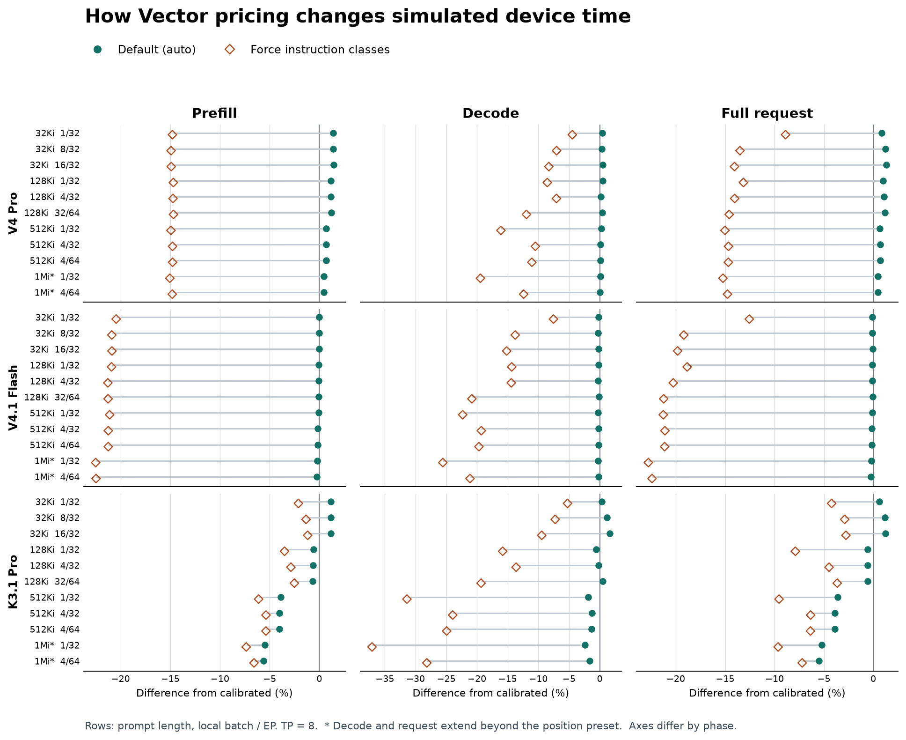
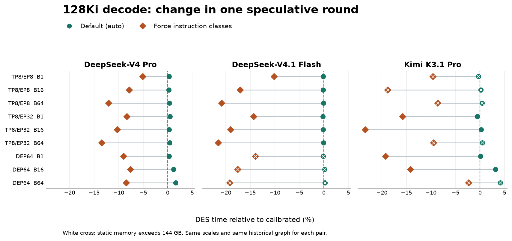
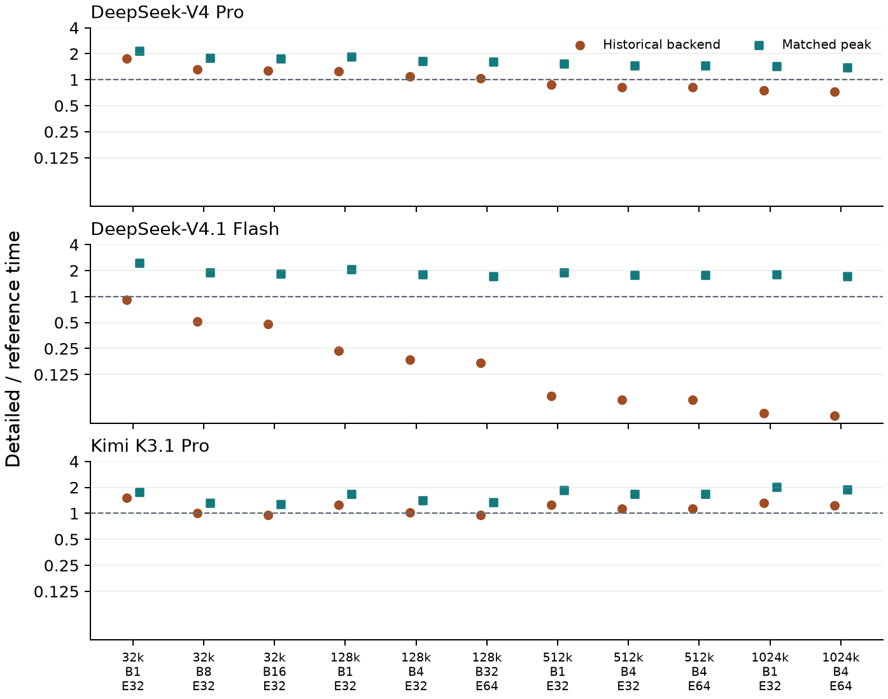

# 7　从设备窗口到整批请求

## 7.1　试验设计与比较条件

系统仿真保留图中原有依赖、通信与排程资源，替换本地调用的计价方法。视图或元数据节点可无设备工作；遇到真实拷贝、通信、归约必须计入对应资源。已融合的设备工作只计一次。历史 Roofline 后端也可独立运行，保留其原决策和缺失项。精细后端覆盖调用名表示能给图中调用分配时间或识别零成本语义。一个调用名可对应许多输入精度、不同内核和计时边界，因此系统覆盖与双芯片 CA 校准覆盖要分别统计。[系统适配与输入](../integration.md) · [按调用名的实现和证据](../system-full-evidence.md)

主实验包括 DeepSeek-V4 Pro、DeepSeek-V4.1 Flash 和 Kimi K3.1 Pro，每个模型有 11 组，共 33 组。本卡 attention 采用 TP8，短序列测试本地 B=1、8、16，128Ki 测 B=1、4、32，512Ki 的 B=4 可比较 EP32 和 EP64，最长的 1Mi 测 B=1、4。每请求输出 1Ki 个 token，每个 prefill 块最多 4096 个 token。场景显存预算 144 GB，33 组的 rank 0 静态估计均可容纳，最大为 129.00 GB。静态可容纳并未验证部署环境在并发、内存碎片和调度保留下仍可运行。

整网模拟使用系统任务声明的 950DT 参数。其 16 位 Cube 峰值是 500 TOP/s、HBM 为 4 TB/s；算子 CA 对表使用原生 950DT SKU 的 432 TOP/s 以及对应 SKU 的其他配置。从一边搬数值去解释另一边会产生虚假的精度差异。为比较同一个系统任务，保持依赖、资源与张量一致，分别运行历史后端、同精度峰值、同精度但带原效率和精细后端。该次历史账单的完整数字见附录 C；本轮两法回放见 7.2–7.3 节及附录 H。历史后端缺失的调用会进入其原本的零耗时路径，这也是与历史数字存在差异的来源。

## 7.2　当前实验：同一张图只改变 Vector 阶段

过去的实验改过候选索引器的执行合同。本次实验固定合同，只问一个问题：**如果实现假设、张量和系统排程保持一致，只改变 Vector 工作如何换算成周期，会如何影响请求时间？** 原法（`calibrated`）保留已有实现的报价，名称并不保证每条路线都经 CA 校准；指令法（`instruction_classes`）在有寄存器程序的地方按指令类别计算服务周期。默认策略（`auto`）逐实现挑选：已有原生实现通常保留原法；有程序的新实现默认指令法。它不是两个整网预测的平均值。

这三次都要把节点设备时间交给系统调度。比如一次矩阵乘的权重展开由 Vector 完成，改写该阶段后，如果 Cube 仍在处理上一页，其完成时刻就可能不动。即使这个节点提前完成，其它并行节点也可能决定下一层何时能开始。只有在依赖图上重新排程，才能知道一次局部报价改动会不会传到整请求。无独立 Vector 计算的视图、纯 Cube 与纯通信路径保持同一合同；未知精度不会因为选择了指令法就自动获得实现。

两组测试回答不同的问题。原始 27 组在固定的 128Ki decode 工作负载上保留三种并行策略，便于比较同一份 decode 图的耗时；扩展的 33 组将预填充和逐步解码拼成一整批请求，观察输入长度、batch 和关键路径的变化。两组的时间单位与计时边界各自标明，不能把 27 行与 33 行合成 60 个独立设备样本。

比较的分母决定数字能回答什么问题。记某一配置、同一阶段的完成时间为 $T_m$，下标 $m$ 表示原法、指令法或默认。对比值取

$$
\Delta_m=100\,(T_m/T_{\rm original}-1).
$$

例如 $\Delta_m=-5\%$ 表示该模型对该阶段给出的时间短了 5%。这是**选法敏感性**。同图峰值 Roofline 则用相同精度、引擎与冷读写义务，检查因建模口径冲突造成的超界。实际硬件端到端真值在这两组实验中均不可得；把两种预测中的较小值、较大值画成区间，不会给真实 latency 建立上下界。即使使用同一图，默认策略也可能在一个节点采取较快的报价，在另一个节点采取较慢的报价；其整图结果不必位于两种强制模式的端点之间。

实际覆盖多少图、在哪里能比较两阶段，要由实验账单确认。原始 27 组各有一张目标图和一张草稿图；33 组长上下文实验读入 747 份捕获、1,278 张阶段图，每种精细策略覆盖 86 个原始调用名、4,687,601 个图节点实例（含零成本视图）。节点覆盖说明每个调用能在图中计价；它不证明不同精度、布局和阶段都有 CA 真值。两组均无新增 CA 采集。

| 模型 | 27 组：默认 vs 原 | 27 组：指令 vs 原 | 33 组：默认 vs 原 | 33 组：指令 vs 原 |
|---|---:|---:|---:|---:|
| DeepSeek-V4 Pro | +0.23% 至 +1.62% | −13.46% 至 −5.07% | +0.45% 至 +1.30% | −15.22% 至 −8.89% |
| DeepSeek-V4.1 Flash | −0.21% 至 +0.24% | −21.53% 至 −10.13% | −0.24% 至 −0.06% | −22.77% 至 −12.56% |
| Kimi K3.1 Pro | −0.56% 至 +4.14% | −23.42% 至 −2.36% | −5.52% 至 +1.25% | −9.64% 至 −2.78% |

表头说明：前两列在每个模型的 9 个原始配置内比较单轮毫秒数，后两列在各自 11 个配置内比较完整请求秒数。每格是逐配置相对原法的最小到最大变化，负值表示预测变短。没有把大 batch 或长请求赋予更高权重。

以历史 Roofline 为参照，默认策略在 8/27 个 decode 轮、18/33 个完整请求上更短；按同精度峰值口径，各自有 27/27、33/33 组三种精细结果都不短于参考。这里检验的是同图、同资源合同的下界；不能把它解释成知道真实系统利用率。[按模型、并行和 batch 查完整报价](16-system-comparison.md)

## 7.3　方法差异在真实任务图上如何传递

**单轮 decode：Kimi K3.1 Pro，128Ki，B=16、DEP64。** 此配置的静态显存为 115.50 GB，在 144 GB 预算内。原法估 198.758 ms，默认估 205.043 ms，指令法估 170.523 ms。原法换成默认后，目标模型由 156.656 增至 162.940 ms，草稿仅由 42.102 增至 42.103 ms；整轮约 6.285 ms 的增量几乎全在目标模型。同一配置的历史 Roofline 为 170.302 ms，恰好接近指令法，但历史 Roofline 本身没有真机时延的身份。原始 27 组中有 8 组超过 144 GB；图中明确标出，不根据这些行推断设备可部署性。

**整批请求：Flash，1Mi，B=1、TP8/EP32。** 同一任务的旧 Roofline 预测整请求 1,972.225 s，同精度峰值参考为 48.713 s。切换到细化后端，原法估 87.848 s，默认 87.669 s，强制指令法 67.842 s。原法与默认只差约 0.20%，而全指令比原法低约 22.77%。分阶段看，prefill 的原 / 默认 / 全指令为 80.090 / 79.932 / 62.066 s；decode 为 7.759 / 7.737 / 5.776 s。这一结果提示应优先查 prefill 的哪些节点传导了约 18 s 的模型差，不能据此宣称实现加快了约 18 s。

把 1Mi 的**最后一块**单独取出来，比在 1,000 多秒的旧基线上猜原因更直接。该块的原法 / 默认 / 全指令是 458.229 / 456.792 / 347.486 ms。保持默认模式的其余节点不动，只把 `inference::lightning_indexer` 切到指令法，再重跑一次 DES，块时长降低 71.121 ms；只把 mHC Pre 切到指令法则降低 23.606 ms。另一个对照体现并行掩蔽：从原法出发，只将哈希门控的调用改为默认，节点时间合计减少 0.442 ms，块完成只提前 0.133 ms。上述单项替换都来自同一个起点，各自反映该图上能传导到终点的时间；不应作普遍可加的“贡献”。稀疏候选实现有短窗及组件证据，1Mi 的完整融合和整图均为外推。[单类节点替换、串行账与重排后差值](../../results/v2.3/system-e2e/counterfactuals.csv)

## 7.4　历史冻结实验：端到端比旧 Roofline 快意味着什么

在 v1.13.1 的冻结账单中，33 组里精细后端有 18 组快于历史后端；与同工作、引擎、精度和冷读写义务的峰值参考相比，快于参考的有 0 组。一个历史偏差很大的例子，是将索引器的矩阵点积按 FP32 Vector 吞吐计价，而目标实现的点积可以用 Cube。另一个方向也存在：合适精度的 Roofline 会假设全部核饱和，decode 很小的投影达不到这一条件，精细预测更慢。一次端到端差值同时包含多个节点的正负变化、通信掩蔽以及原后端缺失的成本。

每点是一整批请求，纵轴为精细秒数除以基准秒数，对数刻度。低于虚线表示精细耗时较短。相邻点只按输入长度、batch 和 EP 排序，不表示可在其间插值。两个基准间的间距展示了选择比较对象的重要性。

例如 V4 Pro、32Ki、B=1、EP32 的 prefill 为历史 2.35 s、精细 2.94 s，decode 为 1.53 s、3.92 s，总计 3.87 s、6.86 s，同精度峰值为 3.19 s。同模型到 512Ki、B=4、EP64，prefill 转为 451.46 s、363.17 s，decode 为 4.86 s、9.03 s，总计 456.32 s、372.21 s，同精度峰值 254.75 s。整批总时间在历史曲线的另一侧，decode 却仍比历史慢。解释模型差距时应先分 phase，再查图中最耗时的调用以及它是否处在关键路径上。[完整配置、阶段和比值](../context-sweep.md)

## 7.5　历史归因：1Mi Flash 末块为什么变化这么大

最后一个 prefill 块有 4096 行，原历史后端给出约 15.176 s。按 BF16 参考实现重算曾得到约 0.871 s；识别本任务的低精度候选路径后，先前资源模型为 0.480550 s，用第 6 章实验约束行间接续后为 0.458229 s。第一步变化反映的是执行引擎、精度和算法合同的改变。最后这 22.321 ms 才是在同一低精度任务里修订候选流水的影响。把全段从 15 s 到 0.46 s 称为一次优化实测加速，会把不同算法假设和两个不同模型误作同一设备的前后表现。

可进一步把最后一个数拆开。固定图中其余节点和排程，四次候选消费各约 3.682 ms，末块其余关键路径约 443.501 ms。用 DT 小规模 CA 中测得的第二行发起间隔与行间交接，外推同一团队连续做 128 行，三种访问布局得到的末块范围约 458.052–458.655 ms。如果反过来让每段更频繁重付短窗的开销，所选三种布局情景约 460.678–468.852 ms。二者在末块总量上接近，因为其余工作占大多数；关键阶段的预测仍可能偏很多。这是几种继承节奏的情景跨度，不是测得的置信区间。[末块分解与逐团队续行数据](../context-sweep.md)

修订从末块传到整请求还要考虑其它块。Flash 1Mi、B=1 的精细总时间在该次历史修订中从 93.079 s 降至 87.848 s，prefill 约从 85.315 降到 80.090 s，decode 约从 7.764 降到 7.759 s。B=4 的请求从 350.259 降至 329.213 s。这次重放只有五组长上下文 Flash 配置变化，其余 28 组复用原账单。Q4096 的完整融合服务与整网均缺设备实测，且 1Mi 输入再生成 1Ki 输出超过原预置最大位置；后者的 decode 利用边界内可捕获图延伸，临界处算法或容量策略改变会使结果失效。

## 7.6　系统采样也有独立误差

每轮 speculative decode 假设产出 7 个有效 token，prefill 已给首个 token，余下 1023 个需调度 147 轮。很多配置可捕获首、中、末轮，对其它轮插值。Kimi 的部分配置显示出周期性的阶梯。以 32Ki、B=8 为例，三轮插值估计 7.462 s，逐轮同后端重放为 7.625 s，相差 −2.14%。如果只看单算子与 CA 的差异，这个系统层误差不会被发现。

原因可以用整除关系检验。设使用 64 个 AIV，每轮本地行数增加 7B，则行数除以 64 的余数以 $P=64/\gcd(64,7B)$ 轮为周期。把相同余数的轮归组，再对每组首尾作插值，就能在同一种分核阶段间比较。B=8、16、32 对应只需 16、8、4 个锚点，与各组剩余全部轮逐一比较，最大轮偏差依次为 0.0270%、0.0185%、0.0112%，三组 decode 总量的差异均低于 0.0023%。这个结果验证了对系统模型的采样近似；整网设备误差还要另有端到端实测才能校准。[留轮检验](../context-sweep.md)
