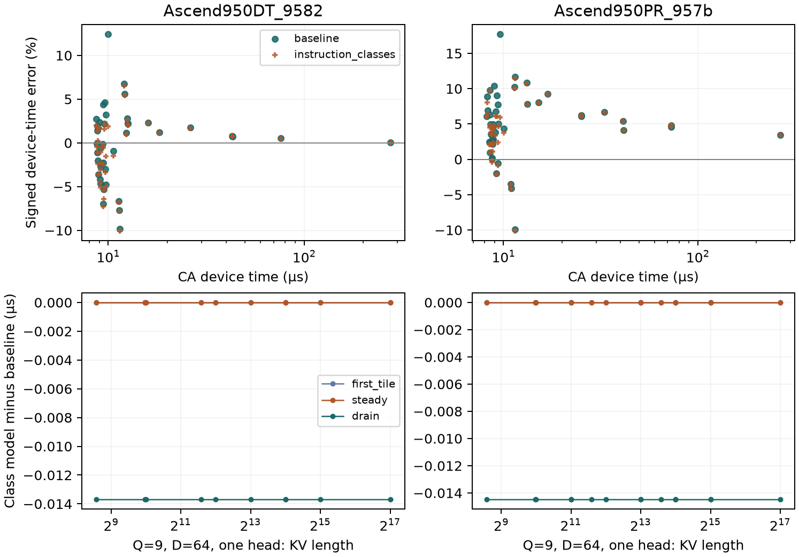

# 附录 E　指令类别能否改善 FlashAttention 的 Vector 预测？

## E.1　把阶段误差与全算子误差分开检验

只知道新芯片 FP32 峰值，可以为一批独立乘加估时，却很难决定求指数、行归约和转换格式的相对价格。原 FA 模型将一个软最大值页的工作分成 score 与输出两组，使用在 950DT 库实现上校准的有效吞吐。它计算快，在见过的实现上可以直接检验。研究新精度时，我们希望修改某类指令的数量或价格后，能看到它是否真的延迟了 PV 的开工。本试验借鉴参考项目的指令类别与搬运探针思路，独立写出一份可计数的行程序，再接入现有的 FA 分核、Cube 和跨页调度。比较有两个独立开关。一个改变 Vector 定价，一个改变首读、搬运发起与交接的证据来源。[参考分支的固定版本](https://github.com/ZhanluModelSim/operator-performance-models/tree/5da9553d6931c4334b69946bf9fd477c12445ce3) · [本项目的指令模板和价格来源](../../src/operator_model/data/parameters/fa_vector_classes.json)

我们分别比较三种观测。第一种是同一物理 AIV 上的指令种类和次数，用来检验算法到机器工作的映射。第二种是该 AIV 的有效指令占用时间，检验每类价格和可双发射程度。第三种是从首个有效设备指令到最后退休的完整 kernel 窗，用来检验用户最终拿到的时间。两种模型采用同一个 shape、dtype、分核策略和计时口径。原始数据的 88 个 BF16 窗是开发回放，本轮冻结后新增的样本单列。WAPE 为绝对时间差之和除以 CA 时间之和，最大误差则取单窗的最大绝对相对误差。

## E.2　怎样从算法数出可定价的指令

在每一张 KV 页上，QK 给出一行分数，Vector 先缩放并找最大值，再生成概率 P，更新行统计，最后把 PV 和前页输出合并。若页上有 n 个 key，头宽为 d，则一个 FP32 行分别需要 x=⌈n/64⌉ 个 score 寄存器、y=⌈d/64⌉ 个输出寄存器。64 来自本模板假设的 256 B 寄存器和 4 B 元素。两个相邻 FP32 向量降至 16 位后可以合为一次整寄存器存储。行最大值每行包含 x 次缩放、x−1 次寄存器间合并和一次横向归约。末页对归一化结果执行 y 次除法和转换。中间页保留旧最大值、归一系数和累积输出，并为更新它们增加读写。每个数都乘以最忙 AIV 的行数。尾页使用真实 n，单页同时承担初始化与最终归一。

对于一个阶段，令 Nᵢ 为类别 i 的指令数，Iᵢ 为连续独立指令的发起间隔，Lᵢ 为有依赖的后继能使用结果前的延迟，单位都是 cycles。固定模板里仅属于同一依赖链的 Lᵢ 需要相加。模型还要计算不同资源的需求。

| 阶段约束 | 周期怎样计算 |
|---|---|
| 输入到结果的依赖 | 对每条模板依赖链求各指令延迟之和，取最长链 |
| 发起槽 | 独占发起的归约与存储各付一拍，其余条数除以发起宽度 |
| 共享算术和特殊函数 | 对算术、归约、指数、除法、转换分别算 Nᵢ×Iᵢ，求和后除以共享计算通道数 |
| UB 和寄存器 | 读写服务之和除以 UB 总端口数，再单查写端口；产生寄存器结果的指令数除以写回端口数 |

阶段时间取这些约束的最大值。当前参考值下，普通算术、归约、转换的发起间隔为 1，指数与除法为 4。这个差别表示 64 个 FP32 元素需要多少发起服务。结果延迟、混合发射、端口共享以及 FP16 转换在未测几何上的行为均含设计假设。芯片配置可分别覆盖这些参数。首张页在概率阶段结束时发布 P，行统计可以与后续工作重叠；相邻页在同一 AIV 上竞争，稳态要计入前页输出更新与本页 softmax 之和。相同的中间满页只计算一次，查询代价不随页数线性增长。[五行、256 个 key 的手算](../examples/fa.md#按指令类别复算同一个忙核) · [阶段计数与约束实现](../../src/operator_model/operators/attention/vector_classes.py)

## E.3　已有 BF16 窗能说明什么

| 芯片 | 不同 shape / 窗 | 原方法 WAPE / 最大 | 类别法 WAPE / 最大 | 绝对误差改善窗数 |
|---|---:|---:|---:|---:|
| 950DT | 38 / 43 | 1.84% / 12.43% | 1.62% / 10.05% | 24 |
| 950PR | 45 / 45 | 5.05% / 17.72% | 4.70% / 11.48% | 36 |

头宽为 128 时，两端的 WAPE 分别由 3.51% 降至 1.94%、由 7.73% 降至 5.77%。头宽为 64 时，降幅为 1.65% 至 1.59%、4.77% 至 4.59%。图 E.1 上排每个点对应一个计时窗，下排固定 Q=9、D=64 并改变上下文，展示改变 Vector 后各段暴露的时间差。长 KV 上，稳态常受读或发起控制，因而两条方法的全窗差很小。测热进程中每种方法每窗交替调用三次，分类法的查询 P95 两端均约 0.24 ms，原法约 0.11–0.12 ms。这个时间在 CPU 上测量，与图中的设备时间单位不同。[88 窗与 970DT 同形外推](../../results/v2.1/fa-vector-windows.csv) · [各子组和查询开销](../../results/v2.1/fa-vector-metrics.json)

在 DT 的 [9,32768,64,1,1] 上，用忙核每次行最大值归约的次数确定该 AIV 分到 5 行，共 128 页，再按物理核与有效指令过滤 trace。模型和 CA 中可直接对应的归约分别为 1280 与 1280 条，转换为 2565 与 2565，最终除法为 5 与 5。指数模型给 3195 条，CA 的 VEXPDIF 为 2687 条，差 508 条。模板将每个续页每行的一次统计重缩放都计入指数；差值与 127 个续页每页多计 4 条相符，这提示原实现可能共享或打包了行统计。仅凭分类计数还不能确定是哪一种实现。

该 AIV 预测的 VF 服务总计 23,655 cycles。把同核有效 RV 指令区间取并集得到 35,796 cycles，相差 −33.92%；用更宽的 SIMD 队列并集则为 46,672 cycles。两种并集和模型的阶段边界不同，均不能直接作为 VF 价格的校正倍数。原 trace 还含循环控制、屏障、地址和选择指令，当前行程序简化了这些工作以及端口冲突。它们是可以进一步检验的误差来源。这说明整窗 WAPE 虽有改善，还不足以判断整套指令服务价格可移植到其他算子。[原始指令计数与区间](../../results/v2.1/fa-vector-opcodes.json)

## E.4　跨芯片收益来自哪一个开关

对可匹配的 BF16 小 Q、单头、D=64 合同，另行试验测得的 ND2NZ 独立读。首笔等返回时用单条读延迟，连续读采用两次相邻发起的间隔。对 256 行的满页，DT、PR 的连续发起间隔分别为 360.19 与 336.35 cycles，隔离单读返回分别为 924 与 898 cycles。K 与 V 共用读引擎，故每页至少需要两次发起服务。原 FA 双端开发 trace 中稳态 V 到下一 K 的典型间距为 479 cycles。模型以两次发起服务、一次发起服务加该间距、共享带宽下界和其他引擎需求的最大值决定页周期。首轮另用 Q/K/V 读取和首个 softmax、P 写回退休、PV 发起的标记，避免重复向每一页收取启动延迟。[双端测量来源及几何限制](../../src/operator_model/data/parameters/fa_port_scenarios.json)

| Q=9、KV=32768、D=64，B=H=1 | DT µs | PR µs | DT 耗时 / PR 耗时 |
|---|---:|---:|---:|
| 原 VF、原搬运 | 76.377 | 76.377 | 1.0000 |
| 类别 VF、原搬运 | 76.363 | 76.363 | 1.0000 |
| 原 VF、探针搬运 | 74.890 | 72.336 | 1.0353 |
| 类别 VF、探针搬运 | 74.752 | 72.192 | 1.0355 |
| CA 完整设备窗 | 75.980 | 72.856 | 1.0429 |

将 KV 扩到 128Ki，CA 比值为 1.0336，单开探针给 1.0309，只切换 Vector 仍约 1.000。由此可将这组跨芯片差异主要定位到读与交接。探针的首发控制来自同 SKU、Q9×8191 的开发窗；其他布局、精度以及 970DT 都缺少对应测量。970DT 默认参数下，32Ki 的原法与类别法分别外推为 70.033 和 70.010 µs，128Ki 为 252.093 和 252.070 µs。继承 950 的每类指令延迟和发起能力只是一个情景。若新芯片改变了 exp 单元、发起槽、寄存器宽度，或软件改用另一布局，这组数字需要随程序或参数重算。[三个长度的全部四组对照](../../results/v2.1/fa-vector-port-ablation.json)

## E.5　先冻结预测，再增加三个 CA 窗

新 BF16 shape 取 [9,4097,64,1,1]，16 张 256-key 满页后只余 1 个 key，可检验循环交接与小尾页。FP16 选 DT 的 [9,257,64,1,1]，同时覆盖新精度和尾页。运行 CANN 9.2.1 的 aclnnFlashAttentionScoreV2，BF16 和 FP16 实际派发不同的混合 kernel，分别校对 576 个输出，三次均无超差。每个窗都从最早有效设备指令起算，到所有活跃核最后退休为止。三次均检查到 1 AIC、2 AIV 和各核 END，BF16 两端各有 66 条 MMAD，FP16 有 6 条。[采集前模型、参数哈希和报价](../../results/v2.1/new-ca/predictions.json) · [设备时钟、实际 kernel 和输出校验](../../results/v2.1/new-ca/receipts.json)

| 新 shape 与芯片 | CA µs | 原 VF µs（误差） | 类别 VF µs（误差） | 原 VF＋探针 µs（误差） | 类别 VF＋探针 µs（误差） |
|---|---:|---:|---:|---:|---:|
| BF16，KV=4097，DT | 18.102 | 18.707 (+3.34%) | 18.693 (+3.26%) | 18.186 (+0.46%) | 18.048 (−0.30%) |
| BF16，KV=4097，PR | 17.068 | 18.708 (+9.61%) | 18.693 (+9.52%) | 17.249 (+1.06%) | 17.106 (+0.22%) |
| FP16，KV=257，DT | 9.370 | N/A | 9.226 (−1.54%) | N/A | N/A |

还可以在这三个冻结窗逐类交叉检验。按物理 AIV 和 PC 提取正时长 RVEC 执行事件，另存零时长标记，防止将同一条除法计两遍。BF16 将 5 行与 4 行两颗 AIV 合计，模型 / CA 的转换为 594 / 594，归约为 306 / 306，除法为 9 / 9，指数为 729 / 617。FP16 的相应计数为 54 / 54、54 / 54、9 / 9 和 63 / 49。FP16 trace 还显示六条 MMAD 的输入均为 F16、累积为 F32。这给新精度的 Cube 工作量提供了直接证据；两种精度上指数均偏多，指向可复查的行间状态更新，而仅按总时间校准会掩盖这项偏差。

BF16 实测 DT/PR 耗时比为 1.0606，默认两组 Vector 价格各自给出约 1.000，两项都启用给 1.0551。相同 BF16 几何的 970DT 原法和类别法外推为 17.169、17.147 µs，FP16 小例的 970DT 外推为 8.468 µs。三次 CA 墙钟依次为 96.1、100.0 和 70.1 秒。本次新增的 FP16 样本检验了一个 DT kernel、一种 shape；PR 的 FP16、其他 tiling 及低位 KV 的独立误差仍为 N/A。

FA 试点保留原 BF16 默认。已登记的按行实现和新的 FP16 合同默认选类别法，让设计者能改变一类硬件资源后观察其影响。对下一种算子，判断能否推广应优先看独立样本中是否存在 Vector 主导的窗、对应忙核是否给出合理的指令数量和服务时间。FA 这批结果更支持优先核实 VF 内控制、行间共享和混合发射，再把模板用于其他算子。完整合格窗、归档回放和架构外推在逐窗记录中分别标明。[试验变更及复算](../../results/v2.1/changes.md)
