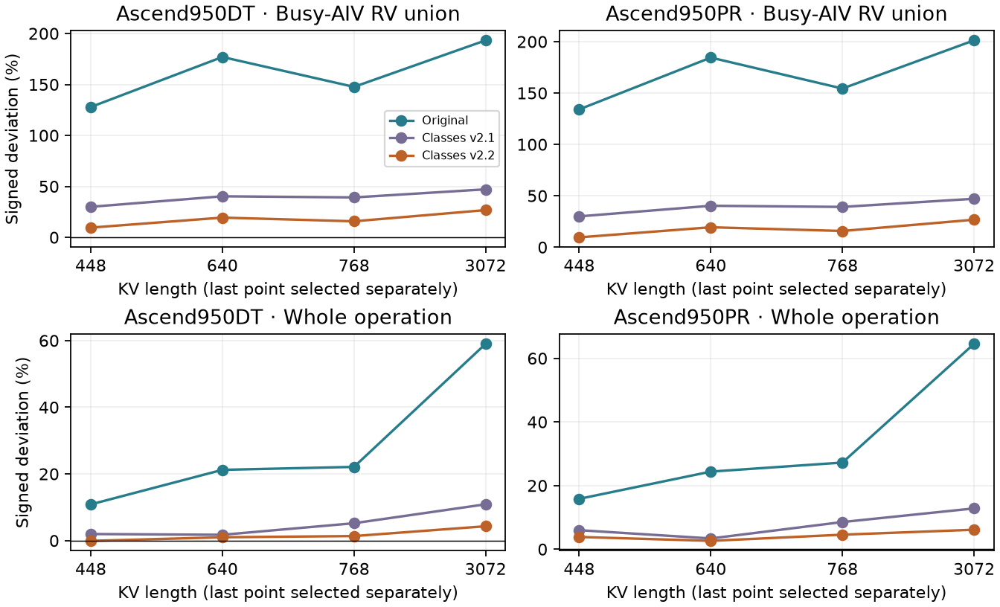
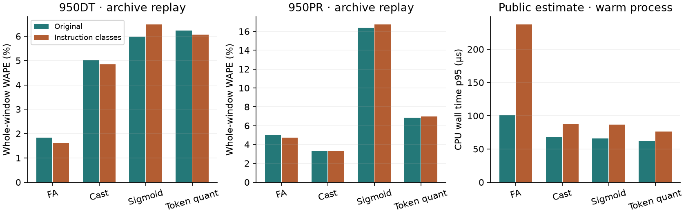

# 附录 F　Vector 指令定价在什么条件下值得采用？

## F.1　用同一条 trace 同时核对指令数和时间

上一轮留下一个看似矛盾的结果。950DT 稠密 BF16 FA [9,32768,64,1,1] 的指数指令多算了 508 条，最忙 AIV 的 Vector 服务却少算了三分之一。我们将同一条 trace 按 AIV、指令地址、操作码和正时长执行记录拆开。输入沿 KV 切 128 张满页，一颗 AIV 处理五行，每行 256 个 score，用四个 FP32 寄存器。

第一组指数指令对 score 运算，条数为 128×5×4=2560。第二组用于在线 softmax 的行状态重缩放；在该忙核，同一个程序地址只出现 127 次，对应所有续页。数据说明这些行的状态更新以寄存器组为单位发起。在 BF16 的 4097-key 旧样本，相应地址也只出现于 16 张续页。因此，忙核共需 2560+127=2687 条指数。旧模板把第二组乘以五，额外多算 127×4=508 条。新模板用每组最多 64 个 FP32 行状态作出可检验的假设。已观测的忙核行数远小于该上限，尚不能从这些 trace 确认超过 64 行时编译器仍采用同样的布局。

设备时间还取决于独立指令的发起间隔、有依赖指令的结果何时可用，以及什么时刻允许访问已经写入的数据。在 DT 开发 trace 上，取有正时长的寄存器指令的执行跨度中位数作依赖延迟的近似，指数为 18 cycles、转换为 7、最大值归约为 16、求和归约为 22，存储屏障为 9。指数的持续发起服务仍按 4 cycles 定价，模型只在后继实际依赖前值时计入更长的结果延迟。在行最大值写回和下一段读取之间按出现的屏障加约束。概率 P 已发布时 PV 可以开工，行和及前页状态更新可能仍在进行。每个阶段取依赖链与资源服务的最大值，续页的向量需求按前页输出更新加本页 softmax 排队。

| DT 32Ki，繁忙 AIV | v2.1 类别 | v2.2 类别 | CA 观测 |
|---|---:|---:|---:|
| 指数条数 | 3195 | 2687 | 2687 |
| VF 服务 / 正时长 RV 指令区间并集，cycles | 23655 | 32570.5 | 35796 |
| 相对于上述并集的有符号偏差 | −33.9% | −9.0% | — |

按区间求并、再扣除与其他指令重叠的部分，控制指令在这个忙核独占了 2442 cycles。屏障记录覆盖 2295 cycles，全部与其他记录重叠。它支持在有依赖处设置可配置的屏障成本，却不足以把 2295 cycles 再加到设备总窗。[逐类并集和独占区间](../../results/v2.2/fa-mechanism.json)

同一开发窗还有一个较宽口径的 SIMD 队列并集，46,672 cycles。原 BF16 方法正是用它校准有效吞吐，在该窗按原公式会复现 46,672。这个数含有与逐条 RV 执行并集不同的队列活动。新旧模型各自对两种口径的匹配程度要联系校准目标来理解。窗口中未独立建模的地址、选择、谓词和编译器调度仍可能影响 VF，孤立指令的执行跨度也只能近似生产者到消费者的真实延迟。[v2.1 操作码与并集](../../results/v2.1/fa-vector-opcodes.json) · [本版指令价格的含义与来源](../../src/operator_model/data/parameters/fa_vector_classes.json)

## F.2　从 FA 扩到三类不同的程序

为检验外推能力，我们选三个局部程序各异的非融合算子。Cast 的每个寄存器组主要执行加载、转换、存储。FP32 Sigmoid 多了指数、加法和除法的相关链。逐 token FP8 量化先按行求极值和生成 scale，再遍历元素完成缩放、转换和写回。对每种模板只改变 VF 服务，复用原模型的分核、tile、读写、首发和尾部。精度、工作量与芯片相同后再比较完整窗；Cast、Sigmoid 与量化的已有窗在本次比较均按回放处理。

| 算子 | DT 原法 → 类别 WAPE | PR 原法 → 类别 WAPE | DT/PR 同形数 | 跨芯片耗时比平均绝对相对误差，原法 → 类别 |
|---|---:|---:|---:|---:|
| 稠密 BF16 FA | 1.84% → 1.62% | 5.05% → 4.72% | 38 | 5.01% → 4.95% |
| BF16→FP32 Cast | 5.03% → 4.85% | 3.31% → 3.29% | 32 | 8.43% → 8.47% |
| FP32 Sigmoid | 5.98% → 6.48% | 16.39% → 16.72% | 20 | 8.70% → 8.47% |
| 逐 token BF16→FP8 量化 | 6.23% → 6.07% | 6.83% → 6.96% | 13 | 3.71% → 3.63% |

表内 WAPE 对每个完整设备窗计一次，分母为对应窗 CA 耗时之和。跨芯片指标仅采用两端都有的 shape，在每个芯片上先对同形重复 CA 取中位数，再算 DT 耗时除以 PR 耗时，最后对每个几何赋予相同的权重。举例来说，Cast 的双端全窗 WAPE 均略降，跨端耗时比误差却略增。FA 的 38 对历史几何中，有 37 对的实测耗时比与 1 相差超过 1%；两种默认搬运下的模型均没有在这 37 对中正确预测出超过 1% 的同方向差异。微小阶段改进不足以重建两个芯片的端口差异。[每个几何的双端实测、预测、比值和 970DT 外推](../../results/v2.2/vector-transfer.json)

三个非 FA 合同另有 66 个可对齐的阶段观测。Cast 首块 SIMD 服务的 WAPE 在 DT/PR 上从 13.40% / 16.47% 变为 27.71% / 27.89%。Sigmoid 的首笔读退休到块内最终向量 store 退休，WAPE 从 0.42% / 2.19% 变为 21.31% / 21.25%。逐 token 量化首笔 payload 读退休到写发起含有交接，WAPE 从 4.00% / 4.09% 变为 7.17% / 7.28%。不能在这些不同的计时窗口间平均出一个“硬件 VF 误差”。Cast 的局部误差变大而整窗略好，说明仅以完整窗选模型会选错理由。Sigmoid 在 DT 的 248 组满块上，原方法为 1067 cycles、CA 为 1070；把普通算术、指数和除法都放在假设的两个共享计算通道上，类别法给出 1314。这里优先需要确认混合指令的可重叠程度。[各算子的公式、计时边界与实例](../nonfa-vector-classes.md)

## F.3　什么能够迁移到另一颗芯片

迁移可分成三个问题。第一，算法是否还需要同样多的 score 和行状态；这部分由输入决定。第二，编译后的程序是否仍按相同的寄存器宽度、精度、布局、尾块和分核策略执行；前文的 508 条误差就来自这一层。第三，新芯片处理一个明确类别的指令要多少发起服务，生产者何时交付结果，又如何与搬运重叠。已有实现的有效吞吐法把这三者的一部分合并为容易测量的价格。同一软件及相近硬件上它有实测支撑；当实现引入新的转换、寄存器溢出或不同归约时，原有价格难以直接拆分。类别法能分别修改程序和单元价格，但两者都需要证据。尤其是代码从寄存器驻留切换到 UB 中间存储时，应重新计算 load、store 和同步。950 的 RegBase 知识只说明这种实现差异可能产生，不能据此确认 970 的编译结果。[RegBase 机制资料](https://gitcode.com/cann/asc-tools/blob/14714fdab5b495b048e13151b418f058cc66c9ce/skills/tool-ops-tune/ops-mechanism/references/optimize/ascendc-regbase-vf.md)

把 970DT 设为 120 AIC、120 AIV、1.8 GHz，沿用项目的 HBM、L2 及每 AIC 一颗 AIV 假设。以下实验每次只改变一个未知参数，所有微秒数都是模型外推。

| 970DT 类别法 | Q9，32Ki，D64 | Q64，KV768，D64 |
|---|---:|---:|
| 原情景 | 70.016 µs | 11.470 µs |
| 指数发起间隔从 4 加到 8 cycles | 70.016 µs | 12.143 µs |
| 通用发起宽度从 2 降至 1 | 70.030 µs | 13.303 µs |
| 每核有效读端口降至 40 B/cycle | 125.642 µs | 11.669 µs |
| 一项任务可用两颗 AIV，并受全卡总核数限制 | 70.016 µs | 9.906 µs |

两个 shape 的差别有明确的资源解释。Q9 时指数变慢使中间页向量服务从 350 增至 422 cycles，但发起控制依然决定稳态；减慢读端口才会显著延长设备时间。Q64 时向量阶段决定中间满页间隔，指数变慢增加约 5.9% 的整窗耗时。对三个非 FA 案例也施加相同类型的扰动：Cast [1024,4096] 的转换间隔翻倍时，这个几何的类别整窗没有变化；Sigmoid [16384,48] 的指数间隔翻倍使其整窗增加 4.35%；逐 token 量化 [144,5120] 的除法间隔翻倍使其整窗增加 4.49%。原方法中没有单独的这些开关。给新芯片做系统研究时，这些数可回答“测准哪个参数对该工作负载最重要”；970DT 上的预测误差目前没有实测值。[逐参数敏感性与页瓶颈](../../results/v2.2/vector-sensitivity.json)

## F.4　冻结之后，选择 Vector 主导的满页

先用 v2.1 的页模型挑出三组此前未测、其中间满页受 Vector 限制的几何。冻结两种旧方法和修订类别法在 DT、PR 上的全部报价，再用 CANN 9.2.1 的 aclnnFlashAttentionScoreV2 运行 BF16 SBH、B=H=1、无因果掩码的实际库 kernel。对每个输出元素检查 CPU 参考，核对 MMAD 精度、分核与每核 END。每个新窗实际都使用 1 AIC 和 2 AIV。以下全窗起止跨所有核，忙核 VF 观测仅对同一 AIV 的正时长 RV 指令求并集。跨核同时执行不会被误加。

| 首批三个新几何 | DT 原法 / v2.1 类别 / v2.2 类别 | PR 原法 / v2.1 类别 / v2.2 类别 |
|---|---:|---:|
| 整算子 WAPE | 18.28% / 2.98% / **0.83%** | 22.69% / 5.91% / **3.65%** |
| 相对忙核 RV 并集的 WAPE | 153.45% / 37.35% / **15.56%** | 160.34% / 37.35% / **15.56%** |

两端实测指数次数一致。繁忙 AIV 在 [60,448,64]、[63,640,128]、[64,768,64] 依次执行 213、324、389 条，均与新公式相符。三个样例的忙核 RV 并集占整窗 12.0%–18.7%。启动时间在这些较短的窗中占有相当比例。观察到前两组的占比后，我们保持价格冻结，单独预登记 [64,3072,64]，再在两端重测。它的忙核指数为 1547 条，仍与公式吻合。RV 并集为 9549 cycles，占完整 DT/PR 窗的 34.12% / 34.71%；PUSHQ 中 VF 描述符的并集则为 10976 / 10929 cycles。此次 msopprof 格式没有旧 compact trace 的独立 SIMD 队列字段。用描述符并集衡量新模型 12102.5 cycles 的服务，偏差约 +10% 至 +11%；用 RV 并集衡量则是 **+26.74%**。这两种边界都保留在逐窗记录中。

| 补充长形 [64,3072,64] | CA 实测 | 原方法 | v2.1 类别 | v2.2 类别 |
|---|---:|---:|---:|---:|
| DT 全窗 µs | 16.963 | 26.972 | 18.809 | 17.693（+4.30%） |
| PR 全窗 µs | 16.673 | 27.433 | 18.809 | 17.693（+6.12%） |
| DT / PR 耗时比 | 1.0174 | 0.9832 | 1.0000 | 1.0000 |

同一个形状的两端忙核 RV 周期一致，跨卡全窗仍相差约 0.29 µs。提高 VF 本身的精度确实降低了这里的全窗误差，却无法仅靠这一点预测 DT/PR 的先后。八次采集进程的墙钟合计约 713 秒，部分采集并行。完整窗、忙核、冻结哈希、实际派发身份、970DT 外推和采集预算均可逐形复核。[预登记首批](../../results/v2.2/fa-validation/comparison.json) · [后选长形](../../results/v2.2/fa-validation/long/comparison.json) · [逐形记录及复现](../../results/v2.2/fa-validation/README.md)

## F.5　系统仿真付出的查询成本

在 AArch64、Python 3.12.16 上，从公开 estimate 的调用前计时到完整返回，包括分核、报价、工作量和诊断对象构造。每个算子取归档里的所有不同芯片和 shape 组合，在同一进程里打乱顺序、交替运行两种方法，共 15 轮。没有缓存整个报价。另对每个算子选定一个 shape，在九个新解释器内各调用一次；这项计时从导入包、加载芯片配置之后开始，包含首次按需加载参数等成本。这里是 CPU 墙钟，系统仿真调度仍使用算子预测的设备时间。

| 算子 | 热进程原法 P50 / P95，µs | 热进程类别 P50 / P95，µs | 首次查询中位数，原法 / 类别，ms |
|---|---:|---:|---:|
| FA | 92.9 / 101.0 | 226.4 / 237.1 | 1.90 / 2.27 |
| Cast | 63.1 / 68.2 | 78.6 / 87.1 | 2.21 / 2.28 |
| Sigmoid | 62.6 / 66.1 | 82.2 / 86.4 | 2.18 / 2.27 |
| 逐 token FP8 量化 | 55.7 / 62.0 | 67.4 / 76.1 | 1.73 / 1.76 |

FA 要给首张、中间和末张页分别生成程序，构造四个阶段的计数和端口/依赖下界。类别法的热进程 P95 比原方法多约 136 µs。相同的满页按重复次数计价，无须把长上下文中几百或几千页逐个展开。其余三个算子新增约 14–20 µs 的 P95。在线成本远低于离线 CA，且随 Python 环境、CPU 和调用边界而变。[逐算子样本数、首查 shape 与分位数](../../results/v2.2/vector-cost.json) · [复算程序](../../calibration/examples/vector_method_study.py)

**采用范围。** FA 的修订类别法有新形、双端、逐类和整窗证据，适合已经登记的按行程序及新精度设计评估。对已有 BF16 库，保留原法默认，类别法可选。当前精度验证包含有限的 FP16 开发样例，新盲测为 BF16。三个非 FA 模型均保留为可选设计假设；局部服务的退化说明现阶段需要更多匹配的吞吐、发起配对和编译布局证据。970DT 及其他未来芯片依然是架构情景。这项结果支持复用“数指令、给目标资源定价、调度依赖”的方法，也界定了每个算子必须单独验证的部分。
