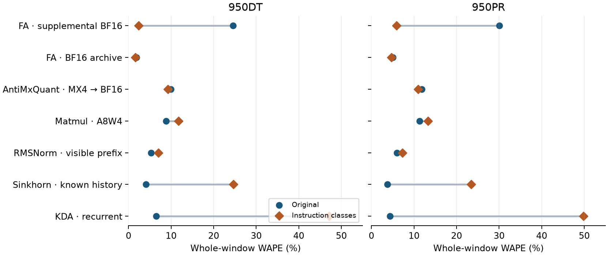

# 附录 G　所有算子都能采用同一套指令价格吗？

一次系统调用可以有多个不同答案。以低精度矩阵乘为例，原生 A4W4 只在 Cube 中消费打包权重，改 Vector 价格会得到完全相同的时间；A8W4 先在 AIV 展开权重，展开每一页的代价都会改变后续 MMAD 何时能发起。因此，可替换的单位是某个实现的 Vector **阶段**。在阶段之外，以同一份任务划分、缓存策略和读写依赖重排整窗，才能公平比较两种方法。

**两种计价依据。** 对已测库实现，原方法从 CA 的指令窗、循环重复和任务边界校准资源服务，能够保留编译器采用的具体归约、融合与等待行为。另一种方法先按精度与寄存器宽度展开每一个计算步骤，再给 load、转换、算术、指数、规约和 store 逐类计价。芯片配置可以将指令个数与对应发起能力分开替换。能从 trace 确认的生产者链另以依赖延迟约束。缺少目标二进制时，计数是一种可检验的实现设计；专用原语、尾块对齐和双发射配对至少有一项不同，便可能改变其相对优势。[按家族展开的公式和参数来源](../vector-family-pricing.md) · [融合算子的页交接和指令数](../fused-family-pricing.md)

**同形比较。** 主档案有 2,180 个设备窗，另用 11 个已公开的 FA 专项窗。比较两种方法时使用同一芯片、精度、shape、调用前序与 CA 零点；FP16 FA 有一个 DT 窗仅可检验类别法。原先冻结的留出在本轮属于历史观测。没有用新增 CA 选出表现最好的方法或价格。两个系统入口对 86 个原始调用名均能选择报价，无法匹配完整 CA 的路线只计算两种模型的预测差。[逐形报价与原始行号](../../results/v2.3/native-windows.csv.gz) · [系统调用对照和口径](../system-vector-methods.md)

FA 的普通 BF16 档案在 DT、PR 上分别从 1.84%、5.05% 降到 1.62%、4.72%；专项 BF16 窗的改善大得多。小样本专门包含暴露 softmax 的几何，不能按它的收益估算整个模型。原生 AntiMxQuant 两个历史留出都有约一个百分点的改善。可见前序的 RMSNorm 两端都回退；mHC Sinkhorn 和 Recurrent KDA 更明显。KDA 的替代程序按状态元素给归约、读改写和依赖定价，和库实现的有效吞吐仍有明显差距。由整窗误差不能识别具体哪条指令发多了。A8W4 的旧留出上，指令法同时降低尾部最大误差、增加 WAPE；两个指标能导向不同的选择。

**部署与迁移。** 本轮已有原生库实现继续默认原法。新设计有已登记的寄存器程序时默认指令法。以 FA 为例，已测的 BF16 SBH 路线还能显式切换；FP16 合同仅提供指令类预测。对无独立 VF 的合同，切换保持相同输出。对于只有测量、只有组件窗或仅有工作量的路线，保留其原有计时边界。CPU 墙钟来自调用当前 Python 预测器；它包括构建指令程序和重排的开销，与预测的设备微秒分别记录。970DT 结果保留在逐形数据中；寄存器宽度、发射能力和端口参数可替换，950 上的误差不能用作未发布芯片的准确度。[全部合同的误差及计时](../vector-method-comparison.md)

将搬运的首次返回与连续发起拆开，可以为这两种 VF 方法提供相同的供数条件。对同形、独立端口和固定缓冲槽的子流水，在线从服务间隔与排空时间直接求末块退休；离线按真实块序列记录读发起、计算就绪和最后一次写回。对新的精度或布局，需要能辨识描述符的源代码或探针。该条件也说明了何时可以迁移已有数据、何时必须报告参数假设。[五块、双缓冲的闭式和离线演示](../examples/transfer-stream.md)
