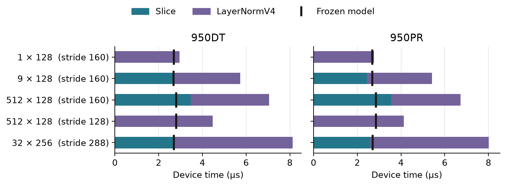

# 附录 I　从三个模型扩展到文本模型目录

## 怎样判断一个模型已经接入

一个名字相同的算子，在两个模型中可能做不同的工作。例如，FP8 投影既可能每行读取一个 FP32 scale，也可能每 32 个 K 元素读取一个 E8M0 scale。按算子名命中同一个公式，无法发现两者的访存和指令差异。我们用系统前端对每个模型预设作 meta 张量前向，把实际产生的逻辑维度、物理张量、步长、数据类型、scale 和并行属性一起交给精细后端，再逐节点检查设备报价和同精度资源下界。

实验覆盖用户列出的 12 个预设，并补入系统源码注册的纯文本 Block Diffusion。DeepSeek V4 Flash 与 Pro、Qwen3.5 27B 与 397B-A17B 均按各自的配置构图。183 张前向图产生 766,282 个节点调用，合并相同输入合同后得到 122,383 个特征签名。三种 Vector 策略在 950DT 上都给出了有效结果。119 个原始调用名中有 116 个覆盖至少十种物理形状。另外三个来自固定头宽的 RoPE 初始化，即使改变请求长度和 batch，对应张量仍为 FP32 [8]。记录这条约束可避免通过变更数据类型或重复层数虚增样例数。[逐模型 shape 索引](../../results/v2.4/catalog/shape-index.md)

## 一次真实调用可以启动几个 kernel

GLM-5.3 Flash 的 Indexer 取投影结果中的一部分作为 key。每行只有 128 个 BF16 元素参与归一化，相邻两行的起点却相隔 160 个元素。预测 9 行时，计算模型计入对输入的两次规约、归一化和仿射变换，得到 2.684 µs。安装包实际先把跨步输入整理为连续张量，再执行归一化。在 950DT 中，两段核窗分别为 2.686 和 3.042 µs，相加为 5.728 µs；950PR 上分别为 2.441 和 2.975 µs，相加为 5.416 µs。两段和仅含各 kernel 内从最早发起到最晚退休的活跃窗。若要预测整个 API 占用的设备时间，还需要核间启动间隙。该对照说明，宽度和行数已知时，输入步长仍可能改变实际执行路径。[逐窗对照](../examples/catalog-layer-norm-ca.md)

条长为实际 Slice 和 LayerNormV4 各自核窗之和；黑线为冻结预测。相同的 512×128 输入仅改变行步长，安装包的核序列就发生了变化。

## 分核相同为何仍会低估耗时

原生 A8W8 Matmul 的小投影采用 M=9、N=256、K=128，两个操作数均为 MXFP8，按 K32 提供 E8M0 scale，输出为 BF16。950DT 的分核预测为 16 个 AIC，CA 也观察到 16 个核各发一条 MMAD_MX。整窗预测为 1.424 µs，实测为 4.424 µs，低估 67.80%。首条 MMAD_MX 直到第 5,943 周期才发起；按 1.65 GHz 换算为 3.602 µs，已超过预测的整窗。这条发起时标足以确定应优先检查首发前的搬运、scale 就绪与控制依赖，但单例无法辨识每种依赖的独占成本。970DT 上同一输入的 1.306 µs 是依赖当前实现与硬件假设的外推，直接沿用这一预测会继承首发误差。[实际对象、指令与逐核证据](../examples/catalog-cube.md)

## 验证和部署的边界

目录报价可以定位尚无整窗的实现，完整 CA 对照才能衡量设备时间误差。BF16 AddRmsNorm 使用独立输出核验以及冻结后的 shape 计分；BMM 的非连续输入已通过双端数值比对，其整窗仍缺失。系统图覆盖的是本次并行配置下的 rank 0，跨专家负载不均衡和服务实测仍需另行取样。在线耗时取公共预测入口的 CPU 墙钟：并发回放的默认策略中位为 0.226 ms；对其中超过 100 ms 的 80 个输入，逐个单进程复测五次，最慢一次为 16.714 ms。这样既保留主机竞争的真实长尾，也给出隔离运行的成本。[工作负载与开销](../../results/v2.4/catalog/README.md) · [AddRmsNorm 独立误差](../examples/catalog-ca.md)
