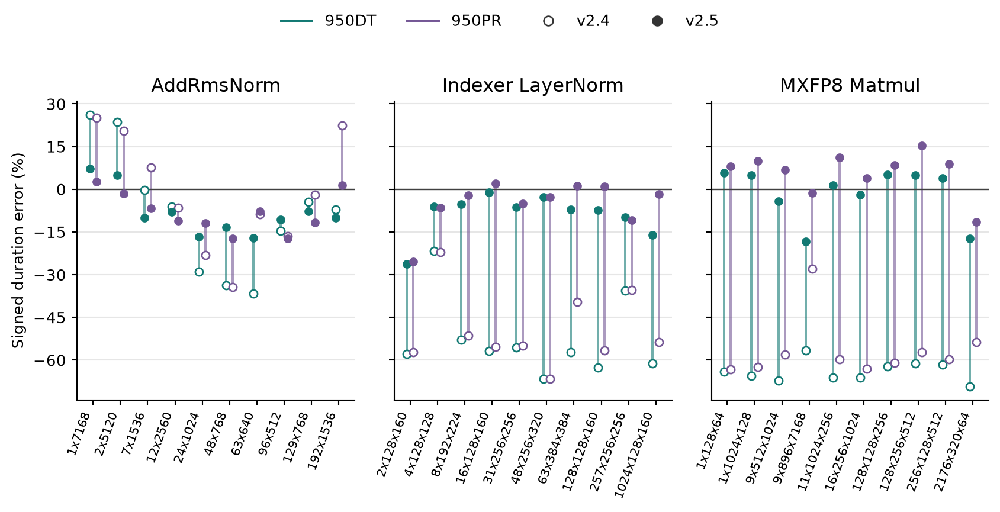

# 附录 J　预测等待时间：首发、物化与跨核写回

## 问题和实验设计

上一版在原生 MXFP8 Matmul 的一个 DT 小投影上低估了 67.80%，在 Indexer LayerNorm 的两组五窗布局对照上低估约一半。加残差的 AddRmsNorm 在旧十形独立集上 WAPE 较低，但个别形状的误差仍超过三成。三者都有精确的有用工作量公式。为了找出遗漏的设备时间，我们分别检查了第一条矩阵指令之前、归一化调用实际启动的各个 kernel，以及最后一个向量核写完各个输出之前的指令。旧验证窗一旦参与诊断，就转入开发集。保留 v2.4 和调整后的 v2.5 价格，在新输入上用同一次完整 CA 观测给两版计分。

## 从指令时标推断模型结构

**MXFP8 Matmul。** DT 开发例每个核只发一条 MMAD_MX。软件需要设置搬运描述符，将两份值和配套的 E8M0 指数送到片上，再交给 Cube 使用。16 个核的首条指令并不同时发起，最晚比最早晚了 525 周期。把最后到达的核纳入时间线后，再按首批 DMA 的响应和交接、首条 MMAD、余下页面的发起与退休重排。首个响应属于固定延迟，后续页面的稳态取决于载荷大小与可用端口。比如 [16,256,1024] 上，DT 原预测为 1.562 µs，重排后为 4.530 µs，CA 为 4.621 µs；PR 重排后也是 4.530 µs，实测 4.360 µs。两端各自的绝对误差缩小，同时模型漏掉了 PR 相对 DT 的小幅领先。两个指标应分别检验。[矩阵实例](../examples/catalog-cube.md)

**Indexer LayerNorm。** 把每个输入的逻辑行宽和实际步长分开。若多行输入带间隙，950 安装包会增加一次 Slice；该 kernel 有自己的开头、分核和写回。归一化随后读取参数和激活，在每个 AIV 上规约忙核所负责的行。外部只取归一化输出时，二进制仍出现两个按行写出的统计量描述符。模型对相邻核的小写引入等待；统计量私有写、输入驻留及跨核争用，仍无法从少量整窗中逐项确定。FP32 仿射输入或单行无法驻留 UB 时沿用相应的通用路径。[布局和逐核证据](../examples/catalog-layer-norm-ca.md)

**AddRmsNorm。** 当残差、权重和输出均匹配普通 BF16 合同时，一行的 rstd 只有 4 字节。DT 的 [32,2048] 中，忙核写 4096 B 残差的描述符持续 338 周期，随后一条仅 4 B 的 rstd 写却持续 4610 周期。观察同形其它核和单核对照后，我们用同一有效写服务范围内的活跃写者数量估计队列长度。每核处理更多相邻行时，同一范围由更少的核写入。这样可以在不改变逻辑字节和峰值带宽的前提下，表示少核宽通道与多核短行的不同完成时间。[写回模型与推导](../examples/add-rms-refinement.md)

## 冻结后的同窗比较

| 算子 | 950DT v2.4 → v2.5 WAPE | 950PR v2.4 → v2.5 WAPE | 950DT / PR 新版最大误差 | 冷读写等效 U 范围（DT / PR） | DT/PR 加速比 WAPE，v2.4 → v2.5 |
|---|---:|---:|---:|---|---:|
| AddRmsNorm | 19.47% → 11.12% | 17.45% → 9.53% | 17.07% / 17.36% | 0.39%–12.80% / 1.18%–36.89% | 8.96% → 6.38% |
| Indexer LayerNorm | 55.49% → 8.92% | 51.89% → 5.76% | 26.31% / 25.41% | 0.01%–2.08% / 0.02%–5.79% | 7.84% → 4.47% |
| MXFP8 Matmul | 63.77% → 7.73% | 53.80% → 7.90% | 18.25% / 15.42% | 0.05%–28.83% / 0.15%–56.54% | 14.29% → 7.06% |

WAPE 用绝对微秒误差之和除以实测微秒之和。最大误差为最差单窗的绝对相对误差。冷读写 U 为同精度有用运算与逻辑读写两项峰值时间的最大值，除以包含该下界的预测。DT/PR 加速比取同形状的 DT 耗时除以 PR 耗时，再对配对比值计算 WAPE。三算子分开统计，原始计时分别为单 kernel 的全设备活跃窗或顺序多 kernel 的活跃窗之和，包含多核指令的最早发起和最晚退休。

横轴为 shape；LayerNorm 最后一项为物理行步长。空心点为 v2.4，实心点为 v2.5，连线越靠近零，当前输入的预测越接近 CA。两代价格使用完全相同的设备窗和逻辑精度。跨芯片比值只用同形状的成对设备观测，970DT 的结果均按芯片假设外推。[逐 shape 对照](../../results/v2.5/paired-errors.csv) · [完整指标](../../results/v2.5/accuracy.json)

按 DT/PR 比值是否高于或低于 1 判定方向，预测等速单列为未命中。十个同形配对里，v2.5 对 AddRmsNorm 判对 8 个、Indexer LayerNorm 判对 3 个、MXFP8 Matmul 判对 1 个。每端平均耗时误差下降后，两芯片的小幅差异仍可能被首发或写回误差盖住。MXFP8 的 [9,896,7168] 是尺寸取自 Kimi 路由器、精度改成双 MXFP8 的试验；实测每核 7 条 MMAD_MX，模型排了 14 个传输页，预测 DT/PR 比为 0.686，实测 0.829。

## 预测开销与覆盖

| 公开入口，单进程 | v2.4 查询 µs | v2.5 查询 µs | v2.5 本次单次最大 µs |
|---|---:|---:|---:|
| AddRmsNorm | 91.2 | 87.1 | 243.4 |
| Indexer LayerNorm | 87.5 | 55.0 | 201.9 |
| MXFP8 Matmul | 70.9 | 59.0 | 110.7 |

表内对每个 shape 与芯片组合预热一次，再在已安装各版本 wheel 的常驻进程中测 30 次默认预测。查询列先取各输入的中位数，再取跨输入中位数。这批输入共有 60 个，计时包括公共 Python 入口与生成结果，模型导入和 CA 采集单列。离线成功 CA 耗时按进程累加，三个合同分别为 1328.8、1299.4、1330.8 秒，采集并发会缩短实际等待。[旧版逐次组统计](../../results/v2.5/query-cost-v24.json) · [本版逐次组统计](../../results/v2.5/query-cost-v25.json)

对原有 13 个预设的 183 张前向图重放时，三种策略分别通过全部 122,383 个输入签名。默认报价有 3,679 个签名变化，来自 BF16 AddRmsNorm 和 Indexer LayerNorm；当前系统图没有命中原生双侧 E8M0 的 MXFP8 投影。逐调用有用工作和逻辑读写与旧版一致。全目录六进程回放中单次查询中位为 0.212 ms，P99 为 8.621 ms，最大 115.532 ms。超过 100 ms 的普通 RMSNorm 签名单进程复测最大 8.799 ms。这里报告报价与主机开销，端到端计算图仍须依赖系统排程。[目录同图核对](../../results/v2.5/catalog-regression.json) · [三种策略核验](../../results/v2.5/catalog-modes.json) · [慢查询复测](../../results/v2.5/slow-query-recheck.csv)
