# 模型预测与 CA 实测的流水对照

先看同一行、同一颜色的起止位置，再看右侧整窗差值。模型图给出它能够解释的分块和依赖；CA 图从全核最早的指令开始计时。末核由实际退休时刻选出，因此一次 Matmul 的末核也可能是 AIV。时间单位均为设备微秒。

## Matmul · 每个输出块的两页 K


950DT，BF16 `[M,N,K]=[1280,2048,512]`，模型 **12.449 µs**、CA **12.219 µs**。首波每核一个 256×256 输出块，第二波每核一个 128×128 尾块。每块读两页 K，每页发起四条 MMAD。浅橙色的实测 FIXP 条包含已发起描述符等待依赖的时间。数据提取逐核核对 GM 地址、L1 页、L0 目的地、累加器初始化和全部 512 条 MMAD。[输入、参数和计算过程](examples/matmul.md) · [图上的全部区间](../results/v0.20/examples/matmul-tile-pages.json)

同一个 shape 在 950PR 上只用 28 个 AIC，首波之后分出 24 个 128×256 矩形。预测和实测都有 416 条 MMAD；首条 MMAD 起点相差 0.059 µs，到了最后一页扩大到 0.586 µs。模型给出 **14.027 µs**，CA 给出 **13.218 µs**。[同一刻度并排看 DT 与 PR](examples/figures/matmul-tile-pages-dt-pr.png) · [950PR 上下对照原图](examples/figures/matmul-tile-pages-pr.png) · [两卡同形的逐页偏差](../results/v0.21/matmul-pages-pr/report.md)

## FA · 同一个 KV 页从 QK 看到 PV


950DT 的 1008 个 KV token 被切成七个 128-token 页和一个 112-token 尾页。第一页 QK 模型晚 0.013 µs，最后一页 PV 早约 1.080 µs。这种逐页比较能直接看出循环的发起间隔还有偏差。[逐页说明](examples/fa.md) · [八页区间](../results/v0.25/coverage/fa-dt-1008-pages.json)

## mHC Post · 末核连续执行四行


内置 Post [196,4,1536]，49 个活动 AIV，图中末核处理第 108–111 个 token。紧邻重复时模型候选给出 3.586 µs，实测 3.800 µs。[四行的输入、地址及计时](examples/mhc_post.md)

## RMSNorm · 同一 UB 块在三种前序下的读、算、写

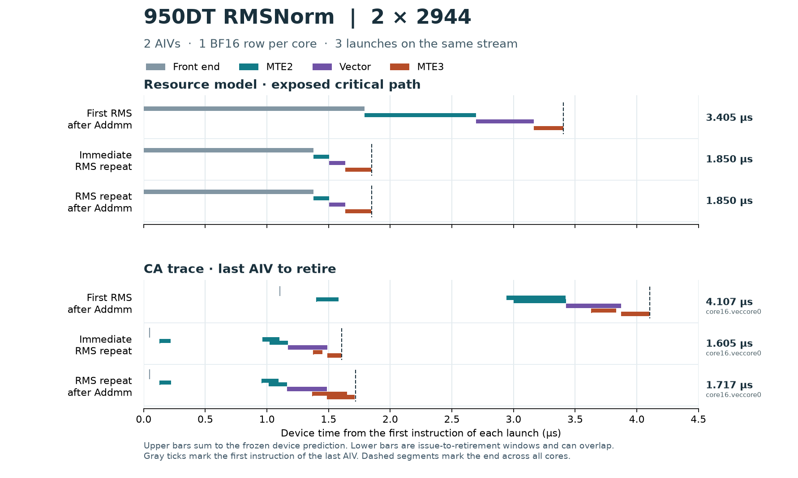

[2,2944] 每个 AIV 一行。中间插入纯 Cube 后再跑 RMS，实际归一化 VF 的发起仍与立即重复相差不到 0.01 µs，主要的时间差发生在最后一笔 y 写回。[逐阶段算例和 950PR 对照](examples/rmsnorm.md)

## 整批 prefill · 从一笔搬运看到每核几十轮

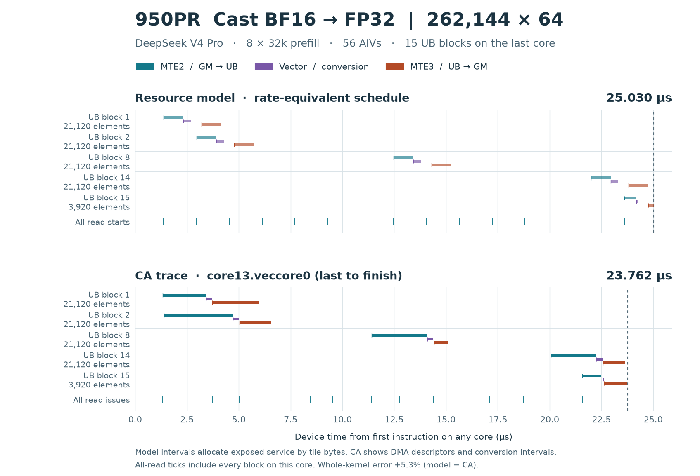

950PR 的 DeepSeek V4 Pro，8 条 32k 一次提交，indexer 系数张量为 BF16 [262144,64]。模型 **25.030 µs**，CA **23.762 µs**。下栏第一、第二块只隔 0.055 µs 就发起了读，写回也发生重叠。每栏最下方 15 根刻度保留所有读发起。相同画法覆盖 Flash 和 Kimi 的 B8×256k；两者在 PR 的实际末核分别跑了 57 轮和 29 轮。[三模型 14 张图及逐块偏差](../results/v0.23/prefill/README.md)

如果看完整 hidden，Flash B8×32k 的激活 Cast 是 [262144,5120]。一次 6 小时 11 分钟的 CA 中 64 个 AIV 已启动，31 个完成。该图仅将已结束核与原生包络下界对照，全核实测留空。[全 hidden 部分窗口图和长作业状态](../results/v0.23/full-hidden/report.md)

### Pro · 每条 128k，单卡 8 条，一次 Cast 做 50 轮

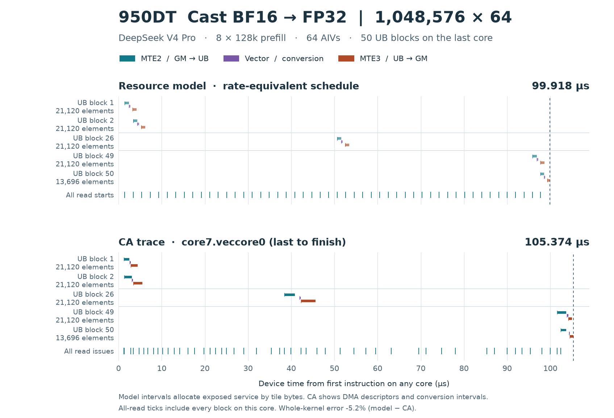

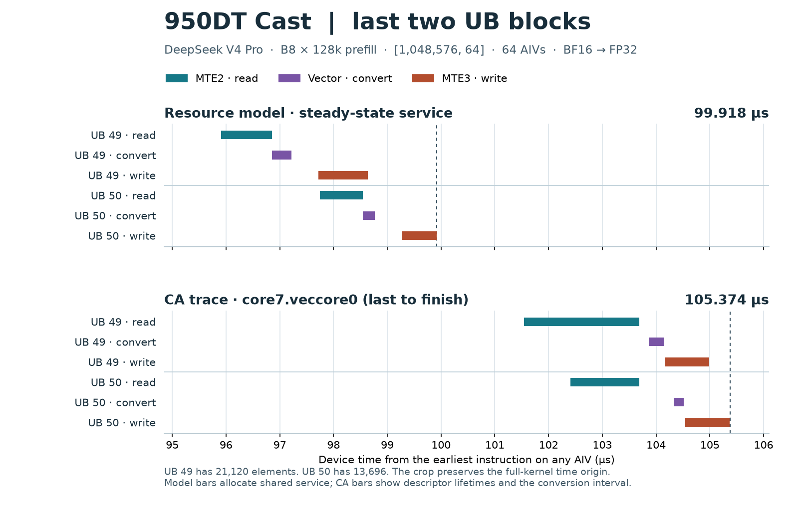

这次独立库调用覆盖全部 67,108,864 个系数。沿尾块看，模型在 **97.747 µs** 发起读，末核 core7.veccore0 在 **102.408 µs** 发起。模型总共低估 5.456 µs，其中 4.661 µs 在尾块开始读之前已积累。上栏的稳态读写条分摊整卡共享带宽，下栏来自真实地址配对的 MTE2、转换和 MTE3 指令。[逐块原始地址与时间](../results/v0.23/pro-prefill/pro-b8-128ki-dt-blocks.json) · [完整库调用与金标](../results/v0.23/pro-prefill/pro-b8-128ki-dt.json)

### Flash · 把 128Ki 末三块的预测与真实描述符放大


每行是同一 UB 块。在第 29 块，模型读起点偏晚 19.870 µs，读描述符的时长却短估 1.585 µs。单看设备整窗，无法定位这两类符号相反的偏差。[全核读写证据](../results/v0.25/cache/README.md) · [按累积数据量定价的候选](../results/v0.25/cache/flash-128ki-pr-prefix.png)

### Pro · 950PR 同形的 57 轮，放大中间三块

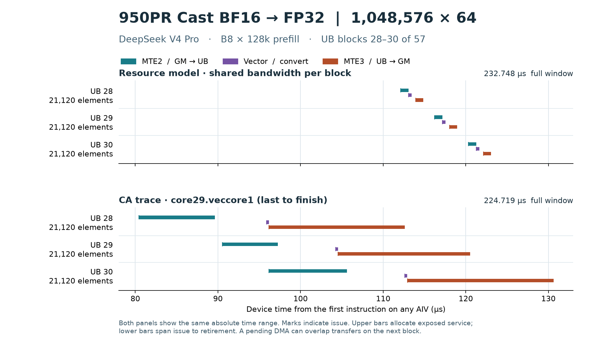

50 轮的 DT 和 57 轮的 PR 都完成全尺寸 CA。同样是读 128 MiB、写 256 MiB，两卡时间分别为 105.374 与 224.719 µs。PR 模型高估整窗 3.57%，第 29 块却因读发起偏晚、在途写窗口过短而出现符号相反的阶段误差。[逐块计算与误差](examples/cast_bf16_fp32.md) · [完整 57 轮](../results/v0.23/pro-prefill/pro-b8-128ki-pr-plot.png) · [同一 Flash 8×128k 场景的最后三块](../results/v0.25/cache/flash-128ki-pr-tail.png)

## KDA V2 · 三个 kernel 分别在哪里产生偏差

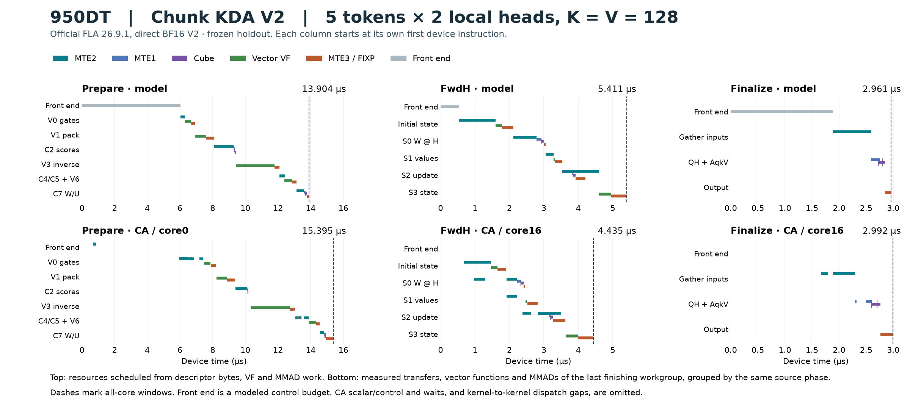

T=5、两个本地头时，950DT 在 Prepare 低估约 1.49 µs，在 FwdH 高估约 0.98 µs，整窗误差只有 0.55 µs。每列独立计时，竖线标实际 MMAD 发起，下栏保留对应的 MTE、Cube 和 Vector。该样本在模型冻结后采集。[950PR 同形流水](../results/kda-resource23/950pr-t5-holdout-comparison.png) · [公式、计时口径与完整算例](examples/kda_chunk.md)

### 两个相邻块哪些输入可以预取

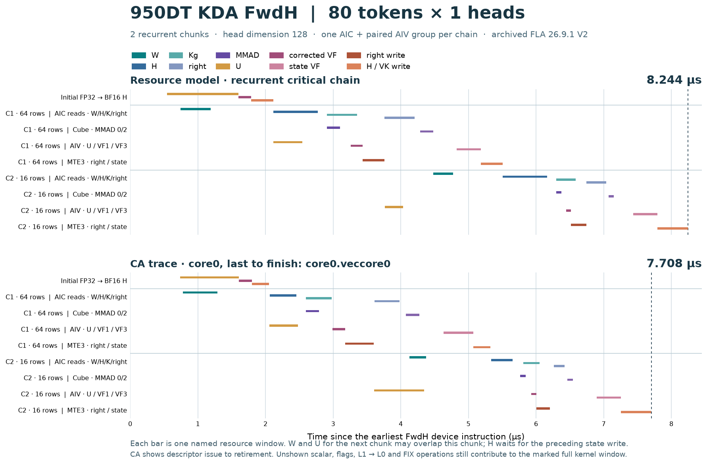

这个冻结后独立样本是 T=80/H=1。沿第二块可看到 W、U 提前发起，而 H 等待上块状态写结束；FwdH 新排程 8.244 µs，CA 7.708 µs。[公式、两端验证和实际缓冲地址](../results/v0.24/kda-prefetch/method.md)

### 129 个 token 如何串成三次状态更新

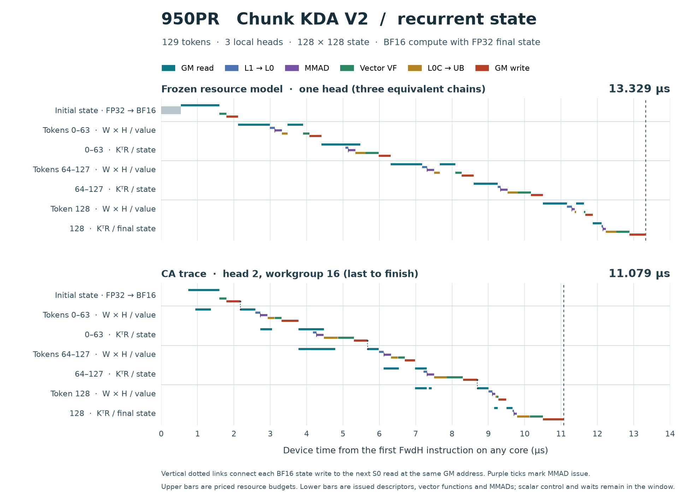

B=1、H=3，每个头的 128×128 状态沿时间递推，三个头可以并行。上栏按同一个头展开，下栏通过上一次的 GM 写地址和下一次的读地址对齐实际 head 2 的状态链。点线连接同地址的写和读，紫色竖线是六次实际 MMAD。尾块只有一个有效 token，但矩阵指令仍按 16 行计算。FwdH 单段预测 **13.329 µs**，实测 **11.079 µs**。沿着第 2 行能看到下一步使用的权重读在上一步状态产生前就已启动，冻结排程中的部分等待可以重叠。[逐块原始区间与价格](../results/v0.23/kda-multiblock/950pr-t129-h3-fwdh.json) · [KDA 输入与三段设备时间](examples/kda_chunk.md)

## 同一个 UB 槽何时可以复用

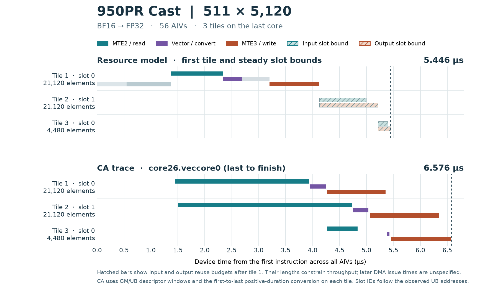

BF16 → FP32 Cast `[511,5120]`，第三个块开始读取输入槽 0 时，第一个块仍在从输出槽 0 写回。上栏的实色块表示已定价的首块阶段，斜纹表示后续槽的周转预算。下栏直接按真实 UB 地址配对读、转换和写。模型 5.446 µs，实测 6.576 µs。[按三个块展开算例](examples/cast_bf16_fp32.md)

## RMSNorm · 同一行的两笔写何时结束

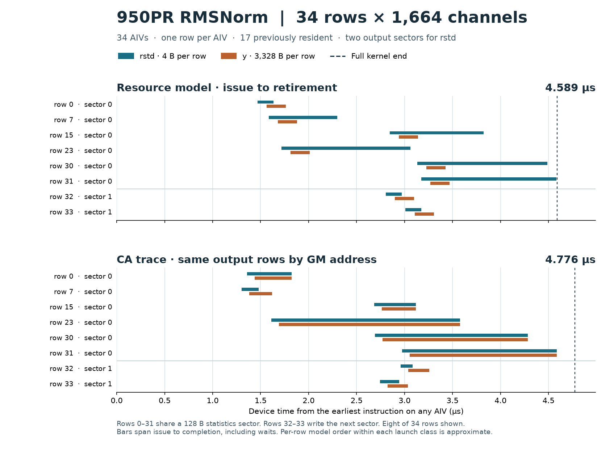

BF16 [34,1664]，前序同流已经执行过 17 个 AIV。图的每一行是同一个逻辑输出行。统计量 rstd 每行 4 B，因此行 31 和 32 恰好分属不同的 128 B 扇区。PR 第 31 行的 y 在模型 3.470 µs 结束，实际与该行的 rstd 几乎同时在 4.587 µs 结束；第 32 行 y 在 3.256 µs 就已完成。两端各有 28/34 行的两笔写退休间隔小于 0.005 µs。整窗预测依然接近，因为争用的 rstd 本来就在模型的关键路径上。图上保留这处逐行偏差。[950DT 同轴图](../results/v0.24/rms-prefix/dt-rms-output-rows.png) · [PR 全部 34 行](../results/v0.24/rms-prefix/pr-rms-output-rows.json) · [输入与公式](examples/rmsnorm.md)

## 最后一笔写怎样随行数改变


`[4,4800]` 的最后一行以 BF16 `y` 写回结束。`[34,1904]` 里有 32 个通道向同一 128 B 区域写 FP32 `rstd`，预估的末段换成了扇区写队列。下栏的细竖线给出实际各通道的写退休时刻。[从系统调用到全核窗口](examples/rmsnorm.md)

## Addmm · 同一列偏置怎样穿过 L1 和 BT

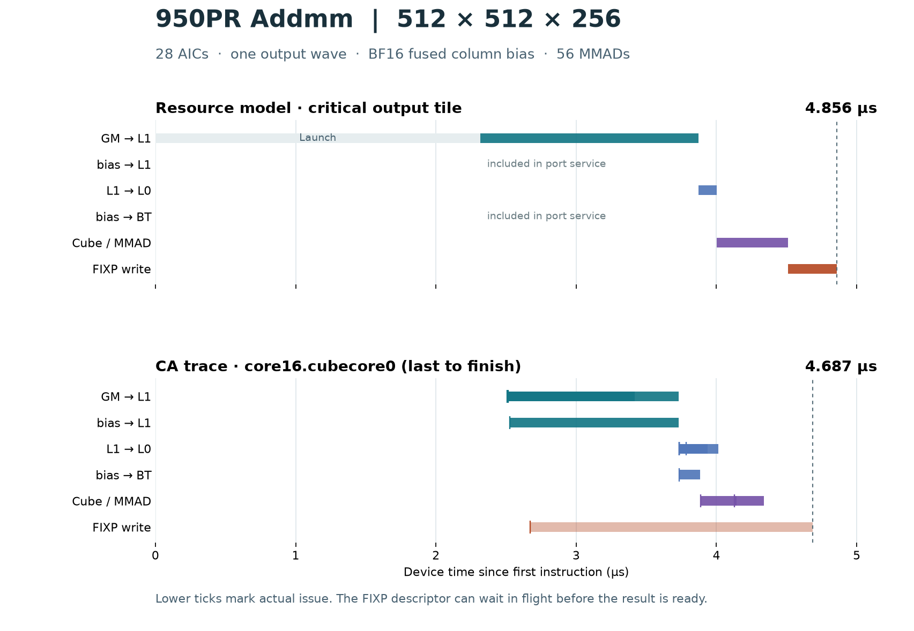

[512,512,256] 在 950PR 用了一波、28 个 AIC。原模型预测 7.101 µs，新模型 4.856 µs，完整 CA 4.687 µs。下栏可以看到偏置搬运与 A、B 读重叠，FIXP 描述符比 Cube 完成更早发起。[从输入算到两卡耗时](examples/addmm.md)

## Lightning Indexer · 第一段 Cube 从何时开始

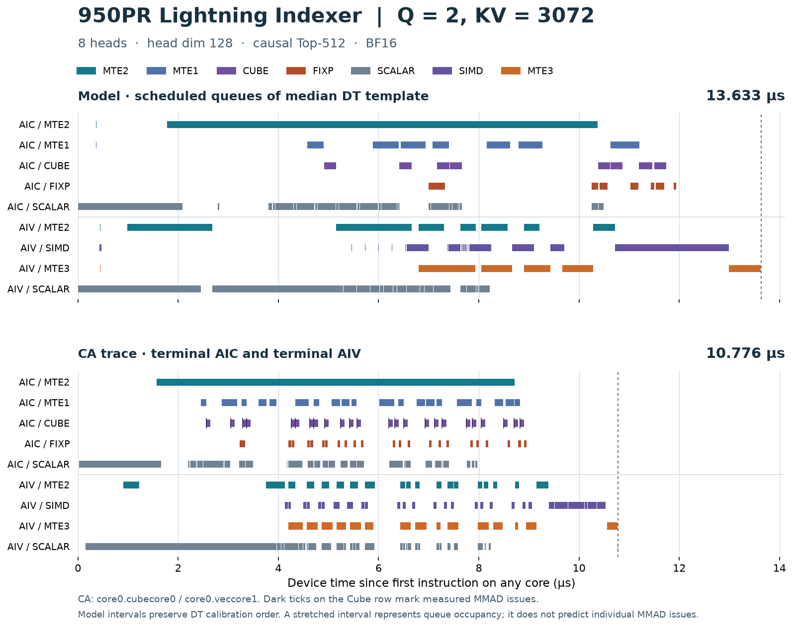

950PR，`[1,2,3072,8,128]`。模型给出 13.633 µs，CA 为 10.776 µs。第一段 Cube 活动开始于 4.910 / 2.561 µs，两者已相差 2.349 µs。图下方有 24 条实测 MMAD 的发起刻度。上栏保留模型所用模板的资源重叠关系，能比较 Cube 何时接到数据；每个 MMAD 的起始位置只有实测侧提供。[输入、模板选择和原始区间](examples/lightning_indexer.md)

## Kimi AttnResFwd · 独立新形状的阶段边界

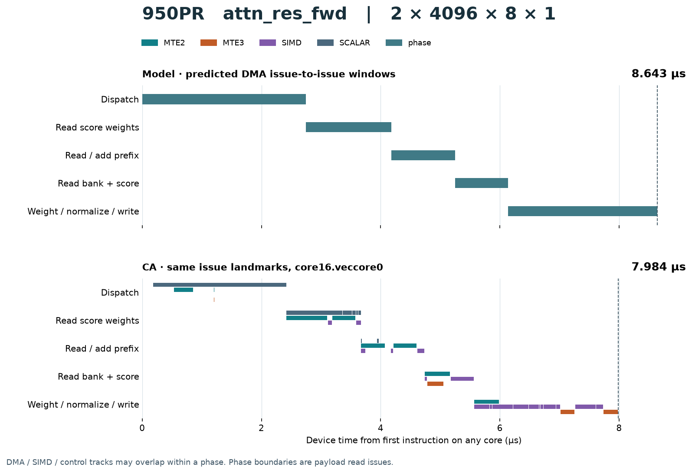

同一 `[2,4096,8,1]`，950PR 预测 8.643 µs，CA 为 7.984 µs；旧版为 11.066 µs。950DT 预测 8.603 µs，CA 为 8.113 µs。两端各自更接近实测，但这个形状的 DT/PR 快慢顺序仍判反。上图按发起、读权重、读前缀、读 bank 和归一化写出五个阶段放置边界，下图由实际末核 core16.veccore0 提取。[按阶段核对输入、估计、读写和尾部](examples/attn_res_fwd.md)

## 整批 prefill · 新 shape 的逐块独立验证

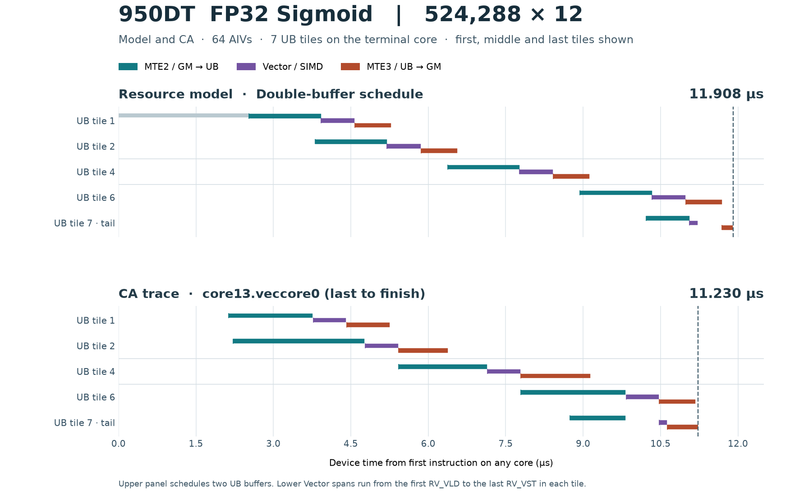

Kimi [524288,12] 在 950DT 预测 11.908 µs、实测 11.230 µs。上栏预测采集前已经固定，图中每个 UB 块可单独核对读发起与写退休。Flash Cast 的新 [393216,32] 在 DT 仍低估 21.0%。[两算子、两端的独立长 shape 图集](../results/v0.21/vector/independent-figures.md) · [开发集 PR 的 128k Kimi](examples/figures/v021-sigmoid-128ki-pr.png)

Flash 的 32 列投影也新增了整批独立点：每卡 8 条、每条 196,608 token，Cast 输入 [1572864,32]。950DT 预测 68.143 µs，完整 CA 为 72.238 µs，低估 5.67%。此处 32 是 indexer 的投影输出列数，模型 hidden 仍为 5120。[该形状的逐块上下图](examples/figures/v021-holdout-cast_bf16_fp32_1572864_32-dt.png)

## 同为 Matmul，Flash 的 Stream-K 多出一段归并


8 个请求每次各处理 256 token，Flash 的 hidden 是 5120，复制的 indexer 投影输出 32 列。950DT 预测 **12.123 µs**，实测 **13.023 µs**。模型和 CA 都算出 640 条 MMAD，但实际指令是 [256,32,64]，模型设为 [64,32,256]。安装包的 Stream-K 分支使用 64 个 AIV 处理部分和。末个 AIC 的 Cube 阶段结束到整窗结束，预测 0.256 µs，实测 2.756 µs。同形 950PR 预测 19.016 µs，实测 20.822 µs。两卡用同一 ELF，DT 按 4 段分 K，PR 按 3 段分 K。DT/PR 时间比预测 0.6375，实测 0.6255。这里使用 BF16 连续 ND 权重做同维度库验证。[PR 的三路归并图](examples/figures/matmul-prefill-pr.png) · [三端预测、安装包分支与逐段残差](examples/matmul-prefill.md)

## Vector · 每个 UB 块的读、计算与两路写


`DynamicMxQuant` 对 BF16 输入 `[2048,5120]` 生成 FP8 值和 E8M0 scale。一个 UB 块对应一次有效读、向量程序和两类输出。图的下栏用字节数及程序计数器把事件归回对应块；一次描述符可以在前一条结束前发起。[逐轮量化算例](examples/quant.md)

## RMSNorm · 每核执行二十多轮的实测


BF16 [32768,1280] 共 41,943,040 个元素，两端都逐元素核对了 y 和 rstd。末核在 DT 处理 22 轮，PR 处理 25 轮，与分块预测逐轮吻合。PR 上整窗预测 61.616 µs，实测 69.729 µs。图中展开首、中、末块，PR 连续满块的 rstd 发起间隔中位数比实测短 0.776 µs。设备整窗和局部块各自采用图上标出的时间原点。[两卡模型公式与逐轮时间戳](../results/v0.21/wide-rms/report.md) · [DT 的 22 轮流水](examples/figures/rms-wide-tiles-dt.png) · [同宽度从 32 到 32,768 行的两卡实测](examples/rmsnorm.md)

## RMSNorm · 同一核新增一条向量通道

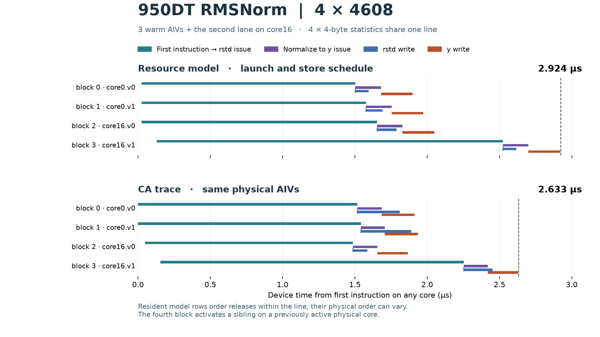

950DT 的 BF16 [4,4608] 紧随一次使用 3 个 AIV 的调用。最后一行对应 core16 的新通道，图上的蓝条是 4 B 统计量写回，橙条是该行归一化输出写回。给出相同的前序信息时，v0.21 预测 3.792 µs，候选模型预测 2.924 µs，CA 为 2.633 µs。候选仍把这一行的首笔统计量写发起得晚了 0.270 µs。该样本属于剔除整个进程后的历史回放。上栏三个已热通道的先后按统计顺序放置，新通道可以由输出地址唯一识别。[完整推导与独立校准状态](examples/rmsnorm.md)

## mHC Post · 同一核连续五行的热态误差


[257,4,832] 的末核负责 token 145–149。沿第二轮读和第一轮写可以看到约 0.374 µs 的交叠。这个热重复的全核预测高估 54.57%，读和写的阶段价格合计多出 1.736 µs。[逐轮读数、比较口径与剩余误差](../results/v0.24/post/multirow.md)

## mHC Post · 同一 shape 的首次与再次派发

同流连续运行两次 [3,4,5376]，相同 dtype、同一 ELF、同样使用 48 个 AIV。950DT 两次实测相差 3.247 µs，950PR 相差 2.908 µs，均超过只给一个耗时能覆盖 40% 最大误差的范围。模型在同一流里读取历史，DT 的两次时延预测为 4.855、2.380 µs，PR 为 4.861、2.386 µs。下栏的末核指令可以看出时间差有多少出现在首次向量装载之前。[双芯片首发与复用的完整上下图](examples/figures/mhc-post-repeat-paired.png) · [可行误差区间与逐段解释](examples/mhc_post.md)

## CV 融合 · 长 KV 循环的首、中、末页


同一页分上下两行对比，三组局部放大图保持同一个全核时间原点。整窗下方的小刻度标出 128 个页的首次 QK 和 PV。预测 76.377 µs、CA 72.856 µs；模型稳态间隔为 0.5172 µs，实测 QK、PV 的中位间隔分别为 0.4973、0.4955 µs。该算例是单头 dense FA；三模型稀疏注意力与 MLA 的配置另列。[首个 QK/PV、循环及排空](examples/fa.md) · [模型对应的注意力几何](prefill-shapes.md)

同类 950DT 算例将 KV 延长到 131,072。模型 274.987 µs，归档 CA 274.821 µs。图中挑出首、中、末共六个页，下方保留全部 512 个页的实际发起时刻。[128k FA 同轴图](examples/figures/fa-dt-128k-pages.png)

## 三个模型的长 prefill

DT、PR 采用相同的逻辑输入。下表的当前模型在归档窗口上回放，独立新形状见上面的 64k 算例。宽度来自每个算子的模型位置。Flash 与 Pro 的数值是 indexer 在每个 token 上的投影宽度，Kimi 的 12 列是 TP8 后本卡的 KDA beta 头数。表中时间单位为 µs。

| 每卡 8 个请求 | 算子输入 | DT 当前 / CA | PR 当前 / CA |
|---|---|---:|---:|
| Flash，每条 32k | Cast [262144,32] | 9.850 / 9.970 | 13.046 / 14.080 |
| Flash，每条 128k | Cast [1048576,32] | 36.368 / 35.535 | 88.943 / 70.711 |
| Flash，每条 256k | Cast [2097152,32] | 99.918 / 106.757 | 232.748 / 223.493 |
| Pro，每条 32k | Cast [262144,64] | 16.592 / 17.041 | 25.030 / 23.762 |
| Kimi，每条 32k | Sigmoid [262144,12] | 8.002 / 7.759 | 12.344 / 11.428 |
| Kimi，每条 128k | Sigmoid [1048576,12] | 19.720 / 18.553 | 39.630 / 34.285 |
| Kimi，每条 256k | Sigmoid [2097152,12] | 45.897 / 42.686 | 104.717 / 88.593 |

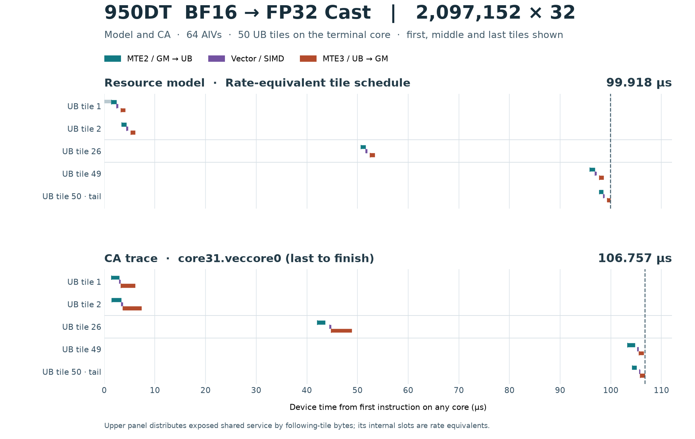

在每条 128k → 256k 时，Flash Cast 的逻辑流量翻倍，DT、PR 的实测时间分别增长 **3.00 倍、3.16 倍**。仅 BF16→FP32 的逻辑输出就由 128 MiB 增至 256 MiB；末核满块的发起间隔也发生了变化。在这个区间按元素数直接翻倍会低估。Kimi 的相同长度变化对应 **2.30 倍、2.58 倍**。两款芯片的逐轮图及控制器读写数据保留了这一区别。[Flash 的 256k PR](examples/figures/v021-cast-256ki-pr.png) · [Kimi 的 128k DT](examples/figures/v021-sigmoid-128ki-dt.png) · [Kimi 的 128k PR](examples/figures/v021-sigmoid-128ki-pr.png) · [开发回放的所有数据](../results/v0.21/vector/development.json)

## MoE · 同一批 token 的两个专家


GMM1 和 GMM2 均用 `[8,256,128,2]`、专家分配 `[1,7]`。GMM1 的两份中位参考排程分别给出 8.930、10.999 µs，模型取均值 9.964 µs；CA 为 7.393 µs。下图栏的 8 条 `MMAD_MX` 来自 2 个 AIC。后续 GMM2 的 17 条 `MMAD_MX` 来自 17 个 AIC，整窗预测 3.701 µs，实测 3.663 µs。同样接近的总时间还可以对应不同的首次 Cube 发起位置，图中保留了产生均值的两条排程。[GMM1 逐段算例与时间戳](examples/grouped_matmul_swiglu_quant_v2.md) · [GMM2 同轴图与算例](examples/gmm2.md)

### 各种图能看出什么

最初的 20 条路线中，**12 条**可以按工作块、阶段或资源队列核对预测与实测（Matmul、Addmm、量化、FA、Cast、Sigmoid、RMSNorm、AttnResFwd、PreSinkhorn、Lightning Indexer、GMM1 和 GMM2）。大 RMSNorm 的局部块用首笔 rstd 对齐，完整设备窗另列。**2 条**对应串行 kernel（mHC 链、MoE FFN）。**5 条**给出状态或阶段成本及真实 CA 队列（mHC Post、mHC Pre、Sinkhorn、KDA recurrent、MoE 路由）。独占成本可以解释总误差来自哪个资源；该资源的逐条发起时刻只在有指令记录的一侧可见。融合 KDA V1 的全窗为 N/A；显式 FLA V2 分成三个 kernel，可用上面同形的新图核对。[各算子示例](modeling-strategy.md#逐算子算例) · [误差明细](error-analysis.md)

### 按算子打开图

| 算例与推导 | 芯片与输入 | 流水图能核对的内容 |
|---|---|---|
| [Matmul](examples/matmul.md) | DT · 1280×2048×512 | [DT 每个输出块的两页 K](examples/figures/matmul-tile-pages.png) · [同形 PR 的矩形尾块](examples/figures/matmul-tile-pages-pr.png) |
| [Addmm](examples/addmm.md) | PR · 512×512×256 | [偏置进 L1、BT，与矩阵读重叠](examples/figures/addmm-v21-pr-page.png) |
| [DynamicMXQuant](examples/quant.md) | PR · 2048×5120 | [一个 UB 块的读、计算、值和 scale 写](examples/figures/quant-chunk-pr-tiles.png) |
| [FA](examples/fa.md) | PR · Q=9，KV=32768，D=64 | [逐 KV 页 QK、PV 发起和稳态间隔](examples/figures/fa-pr-32k-pages.png) |
| [Cast](examples/cast_bf16_fp32.md) | DT · 2097152×32 | [Flash 的首中末轮](examples/figures/v021-cast-256ki-dt.png) · [Pro B8×128k 末两轮放大](../results/v0.24/pro-128ki-tail.png) |
| [Sigmoid](examples/sigmoid_fp32.md) | DT · 524288×12 | [Kimi 冻结新形，终止核的 UB 轮次](examples/figures/v021-holdout-sigmoid_fp32_524288_12-dt.png) |
| [AttnResFwd](examples/attn_res_fwd.md) | PR · 2×4096×8×1 | [五个阶段的边界](examples/figures/attn_res_fwd-independent-v21-pr.png) |
| [Lightning Indexer](examples/lightning_indexer.md) | PR · 1×2×3072×8×128 | [AIC/AIV 的资源队列和 24 个 MMAD](examples/figures/lightning-indexer-3072-pr.png) |
| [GMM1–SwiGLU–MXQuant](examples/grouped_matmul_swiglu_quant_v2.md) | PR · 8×256×128×2 | [两个中位模板、两专家 MMAD_MX](examples/figures/gmm1-two-experts-pr.png) |
| [GMM2](examples/gmm2.md) | PR · 8×256×128×2 | [同一专家分布的第二次 GEMM](examples/figures/gmm2-two-experts-pr.png) |
| [mHC PreSinkhorn](examples/mhc_pre_sinkhorn.md) | PR · 1×4×4096 | [AIC 与 AIV 的交接](examples/figures/mhc_pre_sinkhorn-v21-pr.png) |
| [mHC 拆分链](examples/mhc.md) | PR · 1×4×128 | [三个串行 kernel 的独立设备窗](examples/figures/mhc-pr-pipeline.png) |
| [MoE FFN](examples/moe_ffn.md) | PR · 2×64×64×1 | [GMM1 与 GMM2 两个设备窗](examples/figures/moe_ffn-pr-pipeline.png) |
| [RMSNorm](examples/rmsnorm.md) | DT / PR · 32768×1280；DT · 4×4608 | [PR 25 轮 UB](examples/figures/rms-wide-tiles-pr.png) · [同核扩出第二条 AIV](examples/figures/rms-expanding-sibling.png) |
| [mHC Post](examples/mhc_post.md) | DT / PR · 3×4×5376 | [首次与连续再次派发](examples/figures/mhc-post-repeat-paired.png) · [7168 宽度按同一 token 四路写回](../results/v0.24/post/post-ordered-pipeline.png) |
| [mHC Pre](examples/mhc_pre.md) | PR · 1×4×128 | [末核控制等待、计算、搬运独占成本](examples/figures/mhc-pre-exclusive-pr.png) |
| [mHC Sinkhorn](examples/mhc_sinkhorn.md) | PR · 64×4 | [每 AIV 两行共用发射的阶段成本](examples/figures/mhc_sinkhorn-v21-pr.png) |
| [KDA recurrent](examples/kda_recurrent.md) | PR · 1×3×1×1×128×128 | [完整资源预算与六次实际状态更新](examples/figures/kda-recurrent-state-pr.png) |
| [MoE 路由 Top-K](examples/moe_gating_top_k.md) | PR · 1×384×6 | [路由阶段成本和末核队列](examples/figures/moe_gating_top_k-pr-pipeline.png) |
| [KDA chunk，融合 V1](examples/kda_chunk.md) | PR · 1×64×2×2×128×128 | [V1 同步失败事件，整窗无合格结果](examples/figures/kda-chunk-pr-event.png) |
| [KDA chunk，三段 V2](examples/kda_chunk.md) | PR · 1×5×2×2×128×128 | [三段 PR 观测](../results/kda-resource23/950pr-t5-holdout-comparison.png) · [当前两块 DT](../results/v0.24/kda-prefetch/dt-80-independent.png) · [当前三块 PR](../results/v0.24/kda-prefetch/pr-145-independent.png) |
| [DeepSeek 扩展 HcPost](examples/hc_post_vllm.md) | DT · 1×2×4×16448 | [双槽、五个 D 块和尾片的整块转换](../results/v0.23/hc-timing/dt-16448-timeline.png) · [独立 33 行×7168 的两片](../results/v0.23/hc-timing/dt-7168-independent.png) |

### 从仓内数据重画

在安装 Matplotlib 的 Python 环境中，于仓库根目录执行下列命令即可重画三类代表图。脚本读取的是已经提交的模型区间、精简 CA 时间戳及设备窗口。完整原始的 CA trace 只在重新提取、核对程序计数器和地址时使用。

```sh
python development/validation/prefill_timelines/compare.py --case pro-32ki-pr --replot
python development/validation/dispatch21/addmm_figure.py
python development/validation/fusion21/indexer_figure.py --replot
python development/validation/sku20/matmul_figure.py
python development/validation/matmul_pages_pr/publish.py --replot
python development/validation/matmul_pages_pr/paired.py
python development/validation/sku20/quant_tile_figure.py
python development/validation/rms_dispatch_audit/figure.py --replot
python development/validation/sku20/fa_pages.py --replot
python development/validation/sku20/fa_pages.py --dt128k --replot
python development/validation/prefill_zoom24/plot.py
```
