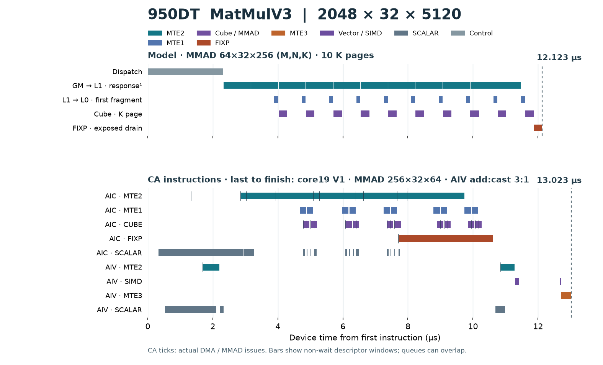
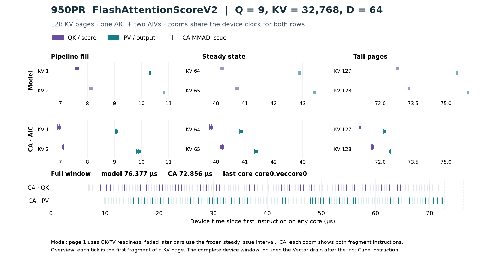

# 模型预测与 CA 实测的流水对照

先看同一行、同一颜色的起止位置，再看右侧整窗差值。模型图给出它能够解释的分块和依赖；CA 图从全核最早的指令开始计时。末核由实际退休时刻选出，因此一次 Matmul 的末核也可能是 AIV。时间单位均为设备微秒。

## Matmul · 每个输出块的两页 K


950DT，BF16 `[M,N,K]=[1280,2048,512]`，模型 **12.449 µs**、CA **12.219 µs**。首波每核一个 256×256 输出块，第二波每核一个 128×128 尾块。每块读两页 K，每页发起四条 MMAD。浅橙色的实测 FIXP 条包含已发起描述符等待依赖的时间。数据提取逐核核对 GM 地址、L1 页、L0 目的地、累加器初始化和全部 512 条 MMAD。[输入、参数和计算过程](examples/matmul.md) · [图上的全部区间](../results/v0.20/examples/matmul-tile-pages.json)

## Addmm · 同一列偏置怎样穿过 L1 和 BT


[512,512,256] 在 950PR 用了一波、28 个 AIC。原模型预测 7.101 µs，新模型 4.856 µs，完整 CA 4.687 µs。下栏可以看到偏置搬运与 A、B 读重叠，FIXP 描述符比 Cube 完成更早发起。[从输入算到两卡耗时](examples/addmm.md)

## Lightning Indexer · 第一段 Cube 从何时开始


950PR，`[1,2,3072,8,128]`。模型给出 13.633 µs，CA 为 10.776 µs。第一段 Cube 活动开始于 4.910 / 2.561 µs，两者已相差 2.349 µs。图下方有 24 条实测 MMAD 的发起刻度。上栏保留模型所用模板的资源重叠关系，能比较 Cube 何时接到数据；每个 MMAD 的起始位置只有实测侧提供。[输入、模板选择和原始区间](examples/lightning_indexer.md)

## Kimi AttnResFwd · 独立新形状的阶段边界


同一 `[2,4096,8,1]`，950PR 预测 8.643 µs，CA 为 7.984 µs；旧版为 11.066 µs。950DT 预测 8.603 µs，CA 为 8.113 µs。两端各自更接近实测，但这个形状的 DT/PR 快慢顺序仍判反。上图按发起、读权重、读前缀、读 bank 和归一化写出五个阶段放置边界，下图由实际末核 core16.veccore0 提取。[按阶段核对输入、估计、读写和尾部](examples/attn_res_fwd.md)

## 整批 prefill · 新 shape 的逐块独立验证


Kimi [524288,12] 在 950DT 预测 11.908 µs、实测 11.230 µs。上栏预测采集前已经固定，图中每个 UB 块可单独核对读发起与写退休。Flash Cast 的新 [393216,32] 在 DT 仍低估 21.0%。[两算子、两端的独立长 shape 图集](../results/v0.21/vector/independent-figures.md) · [开发集 PR 的 128k Kimi](examples/figures/v021-sigmoid-128ki-pr.png)

## 同为 Matmul，Flash 的 Stream-K 多出一段归并



8 个请求每次各处理 256 token，Flash 的 hidden 是 5120，复制的 indexer 投影输出 32 列。950DT 预测 **12.123 µs**，实测 **13.023 µs**。模型和 CA 都算出 640 条 MMAD，但实际指令是 [256,32,64]，模型设为 [64,32,256]。安装包的 Stream-K 分支使用 64 个 AIV 处理部分和。末个 AIC 的 Cube 阶段结束到整窗结束，预测 0.256 µs，实测 2.756 µs。同形 950PR 预测 19.016 µs，实测 20.822 µs。两卡用同一 ELF，DT 按 4 段分 K，PR 按 3 段分 K。DT/PR 时间比预测 0.6375，实测 0.6255。这里使用 BF16 连续 ND 权重做同维度库验证。[PR 的三路归并图](examples/figures/matmul-prefill-pr.png) · [三端预测、安装包分支与逐段残差](examples/matmul-prefill.md)

## Vector · 每个 UB 块的读、计算与两路写


`DynamicMxQuant` 对 BF16 输入 `[2048,5120]` 生成 FP8 值和 E8M0 scale。一个 UB 块对应一次有效读、向量程序和两类输出。图的下栏用字节数及程序计数器把事件归回对应块；一次描述符可以在前一条结束前发起。[逐轮量化算例](examples/quant.md)

## CV 融合 · 长 KV 循环的首、中、末页



同一页分上下两行对比，三组局部放大图保持同一个全核时间原点。整窗下方的小刻度标出 128 个页的首次 QK 和 PV。预测 76.377 µs、CA 72.856 µs；模型稳态间隔为 0.5172 µs，实测 QK、PV 的中位间隔分别为 0.4973、0.4955 µs。该算例是单头 dense FA；三模型稀疏注意力与 MLA 的配置另列。[首个 QK/PV、循环及排空](examples/fa.md) · [模型对应的注意力几何](prefill-shapes.md)

同类 950DT 算例将 KV 延长到 131,072。模型 274.987 µs，归档 CA 274.821 µs。图中挑出首、中、末共六个页，下方保留全部 512 个页的实际发起时刻。[128k FA 同轴图](examples/figures/fa-dt-128k-pages.png)

## 三个模型的长 prefill

DT、PR 采用相同的逻辑输入。下表的当前模型在归档窗口上回放，独立新形状见上面的 64k 算例。宽度来自每个算子的模型位置。Flash 与 Pro 的数值是 indexer 在每个 token 上的投影宽度，Kimi 的 12 列是 TP8 后本卡的 KDA beta 头数。表中时间单位为 µs。

| 每卡 8 个请求 | 算子输入 | DT 当前 / CA | PR 当前 / CA |
|---|---|---:|---:|
| Flash，每条 32k | Cast [262144,32] | 8.363 / 9.970 | 13.046 / 14.080 |
| Flash，每条 128k | Cast [1048576,32] | 36.368 / 35.535 | 88.943 / 70.711 |
| Flash，每条 256k | Cast [2097152,32] | 99.918 / 106.757 | 232.748 / 223.493 |
| Pro，每条 32k | Cast [262144,64] | 13.334 / 17.041 | 25.030 / 23.762 |
| Kimi，每条 32k | Sigmoid [262144,12] | 8.002 / 7.759 | 12.344 / 11.428 |
| Kimi，每条 128k | Sigmoid [1048576,12] | 19.720 / 18.553 | 39.630 / 34.285 |
| Kimi，每条 256k | Sigmoid [2097152,12] | 45.897 / 42.686 | 104.717 / 88.593 |


在每条 128k → 256k 时，Flash Cast 的逻辑流量翻倍，DT、PR 的实测时间分别增长 **3.00 倍、3.16 倍**。两点之间跨过缓存容量区间，线性外推在此处会低估。Kimi 的相同长度变化对应 **2.30 倍、2.58 倍**。两款芯片的逐轮图及控制器读写数据保留了这一区别。[Flash 的 256k PR](examples/figures/v021-cast-256ki-pr.png) · [Kimi 的 128k DT](examples/figures/v021-sigmoid-128ki-dt.png) · [Kimi 的 128k PR](examples/figures/v021-sigmoid-128ki-pr.png) · [开发回放的所有数据](../results/v0.21/vector/development.json)

## MoE · 同一批 token 的两个专家


GMM1 和 GMM2 均用 `[8,256,128,2]`、专家分配 `[1,7]`。GMM1 的两份中位参考排程分别给出 8.930、10.999 µs，模型取均值 9.964 µs；CA 为 7.393 µs。下图栏的 8 条 `MMAD_MX` 来自 2 个 AIC。后续 GMM2 的 17 条 `MMAD_MX` 来自 17 个 AIC，整窗预测 3.701 µs，实测 3.663 µs。同样接近的总时间还可以对应不同的首次 Cube 发起位置，图中保留了产生均值的两条排程。[GMM1 逐段算例与时间戳](examples/grouped_matmul_swiglu_quant_v2.md) · [GMM2 同轴图与算例](examples/gmm2.md)

### 各种图能看出什么

20 条路线中，**11 条**可以按工作块、阶段或资源队列对到真实时间（Matmul、Addmm、量化、FA、Cast、Sigmoid、AttnResFwd、PreSinkhorn、Lightning Indexer、GMM1 和 GMM2）。**2 条**对应串行 kernel（mHC 链、MoE FFN）。**6 条**给出状态或阶段成本及真实 CA 队列（RMSNorm、mHC Post、mHC Pre、Sinkhorn、KDA recurrent、MoE 路由）。独占成本可以解释总误差来自哪个资源；该资源的逐条发起时刻只在有指令记录的一侧可见。KDA chunk 目前只有失败事件诊断，完整耗时为 N/A。[各算子示例](modeling-strategy.md#逐算子算例) · [误差明细](error-analysis.md)

### 从仓内数据重画

在安装 Matplotlib 的 Python 环境中，于仓库根目录执行下列命令即可重画三类代表图。脚本读取的是已经提交的模型区间、精简 CA 时间戳及设备窗口。完整原始的 CA trace 只在重新提取、核对程序计数器和地址时使用。

```sh
python development/validation/dispatch21/addmm_figure.py
python development/validation/fusion21/indexer_figure.py --replot
python development/validation/sku20/matmul_figure.py
python development/validation/sku20/quant_tile_figure.py
python development/validation/sku20/fa_pages.py --replot
python development/validation/sku20/fa_pages.py --dt128k --replot
```
