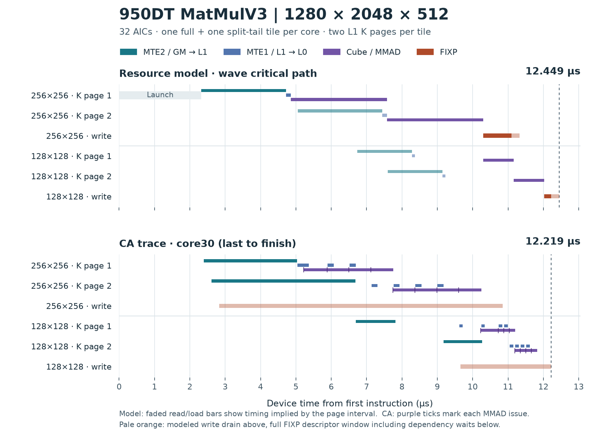
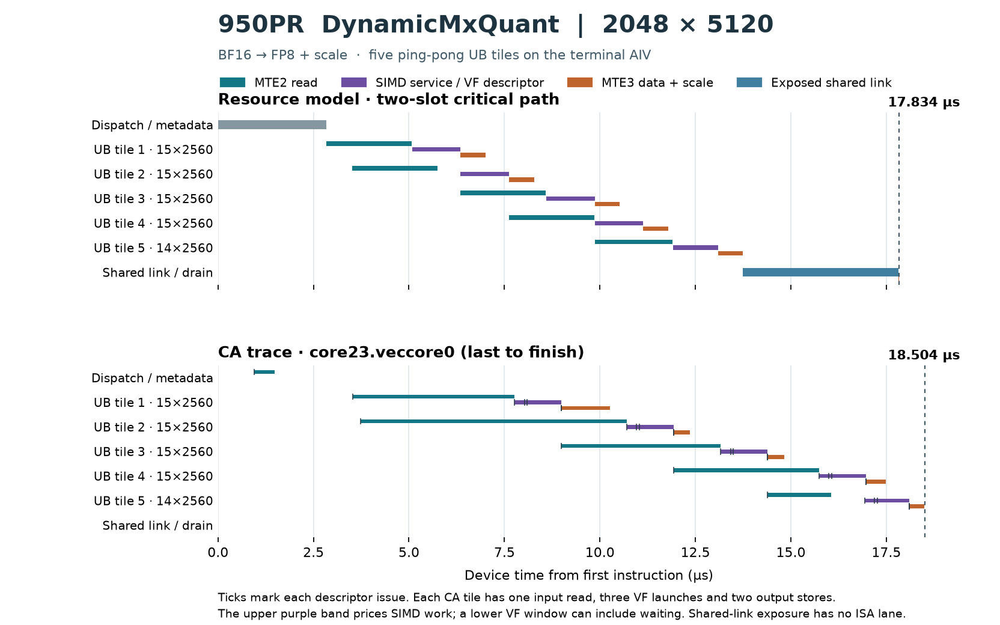
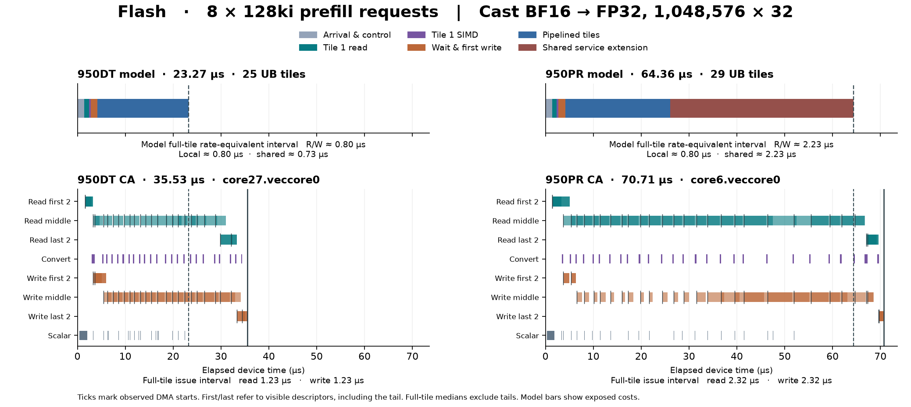
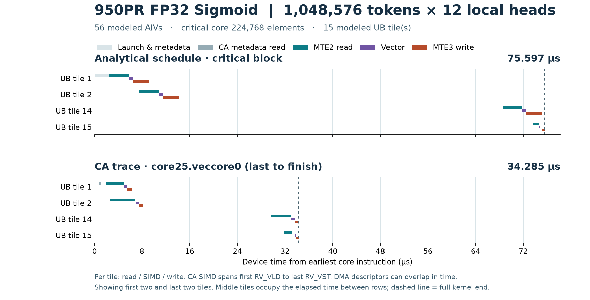

# 模型预测与 CA 实测的流水对照

先看同一行、同一颜色的起止位置，再看右侧整窗差值。模型图给出它能够解释的分块和依赖；CA 图从全核最早的指令开始计时。末核由实际退休时刻选出，因此一次 Matmul 的末核也可能是 AIV。时间单位均为设备微秒。

## Matmul · 每个输出块的两页 K



950DT，BF16 `[M,N,K]=[1280,2048,512]`，模型 **12.449 µs**、CA **12.219 µs**。首波每核一个 256×256 输出块，第二波每核一个 128×128 尾块。每块读两页 K，每页发起四条 MMAD。浅橙色的实测 FIXP 条包含已发起描述符等待依赖的时间。数据提取逐核核对 GM 地址、L1 页、L0 目的地、累加器初始化和全部 512 条 MMAD。[输入、参数和计算过程](examples/matmul.md) · [图上的全部区间](../results/v0.20/examples/matmul-tile-pages.json)

## 同为 Matmul，Flash 的 Stream-K 多出一段归并


8 个请求每次各处理 256 token，Flash 的 hidden 是 5120，复制的 indexer 投影输出 32 列。950DT 预测 **12.123 µs**，实测 **13.023 µs**。模型和 CA 都算出 640 条 MMAD，但实际指令是 [256,32,64]，模型设为 [64,32,256]。安装包的 Stream-K 分支使用 64 个 AIV 处理部分和。末个 AIC 的 Cube 阶段结束到整窗结束，预测 0.256 µs，实测 2.756 µs。同形 950PR 预测 19.016 µs，实测 20.822 µs。两卡用同一 ELF，DT 按 4 段分 K，PR 按 3 段分 K。DT/PR 时间比预测 0.6375，实测 0.6255。这里使用 BF16 连续 ND 权重做同维度库验证。[PR 的三路归并图](examples/figures/matmul-prefill-pr.png) · [三端预测、安装包分支与逐段残差](examples/matmul-prefill.md)

## Vector · 每个 UB 块的读、计算与两路写



`DynamicMxQuant` 对 BF16 输入 `[2048,5120]` 生成 FP8 值和 E8M0 scale。一个 UB 块对应一次有效读、向量程序和两类输出。图的下栏用字节数及程序计数器把事件归回对应块；一次描述符可以在前一条结束前发起。[逐轮量化算例](examples/quant.md)

## CV 融合 · 长 KV 循环的首、中、末页


同一页分上下两行对比，三组局部放大图保持同一个全核时间原点。整窗下方的小刻度标出 128 个页的首次 QK 和 PV。预测 76.377 µs、CA 72.856 µs；模型稳态间隔为 0.5172 µs，实测 QK、PV 的中位间隔分别为 0.4973、0.4955 µs。该算例是单头 dense FA；三模型稀疏注意力与 MLA 的配置另列。[首个 QK/PV、循环及排空](examples/fa.md) · [模型对应的注意力几何](prefill-shapes.md)

同类 950DT 算例将 KV 延长到 131,072。模型 274.987 µs，归档 CA 274.821 µs。图中挑出首、中、末共六个页，下方保留全部 512 个页的实际发起时刻。[128k FA 同轴图](examples/figures/fa-dt-128k-pages.png)

## 整批 prefill · 单卡 8 条请求，每条 128k



Flash indexer 的每 token 宽度是 32，输入为 `[1048576,32]`。相同 42,240 B 的满块读，在 DT、PR 的末核相邻发起中位间隔分别是 1.233、2.319 µs。总模型把核内服务与全片共享带宽同时计入以后，对应的稳态等效间隔是 0.801 和 2.231 µs。[Flash 和 Pro 每个尺寸、逐芯片实测及物理流量](../results/v0.20/large/report.md)

Flash 延长至 B8×256k（`[2097152,32]`）后，DT 预测 **69.523 µs**、CA **106.757 µs**，PR 预测 **208.165 µs**、CA **223.493 µs**。数据量翻倍，DT、PR 窗口分别增长 3.00 和 3.16 倍。DT 这次的旧预测为 101.726 µs，比新版更接近实测。128 个外存控制器观测到 312,226,048 B，模型预计 273,842,176 B；末核满块的发起间隔还从按资源折算的 1.379 µs 增到实测 1.971 µs。[DT 与 PR 的 256k 首末轮流水](../results/v0.20/large/flash-256ki-tiles.png)



Kimi K3 的 KDA 层在 TP8 下每 token 有 12 个 beta，输入为 `[1048576,12]`。950PR 预测 75.597 µs、实测 34.285 µs，针对同一规模仅用核数或峰值带宽均难以解释这段差距。950DT 的控制器数据支持本次设备窗内大部分输出留在片上，PR 的同类物理写回证据仍待取得。[两端逐轮图与后续大输入](../results/v0.20/newop/long-timelines.md) · [冻结模型、两端误差和写回敏感性](examples/sigmoid_fp32.md)

当每条请求增至 256k，Kimi 的单卡输入变成 `[2097152,12]`。950DT 的预测为 54.185 µs、完整 CA 为 42.686 µs；最忙核 25 轮。950PR 的模型为 147.417 µs，CA 为 88.593 µs，最忙核 29 轮。图中用相同工作单元对齐首两轮与末两轮。逻辑元素数从 128k 到 256k 翻倍，DT、PR 耗时分别增长 2.30、2.58 倍。[Kimi 8×256k 的 DT 图](examples/figures/sigmoid-prefill256k.png) · [同形 PR 图](examples/figures/sigmoid-prefill256k-pr.png)

DeepSeek V4 Pro 的 C4 indexer 在同一 8×32k 调度下输出 64 列，整批为 `[262144,64]`。950DT 冻结预测 13.334 µs，实际 17.041 µs；950PR 冻结预测 25.030 µs，实际 23.762 µs。每张卡的 16,777,216 个输出均通过校验。[Pro 的冻结模型与末核流水](../results/v0.20/large/pro-32ki-tiles.png)

其他算子可从总方法进入各自的算例。对只能识别分段预算的路径，上图显示各段对总时间的贡献；逐时刻定位需要完整的发起与依赖证据。[逐算子方法与算例](modeling-strategy.md#逐算子算例) · [全部算子误差](error-analysis.md)

### 从仓内数据重画

在安装 Matplotlib 的 Python 环境中，于仓库根目录执行下列命令即可重画三类代表图。脚本读取的是已经提交的模型区间、精简 CA 时间戳及设备窗口。完整原始的 CA trace 只在重新提取、核对程序计数器和地址时使用。

```sh
python development/validation/sku20/matmul_figure.py
python development/validation/sku20/quant_tile_figure.py
python development/validation/sku20/fa_pages.py --replot
python development/validation/sku20/fa_pages.py --dt128k --replot
```
