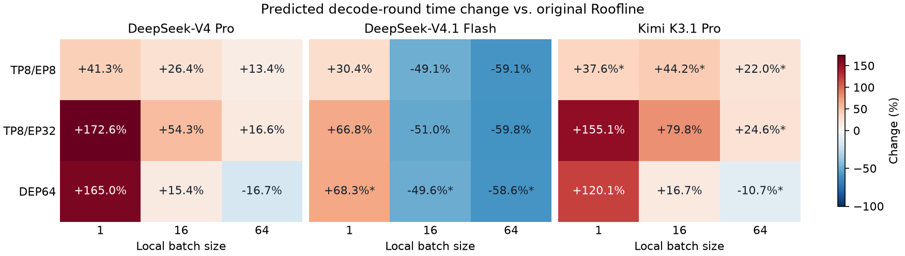

# 128Ki decode · 27 组完整算子后端对照

这页记录首次完成 27 组整图定价时的结果。最新同图回放包括原法、自动选择和指令法，见[27 组 decode 对照](decode-vector-comparison.md)。

数据来自 3 个模型 × 3 种并行 × 每卡 B=1、16、64，均为 rank 0。target/draft 的调用、张量、依赖、任务配置和显存峰值逐对核对。128Ki 个历史 token，推测长度 8，每轮校验 9 个输入，统计口径为原任务的接受长度 7。这里的毫秒是 DES 预测的单轮时长。

精细后端命中 **80 个调用名、171,232 次调用**，含 68,217 个零设备时间节点。每组只配置一个后端；校验器会拒绝任何一个未成功定价的节点。原始已计费预算覆盖率由 v1.8 的 67.63% 达到 100%。

27 组时长求和为原 Roofline 4814.851 ms、v1.8 混合 3737.268 ms、全量 3992.324 ms。求和用于跨配置比较，单个请求的时延要看所在行。相对原方案变化 -17.08%，相对 v1.8 变化 +6.82%。只有与标明精度和布局匹配的代表 CA 窗可用于评价算子误差；尚无这 27 组的整机时延真值。该表保留 v1.9.0 完整后端，后续结果见[当前同精度 Roofline 和端到端重放](roofline-audit.md)。

| 模型（9 组求和） | 原 Roofline ms | v1.8 ms | 完整后端 ms | 相对原方案 |
|---|---:|---:|---:|---:|
| DeepSeek-V4 Pro | 859.311 | 883.174 | 963.197 | +12.1% |
| DeepSeek-V4.1 Flash | 2216.538 | 1015.676 | 997.367 | -55.0% |
| Kimi K3.1 Pro | 1739.003 | 1838.418 | 2031.760 | +16.8% |



红色表示全量后端预测时间增加，蓝色表示减少。格内为相对原 Roofline 的百分比，星号表示显存峰值超出 144 GB。

## 逐配置单轮耗时

单轮含 target 和 draft。显存超过任务配置 144 GB 的行以 † 标记，仍按平台的 compare 模式算出设备工作时间。它们用于容量之外的对照；实际部署需要调整放置、并行或容量。用户原表中的 114.35、33.49 等数值对应原始静态显存峰值，单位 GB。

| 模型 | 并行 | B | 原 Roofline ms | v1.8 ms | 完整 ms | 变化 | target / draft ms | 峰值 GB |
|---|---|---:|---:|---:|---:|---:|---:|---:|
| DeepSeek-V4 Pro | TP8/EP8 | 1 | 36.942 | 39.049 | **52.184** | +41.3% | 49.872 / 2.312 | 114.35 |
| DeepSeek-V4 Pro | TP8/EP8 | 16 | 67.229 | 72.812 | **84.993** | +26.4% | 81.646 / 3.347 | 120.63 |
| DeepSeek-V4 Pro | TP8/EP8 | 64 | 167.170 | 184.821 | **189.541** | +13.4% | 183.382 / 6.159 | 140.73 |
| DeepSeek-V4 Pro | TP8/EP32 | 1 | 11.617 | 18.750 | **31.668** | +172.6% | 30.318 / 1.350 | 33.49 |
| DeepSeek-V4 Pro | TP8/EP32 | 16 | 41.904 | 52.464 | **64.658** | +54.3% | 62.265 / 2.394 | 39.77 |
| DeepSeek-V4 Pro | TP8/EP32 | 64 | 145.378 | 164.607 | **169.579** | +16.6% | 164.356 / 5.224 | 59.88 |
| DeepSeek-V4 Pro | DEP64 | 1 | 12.185 | 20.122 | **32.294** | +165.0% | 30.511 / 1.783 | 37.22 |
| DeepSeek-V4 Pro | DEP64 | 16 | 75.449 | 72.954 | **87.037** | +15.4% | 83.175 / 3.861 | 43.52 |
| DeepSeek-V4 Pro | DEP64 | 64 | 301.436 | 257.595 | **251.243** | -16.7% | 240.674 / 10.570 | 63.67 |
| DeepSeek-V4.1 Flash | TP8/EP8 | 1 | 21.325 | 21.958 | **27.800** | +30.4% | 23.693 / 4.107 | 70.17 |
| DeepSeek-V4.1 Flash | TP8/EP8 | 16 | 150.071 | 74.386 | **76.403** | -49.1% | 65.067 / 11.337 | 75.62 |
| DeepSeek-V4.1 Flash | TP8/EP8 | 64 | 563.583 | 244.703 | **230.771** | -59.1% | 195.241 / 35.531 | 93.07 |
| DeepSeek-V4.1 Flash | TP8/EP32 | 1 | 12.203 | 14.639 | **20.353** | +66.8% | 16.765 / 3.588 | 41.07 |
| DeepSeek-V4.1 Flash | TP8/EP32 | 16 | 140.948 | 67.033 | **69.030** | -51.0% | 58.207 / 10.822 | 46.52 |
| DeepSeek-V4.1 Flash | TP8/EP32 | 64 | 555.703 | 237.427 | **223.617** | -59.8% | 188.585 / 35.031 | 63.97 |
| DeepSeek-V4.1 Flash | DEP64 | 1 | 12.472 | 15.123 | **20.985** | +68.3% | 17.127 / 3.858 | 237.45 † |
| DeepSeek-V4.1 Flash | DEP64 | 16 | 152.082 | 73.437 | **76.696** | -49.6% | 65.185 / 11.511 | 242.91 † |
| DeepSeek-V4.1 Flash | DEP64 | 64 | 608.151 | 266.968 | **251.713** | -58.6% | 213.983 / 37.729 | 260.39 † |
| Kimi K3.1 Pro | TP8/EP8 | 1 | 63.155 | 68.502 | **86.925** | +37.6% | 85.335 / 1.590 | 192.38 † |
| Kimi K3.1 Pro | TP8/EP8 | 16 | 119.423 | 152.608 | **172.196** | +44.2% | 165.796 / 6.400 | 215.32 † |
| Kimi K3.1 Pro | TP8/EP8 | 64 | 307.727 | 346.768 | **375.425** | +22.0% | 352.554 / 22.870 | 288.73 † |
| Kimi K3.1 Pro | TP8/EP32 | 1 | 20.636 | 34.414 | **52.632** | +155.1% | 51.043 / 1.590 | 56.77 |
| Kimi K3.1 Pro | TP8/EP32 | 16 | 76.998 | 118.664 | **138.408** | +79.8% | 132.008 / 6.400 | 79.71 |
| Kimi K3.1 Pro | TP8/EP32 | 64 | 274.176 | 312.788 | **341.742** | +24.6% | 318.872 / 22.870 | 153.13 † |
| Kimi K3.1 Pro | DEP64 | 1 | 26.578 | 43.282 | **58.491** | +120.1% | 50.355 / 8.135 | 71.52 |
| Kimi K3.1 Pro | DEP64 | 16 | 170.302 | 179.820 | **198.739** | +16.7% | 156.656 / 42.083 | 115.50 |
| Kimi K3.1 Pro | DEP64 | 64 | 680.007 | 581.572 | **607.202** | -10.7% | 444.424 / 162.778 | 256.24 † |

## 差异来自哪些调用

完整模型逐节点串行求和 4061.121 ms，其中四类 TP/EP 通信算子预算 208.735 ms。DES 允许部分工作重叠，串行和超过实际轮次和 68.797 ms。以下按所有节点的串行预算归因，各行的差额不能直接当作单算子端到端加速。

| 主要调用 | 原 ms | 完整 ms | 差额 ms |
|---|---:|---:|---:|
| `inference::candidate_filtered_indexer` | 1467.81 | 65.32 | -1402.49 |
| `npu::npu_dynamic_mx_quant` | 791.70 | 1348.76 | +557.07 |
| `npu::npu_grouped_matmul` | 848.43 | 451.68 | -396.74 |
| `inference::cache_load` | 763.47 | 653.64 | -109.83 |
| `collective::all_reduce` | 0.00 | 106.43 | +106.43 |
| `inference::kimi_dsa_indexer_score` | 76.69 | 176.53 | +99.84 |
| `vllm_ascend::sparse_attn_sharedkv_reference` | 126.31 | 37.16 | -89.15 |
| `inference::dynamic_mx_quant_fp8_reference` | 23.60 | 92.98 | +69.38 |
| `_C_ascend::npu_hc_pre_v2` | 10.76 | 70.36 | +59.60 |
| `vllm_ascend::recurrent_kda_reference` | 0.00 | 57.64 | +57.64 |

Flash 的最大差额来自 candidate_filtered_indexer。完整模型区分实际扫描的压缩 key 和只在候选集合上执行的后处理，并利用同一请求跨查询行的重叠。具体边界见[候选 Indexer 算例](examples/candidate-filtered-indexer.md)。Kimi 中 FP4 DSA 的低位解包、打分和筛选，V4 中多轮 MX 量化与真实库式启动，以及原价为零的通信，均能推高单轮估计。DEP64 的静态超容和 rank 之间的稀疏路由不平衡会影响部署表现；这里没有多 rank 机器运行结果。

## 调用成本和复算

在每个任务/阶段/原始名/路线/输入输出物理几何的首次出现时，显式绕过系统预测结果缓存，再调用一次已初始化的公开后端，共 7,131 次。墙钟 P50 0.092 ms、P95 1.011 ms、P99 5.179 ms、最大 12.040 ms。保留库内部常驻参数与公式缓存，冷进程导入、图捕获和离线 CA 单列。每一组的完整任务墙钟见 CSV。

在 preview.1 系统虚拟环境中从本仓根目录运行以下命令。矩阵目录需包含原 task.toml 和 results/l1；scratch 单独保存两套重放的中间输出。

```sh
python -m calibration.system_full_compare "$MATRIX" "$SCRATCH" roofline --jobs 3
python -m calibration.system_full_compare "$MATRIX" "$SCRATCH" full --jobs 3
python -m calibration.system_full_compare "$MATRIX" "$SCRATCH" compare
python -m calibration.system_full_report
```

[80 个调用名及证据](system-full-evidence.md) · [逐物理几何账本](../calibration/reference/system-full-shapes.csv.gz) · [逐配置 CSV](../calibration/reference/system-full-comparison.csv) · [逐调用 CSV](../calibration/reference/system-full-operators.csv) · [通信公式和场景假设](examples/system-communication.md)
