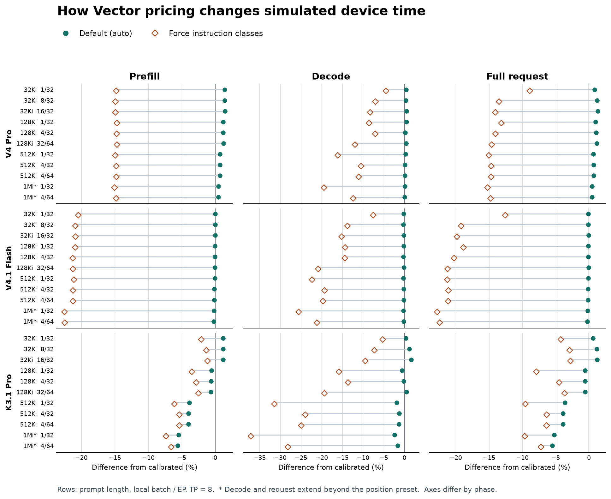

# 三个模型的端到端复算：Vector 方法会改变多少请求时间？

这里固定 950DT 的同一份 rank 0 捕获图、执行精度、核数、通信价格和资源依赖，仅切换 Vector（VF）阶段的定价方法。对三个模型各 11 种配置，分别计算读完整 prompt 的 prefill、随后生成余下 token 的 decode，两者相加就是该批请求在这张图上的完成时间；不除以 B，也不含线上排队。所有秒数都是系统离散事件仿真（DES）预测；与单算子的 CA 校准分开报告。

## 先看结果

按配置逐一对照，默认策略相对原法的**完整请求**变化为 **-5.52% 至 +1.30%**；强制使用指令类别法为 **-22.77% 至 -2.78%**。范围取各配置的最小、最大相对差，不以一次长请求的耗时给其他配置加权。

| 模型 | 默认 vs 原法：prefill | 默认 vs 原法：decode | 全指令 vs 原法：prefill | 全指令 vs 原法：decode | 默认 vs 历史 Roofline：请求 |
|---|---:|---:|---:|---:|---:|
| DeepSeek-V4 Pro | +0.46% 至 +1.42% | +0.07% 至 +0.50% | -15.04% 至 -14.68% | -19.44% 至 -4.47% | -27.19% 至 +78.57% |
| DeepSeek-V4.1 Flash | -0.25% 至 -0.02% | -0.27% 至 -0.09% | -22.50% 至 -20.44% | -25.56% 至 -7.54% | -95.84% 至 -8.40% |
| Kimi K3.1 Pro | -5.64% 至 +1.15% | -2.40% 至 +1.64% | -7.36% 至 -1.17% | -37.09% 至 -5.25% | -5.62% 至 +51.92% |

表头说明：每格为该模型 11 组部署的相对差范围。差值 = 100 ×（当前方法时间 / 对照方法时间 − 1），负号表示预测时间缩短。只有前四列隔离了 Vector 方法；历史 Roofline 还使用原有引擎分配、效率系数和占位路径。方法间差值不代表预测对真机的误差。

默认与原法的请求差值比例最大的是 **Kimi K3.1 Pro，1Mi、B=4、EP=64**：原法 1222.414 s，默认 1154.902 s；其中 prefill 改变 -66.928 s，decode 改变 -0.584 s。该组的 decode 超出模型原位置预置，含这段时间的请求总量也属于外推。整个矩阵有 18/33 组默认请求比历史 Roofline 短；33/33 组的三种请求时间都不短于同口径峰值下界。



图中实心圆为默认方法、空心菱形为强制指令法。每行标出输入长度和 B/EP；三列分别画 prefill、decode 与请求。横轴 0 为原法，各阶段独立设定横轴刻度，便于看清较小的差异。

## 为什么单算子变化不会等比例传到整网

两种定价只替换有 Vector 工作的节点。没有 VF 的纯 Cube、视图、纯搬运和纯通信保持共同路径；Cube 或访存已经主导的节点，即使 VF 估计改变，整窗也可能不变。系统重放保留原图资源互斥与依赖，一个分支提早完成并不保证请求也同样提前。以下表格对每个模型、每个阶段取**默认 vs 原法绝对百分比差最大的配置**，再在该配置中按各调用名累计的绝对设备时间差排序，给出前两项。

| 模型 · 阶段 | 输入 / B / EP | 阶段默认 − 原法（s） | 占原阶段 | 节点累计差前两项：默认 − 原法（s） |
|---|---|---:|---:|---|
| DeepSeek-V4 Pro · prefill | 32Ki / 16 / 32 | +0.644 | +1.42% | `_C_ascend::compressor` +0.725；`_C_ascend::moe_gating_top_k_hash` -0.082 |
| DeepSeek-V4 Pro · decode | 128Ki / 1 / 32 | +0.024 | +0.50% | `vllm_ascend::sparse_attn_sharedkv_reference` +0.022；`_C_ascend::moe_gating_top_k_hash` -0.012 |
| DeepSeek-V4.1 Flash · prefill | 1Mi / 4 / 64 | -0.774 | -0.25% | `inference::lightning_indexer` -0.705；`_C_ascend::moe_gating_top_k_hash` -0.453 |
| DeepSeek-V4.1 Flash · decode | 1Mi / 1 / 32 | -0.021 | -0.27% | `inference::lightning_indexer` -0.018；`_C_ascend::moe_gating_top_k_hash` -0.009 |
| Kimi K3.1 Pro · prefill | 1Mi / 4 / 64 | -66.928 | -5.64% | `inference::kimi_dsa_indexer_score` -69.249；`inference::attention_residual` +1.889 |
| Kimi K3.1 Pro · decode | 1Mi / 1 / 32 | -0.605 | -2.40% | `inference::kimi_dsa_indexer_score` -0.634；`inference::attention_residual` +0.011 |

表头说明：阶段差是两次完整 DES 调度后的结果；节点累计差按同名节点的预计设备时间、出现次数及同一阶段积分口径计算，可用来定位应检查的算子。它没有分摊重叠，不能作为可相加的关键路径贡献。

### 固定其他节点，只替换一种调用名的反事实检验

每个模型取两个点：1Mi、B=1、EP32 的末 prefill 块，以及 128Ki、B=1、EP32 的首个 decode 轮（target + draft）。从同一个基准方法出发，只切换所列调用名的所有实例，其他节点保持原价，再运行一次 DES。两个切换方向（原法 → 默认、默认 → 全指令）各取节点时间总差绝对值最大的三个调用名。每个点列出这六种干预中，对阶段时间影响绝对值最大的一个；这比单纯排列节点的耗时和更接近“如果只改这个节点，系统会怎样”。

| 模型 · 锚点 | 基准 → 对照方法 | 单独切换的调用名（次数） | 节点时间差之和（ms） | 只切此调用的阶段差（ms） | 整图全切的阶段差（ms） |
|---|---|---|---:|---:|---:|
| DeepSeek-V4 Pro · prefill | `auto` → `instruction_classes` | `vllm_ascend::quant_lightning_indexer_reference` (30) | -217.0956 | -217.0956 | -283.3345 |
| DeepSeek-V4 Pro · decode | `auto` → `instruction_classes` | `inference::cache_load` (222) | -1.0371 | -0.9114 | -2.7952 |
| DeepSeek-V4.1 Flash · prefill | `auto` → `instruction_classes` | `inference::lightning_indexer` (4) | -71.1211 | -71.1211 | -109.3058 |
| DeepSeek-V4.1 Flash · decode | `auto` → `instruction_classes` | `npu::npu_dynamic_mx_quant` (342) | -1.0034 | -1.0034 | -2.5273 |
| Kimi K3.1 Pro · prefill | `calibrated` → `auto` | `inference::kimi_dsa_indexer_score` (24) | -138.1593 | -138.1593 | -135.6770 |
| Kimi K3.1 Pro · decode | `auto` → `instruction_classes` | `inference::cache_load` (34) | -5.6921 | -5.6921 | -8.0153 |

表头说明：节点时间差之和可含重叠；只切此调用的阶段差来自重新调度，带符号，负值表示阶段缩短。全切列则让所有节点采用对照方法。随报价改变，忙资源或最后完成的分支可能改变，各单项反事实不可直接相加。这里只覆盖六个锚点；详细干预见[同图反事实账](../results/v2.3/system-e2e/counterfactuals.csv)。

例如 Kimi K3.1 Pro 的 prefill，单独切换 `npu::npu_dynamic_mx_quant`，节点时间差之和为 -13.659 ms；重跑同图只有 -11.101 ms 传到阶段末尾，说明原图有重叠。另一个现象是正负抵消：V4 Pro 的 1Mi 末块，从原法切到默认时，单独切 compressor 增加 5.664 ms，单独切 hash gating 缩短 0.642 ms，所有改变一起排程最终增加 5.066 ms。

### 长上下文实例：Flash 1Mi、B=1、TP8/EP32 的最后一个块

该块已有 1,044,480 个历史位置，新输入 4,096 个位置。历史 Roofline 的块时间为 15.176 s；在同一捕获图上，原 VF 为 0.458229 s，默认 0.456792 s，全指令 0.347486 s。这里区分**末块**与下表的**整段 prefill**。候选消费按 A5 的稀疏 MXFP4 方案报价，地址重合度采用实现默认；设备 CA 只验证过它的若干短窗，没有采集这个 4,096 行末块的完整设备窗。

## 33 组结果：逐一核对 prefill、decode 和 Roofline

表头说明：B 为每个 attention DP 副本的本地请求数，TP 固定为 8，DP = EP/8。Prefill 和 Decode 单元格依次给 **原 / 默认 / 全指令** 三种价格（秒）；请求列为默认 prefill + 默认 decode。历史列复现原后端；峰值列是同执行精度、工作量和资源合同下的理想 Roofline。`*` 表示 1Mi 输入以后的 decode 超出位置预置；`†` 表示 Kimi 该配置直接累加 147 轮。

### DeepSeek-V4 Pro

| 输入 | B / EP | Prefill 原 / 默认 / 全指令（s） | Decode 原 / 默认 / 全指令（s） | 默认请求（s） | 历史 Roofline 请求（s） | 同精度峰值请求（s） |
|---|---:|---:|---:|---:|---:|---:|
| 32Ki | 1 / 32 | 2.942 / 2.982 / 2.507 | 3.919 / 3.935 / 3.744 | 6.917 | 3.874 | 3.192 |
| 32Ki | 8 / 32 | 22.727 / 23.049 / 19.336 | 4.992 / 5.007 / 4.641 | 28.056 | 21.040 | 15.541 |
| 32Ki | 16 / 32 | 45.352 / 45.996 / 38.593 | 6.684 / 6.716 / 6.130 | 52.712 | 40.789 | 29.704 |
| 128Ki | 1 / 32 | 14.020 / 14.182 / 11.960 | 4.708 / 4.731 / 4.306 | 18.914 | 14.871 | 10.191 |
| 128Ki | 4 / 32 | 54.626 / 55.271 / 46.580 | 5.412 / 5.422 / 5.031 | 60.693 | 55.186 | 36.328 |
| 128Ki | 32 / 64 | 434.363 / 439.511 / 370.612 | 14.185 / 14.244 / 12.492 | 453.755 | 431.707 | 279.860 |
| 512Ki | 1 / 32 | 92.393 / 93.041 / 78.599 | 7.869 / 7.890 / 6.603 | 100.931 | 115.325 | 65.090 |
| 512Ki | 4 / 32 | 363.093 / 365.672 / 309.457 | 9.530 / 9.539 / 8.531 | 375.212 | 456.942 | 255.251 |
| 512Ki | 4 / 64 | 363.175 / 365.755 / 309.539 | 9.034 / 9.044 / 8.035 | 374.798 | 456.322 | 254.755 |
| 1Mi\* | 1 / 32 | 281.598 / 282.895 / 239.241 | 12.097 / 12.109 / 9.745 | 295.004 | 389.801 | 205.250 |
| 1Mi\* | 4 / 64 | 1111.892 / 1117.052 / 947.353 | 14.568 / 14.578 / 12.763 | 1131.629 | 1554.144 | 814.500 |

### DeepSeek-V4.1 Flash

| 输入 | B / EP | Prefill 原 / 默认 / 全指令（s） | Decode 原 / 默认 / 全指令（s） | 默认请求（s） | 历史 Roofline 请求（s） | 同精度峰值请求（s） |
|---|---:|---:|---:|---:|---:|---:|
| 32Ki | 1 / 32 | 1.328 / 1.328 / 1.056 | 2.087 / 2.083 / 1.929 | 3.410 | 3.723 | 1.397 |
| 32Ki | 8 / 32 | 10.179 / 10.175 / 8.053 | 3.186 / 3.177 / 2.747 | 13.353 | 26.024 | 7.093 |
| 32Ki | 16 / 32 | 20.302 / 20.295 / 16.065 | 4.616 / 4.607 / 3.916 | 24.902 | 51.572 | 13.655 |
| 128Ki | 1 / 32 | 5.757 / 5.754 / 4.553 | 2.636 / 2.630 / 2.258 | 8.384 | 35.838 | 4.055 |
| 128Ki | 4 / 32 | 22.244 / 22.230 / 17.511 | 3.923 / 3.913 / 3.358 | 26.143 | 141.728 | 14.517 |
| 128Ki | 32 / 64 | 176.501 / 176.386 / 138.980 | 16.402 / 16.387 / 12.986 | 192.773 | 1130.160 | 111.732 |
| 512Ki | 1 / 32 | 30.824 / 30.802 / 24.321 | 4.837 / 4.825 / 3.757 | 35.626 | 503.679 | 18.854 |
| 512Ki | 4 / 32 | 119.976 / 119.797 / 94.496 | 9.249 / 9.232 / 7.464 | 129.029 | 2013.057 | 73.293 |
| 512Ki | 4 / 64 | 119.979 / 119.801 / 94.498 | 9.069 / 9.053 / 7.285 | 128.853 | 2012.833 | 73.116 |
| 1Mi\* | 1 / 32 | 80.090 / 79.932 / 62.066 | 7.759 / 7.737 / 5.776 | 87.669 | 1972.225 | 48.713 |
| 1Mi\* | 4 / 64 | 313.079 / 312.306 / 242.737 | 16.134 / 16.108 / 12.725 | 328.414 | 7886.978 | 192.056 |

### Kimi K3.1 Pro

| 输入 | B / EP | Prefill 原 / 默认 / 全指令（s） | Decode 原 / 默认 / 全指令（s） | 默认请求（s） | 历史 Roofline 请求（s） | 同精度峰值请求（s） |
|---|---:|---:|---:|---:|---:|---:|
| 32Ki | 1 / 32 | 2.846 / 2.878 / 2.786 | 5.869 / 5.888 / 5.561 | 8.767 | 5.770 | 4.916 |
| 32Ki† | 8 / 32 | 21.283 / 21.528 / 20.999 | 7.625 / 7.714 / 7.072 | 29.242 | 28.718 | 21.819 |
| 32Ki† | 16 / 32 | 42.338 / 42.826 / 41.841 | 10.156 / 10.322 / 9.196 | 53.148 | 55.064 | 41.115 |
| 128Ki | 1 / 32 | 13.971 / 13.891 / 13.481 | 7.745 / 7.703 / 6.521 | 21.593 | 17.250 | 13.029 |
| 128Ki | 4 / 32 | 53.250 / 52.903 / 51.727 | 9.456 / 9.434 / 8.167 | 62.337 | 61.502 | 44.431 |
| 128Ki† | 32 / 64 | 420.147 / 417.338 / 409.584 | 30.536 / 30.681 / 24.634 | 448.019 | 474.686 | 336.649 |
| 512Ki | 1 / 32 | 97.169 / 93.416 / 91.231 | 15.250 / 14.961 / 10.461 | 108.376 | 89.508 | 61.151 |
| 512Ki | 4 / 32 | 376.293 / 361.168 / 356.099 | 20.916 / 20.648 / 15.907 | 381.816 | 350.440 | 235.902 |
| 512Ki | 4 / 64 | 375.834 / 360.709 / 355.639 | 20.091 / 19.823 / 15.081 | 380.532 | 349.364 | 235.232 |
| 1Mi\* | 1 / 32 | 304.423 / 287.746 / 282.023 | 25.241 / 24.636 / 15.878 | 312.382 | 251.412 | 164.223 |
| 1Mi\* | 4 / 64 | 1187.058 / 1120.130 / 1109.011 | 35.355 / 34.772 / 25.399 | 1154.902 | 996.814 | 646.319 |

## 采样、外推与复现

- 重放了 747 次捕获，共 1,278 张阶段图；每种精细策略均为 4,687,601 个捕获节点实例定价，涉及 86 个原始调用名。同一节点在多个层、锚点或阶段重复出现会重复统计；这不是不同 kernel 的数目。
- 相同配置的三次重放仅改变方法选择。`calibrated` 是原 VF 排程（某些没有实现的路径本来就是设计估计）；`instruction_classes` 按工作类别为可识别的 VF 工作定价；`auto` 在已有实现上保留原法，在缺少对应实现的新合同上选用类别法。这并不保证任意精度都有两条独立的已校准程序。例如原生 FP16 稠密 FA 没有 `calibrated` 路径，强制它会报不支持；纯 Cube 或纯 DMA 根本没有 VF 可替换。[逐执行合同的方法资格](vector-method-comparison.md)。
- 每请求的 prefill 块上限是 4,096 token；32Ki 输入的 8 个块全部实算。长输入实算首块以及含中点、末点的 5 个续块，未采到的块在相邻 DES 锚点间线性积分。每请求输出总长为 1,024，prefill 产生首 token，之后每轮有 8 个草稿、主模型一般校验 9 个位置，假设每轮推进 7 个 token，故计 147 轮 target + draft。通常实算首、中、末三轮，三组 Kimi 因分块随轮号改变而逐轮计算。
- 把少数锚点排除在拟合外，再用相邻锚点预测它们，默认方法在 prefill、decode 的最大相对偏差分别为 1.90%、0.85%。这个检查只衡量采样积分的误差；1Mi 位置预置以外没有可供核验的真实锚点。
- 三个模型的原位置预置均到 1,048,576。1Mi 最后一个 prefill 块仍在域内；其后的 1Ki decode 由域内相邻位置延伸末段斜率，未验证更远位置的路由、分块与可执行性。没有完整服务实测，不能据此给出真机端到端 WAPE。
- 以原图的 rank 0 静态分配和 KV 预留估算，满足 144 GB 条件的配置为 33/33；它不覆盖其他 rank 的路由倾斜、碎片与服务排队。系统任务的芯片参数和单算子 CA 的 950DT 模板也不完全相同，不能拿系统秒数代替 CA 实测。

相对上一份发布表的默认列，本次默认请求时间变化为 -5.52% 至 +1.30%。单独检查上一份发布表与本次重跑的 `calibrated`，33 组的三项时间（两阶段及请求）最大绝对差为 0 s。

[完整请求与各 Roofline 口径（CSV）](../results/v2.3/system-e2e/requests.csv) · [按算子和阶段的累计价格账（CSV）](../results/v2.3/system-e2e/operator-deltas.csv) · [采样位置检查（CSV）](../results/v2.3/system-e2e/interpolation-check.csv) · [逐算子两法误差及计时资格](system-vector-methods.md) · [历史捕获和配置口径](context-sweep.md)

从仓库根目录运行 `python -m calibration.examples.report_vector_e2e`，可直接用已发布的 CSV/JSON 重绘此图与本页。有可信的本地捕获、SIMPlatform 和原预测存档时，可按以下顺序重新报价；`CAPTURES` 指原始捕获目录，`CACHE` 指本次专用的空缓存目录（程序按已有记录跳过，同一路径不要跨版本复用）。

```bash
python -m calibration.examples.context_vector_e2e run "$CAPTURES" "$CACHE" --workers 8
python -m calibration.examples.context_vector_e2e report "$CAPTURES" "$CACHE"
python -m calibration.examples.vector_e2e_swaps "$CAPTURES" --workers 3
python -m calibration.examples.report_vector_e2e
```
