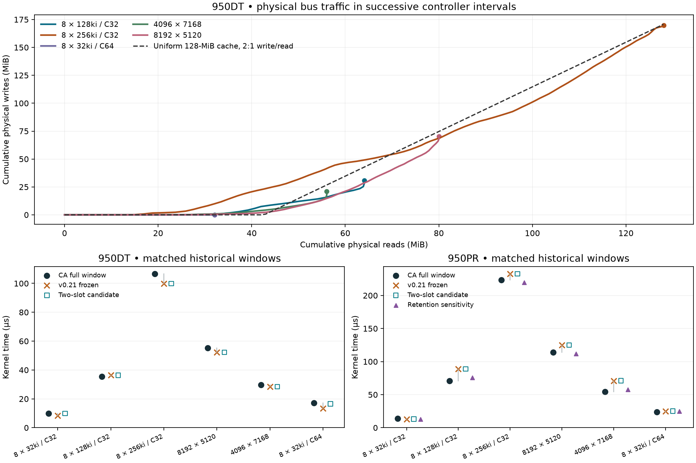

# Cast 在跨越 L2 容量前后的读写、调度与误差

**950DT 的两类误差来自不同的约束。** 96 MiB 的 BF16→FP32 投影没有产生物理写事务，旧预测仍低估了 21.8%。补上独立输入、输出双缓冲槽的占用时间后，预测从 13.33 µs 增至 16.59 µs，完整 CA 为 17.04 µs。384 MiB 的投影则发生 169.72 MiB 物理写，多核竞争外存成为主项。双槽修正单独在 12 个旧大窗口上复算，DT 最大误差由 21.8% 降到 6.4%，PR 的预测相同。**已冻结的前向候选仅含双槽修正**，已有 CA 队列中 6 个双端尚未启动的新形状将检验其可迁移性。[前向合同及源码散列](two-slot-freeze.json) · [逐端滚动计分](two-slot-scores.json)

上图每个实线点累积了该次 CA 从进程启动至当前控制器报告区间的总读写量。灰虚线展示一个假设模型：冷读单遍、每读 1 B 便生成 2 B 输出，全片均匀填充 128 MiB 后才按读写占比驱逐。下图三个标记对应同一调用的完整全核指令窗口、冻结 v0.21 与双槽候选。PR 的三角标记是容量敏感性试算。物理控制器的原点与核指令的原点各自保留。[原始计数、分期及 SHA-256](controller-periods.json) · [逐例时延与核队列](replay.json)

## DT 的真实容量拐点

对 5 个 v0.20 正式 CA 目录分别解析全部 128 个 HBM 控制器。每个控制器逐报告区间用相邻 32、64、128、256 B 读写命令累计计数之差，乘以相应事务宽度。所有区间的读、写之和与原始 DMC 字节头的全程合计逐样本精确相等。物理读略高于张量大小，额外约 0.044 MiB，计数范围还覆盖取指、元数据等。下表的“估计留驻”以全部输出逻辑字节减去物理总写，微小非输出事务会降低该估计。

|DT 单次 shape|逻辑读 / 写 MiB|实测物理读 / 写 MiB|估计留驻输出 MiB|均匀 L2 模型留驻 MiB|累计物理写越过 256 KiB 时的累计读 MiB|
|---|---:|---:|---:|---:|---:|
|262144 × 64|32 / 64|32.043 / 0|64.00|64.00|全程无物理写|
|4096 × 7168|56 / 112|56.043 / 21.093|90.91|85.33|29.23|
|1048576 × 32|64 / 128|64.044 / 30.833|97.17|85.33|30.96|
|8192 × 5120|80 / 160|80.044 / 70.264|89.74|85.33|31.43|
|2097152 × 32|128 / 256|128.046 / 169.716|86.28|85.33|16.97|

对于 batch=8、单请求 128ki 与 256ki 的 32 通道投影，输入行数恰好翻倍。完整 CA 由 35.53 增至 106.76 µs（3.00×），物理总流量由 94.88 增至 297.76 MiB（3.14×），物理写增至 5.50×。大窗口开始写回时，整片从 DRAM 读入的量乘以三仍小于名义 L2 容量。例如 256ki 行在 11 µs 控制器报告处累计读 16.97 MiB、写 0.78 MiB。全片均匀分配的单一容量阈值可以近似最终写量，却不能解释开始写回的时刻。多核条带的映射、缓存组冲突、预取和主动回写都可能影响起点，当前交易直方图缺少张量地址和实际替换策略，无法唯一鉴别。[对应官方 256ki 样本](../v0.20/large/cast_2097152_32_Ascend950DT_9582-official-dram.json)

## 可迁移的双槽发起约束

每个满 UB tile 有 (U=21120) 个元素，从外部读 (2U) B，转换后写 (4U) B。旧内核模型用读、写或转换三者最大的单引擎服务时间约束连续发起。新候选还考虑一个槽位要等前序数据使用完才可复用。12 个归档大窗口的末核共有 295 对可配对的描述符。所有 (R_{i+2}) 都在第 (i) 块的写描述符退休前发起，各例 (R_{i+2}) 相对 (W_i) 发起时刻的差值中位数约 −1 个周期。这支持分别对输入槽和输出槽计算占用。[末核、匹配次数与时间差](replay.json)

设 (mathrm{II}_0) 为原三引擎的满块稳态发起间隔，(V) 为模型计算该块的转换服务时间。(L_R,L_W) 为读、写描述符的在途时延。两个输入槽交替使用时，每个槽承受一次读加转换；两个输出槽各承受一次转换加写。候选使用

[
mathrm{II}_{slot}=maxleft(mathrm{II}_0,rac{L_R+V}{2},rac{V+L_W}{2}
ight).
]

满块以后的剩余元素数除以 (U) 得到等价满块个数，末块按实际有效比例计价。原模型保留首块启动和排空。全核时延取本核流水与片外、片内共享带宽约束的最大值。只有一块的调用直接复用原模型；外存吞吐已经占主导时，双槽可以改变局部发起下界而不会改变全设备预测。

(L_R = 1.4394,t_R)，(L_W = 1.9751,t_W)。(t_R,t_W) 是目标芯片原流水模型对同一个满块的读写服务时间，已有每核 MTE 价格、主频和目标 UB 容量参与。两个无量纲因子都来自同一个 950DT v0.20 [262144,32] 完整采集：末核 MTE2 和 MTE3 描述符在途中位数分别为 1.3755、1.8197 µs，原目标服务预算分别为 0.9556、0.9213 µs。这些因子反映该实现和参考架构在途与本地服务的关系；未来芯片改变队列槽位、请求延迟或 DMA 结构时须更新。DT、PR、970DT 共用公式和参数，无 SKU 条件分支。970DT 结果仅为外推。[冻结函数](../../development/validation/cast_capacity/two_slot.py)

## 两个离线敏感性试验

1. **稳态混合服务。** 取 950DT 384 MiB 采集累计物理写的中间 10%–90%，对 76 个完整 1 µs 区间分别计算物理读写字节 / 活动 AIV / 时钟周期，中位数 28.85 B/(AIV·cycle)。用它替换共享流量上限的 30 B/(AIV·cycle)，仍以芯片外存带宽封顶。此项改善大样本整体误差，但 DT 128ki×8 的预测从 36.37 增到 37.77 µs，CA 为 35.53 µs。该单点的主要偏差来自高估写量，减慢服务在这里会扩大误差。
2. **脏输出的容量敏感性。** 令 (X,Y) 为逻辑读写量、(C) 为 L2 容量、(q=Y/(X+Y))。基线保留 (min(X+Y,C)q) 字节脏输出。试算：当工作集超出 L2，以 (C(1-q)min(1,B_mathrm{ext}/(A f b))) 表示仍分配给干净输入的容量，其他空间可用于留驻输出，最多 (Y) 字节。(A) 为活动 AIV 数、(f) 为 GHz、(b) 为上项的每 AIV 每周期字节数、(B_mathrm{ext}) 为配置的 GB/s。规则模拟慢外存压力下干净输入优先被逐出，额外保留脏输出。PR 的数值提示这一方向值得检查，但同一合同没有 PR 控制器读写计数，外存带宽本身也是 SKU 档位推定。相同的总时间有多组带宽与留驻量都能解释，**这项假设仅留作敏感性分析**。

例如 PR [4096,7168] 的逻辑读+写为 168 MiB。在冷读和 1.4 TB/s 上限假设下，即使把整个 54.61 µs 都给外存，仍至少要留驻 (168-54.61	imes1400	imes1000/2^{20}=95.1) MiB；均匀 L2 模型只给出 74.7 MiB。这个不等式指出外存带宽与脏输出驻留量必须共同检查。它没有测出 PR 的物理写量。该形状的敏感性预测 57.69 µs，基线 70.97 µs。[PR 的 CA 回执](../v0.20/large/cast_4096_7168_Ascend950PR_957b.json)

下表给出 WAPE / 最大绝对相对误差。旧数据都只作开发回放，两项阶段参数分别来自上述两个 DT 窄投影锚点；除去它们的 DT 大样本单列。基线是 v0.21 已冻结实现，所有参数选择和离线比较只用 v0.20 及以前的 CA。敏感性列依次叠加每项候选。

|芯片与数据组|样本|基线|双槽|双槽 + 28.85 混合价格|再加脏输出驻留敏感性|
|---|---:|---:|---:|---:|---:|
|DT 小数据|11|4.5 / 9.9%|4.5 / 9.9%|4.5 / 9.9%|4.5 / 9.9%|
|PR 小数据|10|6.0 / 19.8%|6.0 / 19.8%|6.0 / 19.8%|6.0 / 19.8%|
|DT 窄投影|4|7.7 / 21.8%|4.9 / 6.4%|3.4 / 6.3%|3.4 / 6.3%|
|PR 窄投影|4|9.0 / 25.8%|9.0 / 25.8%|9.0 / 25.8%|3.4 / 7.3%|
|DT 宽通道|2|5.1 / 5.5%|5.1 / 5.5%|1.4 / 1.8%|1.4 / 1.8%|
|PR 宽通道|2|16.1 / 29.9%|16.1 / 29.9%|16.1 / 29.9%|3.3 / 5.6%|
|DT 大样本，扣除两个锚点|4|6.4 / 21.8%|4.1 / 5.5%|2.8 / 6.3%|2.8 / 6.3%|

CANNBot 950 缓存提示卡说明某些 SIMT 读指令具有清洁行分配提示。该接口、负载和 Cast 的 MTE2/MTE3 描述符不同。另一张 DataCopy 卡的容量来自另一算子的故障反推。二者只能说明协议须区分，文中缓存容量来自芯片配置，交易字节来自该次 CA。[缓存提示卡](../../third_party/cannbot-knowledge/knowledge/ops/ascendc/optimizations/p_p18_ldg_stg_l2_cache_hint_updated_2026_04_02.md) · [DataCopy 卡](../../third_party/cannbot-knowledge/knowledge/ops/ascendc/runbooks/precision/ascend950_datacopy_l2.md)

## 已登记队列上的前向计分

2026-11-19 20:40:03（北京时间）单独封存双槽候选。一对 shape 的任何一端已有 CA 原始目录或回执，整对均归历史回放。10 个登记形状中的 6 个满足两端均未开始；计分时再检查两端实际启动时间均晚于冻结，缺少任一开始时间时单列“等待配对启动确认”。原有队列、采集进程与线上公共模型均沿用，新增 CA 次数为零。

|shape|DT 基线→双槽 µs|PR 基线→双槽 µs|970DT 外推基线→双槽 µs|
|---|---:|---:|---:|
|[3,7168]|2.203→2.203|2.204→2.204|2.019→2.019|
|[17,32]|1.995→1.995|1.995→1.995|1.828→1.828|
|[111,7168]|3.531→3.531|3.592→3.592|3.341→3.341|
|[511,5120]|4.943→5.210|5.094→5.446|4.379→4.387|
|[32769,32]|3.834→3.834|3.941→3.941|3.489→3.489|
|[98305,64]|7.121→8.165|10.050→10.050|5.443→5.831|

两组信息量不同。四个形状在两端都只有一块，可检验旧行为能否保留。[511,5120] 可检验双端多轮的变化；[98305,64] 可检验 DT 多轮和 PR 共享带宽封顶。每次只读已有 CA 回执，对比采集前封存的 µs。已开始的四对属于事后历史回放。[滚动分组、逐例、失败和待完成](two-slot-scores.json) · [复算与计分脚本](../../development/validation/cast_capacity/prospective.py)
