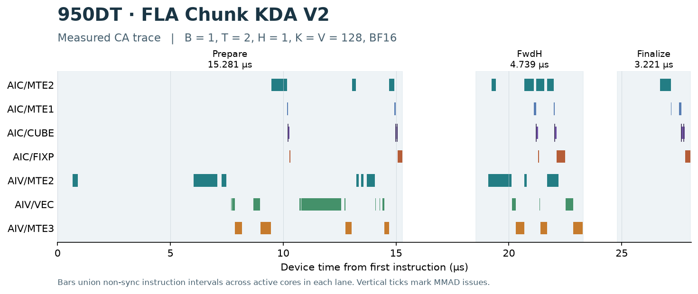

# Kimi 的 FLA Chunk KDA V2 首个完整 950DT 窗口

**直接调用正式库的 `aclnnChunkKdaFwdV2`，三段设备窗口合计 23.2406 µs。从第一段最早指令到最后一段最终退休为 28.0339 µs，其中两次调度间隔合计 4.7933 µs。** 本例是一个开发样本，单卡 950DT，四组数值全部通过，0 次 CA 同步错误。按 Kimi 模型默认分派，该小 shape 会走 V1。本例覆盖 V2 的公开低层入口、设备实现和计时链路。普通小输入 V1、生产长输入 V2、950PR 和 970DT 的误差均为 N/A。[正式计时和所有活动核的证据](verified.json) · [采前登记](register.json)

| 正式发布 kernel | 全核起止 tick | 活动 AIC / AIV | MMAD 发起次数 | CA µs |
|---|---:|---:|---:|---:|
| `ChunkKdaFwdPrepare_171e9a19df4c0d44ca00a177d8fe300c_32513546_mix_aic` | 7,219–32,432 | 1 / 2 | 3 | 15.2806 |
| `ChunkFwdH_72371232203476155baf45810c33a7f9_7710_mix_aic` | 37,817–45,637 | 1 / 2 | 2 | 4.7394 |
| `ChunkKdaFwdFinalize_c0d447f32579acd296e1c16d6d9c7d38_0` | 48,161–53,475 | 1 / 0 | 2 | 3.2206 |

图中阴影表示各阶段的全核窗口，白色间隔对应 3.2636 和 1.5297 µs 的设备调度间隔。同一轨道上的条是该类活动核物理指令区间的并集，AIV/VEC 汇总 RVEC 子流水。深色刻线是七个实发 MMAD；MTE 与 Vector 重叠时不会把两个时间相加。未展示的标量指令或同步工作可以发生在图内空白区域。此分支尚无冻结资源模型，因而本图只呈现实测。

### 为什么最小诊断用两个 token

`B=1,T=2,Hq=Hv=1,K=V=128,C=64` 在公开 C ABI 的连续 BF16 条件下合法。两个 token 使 Aqk/Akk 出现非平凡三角项，并覆盖一次状态对后一个 token 的影响。保持 Kimi 的 BSND、非零 FP32 VK 初态、已预处理 beta、raw BF16 gate、FP32 A_log/dt_bias、`cu=[0,2]`、`chunk_indices=[0,0]`。Q/K 的归一化由上游负责，本例测试传入这些张量之后的 KDA 合同。诊断固定 `epsilon=1e-6`、`use_exp2=true`，未打开额外内核归一化。显式调用 V2 保持了 Kimi 算法和四个可见输出的定义。小例 $W=1$，生产 Python/Stable ABI 通常需要 $W\ge4096$ 才会在这些开关下自动分派 V2。[FLA 公开入口校验](https://github.com/flashserve/flash-linear-attention-npu/blob/5cc699069c7f91a35aabd583032c8720a0b626fa/fla/ops/ascendc/kda/chunk_kda_fwd/op_host/op_api/aclnn_chunk_kda_fwd.cpp) · [三段执行器的实际实现](https://github.com/flashserve/flash-linear-attention-npu/blob/5cc699069c7f91a35aabd583032c8720a0b626fa/fla/ops/ascendc/kda/chunk_kda_fwd/op_host/op_api/chunk_kda_fwd_v2.cpp) · [生产分派开关](https://github.com/flashserve/flash-linear-attention-npu/blob/5cc699069c7f91a35aabd583032c8720a0b626fa/torch_custom/fla_npu/csrc/src/stable_chunk_kda_fwd.cpp)

| 全张量独立 CPU 参考 | 元素 | 超差数 | 最大绝对误差 |
|---|---:|---:|---:|
| Attention 输出 | 256 | 0 | 3.862e-7 |
| Aqk | 128 | 0 | 1.70948e-5 |
| Akk | 128 | 0 | 4.98989e-5 |
| 最终 VK 状态 | 16,384 | 0 | 7.70532e-7 |

初始状态逐元素保持；宿主及 msopprof 完整退出。总采集墙钟 110.52 s，采样峰值 248.90 MiB。设备耗时使用 1650 tick/µs；每段横跨活动核的最早指令与最后退休，同一段不同核心的时长不累加。完整链设备耗时与查询模型的墙钟需分别报告，此次未运行 V2 预测。[初始全进程和逐输出记录](receipt.json)

### 逐核核验与同步显示格式

宿主对 GetWorkspaceSize 和 launch 两个符号分别取实际动态地址并核实来自 FLA wheel 的 `libcust_opapi.so`。三个捕获的设备 `.text` 分别匹配 wheel 内对应家族。每个活动核都有真实 END，全部非同步指令的操作码、PC、起止 tick，以及每个同步指令的操作码、PC、方向、编号、退休 tick，在分核与合并文件的多重集合一致；每个核的起止跨度与官方 0.01 µs 精度的时长表相符。窗口、活动核、三段代码哈希、合并 trace 和逐核 trace 的 SHA256 全部保存在回执。[正式逐核回执](verified.json)

首次只读取 Chrome 完整事件 `ph=X` 时，FwdH 的 Cube 窗口只读到 tick 44,325。实际位于 PC `0x9000d3641c` 的 `WAIT_INTRA_BLOCK` 在分核 trace 中是合在一起的 X，在合并 trace 中则拆成同核同流水同 ID `intra_4` 的 B/E，覆盖 tick 40,291–44,942。恢复所有 B/E 配对后，Cube 该核窗口为 37,928–44,942，即 4.2509 µs，官方为 4.25 µs。关键路径的最后退休发生在 AIV0 的 45,637 tick。物理 WAIT 的开始可在合并视图中按前驱依赖扩展；同步部分通过物理指令的准确退休时间逐条对账。同时验证全部核的首末 tick，保留原判定为离线解析对照。同一份采集完成了全部核验。[B/E 与分核指令的复核脚本](../../../../development/validation/chunk_recovery/fla2691/v2/verify_chrome.py)

### 后续跨芯片模型所缺的最小证据

以下为候选设计，均未开展新 CA。单点的三个阶段时长只校验路径，不能识别 Cube 吞吐、Vector 发起间隔、MTE 带宽或核数扩大后的利用率。状态大小随 $H_v K V$ 增长；给定 chunk 中有效行数 $n$，三角部分含 $n(n+1)/2$ 个位置，等价 MAC 数需从真实 tile/MMAD 形状与掩码提取。以下测量将这些计数和物理资源参数分开。

| 需要辨识的变化 | 优先比较的候选 shape，$K=V=128$、$C=64$ | 检查内容 |
|---|---|---|
| 芯片迁移，固定工作 | 首先在 PR 对本例 $B=1,T=2,H_v=1$ 做相同 V2 诊断；DT 使用现有完整窗 | 验证实际分核、同 ELF、首 MMAD、Cube/Vector 发起间隔、MTE 读写字节与长延迟；分阶段比较 DT/PR |
| 部分 tile 与递归阶段增加 | 先在 DT 比较 $B=1,H_v=1,T=63,64,65$ | 对照最后一个 tile 的实际元素与填充工作量，区分第二 chunk 带来的状态加载/回写和首轮准备 |
| 独立头与分核 | 保持 $T=65,B=1$，比较 $H_v=1,2,12$；只把能区分方案的一组复制到 PR | 检查头并行、每核 MMAD 数、能否跨头重叠 MTE 与 Cube，保留 $H_q/H_v$ 和合法映射 |
| 真实分派边界 | Kimi 单卡 $H_v=12$ 时，341 个满 chunk 有 4,092 项，342 个有 4,104 项；如 $B=1,T=21824/21825$ | 先用 host 分派验证，再按观测决定大 CA；完整 Kimi 默认路由在此边界变化 |

对每组只保留必要的新形状。取数优先复用三段实际 trace 的 DMA 描述符、MMAD 的 M/N/K、Vector 指令、跨核信号与真实状态读写位置。下一轮应先冻结分块、依赖与芯片资源公式，再做独立形状预测。970DT 的每阶段耗时、瓶颈和误差仍需另行外推与标记。
