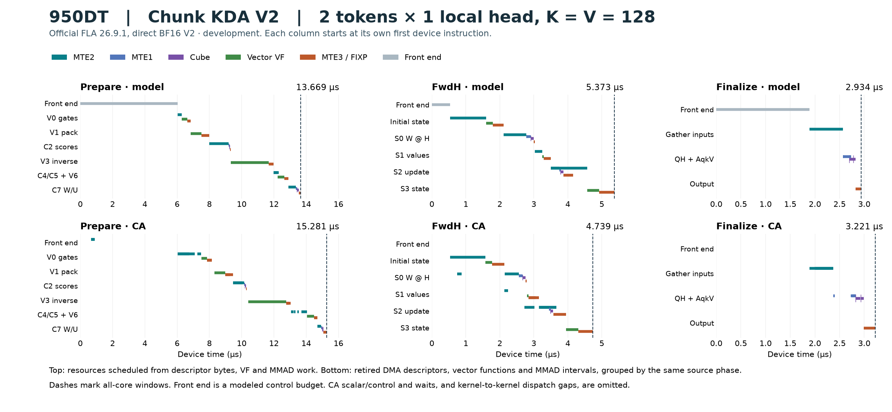
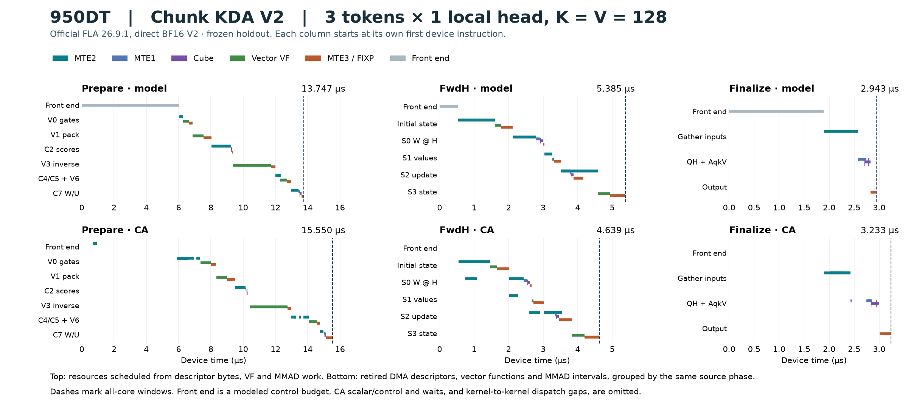
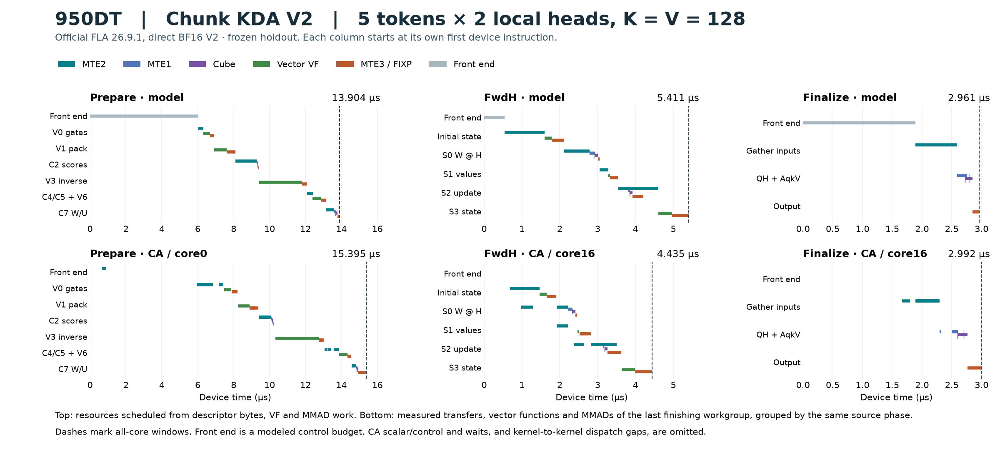
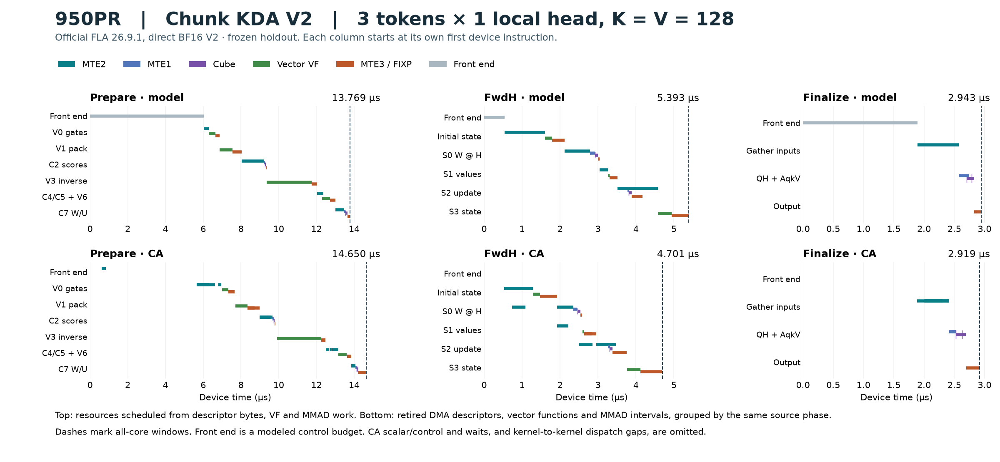
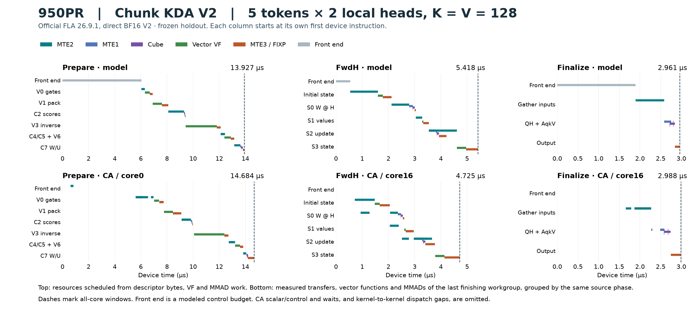

# FLA KDA V2 候选的设备资源与误差

| 算子 | 950DT 合格开发形状 | DT 开发 WAPE / 最大 | 950PR 合格开发形状 | PR 开发 WAPE / 最大 | 独立验证 |
|---|---:|---:|---:|---:|---|
| Chunk KDA V2，三段设备服务 | 2 | 5.57% / 5.68% | 2 | 4.14% / 6.46% | 950DT 2 形 4.09% / 5.75%，950PR 2 形 0.57% / 0.74%（WAPE / 最大） |

S2H1 的预测 DT/PR 加速比为 0.9987，CA 为 1.0462。按相同 shape 两端独立预测，当前候选把这个 shape 的 DT 和 PR 快慢方向判反。S65 另有同形双端开发窗口，见下表；两种小输入不足以验证跨芯片加速比。正式发布库、设备代码和数值资格由每行的原回执保存。公开入口仅在调用方显式选择 FLA 26.9.1 V2 时启用，结果标记为实验外推。[模型和公式](modeling.md) · [逐形回放与计数](development-check.json)



上面展示的 V0、V1、C2 等行对应源码工作单元。上图按冻结模型的源码相位依赖展开读、写、Vector 及 Cube 服务预算，底图同色显示相应单元的实际指令时间。每列的零点是该 kernel 所有活动核的最早指令，下方虚线止于最后退休。实测下图七条紫色刻线对应七次 MMAD。上图 Prepare C7 的同价 W/U 显示为一组 Cube 服务预算。CA 整链第一条指令至最后退休为 28.034 µs，含两段 dispatch 间隔。模型所比口径为三段窗口之和 23.241 µs。[原始 trace SHA 和阶段明细](dt-primitive-services.json)

## 每个形状的证据

| SKU | B,S,Hq,Hv,K,V | 资格 | 模型 Prepare/FwdH/Finalize µs | 实测或诊断窗 µs | 模型/合格 CA 总 µs | 3 段核数 / MMAD 维度与次数 / 各路径字节一致 |
|---|---|---|---|---|---|---|
| 950DT | [1×2×1×1×128×128](../kda-v23/reused-ascend950dt-t2-h1.json) | 首轮协议，合格开发 | 13.669 / 5.373 / 2.934 | 15.281 / 4.739 / 3.221 | 21.976 / 23.241 | 是 / 是 / 是 |
| 950PR | [1×2×1×1×128×128](../kda-v23/ascend950pr-t2-h1.json) | 首轮协议，合格开发 | 13.690 / 5.380 / 2.934 | 14.593 / 4.717 / 2.904 | 22.004 / 22.213 | 是 / 是 / 是 |
| 950DT | [1×15×1×1×128×128](../kda-v23/ascend950dt-t15-h1.json) | 首轮协议，只计结构诊断 | 14.684 / 5.537 / 3.051 | 15.838 / 4.447 / 2.982 | 23.272 / N/A | 是 / 是 / 是 |
| 950DT | [1×15×2×2×128×128](../kda-v23/ascend950dt-t15-h2.json) | 首轮协议，只计结构诊断 | 14.684 / 5.537 / 3.051 | 15.882 / 4.644 / 3.015 | 23.272 / N/A | 是 / 是 / 是 |
| 950PR | [1×15×2×2×128×128](../kda-v23/ascend950pr-t15-h2.json) | 首轮协议，只计结构诊断 | 14.719 / 5.545 / 3.051 | 15.592 / 4.939 / 3.153 | 23.315 / N/A | 是 / 是 / 是 |
| 950DT | [1×63×1×1×128×128](../kda-v23/ascend950dt-t63-h1.json) | 首轮协议，只计结构诊断 | 19.671 / 6.404 / 3.747 | 20.317 / 5.312 / 3.207 | 29.822 / N/A | 是 / 是 / 是 |
| 950DT | [1×64×1×1×128×128](../kda-v23/ascend950dt-t64-h1.json) | 首轮协议，只计结构诊断 | 19.749 / 6.424 / 3.759 | 20.356 / 5.243 / 3.207 | 29.931 / N/A | 是 / 是 / 是 |
| 950DT | [1×65×1×1×128×128](../kda-v23/ascend950dt-t65-h1.json) | 首轮协议，只计结构诊断 | 19.749 / 9.123 / 3.759 | 19.974 / 7.277 / 3.432 | 32.630 / N/A | 是 / 是 / 是 |
| 950DT | [1×65×1×1×128×128](../kda-v23/development-ascend950dt-t65-h1.json) | 官方 BF16 精度协议，合格开发 | 19.749 / 9.123 / 3.759 | 20.281 / 7.279 / 3.318 | 32.630 / 30.878 | 是 / 是 / 是 |
| 950PR | [1×65×1×1×128×128](../kda-v23/ascend950pr-t65-h1.json) | 首轮协议，只计结构诊断 | 19.854 / 9.138 / 3.759 | 19.998 / 7.621 / 3.224 | 32.750 / N/A | 是 / 是 / 是 |
| 950PR | [1×65×1×1×128×128](../kda-v23/development-ascend950pr-t65-h1.json) | 官方 BF16 精度协议，合格开发 | 19.854 / 9.138 / 3.759 | 19.932 / 7.655 / 3.178 | 32.750 / 30.764 | 是 / 是 / 是 |

S65 的 Prepare 和 Finalize 用两组，递归 FwdH 仍用一组。该形状在两端的 FwdH MMAD/搬运字节匹配，DT 预测 9.123 µs，诊断窗 7.277 µs。递归状态生成、前后块的 W/K 预读和数据槽重用可重叠，当前相位模型只重叠部分 S2 和 Stage3。CA 的 RVEC 子流水共 7,395 条，模型近似 6,368 条。模型低估记录数却高估时延，说明单靠调整向量吞吐不能解释差异。数值失败例仍排除于端到端误差。原始失败记录与更正参考后新运行的 BF16 逐操作协议分别保存，同 shape 的两个回执没有互相覆盖。[原数值诊断和开发资格](../kda-v23/report.md)

950DT S2 Prepare 总前端 9,952 周期后开始首笔 payload。此后 V0/V1 至 C2 的实际数据依赖使C2 的 MMAD 发起比模型靠后，模型低估 Prepare 1.612 µs。FwdH 的 W 读取早于首轮初态转换完成，部分 S2 等待与其他通道推进并行；这说明简单串行队列预算偏保守。PR 与 DT 物理外存分别为 LPDDR5、HBM3，两端核数相同的小例中主要差异来自前端和首搬运响应。候选复用了 DT 启动和响应参数，PR 的 Prepare/Finalize 因而没有得到实测中的全部提前量。这里能定位偏差发生的时间段，更细的冷态、队列发起和测量环境各自贡献尚未识别。

## 冻结形状独立验证

每条合格的新登记与冻结文件中的 SKU 和完整 shape 逐项匹配。逐行的全输出 golden、窗口、真实 ELF 和核数由原回执保存。[全部独立回执及 SHA](../kda-v23/holdout-comparison.json)

| SKU | B,S,Hq,Hv,K,V | 固定预测 µs | 合格 CA µs | 有符号误差 |
|---|---|---:|---:|---:|
| 950DT | [1×3×1×1×128×128](../kda-v23/holdout-ascend950dt-t3-h1.json) | 22.076 | 23.422 | -5.75% |
| 950PR | [1×3×1×1×128×128](../kda-v23/holdout-ascend950pr-t3-h1.json) | 22.105 | 22.270 | -0.74% |
| 950DT | [1×5×2×2×128×128](../kda-v23/holdout-ascend950dt-t5-h2.json) | 22.275 | 22.822 | -2.40% |
| 950PR | [1×5×2×2×128×128](../kda-v23/holdout-ascend950pr-t5-h2.json) | 22.306 | 22.397 | -0.41% |

独立 T3 H1 的 DT/PR 耗时比预测 0.9987，实测 1.0517，相对误差 -5.04%。

独立 T5 H2 的 DT/PR 耗时比预测 0.9986，实测 1.0190，相对误差 -2.00%。









## Kimi 长 prefill 外推

下面按一个完整、不切 chunk 的调度批次推导，单卡 attention DP 副本 B=8，每请求 S 取 32/128/256 Ki token，采用 Kimi K3 KDA 本地 Hq=Hv=12（TP8），K=V=128；64 是 KDA 内部 chunk。若 serving 采用 chunked prefill，每次传入的是该批实际调度的 token 和 cu_seqlens，不能将下表当作一次线上 kernel 的 CA。长表采用多头串行服务近似和可替换芯片资源，AIV 参与的 Finalize、长循环和重叠均待独立检验。970 全部为外推。

| SKU | 单请求 S | 准备 / 递归 / 输出 ms | 合计 ms | 最大每核 head×chunk（同顺序） | 模型墙钟中位 ms |
|---|---:|---:|---:|---|---:|
| 950DT | 32,768 | 22.130 / 6.656 / 4.375 | 33.161 | 1536 / 1536 / 1536 | 1.947 |
| 950DT | 131,072 | 88.502 / 26.606 / 17.493 | 132.600 | 6144 / 6144 / 6144 | 1.937 |
| 950DT | 262,144 | 176.997 / 53.206 / 34.984 | 265.186 | 12288 / 12288 / 12288 | 1.938 |
| 950PR | 32,768 | 25.598 / 8.774 / 5.024 | 39.396 | 1764 / 2048 / 1764 | 1.774 |
| 950PR | 131,072 | 102.025 / 35.074 / 20.021 | 157.121 | 7032 / 8192 / 7032 | 1.774 |
| 950PR | 262,144 | 203.871 / 70.141 / 40.005 | 314.017 | 14052 / 16384 / 14052 | 1.775 |
| 970DT | 32,768 | 10.414 / 3.929 / 2.107 | 16.450 | 828 / 1024 / 828 | 2.624 |
| 970DT | 131,072 | 41.336 / 15.707 / 8.361 | 65.403 | 3288 / 4096 / 3288 | 2.631 |
| 970DT | 262,144 | 82.516 / 31.410 / 16.689 | 130.614 | 6564 / 8192 / 6564 | 2.631 |

各组合查询 30 次，本机已加载候选和 JSON 参数，观测到最慢 2.699 ms。计算只遍历目标核数和有限 tile 类型，长上下文不会逐 token 展开。表中在固定 batch、每核多轮、满块占主导时近似线性；这是工作计数的可解释结果，当前缺同形 CA 来证明这条斜率。Prepare 和 Finalize 多头交错以及 HBM 工作集跨 L2 的行为可改变斜率。[每个情景的阶段、核数、工作量、带宽下界和查询开销](prefill-projections.json)

## 冻结与复算

首批冻结清单包含四个新 shape 的双端和 970 推演、实现与参数 SHA256。补充八个 shape 在新采集前另行封存，建模参数保持原冻结。[补充选择及预测](../kda-v23/supplement-predictions.json)T3H1 和 T5H2 的双端 CA 由独立验证作业管理。开发系列中的 T15/T63/T64/T65 一律保持其原登记角色。[冻结清单](freeze.json) · [原始采集](../kda-v23/report.md)

在仓库根目录运行以下命令可以核对冻结 SHA，并重建离线结果。第一条命令仅提取已有 trace。图使用环境中的 Matplotlib。

```bash
python3 development/validation/kda_resource23/extract.py
python3 development/validation/kda_resource23/audit.py
python3 development/validation/kda_resource23/report.py
toolchains/envs/cann-9.2.1/bin/python development/validation/kda_resource23/timeline.py
```
