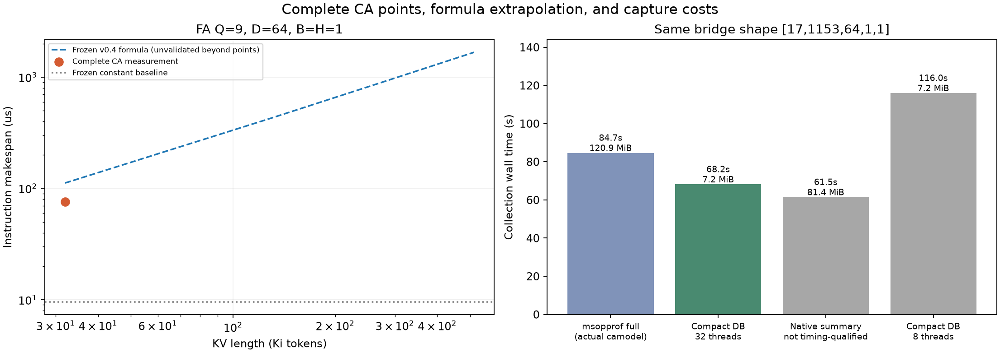
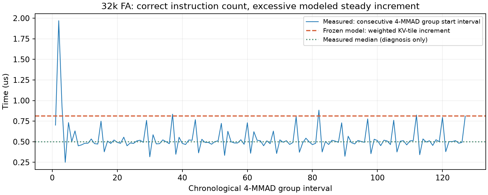

# 当前建模策略的误差分析：长 FA 采集迭代

配套 [建模策略与完整公式](modeling-strategy.md)。本轮冻结 v0.4 预测，不根据新测量回调参数。所有时间误差以完整指令 makespan 为准；本报告由 `scripts/report-long-fa.py` 重建。

## 1. 数据角色和当前结论

复用历史成功记录 **45** 条，其中38条为本版开发数据、7条为v0.4历史留出；本轮有 **5** 条可接受计时采集，其中旧 shape 重复桥接 4 次、新长 shape 完整实测 1 次。重复桥接不是新留出。

- **kv32k-compact-complete**：CA 75.980000 µs，冻结模型 111.985723 µs，APE **47.39%**；正确性通过，核数预测/实测 [1, 2]/[1, 2]，MMAD 512/512。

图中圆点为完整实测，虚线为冻结公式外推；未实测区不是CA曲线。成本比较是同一旧 shape 的单次探索结果，没有重复统计显著性。

## 2. 实际测的是什么库算子

| 模型名 | ACLNN API | 输入/属性 |
|---|---|---|
| quant | aclnnDynamicMxQuant | [R,C]；BF16→E4M3FN，尾轴block32，E8M0 scale，rint |
| matmul | aclnnMatmul | [M,K]×[K,N]→[M,N]，BF16 ND，cubeMathType=0 |
| FA | aclnnFlashAttentionScoreV2 | Q=[Q,B,H×D]，K/V=[KV,B,H×D]，BF16 SBH，非因果、无mask/dropout，scale=1/sqrt(D) |

调用器为 `smoke/three_ops.cpp`，本轮没有改源码或二进制。FA验证全部输出，CPU double golden，atol=0.002、rtol=0.01；matmul atol=0.01、rtol=0.005；quant输出和scale逐字节精确比较。输入是确定性模式，不能视为全面随机数值测试。

CANN 9.2.1；SoC `Ascend950DT_9582`；本轮 host SHA256 `2cf2c77e48233383ef4619ad61f136cc51a1462ae0d5ea63f226e64b4d2bd0e8`。每个历史记录的 package/platform/config/host SHA 保留在 evaluation.json。源码参考为 ops-nn `602e4ad985da00aad28c16432841e9c5069e10de`、ops-transformer `14d022b1a4c3df263bf697534e3c25c7c992ff5d`；不能断言这些源码与安装包二进制逐字对应。

缓存口径补充：旧记录中的cache_state提到`lib/config.json`里L2 cache_enable=0，只能证明该文件的值。本轮发现实际执行是camodel全SoC后端，尚未证明它采用该核wrapper配置，故不据此声称所有CA采集关闭了L2；历史字段保留，不把这个未确认假设用于误差归因。

| 索引 | 算子 | 实际 kernel/entry | kernel 二进制 SHA256 |
|---|---|---|---|
| K01 | fa | FlashAttentionScore_50348df09d0b3ee451d3693a6b2ab3f5_2328361008425337376_mix_aic | ac006aee669c8696aeab3bb3fe64fc29e5f3c8e2d172bf75f46db7176a2d4580 |
| K02 | fa | FlashAttentionScore_50348df09d0b3ee451d3693a6b2ab3f5_2328361008425599520_mix_aic | ac006aee669c8696aeab3bb3fe64fc29e5f3c8e2d172bf75f46db7176a2d4580 |
| K03 | fa | FlashAttentionScore_50348df09d0b3ee451d3693a6b2ab3f5_2328361009230643744_mix_aic | ac006aee669c8696aeab3bb3fe64fc29e5f3c8e2d172bf75f46db7176a2d4580 |
| K04 | fa | entry_kernel_2050000040140220 | 未导出 |
| K05 | matmul | MatMulV3_ND_ND_ND_ND_BF16_BF16_BF16_BF16_high_performance_2 | e6899fbaa2659b7778bee81deb00b64b009dafcb7ad350f06576767fdeba2bf7 |
| K06 | quant | DynamicMxQuant_bf16toe4m3_high_performance_33_mix_aiv | 17d48c749a27b6d68751ec25f76dc1e9feba37df2052be7b53a7cbd36e86a661 |

helper DB 的 `entry_kernel_2050000040140220` 与旧 FlashAttentionScore tiling key `2328361008425599520` 对应，但该采集未导出 kernel ELF；“未导出”不补成旧 ELF 哈希，也不把 tiling key 当完整二进制身份。

## 3. 本轮完整测量：桥接与新留出分开

| ID | 算子 | shape | kernel | CA µs | 预测 µs | APE | 偏差 µs | AIC/AIV 实测 | 指令 预测/实测 |
|---|---|---|---|---|---|---|---|---|---|
| bridge-1153-core-lib | fa | [17, 1153, 64, 1, 1] | K02 | 12.149697 | 12.321879 | 1.42% | +0.172182 | 1/2 | 20.00/20 |
| bridge-1153-native-dual | fa | [17, 1153, 64, 1, 1] | K04 | 12.555758 | 12.321879 | 1.86% | -0.233878 | 1/2 | 20.00/20 |
| bridge-1153-npusim-local-sku | fa | [17, 1153, 64, 1, 1] | K04 | 12.552727 | 12.321879 | 1.84% | -0.230848 | 1/2 | 20.00/20 |
| bridge-1153-threads8 | fa | [17, 1153, 64, 1, 1] | K04 | 12.023636 | 12.321879 | 2.48% | +0.298243 | 1/2 | 20.00/20 |
| kv32k-compact-complete | fa | [9, 32768, 64, 1, 1] | K04 | 75.980000 | 111.985723 | 47.39% | +36.005723 | 1/2 | 512.00/512 |

新鲜进程、单次采集；本轮没有建立置信区间。core-lib 名称表示一次尝试，msopprof实际仍选择camodel，不能将它作为另一个后端的结果。threads8仅为拒绝采用的调度探索，不并入正式校准。

## 4. 当前策略在复用数据上的逐点误差

### v0.4 历史独立留出（本轮未重跑）

| ID | 算子 | shape | kernel | CA µs | 预测 µs | APE | 偏差 µs | AIC/AIV 实测 | 指令 预测/实测 |
|---|---|---|---|---|---|---|---|---|---|
| q4_test_tiny | quant | [1, 128] | K06 | 4.324848 | 4.230658 | 2.18% | -0.094190 | 0/1 | 136.00/136 |
| q4_test_small | quant | [36, 512] | K06 | 5.646060 | 5.429783 | 3.83% | -0.216277 | 0/36 | 180.00/180 |
| q4_test_flash_decode | quant | [9, 5120] | K06 | 4.867273 | 5.429783 | 11.56% | +0.562510 | 0/45 | 268.00/268 |
| q4_test_pro_decode | quant | [144, 7168] | K06 | 6.331515 | 5.524225 | 12.75% | -0.807290 | 0/58 | 3300.00/3300 |
| q4_test_prefill | quant | [512, 5120] | K06 | 6.298788 | 6.364308 | 1.04% | +0.065520 | 0/64 | 7480.00/7480 |
| q4_test_batch128 | quant | [1152, 5120] | K06 | 8.683636 | 8.941661 | 2.97% | +0.258025 | 0/64 | 16788.00/16788 |
| f4_test_batch4 | fa | [9, 256, 128, 4, 1] | K03 | 9.690303 | 9.766535 | 0.79% | +0.076233 | 4/8 | 4.00/4 |

quant 6点 WAPE=5.54%，v0.3冻结公式=6.46%，固定均值=17.91%；FA 1点APE=0.79%。这些是上一轮已冻结结果，本轮不能宣传为新增精度改善。

### 开发/校准复用集（不是本轮独立准确率）

| ID | 算子 | shape | kernel | CA µs | 预测 µs | APE | 偏差 µs | AIC/AIV 实测 | 指令 预测/实测 |
|---|---|---|---|---|---|---|---|---|---|
| q3_test_small | quant | [512, 256] | K06 | 5.207879 | 5.429783 | 4.26% | +0.221904 | 0/64 | 444.00/444 |
| f3_test_short_tail | fa | [32, 129, 64, 1, 4] | K01 | 9.150303 | 9.720359 | 6.23% | +0.570056 | 4/8 | 4.00/4 |
| f3_test_d128_tail | fa | [17, 257, 128, 1, 1] | K03 | 9.550910 | 10.470607 | 9.63% | +0.919697 | 1/2 | 6.00/6 |
| f3_test_longkv | fa | [17, 1153, 64, 1, 1] | K02 | 12.486668 | 12.321879 | 1.32% | -0.164788 | 1/2 | 20.00/20 |
| q3_test_one_ub | quant | [576, 4096] | K06 | 6.948485 | 6.729157 | 3.16% | -0.219329 | 0/64 | 6684.00/6684 |
| q3_test_two_ub | quant | [768, 4096] | K06 | 7.202424 | 6.743424 | 6.37% | -0.459000 | 0/64 | 8952.00/8952 |
| q2_cal_tiny | quant | [1, 64] | K06 | 4.326061 | 4.230658 | 2.21% | -0.095403 | 0/1 | 136.00/136 |
| q2_cal_saturation | quant | [65, 256] | K06 | 4.898182 | 5.429783 | 10.85% | +0.531601 | 0/33 | 180.00/180 |
| q2_cal_ub_loop | quant | [1024, 4096] | K06 | 8.047273 | 7.501657 | 6.78% | -0.545616 | 0/64 | 11896.00/11896 |
| m2_cal_skinny_k | matmul | [1, 256, 1024] | K05 | 4.624243 | 4.560230 | 1.38% | -0.064013 | 4/0 | 4.00/4 |
| m2_cal_k_tail | matmul | [65, 128, 129] | K05 | 3.711515 | 3.627777 | 2.26% | -0.083738 | 10/0 | 1.00/1 |
| m2_cal_full | matmul | [128, 512, 512] | K05 | 4.381818 | 4.506080 | 2.84% | +0.124262 | 32/0 | 2.00/2 |
| f2_cal_q128 | fa | [128, 128, 64, 1, 1] | K01 | 9.498182 | 9.247694 | 2.64% | -0.250489 | 2/4 | 2.00/2 |
| f2_cal_longkv | fa | [16, 1025, 64, 1, 1] | K02 | 12.384243 | 12.312583 | 0.58% | -0.071660 | 1/2 | 18.00/18 |
| f2_cal_heads4 | fa | [16, 128, 64, 1, 4] | K01 | 8.758182 | 8.894442 | 1.56% | +0.136260 | 4/8 | 2.00/2 |
| f2_cal_d128 | fa | [16, 128, 128, 1, 1] | K03 | 8.714545 | 8.828627 | 1.31% | +0.114082 | 1/2 | 2.00/2 |
| q2_test_wide | quant | [1, 4096] | K06 | 5.686060 | 5.429783 | 4.51% | -0.256277 | 0/16 | 136.00/136 |
| m2_test_m_tail | matmul | [129, 256, 256] | K05 | 3.664243 | 3.946899 | 7.71% | +0.282656 | 20/0 | 1.00/1 |
| m2_test_k_work | matmul | [17, 256, 1024] | K05 | 4.741818 | 5.040240 | 6.29% | +0.298421 | 8/0 | 4.00/4 |
| f2_test_q129 | fa | [129, 128, 64, 1, 1] | K01 | 8.870910 | 9.080719 | 2.37% | +0.209809 | 3/6 | 2.00/2 |
| f2_test_heads8 | fa | [16, 128, 64, 1, 8] | K01 | 9.401818 | 8.992063 | 4.36% | -0.409756 | 8/16 | 2.00/2 |
| f2_test_d128 | fa | [17, 192, 128, 1, 1] | K03 | 9.050303 | 9.653277 | 6.66% | +0.602975 | 1/2 | 4.00/4 |
| q2_test_ub_loop | quant | [640, 4096] | K06 | 6.217576 | 6.364308 | 2.36% | +0.146733 | 0/64 | 7480.00/7480 |
| import_v1_q_test_wave | quant | [33, 768] | K06 | 5.209697 | 5.429783 | 4.22% | +0.220086 | 0/34 | 268.00/268 |
| import_v1_m_cal_prefill | matmul | [128, 256, 512] | K05 | 4.393333 | 4.260930 | 3.01% | -0.132403 | 32/0 | 2.00/2 |
| import_v1_f_test_verify | fa | [17, 96, 64, 1, 1] | K01 | 9.162425 | 8.691510 | 5.14% | -0.470915 | 1/2 | 2.00/2 |
| import_v1_q_cal_small | quant | [4, 256] | K06 | 4.588485 | 4.759044 | 3.72% | +0.170558 | 0/4 | 136.00/136 |
| import_v1_f_cal_small | fa | [16, 64, 64, 1, 1] | K01 | 9.052122 | 8.656922 | 4.37% | -0.395199 | 1/2 | 2.00/2 |
| import_v1_q_cal_decode | quant | [17, 512] | K06 | 5.790303 | 5.429783 | 6.23% | -0.360520 | 0/34 | 136.00/136 |
| import_v1_m_cal_decode | matmul | [1, 128, 128] | K05 | 3.356363 | 3.370393 | 0.42% | +0.014029 | 2/0 | 1.00/1 |
| import_v1_m_cal_small | matmul | [32, 64, 64] | K05 | 3.291515 | 3.367861 | 2.32% | +0.076346 | 2/0 | 1.00/1 |
| import_v1_f_test_context | fa | [8, 192, 64, 1, 1] | K01 | 8.805454 | 9.425492 | 7.04% | +0.620037 | 1/2 | 4.00/4 |
| import_v1_f_cal_prefill | fa | [64, 256, 64, 1, 1] | K01 | 9.409091 | 9.702956 | 3.12% | +0.293865 | 1/2 | 4.00/4 |
| import_v1_q_test_tail | quant | [8, 384] | K06 | 5.760000 | 5.429783 | 5.73% | -0.330217 | 0/16 | 136.00/136 |
| import_v1_f_cal_decode | fa | [1, 128, 64, 1, 1] | K01 | 8.784242 | 8.718488 | 0.75% | -0.065754 | 1/2 | 2.00/2 |
| import_v1_q_cal_prefill | quant | [64, 1024] | K06 | 5.531516 | 5.429783 | 1.84% | -0.101733 | 0/64 | 268.00/268 |
| import_v1_m_test_prefill | matmul | [48, 128, 192] | K05 | 3.575152 | 3.632713 | 1.61% | +0.057561 | 6/0 | 1.00/1 |
| import_v1_m_test_tail | matmul | [17, 96, 128] | K05 | 3.493940 | 3.505495 | 0.33% | +0.011556 | 4/0 | 1.00/1 |

每条记录的预测计划、实际核数、指令计数、原始trace/DB哈希、数值检查都保存在 [evaluation.json](evaluation.json)。matmul本轮没有新增CA，表中如出现偏差不能归因于本轮采集优化。

## 5. 误差来源：证据与待验证假设

**quant 已证实的旧问题**：v0.2把含参数/排队的MTE2聚合窗当每轮服务，重复计算后续预取；VF命令窗也不等于Vector实际忙碌区间。v0.3按UB槽依赖修正；v0.4对小shape控制路径饱和。本轮复用结果仍可见单点约12.8%误差，未因改采集方式消失。

**quant 尚未证实的残差归因**：控制前缀、核间起始偏差与写回排队在小shape占比较高，单次采集波动可能影响数个百分点，但没有逐因素实验或重复统计，不能全部称为随机噪声。三点多UB校准仍不足以识别所有尾块、槽竞争与更长循环。

**matmul 边界**：输出tile重平衡是有限启发式，gemv/K-tail/粗tile各只少数旧样本；核数吻合不证明内部tile、访存与流水完全一致。参数中较大的fix截距可能吸收其他固定开销，不能解释为真实硬件FIXP固有延迟。

**FA 已证实的指令问题**：外层KV256仍有QK/PV内部128分段，旧的“2×外层次数”会少算；当前Q64结构公式已在旧trace检验。长shape的实际次数与核数见上表。指令次数正确只说明工作量分解通过，不保证每轮关键路径正确。

**FA 时延模型的局限**：现有 II=max(R,C+F,V+C/2) 来自小KV的聚合服务拟合，省略了每轮标量、同步、softmax递推和存储竞争的详细依赖。单凭总时间不能认定“Vector bound”或将差额全归到L2/HBM。

**32k具体诊断（复用本次DB，无新增CA）**：按时间排序每4条MMAD取一次起点，共127个间隔，中位数 **0.501212 µs**，四段均值分别为 0.572178, 0.522235, 0.512576, 0.529990 µs；旧模型加权后每KV tile增量 **0.810880 µs**。实测读payload为1次1152B的Q和256次32768B的K/V搬运；单次32KiB DMA窗口中位数 0.572121 µs。AIC MTE2非排除区间并集67.8515 µs，Cube27.6394 µs，最大AIV SIMD28.2861 µs，存在明显重叠。**证实了总工作次数正确、旧模型稳态增量偏大；尚未证明每个MMAD分组等于源码完整循环，或唯一根因是哪一条依赖。** 下一版应分离首轮读延迟、读发起间隔和稳态递推，不能直接将本点调准后称为独立验证。

**为什么固定耗时曾更好**：旧小shape由启动/控制主导，增加总工作常被分核吸收，时延区间很窄，多参数拟合容易放大噪声；常数方差小。长KV在B=H=1下没有增加活跃核，核内循环增加，常数失去结构解释。固定值仍以旧数据均值比较，不用新留出估计均值。

**采集与计时口径**：npusim compact 路径仍采完整指令，仅省去JSON生成和大量文本格式化。SKU适配器仅在soc_version=Ascend950DT且显式目标DT_9582时生效；无适配器的PR_9589结果全部拒绝。原生summary启动/结束窗口与helper指令窗不同，尚不作为替代参考。

## 6. 长上下文：已实测与未实测外推

| shape [Q,KV,D,B,H] | 预测 µs | 完整CA µs | 状态 | 最大核MMAD预测 |
|---|---|---|---|---|
| [9, 32768, 64, 1, 1] | 111.985723 | 75.980000 | 完整实测 | 512 |
| [9, 33792, 64, 1, 1] | 115.229242 | — | 未完成实测；仅公式外推 | 528 |
| [9, 131072, 64, 1, 1] | 423.363568 | — | 未完成实测；仅公式外推 | 2048 |
| [9, 132096, 64, 1, 1] | 426.607087 | — | 未完成实测；仅公式外推 | 2064 |
| [9, 262144, 64, 1, 1] | 838.534029 | — | 未完成实测；仅公式外推 | 4096 |
| [9, 263168, 64, 1, 1] | 841.777548 | — | 未完成实测；仅公式外推 | 4112 |
| [9, 524288, 64, 1, 1] | 1668.874950 | — | 未完成实测；仅公式外推 | 8192 |
| [9, 525312, 64, 1, 1] | 1672.118469 | — | 未完成实测；仅公式外推 | 8208 |

Q=9代表草拟8个token后的主模型校验。32/128/256/512k按1024倍数解释，L+1024表示输出接近1k的上下文端点。该表仅B1/H1/D64普通FA代理；用户的其他batch、prefill chunk、TP与MLA/KDA/压缩注意力未因该表而获得验证。核函数在更长shape上是否换路由尚需独立证据。

本轮32k成功后，128k–512k完整CA尚未执行：按32k 222.3秒、约20–60秒固定部分粗估，128k单点约12–14分钟，512k约44–54分钟；这是预算外推，不是仿真时间实测。本轮已完成14次采集探索，停止增加高成本长点。鉴于32k已暴露47.4%偏差，表中更长KV公式仅保留可审计预测，不满足准确性验收。下一轮先用已有DB修正服务与发起间隔，再决定是否采用窗口采集或一次128k完整留出；512k目前仍未完成验证。

## 7. 所有尝试与采集开销

| 尝试 | Q/KV | 路径 | 状态 | 墙钟 s | 记录CPU s | 保留 MiB |
|---|---|---|---|---|---|---|
| bridge-1153-core-lib | 17/1153 | legacy | 完整计时 | 84.68 | 1538.82 | 120.90 |
| bridge-1153-native | 17/1153 | native | failed | 12.63 | 9.39 | 0.00 |
| bridge-1153-native-dirs | 17/1153 | native | correctness_only | 61.50 | 1319.73 | 81.39 |
| bridge-1153-native-dual | 17/1153 | native | 完整计时 | 66.10 | 1300.07 | 88.52 |
| bridge-1153-npusim | 17/1153 | npusim | failed | 70.99 | 1385.36 | 7.17 |
| bridge-1153-npusim-adapter | 17/1153 | npusim | failed | 0.03 | 0.02 | 0.01 |
| bridge-1153-npusim-adapter-env | 17/1153 | npusim | failed | 77.76 | 1316.86 | 7.18 |
| bridge-1153-npusim-dt | 17/1153 | npusim | failed | 72.40 | 1402.38 | 7.18 |
| bridge-1153-npusim-local-sku | 17/1153 | npusim | 完整计时 | 68.19 | 1308.94 | 7.17 |
| bridge-1153-thread1 | 17/1153 | default | 超时 | 126.21 | 169.98 | 73.60 |
| bridge-1153-threads8 | 17/1153 | npusim | 完整计时 | 116.03 | 917.46 | 7.24 |
| kv32k-compact-complete | 9/32768 | npusim | 完整计时 | 222.29 | 6556.38 | 105.09 |
| kv32k-no-raw | 9/32768 | default | 超时 | 130.89 | 3626.36 | 251.52 |
| kv32k-npusim | 9/32768 | npusim | 超时 | 120.02 | 29.34 下界 | 0.13 |

本轮14次探索合计墙钟 **20.50分钟**、记录CPU至少 **5.80小时**、保留原始数据 **0.739GiB**。包含失败设置、错误SKU、超时和拒绝采用的配置，不只统计最终成功case。CPU下界来自npusim超时前端未回收后代的getrusage限制；字节数是结束时保留量，不是峰值临时空间。

采集预算：旧基线和早期探针是120秒；`kv32k-compact-complete`显式提高为360秒，只用于获得一次完整32k参考。若它完成，不能将预算增加的作用宣传为降开销。1线程和8线程配置没有墙钟收益；未改全局SDK配置。更长上下文继续以成本门槛决定是否完整仿真。

原始产物留在本地runs/long-fa，不进入Git。可审计尝试命令、日志/config/host/model哈希和CPU口径见 [capture-attempts.json](capture-attempts.json)。在线模型仍为v0.4，无新增CA校准拟合。
