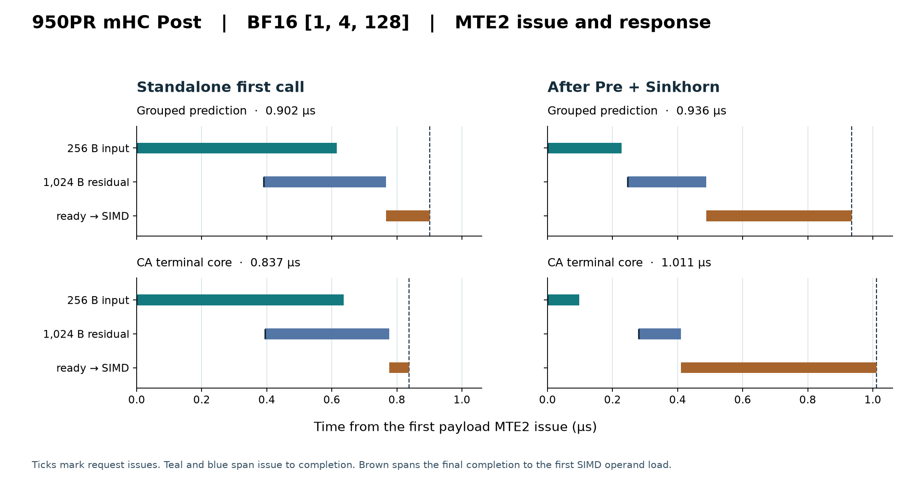

# mHC Post 首批 DMA 与发起状态的可辨识性

在 950DT 的 [1,4,128] 上，相同 MhcPost ELF 单独首发为 4.752 µs，紧接 Pre→Sinkhorn 时为 2.672 µs。只给芯片与 shape，任何单值预测的两协议最坏相对误差都至少为 **28.03%**。950PR 三个同 ELF 配对合计的理论最优为 **19.02%**。本次拆分各条读发起、完成与 SIMD 交接后，在对应留出集上，无历史模型仍将 PR 首发低估约 30%。本次实验沿用历史迹线，线上版本和冻结样本保持原样。

## 同形同 ELF 的两种协议能否分别达标

每对均为同 SKU、同 BF16 输入布局与属性、相同残差合同、相同活跃核数、相同安装包 kernel 名与 ELF SHA-256。生产链由前序算子提供张量，因此协议也会改变输入的生产历史。档案中还缺少能够验证 ELF 哈希的同流 Post→Post 重复调用配对。

|SKU|严格配对 shape|两种协议分别满足 WAPE ≤20% 且每个点最大误差 ≤40%|最优的较差协议 WAPE|预测总和的约束 (µs)|
|---|---:|---|---:|---|
|950DT|1|不可行|28.03%|至少 3.802 且至多 3.206|
|950PR|3|可行|19.02%|10.469 至 10.685|

对第 $i$ 个 shape，较短实测为 $a_i$，较长实测为 $b_i$。一个模型给两协议的共同预测 $p_i$ 可以限制在二者之间，移动到最近的端点不会增大任一误差。40% 逐项上限进一步要求 $l_i=\max(a_i,0.6b_i)\le p_i\le u_i=\min(b_i,1.4a_i)$。令 $A=\sum a_i$、$B=\sum b_i$、$S=\sum p_i$。两协议 WAPE 分别为 $(S-A)/A$ 和 $(B-S)/B$。20% 门槛要求 $0.8B\le S\le1.2A$，并与逐项上限允许的总和区间 $[\sum l_i,\sum u_i]$ 相交。令两协议误差相等，得到 $S=2AB/(A+B)$，再将它限制于逐项上限允许的范围即可算出理论最优。合并两协议的 WAPE 在这一范围恒为 $(B-A)/(A+B)$，因此不足以表明两者分别达标。

950PR 的 [1,4,64]、[1,4,128]、[9,4,1024] 若各自单独考核，最优相对误差分别约为 21.8%、23.0%、13.5%。合计时允许每形状选择任意一个预测，短/长协议的误差可以在各自分母内聚合。该证书用已知实测求下界。另有 DT [2,4,6144] 同一 Post 首次/复用的 compact 数据为 4.838/2.905 µs，单形下界 24.96%，缺少 ELF 哈希，单列为辅助证据。

## 同一预测器下的整组留出

全部严格配对所在的进程及这些进程使用的 shape 在两张卡上的所有记录均从训练中清除。剩余 77 个旧窗口统一校准一次，保证相同 SKU/shape 的两次无历史估计逐位相等。

|SKU|留出协议|shape 数|无历史 WAPE / 最大误差|已知执行流上下文 WAPE / 最大误差|
|---|---|---:|---:|---:|
|950DT|首发|1|36.53% / 36.53%|4.30% / 4.30%|
|950DT|紧接 Pre→Sinkhorn|1|12.91% / 12.91%|16.25% / 16.25%|
|950PR|首发|3|29.91% / 31.94%|5.12% / 8.73%|
|950PR|紧接 Pre→Sinkhorn|3|11.69% / 13.28%|12.96% / 16.62%|

## 多个操作数的发起、响应与交接

横轴以该核第一条操作数 DMA 发起为起点。前一条 96 B 元数据搬运计入控制段。PR [1,4,128] 独立首发时，两个操作数相隔 0.395 µs 发起，分别经过 0.636/0.382 µs 完成。最后一条读完成至首条 RV_VLD 还有 0.060 µs。在生产链后，发起间隔缩至 0.279 µs，两个响应时间缩至 0.098/0.131 µs，但最后的交接增至 0.601 µs。单用“热态折扣”同时缩短响应和交接会判错后者的变化方向。

通道分核时，设 $K$ 为一个核心的片宽。首行输入和四个 residual lane 各按 32 B 对齐，两条 DMA 的字节数为 $[L,4L]$，其中 $L=32\lceil2K/32\rceil$。token 分核时有四条 DMA，字节数依次为 $[64,16,2K,8K]$。90 个窗逐条验证了这两种大小映射。以首个操作数发起为零，$t_1=0$，$t_i=t_{i-1}+g_i/F$。$g_i$ 是同一路径、同状态下训练集中相邻请求发起间隔的中位数（周期），$F$ 为目标频率（周期/µs）。大小 $D_i$ 的请求有响应成本 $c_i+bD_i/1024$（周期）。$b$ 为本地 MTE2 端口周期/KiB，有配置带宽时按带宽换算，否则沿用独立 RMS 阶段标定的 18.39635 周期/KiB。$c_i$ 为观测响应周期减去字节成本后的中位数，下限为零。于是从首次读发起至首次 SIMD 操作数使用的时间为

$$
R=\max_i\{t_i+(c_i+bD_i/1024)/F\}+h/F .
$$

$h$ 为最后完成返回至首次 RV_VLD 的中位周期数。档案中的实测交接为 0.0158–0.6218 µs。逐窗代入该窗的实际发起间隔、响应与交接，可重建所有 90 个窗口的首读到 SIMD 阶段。预测时则只取训练得到的请求级参数。$c_i,g_i,h$ 是缓存状态、争用及发起顺序的混合观测，当前数据无法把它们拆分为唯一的硬件参数。

|通道分核状态|校准窗数|第二条发起间隔 (周期)|两个响应固定项 (周期)|交接 (周期)|
|---|---:|---:|---|---:|
|首次|21|651|1045 / 613|147|
|扩核|10|241|745 / 620|26|
|复用|18|63|199 / 326|26|
|紧接 Pre→Sinkhorn|20|412|364 / 379|744|

表中给出所有旧档案校准后的例子，实际留出时逐折重估。某状态没有训练窗时先取同路线相近状态，仍缺失时取该路线样本最多的状态。PR 缺同 Post 连续复用记录，两颗 SKU 的 token 路线都没有前序生产链样本。其他四段沿用原阶段候选。到核项随历史与活跃核数变化，控制和写退休按状态取固定周期。算体按 $J\lceil K/64\rceil$ 个向量工作组和 $J-1$ 个额外行发起计费，$J$ 是最长核的行数。各段系数使用非负拟合，soft-L1 的转折点为 0.1 µs。给定上下文时依据同一流的前序算子和先前活跃核数选择首发、扩核、复用或生产链。历史全未知时，对可行状态的最短与最长估计 $a,b$ 取等相对误差值 $2ab/(a+b)$。若只知首发或生产链，对普通连续调用取扩核和复用的等损值。进程路径仅用于数据分组。

## 45 个旧进程的交叉回放

下表覆盖 90 个历史完整窗。每折留出一个完整进程，并在两端移除所有对应 shape 后训练。该表衡量全量旧样本的回顾性泛化，协议的数学下界和此前冻结的新样本独立验证应分别阅读。

|SKU|窗数|上次阶段候选，历史未知|拆分首批读，历史未知|仅知首次或生产链|已知状态|实测落入候选状态最短至最长范围|
|---|---:|---:|---:|---:|---:|---:|
|950DT|70|25.50% / 51.98%|25.32% / 59.01%|16.12% / 45.23%|9.25% / 38.99%|45.7%|
|950PR|20|17.08% / 31.64%|17.03% / 31.72%|4.99% / 17.29%|4.99% / 17.29%|90.0%|

首读阶段的留出绝对误差中位数在 DT 从 0.067 增至 0.116 µs，在 PR 从 0.114 降至 0.081 µs。DT 多行每核子集从 0.048 增至 0.209 µs，说明固定本地端口加请求级中位数不足以估计某些首批调度。不同状态估计的范围仅覆盖 DT 45.7%、PR 90.0% 的真实窗口，更适合作为情景对照。DT 已知状态的原阶段候选为 7.98% / 29.75%，新增细分在 DT 有回退，因此当前证据只支持诊断。两颗 950 同频，这些结果也无法检验 970 的响应、交接与缓存规律。

[逐形公式可行性证书](protocol-feasibility.json) · [逐次请求、折划分与结果](issue-response.json) · [原阶段参数](cross-validation.json) · [各窗口 CA 观测](phase-evidence.json)
