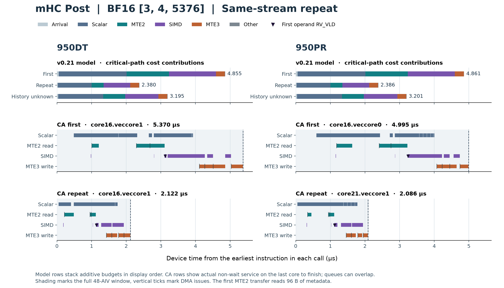

# mHC Post 同形同流重复调用的独立验证

**在 [3,4,5376] 上，只给芯片、shape、dtype 和算子属性，即使事后选择最佳单值，两次调用的最大相对误差也至少为 950DT 的 43.34%、950PR 的 41.08%。** 两端都超过 40%。将同一流是否首次派发、上一次实际派发的 AIV 数交给冻结的 v0.21 模型后，两端每次调用的误差均低于 15%。这次实验每颗芯片各有一个独立 shape、一个进程、两次调用。

|芯片|协议|CA 全核 µs|v0.21 不给历史 µs|有符号误差|v0.21 给定历史 µs|有符号误差|冻结阶段候选给定历史 µs|有符号误差|
|---|---|---:|---:|---:|---:|---:|---:|---:|
|950DT|首发|5.370|3.195|−40.51%|4.855|−9.58%|4.827|−10.10%|
|950DT|同流再调用|2.122|3.195|+50.51%|2.380|+12.15%|2.542|+19.78%|
|950PR|首发|4.995|3.201|−35.92%|4.861|−2.68%|4.835|−3.19%|
|950PR|同流再调用|2.086|3.201|+53.43%|2.386|+14.37%|2.550|+22.25%|

图中每列使用相同的设备时间刻度，每次调用从全核最早指令重新计零。上部按显示顺序累加模型贡献，仅刻画关键路径预算；例如 SCALAR 预算结束的位置无法当作第一条真实 MTE2 的发起时间。下部画各次调用最后完成的实际 AIV。着色跨度来自该核的逐指令 trace，已排除 wait、sync 和统计排除项，重叠区间取并集。小竖线是逐次 DMA 发起，深色三角是首次向量操作数加载 RV_VLD。底色标出 48 AIV 的完整设备窗。DT 两次的末核都是 core16.veccore1，PR 由 core16.veccore0 变为 core21.veccore1。

## 相同输入与冻结计时口径

两个 SKU 均在同一个进程创建一次流，串行调用两次安装包的 aclnnMhcPost。batch 记录的 0/1 只用于标记日志序号。两次均重新构造相同的 BF16 输入 x[3,4,5376] 与 h[3,5376]，FP32 residual[3,4,4] 与 post[3,4]，输出形状为 [3,4,5376]。宿主对 x、h 分别使用固定偏移 4、7 的同一确定性生成函数，并对两份 FP32 系数使用固定的下标公式。每次新建张量、执行、同步流，再单独将全部 64,512 个输出与 FP64 公式比较，四次均 bad=0 且最大绝对误差为 0。物理地址与缓存行驻留没有作为可见输入。

四个窗口均为 MhcPost_59130ccee6717ff2c0f15b485e731162_5，ELF SHA-256 为 36851e45520023382742d07d871519f65e57e9c49ec3594583e361b0bb9b6677。每次启动 48 个 AIV、0 个 AIC，同芯片两次的实际核心集合相同。分析脚本由原 trace 重新核对了 SKU、内存类型、金标、调用顺序、每个核的供应商 duration 表、全核起止和 ELF。所有预测均预先登记。四条 CA 的原始路径、全核窗口及成本见逐芯片回执。[冻结清单](paired-freeze.json) · [950DT 回执](paired-Ascend950DT_9582.json) · [950PR 回执](paired-Ascend950PR_957b.json)

## 为什么未知历史无法满足 40% 单点上限

设第一次实测为 $b$，第二次为 $a$，且 $a<b$。只有相同可观测输入的预测器对两次只能给同一个值 $p$。若要求相对误差都在 $e$ 内，$p$ 必须同时位于 $[(1-e)b,(1+e)b]$ 和 $[(1-e)a,(1+e)a]$。两个区间相交至少要求 $(1-e)b\le(1+e)a$，所以

$$
e_{\min}=\frac{b-a}{b+a},\qquad p^*=\frac{2ab}{a+b}.
$$

当 $p=p^*$ 时，两次相对误差大小相等且符号相反，给出最小可能的最大相对误差。

|芯片|首发 / 第二次|首发允许的 ±40% 区间 µs|第二次允许的 ±40% 区间 µs|区间缺口 µs|最佳共同预测 µs|不可约最大误差|
|---|---:|---|---|---:|---:|---:|
|950DT|2.530×|[3.222, 7.518]|[1.273, 2.971]|0.250|3.042|43.34%|
|950PR|2.394×|[2.997, 6.992]|[1.252, 2.920]|0.076|2.943|41.08%|

对于仅含这两次的集合，若共同预测位于两次实测之间，WAPE 恰为 $(b-a)/(b+a)$。已知历史的 v0.21 在该配对上的 WAPE / 最大误差为 DT **10.31% / 12.15%**、PR **6.12% / 14.37%**。任一覆盖这两次的无历史评估集合，其最大误差都受到上述下界约束；整个算子跨 shape 的 WAPE 仍取决于其他样本、协议组成与耗时权重。较早的 DT 28.03% 下界属于另一个 shape [1,4,128] 的首次 Post 对比 Pre→Sinkhorn→Post，两种实验的输入生产历史不同。[历史生产链配对及公式](issue-response.md) · [总误差分析](../../docs/error-analysis.md)

## 哪些阶段发生变化

两颗芯片均走通道切分。每个 token 最多沿通道二分至 16 片，再切一轮会超出可用核数。3×16=48 个核，每核一行、336 个通道。冻结模型按每核 $\lceil336/64\rceil\times4\times5=120$ 个向量工作单位估算 SIMD 预算，由校准资源系数定价。芯片和派发数相同时，首次与复用使用各阶段的不同起始延迟。显式历史在首发时取 resident_aiv=0，再调用时取上次已派发的 48 核。这里记录的是同流次序及派发核数，实际缓存状态仍待单独观测。[通用模型与参数来源](../../docs/modeling-strategy.md) · [Post 算子模型代码](../../operator_model/post_resource.py)

下表直接取真实逐核时间戳。相邻阶段首尾相接，每一行之和等于完整设备窗口。到核为全核最早指令至末核首条指令，控制段到元数据之后首个张量读，首批读段到首条 RV_VLD，主体段至最后一次数据写发起，写尾至末核结束。各相邻阶段可包含其他流水单元并行工作。

|芯片与调用|到核 µs|控制 µs|首批读 µs|主体 µs|写尾 µs|完整窗 µs|
|---|---:|---:|---:|---:|---:|---:|
|DT 首发|0.486|1.807|0.830|1.905|0.342|5.370|
|DT 再次|0.050|0.903|0.186|0.795|0.188|2.122|
|PR 首发|0.599|1.813|0.830|1.499|0.253|4.995|
|PR 再次|0.050|0.893|0.182|0.822|0.138|2.086|

四个末核都执行 1,528 条 SCALAR、1,847 条 SIMD，首批业务输入读 672+2,688=3,360 B，四条写回各 672 B，另有一次 96 B 元数据读取。在 DT 首发，两个输入读相隔 0.396 µs 发起，第二次相隔 0.038 µs，首发与重复各自第一笔 672 B 读取的响应耗时为 0.558 与 0.108 µs。首次 RV_VLD 前，DT、PR 已分别积累 1.984、2.118 µs 的首发额外时间。读发起、响应、核间到达错峰及主计算体均发生变化。仅由这些窗口不能唯一归因于 L2 缓存、指令缓存或仿真器派发机制。

这批采集为每 SKU 一个串行双发进程。DT 花费 116.2 s 墙钟、2,812.6 CPU·s、峰值 487.8 MiB，PR 为 104.1 s、2,359.3 CPU·s、394.9 MiB。以上过程复用了已有完整 trace 生成图表，本次分析新增 CA 开销为零。[逐次测量、物理区间与成本 JSON](paired-result.json) · [复核及作图脚本](../../development/validation/post_candidate/paired_result.py)
