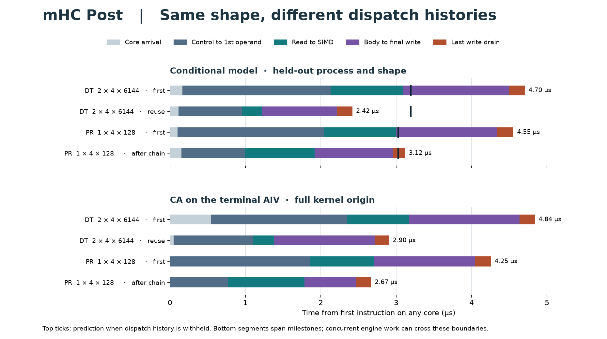

# mHC Post 发起状态与资源流水的独立审计

|芯片与样本|v0.21 缺历史|阶段候选缺历史|仅知首次/前序链|已知全部状态|
|---|---:|---:|---:|---:|
|Ascend950DT_9582 · all · n=70|26.31 / 47.06|25.50 / 51.98|15.05 / 44.94|7.98 / 29.75|
|Ascend950DT_9582 · few token/wide · n=23|33.19 / 46.44|32.76 / 51.96|16.01 / 44.90|7.72 / 16.76|
|Ascend950DT_9582 · multiple rows/core · n=8|21.43 / 36.32|14.50 / 44.59|9.26 / 37.65|8.99 / 22.73|
|Ascend950PR_957b · all · n=20|18.13 / 33.54|17.08 / 31.64|5.81 / 16.95|5.81 / 16.95|

数字为 WAPE / 最大绝对相对误差（%）。档案有 45 个独立 CA 进程，合计 90 个通过完整全核窗口和金标的调用，DT 70 次（60 个 shape）、PR 20 次（17 个 shape）。每折留出一整个进程，并从训练中清除该进程所有 shape 在两张卡、所有状态的记录。v0.21 的既有参数用过部分早期 DT 样本；它在此是原版本回放。所有候选都属于回顾性分组交叉验证。

## 小 token、宽通道的偏差从哪里开始

在 DT [2,4,6144]，首发及批尾复用都用 64 AIV，终止核各有 1,578 条 SCALAR 和 581 条 SIMD 指令。同一核搬入 1,920 B 有效载荷、写出 1,536 B，一次 MOV 96 B 是元数据。两次的到核、控制、读取、计算体和退休分别为 0.545 / 1.802 / 0.825 / 1.461 / 0.204 µs 与 0.050 / 1.054 / 0.275 / 1.335 / 0.190 µs。总差 1.933 µs，其中 1.79 µs 已在首次向量操作数读取前出现。控制阶段的变化来自到核之后、首个真实输入 DMA 发起之前；队列内指令间可重叠，其原始 duration 不宜直接相加。

在 PR [1,4,128]，单独首发与执行 Pre→Sinkhorn 后调用 Post 使用同一包内二进制、同一终止核；从原点到首个 ≥256 B 的载荷读由 1.864 降至 0.772 µs。DT 同形状是 2.138 降至 0.767 µs。下一个算子可知道同一执行流的顺序和前面实际派发给哪些核。当前记录能定位第一批读之前的关键路径，无法区分指令缓存、数据缓存、前端派发或仿真器内状态各占多少。链内输入还来自实际生产算子，其驻留条件与简单重复 Post 有别。

## 窄通道、多 token 与分核边界

当 2T≥C 时按 token 分片，最长核处理 J=⌈T/C⌉ 行。否则按通道二分，直到片宽不超过 256 或下一次切分超出核数。切分数为 P，片宽 K=⌈D/P⌉。两条路在 90 个调用中均预测对活跃 AIV 数。DT [31,4,256] 沿通道分支，每核一行且输入片宽 256，在复用状态读到第一次 SIMD 只要 0.302 µs；[256,4,1536] 改走 token 分支，最长核四行，数据读累计 61,760 B、写 49,152 B，读到 SIMD 为 1.213 µs、计算体 2.096 µs。PR 档案的 token 分支只有 3 次、均为首次且只有一行/核；缺少 PR 多轮和同算子连续复用，不能据这组数据验证这些分支。

## 方法和边界

以全核最早首指令为零点，找最后完成的 AIV，记录其首指令、元数据之后首条操作数 MTE2 发起、首条 RV_VLD、末次有效 MTE3 发起及该核最后指令。相邻之差相加恰为全核时间。读到 SIMD 可能含排队和依赖等待，跨多轮的计算体可能还包含下一轮 DMA。每条 trace 都保留 SCALAR、SIMD、MTE 请求计数、原始 duration、DMA 载荷及起止。

对两种实际分核路线分别在相应阶段校准非负服务项，以 950DT 1.65 GHz 为周期基准。到核项含 log₂(A)/6 以允许随参与核数错峰；A 为参与核数。控制与写退休使用每个状态的固定延迟。首读到 SIMD 增加当前操作数 KiB × 学到的服务斜率；一行包含 2K(4+1) B 数据，token 路径还读 4×4×(4+1)=80 B 系数。计算体的 SIMD 单位为 J⌈K/64⌉，按每核 FP32 算力缩放，J−1 个额外行另计发起周期。参数只用分段观测标定，soft-L1 转折为 0.1 µs，用于减弱异常调度延迟影响。两张 950 卡同频，缺少独立数据辨识各项跨代缩放；大数据还可能遇到共享带宽饱和，此候选不能扩展为任意大 shape 的模型。

历史全未知时，以可行状态中预测最小和最大的相对误差等损点 2ab/(a+b) 输出；状态频率不参与。仅知首发或前序生产链时，可直接选择相应阶段；其余在 expand/reuse 两个端点间取等损点。最右列用测试档案的历史状态标签衡量额外背景能解释多少误差。批次标签沿用已发布的同流 prior_aiv，链后标签来自实际调用顺序；得到的是条件交叉回放，尚不能声称对未知运行时状态已独立达标。折内缺失状态时回退到同路线可观察的相近状态，无法检验缺少测量的 PR 连续热态。

这组阶段候选的 **DT 无历史结果仍未达标**。同形核入口的观测下界最高为 DT 28.03%、PR 22.96%，尚不能断言 40% 门槛数学上不可达。显式状态候选在当前档案可达到两个目标，适合下一步用调度器已有的前序信息作预注册检验。本轮保持线上模型冻结。仅用 DT 阶段训练、完全留出 PR 标签的次级对照得到 PR 无历史 WAPE 16.92%、最大 31.02%。

建议的三个新输入各在同一进程连续调用两次，同时校验每次输出和逐核窗口。[3,4,5376] 检验宽通道切分，[30,4,416] 跨越 DT/PR 路线切换，[97,4,1792] 覆盖两行/核。已保存预测和合同，本次没有启动新 CA。

[逐形与整进程留出结果](cross-validation.json) · [每个原始窗口的里程碑、指令、字节与 trace 哈希](phase-evidence.json) · [三个未启动的控制实验](prospective.json)
