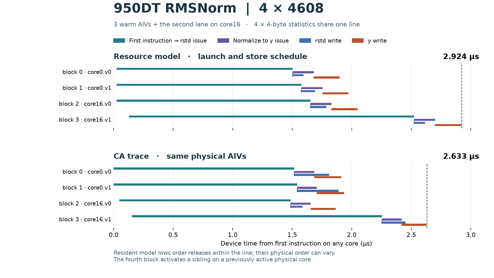

# RMSNorm 的扩核与统计量写回

在 950DT 复用 53 个完整库窗口、1,418 个活跃 AIV 的指令，从 rstd 的 GM 地址还原每核逻辑行。从同一批次中剔除整个宿主进程，再在两侧剔除相同 shape，测试阶段参数能否迁移到另一组调用。PR 的首发归档另列；开发数据缺少实际连续 PR RMS 的扩核阶段。

## 工作量如何变成设备时间

设 T 为行数、D 为通道数、C 为目标 AIV 数，R＝ceil(T/C) 为最忙核行数，A＝ceil(T/R) 为活跃 AIV 数。当前实现的一次首块可以容纳 R 行时，每个 AIV 产生一笔 rstd 和一笔 y。多 UB 块和独立首发沿用已冻结的逐块资源模型。

1. **落核与启动。** H 表示同流此前已预热的 AIV 高水位。找出本次每个逻辑块对应的硬件分区、物理核和通道，将其分为已热、同核新通道、新物理核和新分区。两个 950DT 分区分别承接 ceil(A/2) 与 floor(A/2) 个连续块；每个分区中一对 AIV 共用物理核。53 个归档上的 1,418 次映射和实际输出地址全部一致。分区并发与物理核布局在 970DT 是继承假设，两代间的启动周期仍需确认。

2. **何时发起 rstd。** 首发时刻＝首条指令到达周期＋前端准备周期＋max(本核输入字节÷读端口吞吐，归约组数×每组周期)。输入字节为 2D(R+1)，包括 gamma；组数为 R×ceil(D/128)。准备周期由实际首笔 rstd 的发起时间扣除已定价的工作获得。已热核还包含按活跃 AIV 数估计的发起竞争，每多一个 AIV 约 10.35 周期。

3. **谁在争同一条写线。** 第 k 个块的 rstd 从偏移 4kR 写入，每行占 4 B。对落入同一 128 B 区间的描述符，按预计到达先后递推 Fᵢ＝max(Iᵢ＋L, Fᵢ₋₁＋J)。Iᵢ 是发起周期，Fᵢ 是完成周期，L 是单写响应，J 是已排队写的退休间隔。完整开发档案估计 L＝273、J＝157 cycles，分别来自单写区间和写请求均已发出之后的相邻退休时间。相同状态各核的先后按该次参与写线的核数和观测到的发起离散程度估计。

4. **写 y 和结束。** rstd 发起后开始归一化，y 可以独立写出。去掉被 rstd 阻塞到最后的 y 写回，以单笔描述符字节量估计响应约 314.25＋5.19×KiB 周期。取全片最晚的 rstd、y 及共享带宽下界，描述符后还留实测的尾部退休周期。按目标主频转换成 µs。不同芯片上的核数、Vector 与 MTE 配置、UB、L2 和片外带宽先进入计算。

未提供驻留状态时，另外返回热态和可能冷态窗口的调和中心；它在两个端点上有相等的相对误差。以下单独计分，尚未作为默认模型发布。

## 模型、CA 与误差

DT [4,4608] 接在使用 3 个 AIV 的 RMSNorm 后。core16 的第一条 AIV 已在前序调用中预热，第二条此次加入。旧版估计 3.792 µs，候选 2.924 µs，CA 2.633 µs。候选仍高估了新通道到首笔 rstd 的时间。若从一个 AIV 扩到两个，第二个 AIV 在另一个分区，两个宽通道样本的新分区首发偏移超过 2,300 周期。

| 回放组 | 芯片 | N | 已知派发顺序 旧 → 候选 WAPE / 最大 | 仅 shape 旧 → 候选 WAPE / 最大 |
|---|---|---:|---|---|
| development | Ascend950DT_9582 | 43 | 14.11% / 44.03% → 7.06% / 15.49% | 24.70% / 54.94% → 19.85% / 43.93% |
| validation | Ascend950DT_9582 | 10 | 12.33% / 36.89% → 9.55% / 24.97% | 15.99% / 38.04% → 15.63% / 40.36% |
| v0.19 archived independent launch | Ascend950DT_9582 | 10 | 3.41% / 9.03% → 3.41% / 9.03% | 10.89% / 25.75% → 20.63% / 31.87% |
| v0.19 archived independent launch | Ascend950PR_957b | 10 | 9.04% / 25.13% → 9.04% / 25.13% | 14.23% / 25.55% → 22.97% / 34.46% |
| v0.20 archived independent launch | Ascend950DT_9582 | 9 | 8.64% / 12.90% → 8.64% / 12.90% | 10.41% / 14.66% → 17.54% / 29.43% |
| v0.20 archived independent launch | Ascend950PR_957b | 9 | 13.65% / 22.55% → 13.65% / 22.55% | 14.05% / 22.90% → 18.07% / 33.13% |

## 新形状的前向验证

已在原独立 RMS 队列启动前同时冻结两个版本。沿用的十形各自单独发起，另有十个不同的形状在一个真实 stream 上按顺序调用。每端只增加一个十形宿主进程，分别检查每个 y、rstd 和实际 kernel 全核窗口。候选在 DT、PR、970 三档共 60 个冻结预测中的单次最大查询成本为 6.326 ms。970DT 只有资源外推。

| 协议 | 芯片 | 合格 / 登记 | 已知顺序 旧 → 候选 WAPE / 最大 | 仅 shape 旧 → 候选 WAPE / 最大 |
|---|---|---:|---|---|
| ordered new sequence | Ascend950DT_9582 | 9 / 10 | 17.86% / 47.26% → 6.60% / 15.64% | 18.80% / 37.80% → 13.99% / 37.43% |
| ordered new sequence | Ascend950PR_957b | 9 / 10 | 17.32% / 52.16% → 7.60% / 14.47% | 16.37% / 38.10% → 17.84% / 36.44% |
| isolated frozen v0.21 | Ascend950DT_9582 | 7 / 10 | 6.39% / 10.78% → 6.39% / 10.78% | 13.69% / 27.76% → 19.05% / 27.08% |
| isolated frozen v0.21 | Ascend950PR_957b | 6 / 10 | 2.92% / 5.83% → 2.92% / 5.83% | 12.53% / 23.99% → 17.95% / 21.78% |

## 更早归档的仅输入预测

候选冻结后，补入 v0.17 和 v0.18 的 40 个历史端点。v0.17 的 DT 样本含先前多次调用及同形复测，保留其原始数据角色。下表全部省略前序信息。前序未知时，更细的扩核模型仍会高估热态与低估首发，尚不足以替代默认模型。

| 归档 | 芯片 | 形状数 | 仅 shape 的 v0.21 → 候选 WAPE / 最大 |
|---|---|---:|---|
| v0.17 | Ascend950DT_9582 | 10 | 23.77% / 43.22% → 22.69% / 43.09% |
| v0.17 | Ascend950PR_957b | 10 | 13.58% / 31.34% → 18.52% / 34.83% |
| v0.18 | Ascend950DT_9582 | 10 | 9.16% / 26.46% → 19.37% / 31.54% |
| v0.18 | Ascend950PR_957b | 10 | 13.06% / 24.11% → 19.64% / 30.34% |

[早期逐形回放与前序来源](earlier-shape-only.json)

连续调用的训练与预测均在采集前冻结。部分宿主在数值检查及设备执行完成后触及导出文件预算；只有与官方每核 duration、实际入口及 END 指令逐核相符的独立完整窗口计分。原进程终态与逐调用计时依据同时保留。[逐次恢复的证据与范围](scope.md)

[时间戳与原始数据库位置](core-windows.json) · [逐进程交叉回放](candidate.json) · [两个协议的事前预测](freeze.json) · [新回执](independent.json)
