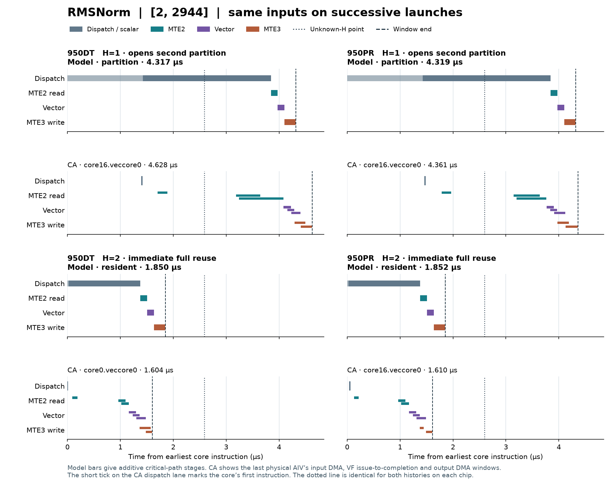

# RMSNorm 无前序预测的可辨识性与资源包络

BF16 RMSNorm `[2,2944]` 在相同的 950DT、相同的两个活跃 AIV 上，先从一核扩到两核需 **4.628 µs**，立即同形复跑只要 **1.604 µs**。任何只读 shape、dtype、芯片和算子属性的模型，对这两个实测给同一个时延，最大相对误差至少 **48.52%**。950PR 的同一配对下界为 **46.07%**。这是事前冻结后完成、通过正式 kernel 全核与数值核验的结果。对两个 SKU 的整套 RMSNorm 验收，逐形最大误差 40% 因此要求调用端提供可区分的历史。WAPE 是否达标还取决于负载包含哪些样例及其权重。[新形逐对实测、双协议 WAPE 和进度](independent.md)

冻结的 10 个全新 shape 在两端均已完成，8/8 个 CA 进程、40/40 个目标窗通过核验。下表按每端 20 次调用合并，候选缩小两端的 WAPE，同时扩大最坏误差，生产默认点继续沿用 v0.22。

| 芯片 | v0.22 无 H WAPE / 最大 | 候选无 H WAPE / 最大 | 显式 H WAPE / 最大 | 双协议最优最坏 WAPE 下界 |
|---|---:|---:|---:|---:|
| 950DT | 26.41% / 57.94% | 24.93% / 61.46% | 5.34% / 15.33% | 21.52% |
| 950PR | 25.56% / 53.97% | 24.21% / 61.01% | 6.10% / 17.73% | 20.99% |

`[563,4048]` 的 DT 最忙核以 7+2 行运行，PR 以 7+4 行运行；每个进程首发 / 热态 CA 实测分别为 6.658 / 4.777 µs、8.210 / 5.197 µs。已知 H 的 PR 首发预测 6.755 µs，仍低估 17.73%，热态为 5.112 µs。多块首发误差无法单靠识别 H 解决。970DT 预测的最忙核只需一块 5 行，结果仅作外推。本轮 CA 共用 1518.57 s（25.31 分钟），两次不计分前缀也含在采集开销中。

## 为什么同一工作量会有两种耗时



两次均向量化归约两行、每行 2944 个通道，每核各读取 5888 B 的 x 和 gamma，写回 4 B rstd 与 5888 B y。DT 第二分区首次启动时，末核第一条指令到达全片首条指令后 **1.405 µs**，该核 x 读出现在 3.243–4.083 µs。复跑时末核从 0 开始，读 x 缩短到 1.018–1.160 µs。PR 分别为首指令 1.474 / 0.048 µs、x 读 3.202–3.764 / 1.021–1.167 µs。图下半栏的 VF、DMA 与最终完成时钟取自真实 trace。图上半栏是明确给出 H 的 v0.22 关键链，点线给同一算例无 H 的冻结候选。[每个输入、VF、写回的时间和指令地址](paired-2944.json)

## 建模与决策

令 `A` 为目标芯片实际分配的 AIV 数，`H` 为同族前序使用过的 AIV 高水位。每个 H 均按现有的资源方法定价得到 `T(H)`。`H=0` 用首发前端、读、SIMD、写与共享带宽下界。`0<H<A` 把两分区的块分别映射到已热通道、同核新通道、新物理核和新分区。每个状态有自己的首指令到达、首个 rstd 发起和延迟分布，再按 FP32 rstd 的 128 B 区间与写回间隔逐笔退休，和 y 写回取最晚者。`H≥A` 的所有通道都已使用，同一 shape 的所有这类 H 具有相同预测。超过单 UB tile 的路径继续使用既有分段模型和带宽约束。[已冻结的逐阶段参数与物理依据](../v0.22/rms-lane-parameters.json)

没有历史时，枚举 `H=0…A` 得到 `L=min T(H)` 与 `U=max T(H)`。极值带随目标芯片的核数、频率、向量服务率、UB 和存储吞吐重新计算。`H=1` 会打开另一个分区，有时比 `H=0` 更慢。要求同一个候选点对所有**预测的**状态都位于 ±20% 时，可行点区间为 `[0.8U,1.2L]`；候选把旧默认点投影到此区间。若区间为空，选 `2LU/(L+U)`，它平衡最短与最长预测的相对误差。20% 是事前登记的决策容差，和整组 WAPE 的达标判断分开。这个物理场景带不包含同一 H 下指令响应的所有误差，不能解读为实测置信区间。[冻结公式、每形所有 H 和目标协议](freeze.json)

**同 H 仍有误差。** `[2,2944]` 已知 H 时 DT 预测 4.317 / 1.850 µs，对比实测 4.628 / 1.604 µs。PR 预测 4.319 / 1.852 µs，对比 4.361 / 1.610 µs。在热态，模型预计首个 rstd 约 1.506 µs 才能发起，实际 DT / PR 为 1.365 / 1.374 µs。模型给单笔 y 写 0.209 µs，两端实测均约 0.116 µs。两项一起解释了约 0.23 µs 的热态高估。无 H 候选各给一个点，为 2.590 和 2.593 µs。DT 对扩核实测要求至少 2.777 µs 才能进入 40% 误差带，复跑要求至多 2.246 µs。PR 相应边界为 2.617 和 2.254 µs。历史 PR `[495,6912]` 已知 H=0，仍低估约 25.13%，多 UB 块的响应和写回开销需要分开研究。[旧归档的状态实测与残差](../v0.22/rms-unknown/report.md)

## 历史回放和模型选择

| 历史数据组 | N | v0.22 无 H，WAPE / 最大 | 候选无 H，WAPE / 最大 | 给 H，WAPE / 最大 |
|---|---:|---:|---:|---:|
| DT compact（缺少可确认的库 ELF） | 57 | 21.07% / 54.94% | 18.01% / 43.09% | 6.64% / 23.98% |
| DT 官方完整窗 | 66 | 11.89% / 37.80% | 16.01% / 37.43% | 6.27% / 15.64% |
| PR 官方完整窗 | 76 | 13.80% / 38.35% | 17.01% / 36.70% | 9.31% / 25.13% |
| DT 原独立十形，全部首发 | 10 | 11.01% / 27.76% | 15.07% / 27.08% | 5.63% / 10.78% |
| PR 原独立十形，全部首发 | 10 | 16.41% / 23.99% | 19.50% / 29.60% | 12.36% / 23.42% |
| DT 原独立有序十形 | 10 | 20.36% / 37.80% | 15.57% / 37.43% | 6.02% / 15.64% |
| PR 原独立有序十形 | 10 | 17.97% / 38.10% | 18.59% / 36.44% | 7.03% / 14.47% |

前 3 行按真实 trace 去重，后 4 行重现原登记协议，可能与前面行重合。所有历史数据都按回放处理。全热的 27 个 DT 历史调用，WAPE 从 30.12% 降至 18.17%；目标为独立首发时，默认估计更靠近实测。生产默认模型继续使用 v0.22。[199 个逐窗结果](replay.json)

另从 49 个单 UB 档案的 1166 条 AIV 路径提取 gamma/x 发起、完成、归约 VF、rstd 和 y 发起时刻。典型路径中，x 晚于 gamma 96 cycles 发起，首个归约 VF 在两笔读都结束后 4 cycles 发起；两次完整读相互重叠。将各状态的准备时间和读响应按参与核数建模，仅从阶段事件估计参数，交叉回放时剔除整个原始宿主和其使用的全部形状。该响应模型的全 H 估计在 DT compact 中最坏仍约 47.7%，现阶段将其用于误差归因。compact 的 `.text` 身份不可从 DB 恢复，本轮公式的对比只以独立官方 CA 完整窗给结论。[按核阶段地标](landmarks.json) · [交叉回放](resource-diagnostic.json)

为避免枚举 H 时重复构造同一批描述符，快速路径复用 `(驻留类型、行数、统计量输出区)` 的发起/退休成本。63 个原冻结预测、1584 个前序条件，以及 180 个历史芯片–shape 的 6056 个条件与原实现差异小于 1.8×10⁻¹⁵ µs。所有 63 次调用均重新建立本次缓存，最慢从 136.52 ms 降至 17.30 ms。970DT 的耗时和状态带只作芯片配置外推。[性能与逐条件验等](fast-parity.json)

采集器沿用 v0.21 中断导出时的 `device0/<kernel>/<ordinal>` 临时位置。完整退出的 CANN 9.2.1 将同一输出发布到 `<kernel>/<ordinal>`，首轮检查因原路径消失而失败。`receipts/` 保留这一原始判定，`verified/` 只读检查已发布位置，并重新核对真实原始片段和 SHA。这个修复没有重跑 CA、改变输入、使用不同时间窗或改写原回执。[核验实现](../../development/validation/rms_unknown23/verify_published.py)

逐前序的全部预测与宿主二进制已在采集前冻结。依赖复核另列冻结清单遗漏的 v0.10 `wide/profile.json`（原有启动阶段系数）及宿主源文件等，它们与 v0.22 的 Git blob 逐字节一致；此复核发生在冻结之后。[冻结依赖补充核验](dependency-audit.json)

## 系统仿真的可选调用

```python
from operator_model import estimate_rms_history_band

band = estimate_rms_history_band([2, 2944], chip="Ascend950DT_9582", dtype="bf16")
print(band.active_aiv, band.by_resident_aiv_us)
print(band.lower_us, band.upper_us)
```

元组从 H=0 起依次对应独立首发、已预热 H 个 AIV 和全热。`H≥active_aiv` 共享元组最后一项。这个接口不改变 `estimate` 的默认点预测。以 `[2,2944]` 为例，模型带最短 1.850 µs、最长 4.317 µs，DT 热态 1.604 µs 和扩核 4.628 µs 分别落在两端外侧。这种偏差来自已给 H 的资源定价残差，模型带不能直接作为实际误差界。同 63 个冻结预测的逐 H 验等最大差为 1.78×10⁻¹⁵ µs；直接用公开 API 和芯片名、每次重新计算，DT / PR / 970DT 最大查询墙钟为 7.45 / 7.17 / 24.18 ms。[公开 API 耗时和全量数值验等](public-parity.json)
