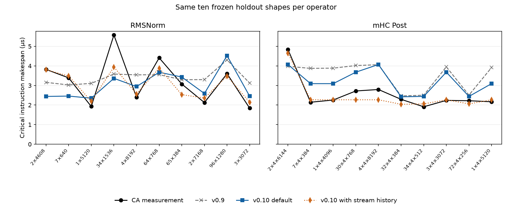

# 950DT 阶段归因与独立验证（v0.10）

|算子 / 独立分组|形状数|v0.9 WAPE / max|v0.10 默认 WAPE / max|v0.10 已知前序核覆盖 WAPE / max|旧数据固定中位数 WAPE / max|
|---|---:|---:|---:|---:|---:|
|rmsnorm / all|10|29.80% / 69.62%|26.69% / 39.68%|12.12% / 29.27%|31.67% / 100.10%|
|rmsnorm / few_wide|5|44.94% / 69.62%|28.28% / 36.13%|8.09% / 16.49%|54.31% / 100.10%|
|rmsnorm / controls|5|20.65% / 35.77%|25.73% / 39.68%|14.56% / 29.27%|17.99% / 33.97%|
|mhc_post / all|10|44.17% / 80.70%|31.41% / 64.40%|7.79% / 18.79%|44.42% / 78.31%|
|mhc_post / few_wide|5|50.51% / 80.70%|36.71% / 64.40%|5.98% / 18.79%|39.24% / 57.27%|
|mhc_post / controls|5|36.14% / 80.67%|24.69% / 44.28%|10.07% / 16.54%|51.00% / 78.31%|

主结果是默认输入不含上下文的单一预测；第三种输入仅用于说明系统仿真器能跟踪同类前序发射时的价值。开发 23/族，均为旧数据；上表来自冻结后独立的十个新大小/族，其中五个 T≤4 且 D≥2048，五个对照；第一次调用也算进表，不挑选热态。[冻结材料](freeze.json) 含两个版本逐行预测、顺序、时间戳、模型与采集器 SHA256、620 秒 / 3 GiB 每批预算。固定基线取每族全部 23 条旧 CA 时延的中位数。WAPE=Σ|预测−CA|/ΣCA，max 是单 shape 最大绝对百分比。

## 为什么旧模型高估、哪些事情仍不知道

历史 RMSNorm `[1,6144]` 的 SCALAR/MTE2 分别预计 1.625/0.718 µs，CA 0.858/0.338；mHC Post `[2,4,4096]` 预计 1.635/0.887，CA 0.984/0.282。两者都是各自批的最后一次。Post 旧批从 `[3,4,256]`、`[6,4,512]`、`[17,4,256]` 到 `[2,4,4096]` 关键 AIV 均有 1578/5 条 SCALAR/MTE2，阶段时间却明显不同；RMSNorm 在旧批长宽/普通宽的同实现中也常为 1093/5。单靠指令数及固定启动截距不能解释这一点。按已覆盖核数建模是可被推翻的上下文代理，基于 950 的 CANNBot 流水机制卡采用互斥暴露时间，未把某个硬件缓存宣称为实锤。

**新冻结同形对照：同一进程、流、shape、类型、生成器和基础 caller，批首与批尾（重复行不计入独立样本数）。**

|算子 / shape|CA 首→末 µs|SCALAR / MTE2 首→末 µs|SIMD 首→末 µs|首→末 SCALAR/MTE2 指令条数|
|---|---:|---|---:|---|
|rmsnorm [2, 4608]|3.819→1.939|2.054/0.844→0.822/0.394|0.684→0.436|1093/5→1093/5|
|mhc_post [2, 4, 6144]|4.838→2.905|1.252/1.202→1.304/0.623|1.384→0.670|1578/5→1578/5|

可确认：同一 shape、分核、指令数量存在两种明显时延，v0.9 把可变的暴露时间计作基础成本。RMSNorm 首末 SCALAR+MTE2 合计少 1.68 µs；Post 本次重复的 SCALAR 反而略长，差异主要是 MTE2、SIMD、arrival 与 other，一概归为标量提速会误导。地址/分配器、缓存与发射状态同时随执行历史变化；单对 trace 不能区分各自的因果贡献，更不能承诺跨流适用。

**退化与剩余误差。** RMSNorm 五个普通对照的默认 WAPE 从 20.65% 增至 25.73%；最差 `[34,1536]` CA 5.576 µs、默认 3.363，MTE3 暴露 2.325 而默认仅 0.667，单此项已解释约 75% 的绝对差；更改 H 后仍为 3.944 µs。写回合并、并发竞争与地址分布是后续应分辨的假设。Post 默认最差 `[3,4,3072]`（3.679 对 2.238 µs）发生在新批首个 shape 已激活 64 核的情况下；旧先验以核数逐渐扩展序列为主，默认仍偏向扩展态；发射记录推得 H=64 时为 2.269。Post `[4,4,8192]` 默认预测和旧版几乎不变。已知执行历史不代表可观测硬件缓存。10 个独立 shape 只约束所采区域，不能声称整个分布或 950 真机同精度。

## 逐 shape，新留出数据

|算子|shape|库接口 / 实际 kernel|关键核 SCALAR / MTE2 指令|活跃 AIV CA / 预测|CA (µs)|v0.9|v0.10 默认|有上下文|默认有符号误差|
|---|---|---|---:|---:|---:|---:|---:|---:|---:|
|rmsnorm|[2, 4608]|ops-nn aclnnRmsNorm / entry_kernel_1388|1093 / 5|2 / 2|3.819|3.158|2.440|3.802|-36.1%|
|rmsnorm|[7, 640]|ops-nn aclnnRmsNorm / entry_kernel_1388|1093 / 5|7 / 7|3.388|3.026|2.458|3.482|-27.5%|
|rmsnorm|[1, 5120]|ops-nn aclnnRmsNorm / entry_kernel_1388|1093 / 5|1 / 1|1.927|3.107|2.350|2.190|+22.0%|
|rmsnorm|[34, 1536]|ops-nn aclnnRmsNorm / entry_kernel_1388|1093 / 5|34 / 34|5.576|3.582|3.363|3.944|-39.7%|
|rmsnorm|[4, 8192]|ops-nn aclnnRmsNorm / entry_kernel_1388|1093 / 5|4 / 4|2.395|3.541|2.943|2.561|+22.9%|
|rmsnorm|[64, 768]|ops-nn aclnnRmsNorm / entry_kernel_1388|1093 / 5|64 / 64|4.410|3.553|3.675|3.885|-16.7%|
|rmsnorm|[65, 384]|ops-nn aclnnRmsNorm / entry_kernel_1388|1093 / 5|33 / 33|3.073|3.293|3.430|2.531|+11.6%|
|rmsnorm|[2, 7168]|ops-nn aclnnRmsNorm / entry_kernel_1388|1093 / 5|2 / 2|2.127|3.299|2.589|2.356|+21.8%|
|rmsnorm|[96, 1280]|ops-nn aclnnRmsNorm / entry_kernel_1388|1093 / 5|48 / 48|3.601|4.306|4.523|3.475|+25.6%|
|rmsnorm|[3, 3072]|ops-nn aclnnRmsNorm / entry_kernel_1388|1093 / 5|3 / 3|1.840|3.121|2.451|2.143|+33.2%|
|mhc_post|[2, 4, 6144]|ops-transformer aclnnMhcPost / entry_kernel_5|1578 / 5|64 / 64|4.838|3.974|4.069|4.653|-15.9%|
|mhc_post|[7, 4, 384]|ops-transformer aclnnMhcPost / entry_kernel_5|1578 / 5|14 / 14|2.144|3.873|3.093|2.269|+44.3%|
|mhc_post|[1, 4, 4096]|ops-transformer aclnnMhcPost / entry_kernel_5|1578 / 5|16 / 16|2.256|3.884|3.093|2.269|+37.1%|
|mhc_post|[30, 4, 768]|ops-transformer aclnnMhcPost / entry_kernel_5|1578 / 5|60 / 60|2.719|4.017|3.679|2.269|+35.3%|
|mhc_post|[4, 4, 8192]|ops-transformer aclnnMhcPost / entry_kernel_5|1578 / 5|64 / 64|2.794|4.061|4.069|2.269|+45.6%|
|mhc_post|[32, 4, 384]|ops-transformer aclnnMhcPost / entry_kernel_6|1116 / 7|32 / 32|2.292|2.465|2.422|2.040|+5.7%|
|mhc_post|[34, 4, 512]|ops-transformer aclnnMhcPost / entry_kernel_6|1116 / 7|34 / 34|1.912|2.502|2.440|2.058|+27.7%|
|mhc_post|[3, 4, 3072]|ops-transformer aclnnMhcPost / entry_kernel_5|1578 / 5|48 / 48|2.238|3.950|3.679|2.269|+64.4%|
|mhc_post|[72, 4, 256]|ops-transformer aclnnMhcPost / entry_kernel_6|1767 / 11|36 / 36|2.221|2.509|2.440|2.058|+9.9%|
|mhc_post|[1, 4, 5120]|ops-transformer aclnnMhcPost / entry_kernel_5|1578 / 5|32 / 32|2.167|3.916|3.093|2.269|+42.7%|

全部 20 个独立样本与 2 个重复对照完成 950DT 单流调用、CPU golden 和逐条 DB 检查；RMSNorm 检查 y/rstd 两输出，Post 检查组合输出。所有独立点活跃 AIV 比对一致，首个/末个 launch 正确性或分核相同并不保证时延相同。`rows.json` 可检索开发及验证全部阶段、CPU 输出摘要和关键核指令；`paired-controls.json` 单列重复样本。

## 成本与复核

|算子|CA 批次墙钟|DB MiB / 整批保留 MiB|单次预测 µs（中位 / 最大）|
|---|---:|---:|---:|
|rmsnorm|134.20 s（11 次发射）|102.5 / 102.7|22.28 / 44.40|
|mhc_post|174.27 s（11 次发射）|351.1 / 351.3|26.10 / 65.95|

每 shape 做 100 次无结果缓存、已加载模型的调用；最大值是本次观测，不是延迟 SLA。两批并行；两批 worker 墙钟求和是约 308.5 s，不是用户实际经过时间。DB 保留在 runs/v10wide，本目录只保留小型结果。`development-trace.json` 与冻结合约记录旧 trace 的来源；`summary.json` 含每族每组的开发回放和验证 WAPE/max、偏置及 MAE。图中的上下文预测在采集前基于顺序和预测 AIV 数计算，不读取新 trace。
