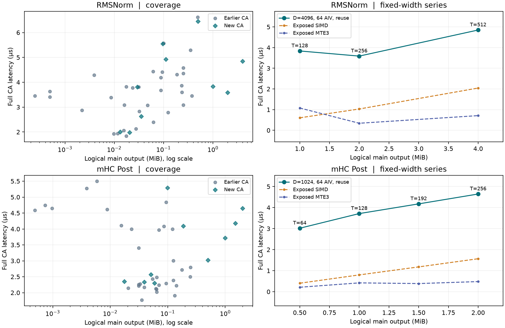

### RMSNorm 写回误差来自哪里

复用的 `[34,1536]` 现属开发样本。最后完成的核发起两次写回，一次写 3072 B 的 BF16 归一化输出，一次写 4 B 的 FP32 行统计量。两指令重叠 3830 ticks，原始时长之和为 4.719 µs，实际暴露在关键路径上的 MTE3 时间为 2.325 µs。34 个统计量地址彼此相邻，其中 32 个落在同一 128 B 对齐区间。增加邻近写者项后，写回预测从 0.667 升到 1.744 µs，整例从 3.363 升到 4.441 µs，CA 为 5.576 µs。地址与时间能从 trace 核对；合并、仲裁和缓存各贡献多少仍未分离。[写指令、地址与临界核证据](rms/diagnosis.md)

冻结后的 `[33,1536]` 和 `[38,1536]` 实测分别为 5.548、4.921 µs。整例误差分别由 −39.6% 降至 −20.0%、由 −27.5% 降至 −6.4%。这种改善主要出现在几十个 AIV 各写一行的分核形态。少 token、宽通道组只有 4 个新例，WAPE 基本持平。对于 `[512,4096]`，v0.10 和当前预测为 25.595、10.163 µs，CA 只有 4.851 µs。当前光是 MTE3 就估到 5.825 µs，实测暴露仅 0.711 µs。该点临界核分 7+1 行两轮写回，2230 个写回在途 tick 中有 1057 个与 SIMD 重叠。把训练范围内按全片字节增加的成本直接延伸到数 MiB，会高估实际暴露的时间。[固定宽度的写回明细](rms/scaling.json)

### mHC Post 在缺少执行历史时的偏差

小宽组的 5 种新 shape 都使用切通道分支。其中三次发射前已有足够的 AIV 覆盖，默认预测的 WAPE 从 28.52% 降到 4.76%。对首次或扩展调用，缺少前序覆盖数仍会严重低估。以首发 `[3,4,4352]` 为例，CA 是 5.288 µs，v0.10 默认估 3.679 µs，当前默认估 2.325 µs，给出发射前已知的 `resident_aiv=0` 则估 4.749 µs。对 `[4,4,6144]`，覆盖从 48 扩展至 64 核，CA 是 4.095 µs，默认估 2.347 µs，显式传 48 估 4.270 µs。三种状态的开发频率只反映旧采集批次的调用顺序。总表使用默认预测，显式历史只用于说明偏差来自哪里。[分核与状态权重](post/method.md)

复用上一批的同 shape 配对可以量化这个限制。`[2,4,6144]` 的批首和批尾 CA 分别为 4.838、2.905 µs，关键核的 SCALAR 和 MTE2 指令数均相同。若默认查询必须给这两个调用返回同一个值，无论怎样选，该对样本上至少一次的相对误差都会达到约 25.0%。这个下界等于两次时间之差除以两次时间之和，只约束这两个观测；按 shape 调截距无法同时消除这个差异。

### 数据量较大时是否进入稳态

此前两个算子各有 33 个完整 shape，但最大主输出仅为 RMSNorm 0.492 MiB、mHC Post 0.250 MiB。宽通道、少 token 的例子不能代替多核多轮工作。固定宽度、增长 token 后，本轮最大完整主输出分别为 4 MiB、2 MiB，历史覆盖扩大约 8 倍。这里统一用主输出逻辑字节数表示大小，输入、权重及统计量见规模实验；实际总线流量还取决于重读与缓存。

RMSNorm 的同进程已覆盖 64 核子序列中，主输出 1、2、4 MiB 的 CA 分别为 3.838、3.589、4.851 µs。数据量翻倍时，时间分别变为 0.94×、1.35×。0.5 MiB 的首次发射反而用了 6.457 µs。固定项、启动状态、写回与 SIMD 重叠共同影响净时延，不能用一个过原点的比例贯穿这几档规模。[规模图、相邻增量与各点角色](scaling/summary.md)

mHC Post 在 N=4、D=1024、前序覆盖 64 核时，T=128、192、256 的主输出分别为 1、1.5、2 MiB。隔离重采的 CA 分别为 3.715、4.177、4.646 µs。每增加 0.5 MiB，增加 0.462、0.469 µs；三个点在这个区间内接近「固定时间 + 数据量 × 斜率」。输出量从 1 MiB 翻倍到 2 MiB 时耗时只增加约 25%。三个独立进程各用相同的预热输入，证据只覆盖该实现和区间，尚未测到可跨分核策略使用的渐近带宽。T=64 在原批测得 3.019 µs，前序执行序列与隔离重采不同。

### CA 计时完整性与采集成本

数值正确、数据库非空、计时确属本次发射需要分别核对。Post 原批的 T=128、192 通过输出 golden，但 helper 报负时长区间并拒绝写记录。紧随其后的 T=256 有记录且 helper 状态为 ok，输出应为 2,097,152 B，实际却记录 3,342,336 B 的写操作；408 笔行写分布在 311 个不同的行地址。最早的一部分沿前一次三行/核的地址步长推进，之后才进入当前四行/核的地址步长。三条原始记录都不参与拟合、误差或趋势统计。隔离进程先用既有 shape 覆盖 64 核，再仅运行原冻结目标。预热和失败均计入 CA 成本，不增加独立 shape 数。所有最终计时都核对了 CPU golden、库入口、活跃核、跨核首末 tick、helper 写入记录数及目标输出字节覆盖。[逐数据库审计（含被剔除记录）](scaling/trace-audit.csv)

作为量级对照，将 33 个开发计时的中位数直接用于全部新 shape，RMSNorm 得到 30.31% WAPE，优于当前的 37.93%；Post 得到 30.51%，高于当前的 19.25%。固定时间在这组 RMSNorm 大输出上少受字节斜率高估的影响。给 Post 提供真实可知的前序覆盖后，全部 10 例 WAPE 为 7.66%，小宽 5 例为 6.37%。另用旧数据和首批 7 个合格点做了按 CA 进程留一的事后检查，平滑状态概率也未能稳定兼顾首发和扩核。[状态先验敏感性分析](post/context-sensitivity.md)

两族各复用 33 个旧 shape，只冻结和评估各 10 个独立新 shape。其余算子复用既有独立 CA。完整过程开销分别记录在 [RMSNorm 采集账单](rms/costs.json) 和 [mHC Post 采集账单](post/costs.json)。

### 其他算子的覆盖边界

| 路线 | 已有完整 CA 示例 | 扩大到系统负载时还缺什么 |
|---|---|---|
| DynamicMXQuant | `[1024,7168]`，9.332 µs | 已有宽行、多轮 UB 实测。放大行数跨分块边界时仍需重新确定尾轮。 |
| Matmul / Addmm | `[512,512,256]` 分别为 4.799 / 4.479 µs | 现有集合对大型投影 K 维的多段归约和大输出块覆盖有限。 |
| 普通 FA / Lightning Indexer | FA `[9,131072,64,1,1]` 为 274.821 µs，Indexer `[1,1,8192,8,128]` 为 22.709 µs | FA 的 128k 点是 B=H=1 的非因果路线，256k、512k 仍属外推。Indexer 的大 L 不能套用普通 FA 的斜率。 |
| mHC Pre / Sinkhorn / 组链 | Pre `[24,4,1536]` 为 12.201 µs，融合 PreSinkhorn `[32,4,4096]` 为 11.114 µs | Pre 投影、逐 token 小矩阵归约及串行链各有不同扩展规律。 |
| KDA / MoE | 递推 `[1,8,1,1,128,128]` 为 35.396 µs，GMM1 / GMM2 在 `[64,128,256,4]` 为 8.355 / 4.142 µs | 长序列、生产规模专家数及倾斜负载缺少覆盖；KDA chunk 缺少合格计时。 |

Addmm 的小输出块仍受 FIXP 尾部影响。拆分 mHC 链中，Pre 低估和后续阶段高估可以抵消。Indexer 的 L=8192 例分段数与 64 条 MMAD 一致，时间模板仍高估约 32%。MoE 的两次 GMM 分别受本地专家负载和尾块影响。这些路线沿用原模型的冻结独立数据，本轮无新增 CA。
