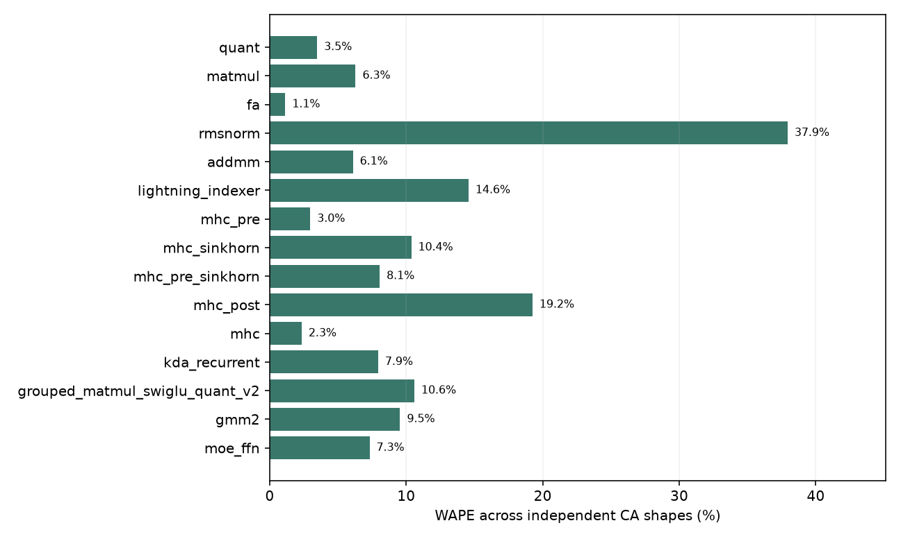
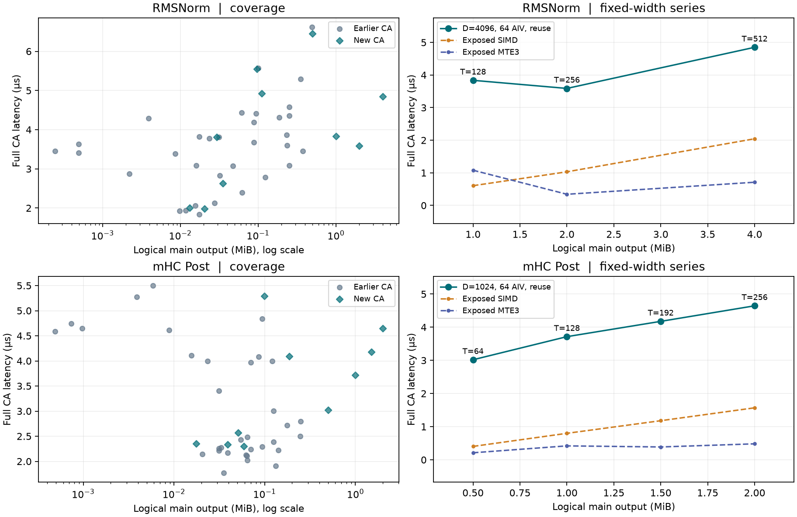

# 算子耗时预测与 CA 校准误差

| 算子 | 方法 | 开发 / 独立 shape | 独立 WAPE / 最大误差 | 最慢查询 ms | CA 计时状态 |
|---|---|---:|---:|---:|---|
| dynamicMXquant | Vector | 19 / 10 | 3.47% / 5.92% | 1.808 | 完整计时 |
| Matmul | Cube | 10 / 10 | 6.29% / 10.43% | 0.115 | 完整计时 |
| FA | CV | 16 / 12 | 1.14% / 13.61% | 0.155 | 完整计时 |
| RMSNorm | Vector | 33 / 10 | 37.93% / 109.52% | 0.620 | 完整计时 |
| Addmm | Cube | 13 / 10 | 6.09% / 11.54% | 2.931 | 完整计时 |
| Lightning Indexer | CV | 3 / 10 | 14.56% / 31.71% | 0.935 | 完整计时 |
| mHC Pre | CV | 13 / 10 | 2.97% / 6.09% | 0.541 | 完整计时 |
| mHC Sinkhorn | Vector | 13 / 10 | 10.37% / 39.20% | 0.547 | 完整计时 |
| mHC PreSinkhorn | CV | 3 / 10 | 8.05% / 14.19% | 0.126 | 完整计时 |
| mHC Post | Vector | 33 / 10 | 19.25% / 56.03% | 0.684 | 完整计时 |
| mHC组合 | CV | 13 / 10 | 2.34% / 5.02% | 0.039 | 完整计时 |
| KDA recurrent | Vector | 3 / 10 | 7.94% / 17.55% | 0.450 | 完整计时 |
| KDA chunk | CV | 0 / 0 | N/A / N/A | N/A | 仅结构核对 |
| GMM1–SwiGLU–MX量化 | CV | 4 / 10 | 10.59% / 32.74% | 0.131 | 完整计时 |
| MoE GMM2 | Cube | 4 / 10 | 9.55% / 26.86% | 0.057 | 完整计时 |
| MoE FFN组合 | CV | 4 / 10 | 7.31% / 23.01% | 0.177 | 完整计时 |

每行对应后端的一条默认预测路径。WAPE 是绝对时延偏差之和除以 CA 参考时延之和；较慢的样例权重较大。最大误差是单例最大的绝对相对误差。表内误差只使用独立 shape。KDA chunk 有 10 个结构检查，尚无完整 CA 耗时。

## 怎样把这些误差用于系统仿真

参考平台为 CANN 9.2.1 的 Ascend950DT_9582 CA。单 kernel 取最早指令至最晚指令的跨核净窗口，多 kernel 串行链求各窗口之和。框架需另计 host launch、通信、kernel 间间隙和跨算子重叠。多个组件共享一次链采集，整链误差可能包含相反方向的阶段偏差。A7/A8 尚无对应实测。

模型输入使用每卡实际 shape、布局、dtype、迭代数或专家 token 分布。对批量顺序执行的 trace，缓存与控制状态可能随请求顺序变化。查询列为一个 Python 进程逐个 shape 调用系统后端五次的最大墙钟，按次重算且包含各路径首次读参数；返回的设备时延以 µs 计。

## 改动算子的同集对照

默认调用只传 shape。少 token 宽通道组在冻结时定义为 T≤4 且末维 D≥2048，普通组为其余输入。两个版本使用相同库调用的 CA 窗口。

| 算子 | 独立分组 | shape 数 | v0.10 WAPE → 当前 | v0.10 最大误差 → 当前 |
|---|---|---:|---:|---:|
| RMSNorm | 全部 | 10 | 107.46% → 37.93% | 427.63% → 109.52% |
| RMSNorm | 少 token 宽通道 | 4 | 21.02% → 21.07% | 32.01% → 34.12% |
| RMSNorm | 普通 | 6 | 138.33% → 43.96% | 427.63% → 109.52% |
| mHC Post | 全部 | 10 | 21.73% → 19.25% | 34.58% → 56.03% |
| mHC Post | 少 token 宽通道 | 5 | 22.25% → 30.44% | 34.58% → 56.03% |
| mHC Post | 普通 | 5 | 21.25% → 8.86% | 32.66% → 21.63% |

### RMSNorm 写回误差来自哪里

复用的 `[34,1536]` 现属开发样本。最后完成的核发起两次写回，一次写 3072 B 的 BF16 归一化输出，一次写 4 B 的 FP32 行统计量。两指令重叠 3830 ticks，原始时长之和为 4.719 µs，实际暴露在关键路径上的 MTE3 时间为 2.325 µs。34 个统计量地址彼此相邻，其中 32 个落在同一 128 B 对齐区间。增加邻近写者项后，写回预测从 0.667 升到 1.744 µs，整例从 3.363 升到 4.441 µs，CA 为 5.576 µs。地址与时间能从 trace 核对；合并、仲裁和缓存各贡献多少仍未分离。[写指令、地址与临界核证据](./rms/diagnosis.md)

冻结后的 `[33,1536]` 和 `[38,1536]` 实测分别为 5.548、4.921 µs。整例误差分别由 −39.6% 降至 −20.0%、由 −27.5% 降至 −6.4%。这种改善主要出现在几十个 AIV 各写一行的分核形态。少 token、宽通道组只有 4 个新例，WAPE 基本持平。对于 `[512,4096]`，v0.10 和当前预测为 25.595、10.163 µs，CA 只有 4.851 µs。当前光是 MTE3 就估到 5.825 µs，实测暴露仅 0.711 µs。该点临界核分 7+1 行两轮写回，2230 个写回在途 tick 中有 1057 个与 SIMD 重叠。把训练范围内按全片字节增加的成本直接延伸到数 MiB，会高估实际暴露的时间。[固定宽度的写回明细](./rms/scaling.json)

### mHC Post 在缺少执行历史时的偏差

小宽组的 5 种新 shape 都使用切通道分支。其中三次发射前已有足够的 AIV 覆盖，默认预测的 WAPE 从 28.52% 降到 4.76%。对首次或扩展调用，缺少前序覆盖数仍会严重低估。以首发 `[3,4,4352]` 为例，CA 是 5.288 µs，v0.10 默认估 3.679 µs，当前默认估 2.325 µs，给出发射前已知的 `resident_aiv=0` 则估 4.749 µs。对 `[4,4,6144]`，覆盖从 48 扩展至 64 核，CA 是 4.095 µs，默认估 2.347 µs，显式传 48 估 4.270 µs。三种状态的开发频率只反映旧采集批次的调用顺序。总表使用默认预测，显式历史只用于说明偏差来自哪里。[分核与状态权重](./post/method.md)

复用上一批的同 shape 配对可以量化这个限制。`[2,4,6144]` 的批首和批尾 CA 分别为 4.838、2.905 µs，关键核的 SCALAR 和 MTE2 指令数均相同。若默认查询必须给这两个调用返回同一个值，无论怎样选，该对样本上至少一次的相对误差都会达到约 25.0%。这个下界等于两次时间之差除以两次时间之和，只约束这两个观测；按 shape 调截距无法同时消除这个差异。

### 数据量较大时是否进入稳态

此前两个算子各有 33 个完整 shape，但最大主输出仅为 RMSNorm 0.492 MiB、mHC Post 0.250 MiB。宽通道、少 token 的例子不能代替多核多轮工作。固定宽度、增长 token 后，本轮最大完整主输出分别为 4 MiB、2 MiB，历史覆盖扩大约 8 倍。这里统一用主输出逻辑字节数表示大小，输入、权重及统计量见规模实验；实际总线流量还取决于重读与缓存。

RMSNorm 的同进程已覆盖 64 核子序列中，主输出 1、2、4 MiB 的 CA 分别为 3.838、3.589、4.851 µs。数据量翻倍时，时间分别变为 0.94×、1.35×。0.5 MiB 的首次发射反而用了 6.457 µs。固定项、启动状态、写回与 SIMD 重叠共同影响净时延，不能用一个过原点的比例贯穿这几档规模。[规模图、相邻增量与各点角色](./scaling/summary.md)

mHC Post 在 N=4、D=1024、前序覆盖 64 核时，T=128、192、256 的主输出分别为 1、1.5、2 MiB。隔离重采的 CA 分别为 3.715、4.177、4.646 µs。每增加 0.5 MiB，增加 0.462、0.469 µs；三个点在这个区间内接近「固定时间 + 数据量 × 斜率」。输出量从 1 MiB 翻倍到 2 MiB 时耗时只增加约 25%。三个独立进程各用相同的预热输入，证据只覆盖该实现和区间，尚未测到可跨分核策略使用的渐近带宽。T=64 在原批测得 3.019 µs，前序执行序列与隔离重采不同。

### CA 计时完整性与采集成本

数值正确、数据库非空、计时确属本次发射需要分别核对。Post 原批的 T=128、192 通过输出 golden，但 helper 报负时长区间并拒绝写记录。紧随其后的 T=256 有记录且 helper 状态为 ok，输出应为 2,097,152 B，实际却记录 3,342,336 B 的写操作；408 笔行写分布在 311 个不同的行地址。最早的一部分沿前一次三行/核的地址步长推进，之后才进入当前四行/核的地址步长。三条原始记录都不参与拟合、误差或趋势统计。隔离进程先用既有 shape 覆盖 64 核，再仅运行原冻结目标。预热和失败均计入 CA 成本，不增加独立 shape 数。所有最终计时都核对了 CPU golden、库入口、活跃核、跨核首末 tick、helper 写入记录数及目标输出字节覆盖。[逐数据库审计（含被剔除记录）](./scaling/trace-audit.csv)

作为量级对照，将 33 个开发计时的中位数直接用于全部新 shape，RMSNorm 得到 30.31% WAPE，优于当前的 37.93%；Post 得到 30.51%，高于当前的 19.25%。固定时间在这组 RMSNorm 大输出上少受字节斜率高估的影响。给 Post 提供真实可知的前序覆盖后，全部 10 例 WAPE 为 7.66%，小宽 5 例为 6.37%。另用旧数据和首批 7 个合格点做了按 CA 进程留一的事后检查，平滑状态概率也未能稳定兼顾首发和扩核。[状态先验敏感性分析](./post/context-sensitivity.md)

两族各复用 33 个旧 shape，只冻结和评估各 10 个独立新 shape。其余算子复用既有独立 CA。完整过程开销分别记录在 [RMSNorm 采集账单](./rms/costs.json) 和 [mHC Post 采集账单](./post/costs.json)。

### 其他算子的覆盖边界

| 路线 | 已有完整 CA 示例 | 扩大到系统负载时还缺什么 |
|---|---|---|
| DynamicMXQuant | `[1024,7168]`，9.332 µs | 已有宽行、多轮 UB 实测。放大行数跨分块边界时仍需重新确定尾轮。 |
| Matmul / Addmm | `[512,512,256]` 分别为 4.799 / 4.479 µs | 现有集合对大型投影 K 维的多段归约和大输出块覆盖有限。 |
| 普通 FA / Lightning Indexer | FA `[9,131072,64,1,1]` 为 274.821 µs，Indexer `[1,1,8192,8,128]` 为 22.709 µs | FA 的 128k 点是 B=H=1 的非因果路线，256k、512k 仍属外推。Indexer 的大 L 不能套用普通 FA 的斜率。 |
| mHC Pre / Sinkhorn / 组链 | Pre `[24,4,1536]` 为 12.201 µs，融合 PreSinkhorn `[32,4,4096]` 为 11.114 µs | Pre 投影、逐 token 小矩阵归约及串行链各有不同扩展规律。 |
| KDA / MoE | 递推 `[1,8,1,1,128,128]` 为 35.396 µs，GMM1 / GMM2 在 `[64,128,256,4]` 为 8.355 / 4.142 µs | 长序列、生产规模专家数及倾斜负载缺少覆盖；KDA chunk 缺少合格计时。 |

Addmm 的小输出块仍受 FIXP 尾部影响。拆分 mHC 链中，Pre 低估和后续阶段高估可以抵消。Indexer 的 L=8192 例分段数与 64 条 MMAD 一致，时间模板仍高估约 32%。MoE 的两次 GMM 分别受本地专家负载和尾块影响。这些路线沿用原模型的冻结独立数据，本轮无新增 CA。

## 逐算子与逐 shape 的证据

### dynamicMXquant

安装包调用 ops-nn 的 `aclnnDynamicMxQuant`。

| shape 与属性 | 用途 | 预测 µs | CA µs | 有符号误差 | 实际 kernel | 活跃 AIC / AIV |
|---|---|---:|---:|---:|---|---|
| `[36, 5120]` | 独立 | 5.292 | 5.584 | -5.2% | entry_kernel_21 | 0 / 60 |
| `[288, 7168]` | 独立 | 7.181 | 6.876 | +4.4% | entry_kernel_21 | 0 / 64 |
| `[1024, 7168]` | 独立 | 9.586 | 9.332 | +2.7% | entry_kernel_21 | 0 / 64 |
| `[1024, 6144]` | 独立 | 8.935 | 8.704 | +2.7% | entry_kernel_21 | 0 / 64 |
| `[128, 5120]` | 独立 | 5.794 | 5.885 | -1.5% | entry_kernel_21 | 0 / 64 |
| `[17, 1024]` | 独立 | 5.430 | 5.772 | -5.9% | entry_kernel_21 | 0 / 36 |
| `[1, 192]` | 独立 | 4.231 | 4.129 | +2.5% | entry_kernel_21 | 0 / 1 |
| `[36, 3072]` | 独立 | 5.156 | 4.971 | +3.7% | entry_kernel_21 | 0 / 54 |
| `[576, 7168]` | 独立 | 7.577 | 7.758 | -2.3% | entry_kernel_21 | 0 / 64 |
| `[7, 320]` | 独立 | 5.393 | 5.146 | +4.8% | entry_kernel_21 | 0 / 14 |
| `[1, 128]` | 开发 | 4.231 | 4.325 | -2.2% | DynamicMxQuant_bf16toe4m3_high_performance_33_mix_aiv | 0 / 1 |
| `[36, 512]` | 开发 | 5.430 | 5.646 | -3.8% | DynamicMxQuant_bf16toe4m3_high_performance_33_mix_aiv | 0 / 36 |
| `[9, 5120]` | 开发 | 4.980 | 4.867 | +2.3% | DynamicMxQuant_bf16toe4m3_high_performance_33_mix_aiv | 0 / 45 |
| `[144, 7168]` | 开发 | 6.207 | 6.332 | -2.0% | DynamicMxQuant_bf16toe4m3_high_performance_33_mix_aiv | 0 / 58 |
| `[512, 5120]` | 开发 | 6.364 | 6.299 | +1.0% | DynamicMxQuant_bf16toe4m3_high_performance_33_mix_aiv | 0 / 64 |
| `[1152, 5120]` | 开发 | 8.942 | 8.684 | +3.0% | DynamicMxQuant_bf16toe4m3_high_performance_33_mix_aiv | 0 / 64 |
| `[512, 256]` | 开发 | 5.430 | 5.208 | +4.3% | DynamicMxQuant_bf16toe4m3_high_performance_33_mix_aiv | 0 / 64 |
| `[576, 4096]` | 开发 | 7.470 | 6.948 | +7.5% | DynamicMxQuant_bf16toe4m3_high_performance_33_mix_aiv | 0 / 64 |
| `[768, 4096]` | 开发 | 6.743 | 7.202 | -6.4% | DynamicMxQuant_bf16toe4m3_high_performance_33_mix_aiv | 0 / 64 |
| `[1, 64]` | 开发 | 4.231 | 4.326 | -2.2% | DynamicMxQuant_bf16toe4m3_high_performance_33_mix_aiv | 0 / 1 |
| `[65, 256]` | 开发 | 5.430 | 4.898 | +10.9% | DynamicMxQuant_bf16toe4m3_high_performance_33_mix_aiv | 0 / 33 |
| `[1024, 4096]` | 开发 | 7.502 | 8.047 | -6.8% | DynamicMxQuant_bf16toe4m3_high_performance_33_mix_aiv | 0 / 64 |
| `[1, 4096]` | 开发 | 5.430 | 5.686 | -4.5% | DynamicMxQuant_bf16toe4m3_high_performance_33_mix_aiv | 0 / 16 |
| `[640, 4096]` | 开发 | 6.364 | 6.218 | +2.4% | DynamicMxQuant_bf16toe4m3_high_performance_33_mix_aiv | 0 / 64 |
| `[33, 768]` | 开发 | 5.430 | 5.210 | +4.2% | DynamicMxQuant_bf16toe4m3_high_performance_33_mix_aiv | 0 / 34 |
| `[4, 256]` | 开发 | 4.759 | 4.588 | +3.7% | DynamicMxQuant_bf16toe4m3_high_performance_33_mix_aiv | 0 / 4 |
| `[17, 512]` | 开发 | 5.430 | 5.790 | -6.2% | DynamicMxQuant_bf16toe4m3_high_performance_33_mix_aiv | 0 / 34 |
| `[8, 384]` | 开发 | 5.430 | 5.760 | -5.7% | DynamicMxQuant_bf16toe4m3_high_performance_33_mix_aiv | 0 / 16 |
| `[64, 1024]` | 开发 | 5.214 | 5.532 | -5.7% | DynamicMxQuant_bf16toe4m3_high_performance_33_mix_aiv | 0 / 64 |

### Matmul

安装包调用 ops-nn 的 `aclnnMatmul → MatMulV3`。

| shape 与属性 | 用途 | 预测 µs | CA µs | 有符号误差 | 实际 kernel | 活跃 AIC / AIV |
|---|---|---:|---:|---:|---|---|
| `[128, 192, 256]` | 独立 | 3.816 | 3.798 | +0.5% | entry_kernel_2 | 24 / 0 |
| `[1, 32, 16]` | 独立 | 3.188 | 3.030 | +5.2% | entry_kernel_2 | 1 / 0 |
| `[256, 512, 256]` | 独立 | 4.368 | 4.192 | +4.2% | entry_kernel_2 | 32 / 0 |
| `[31, 64, 257]` | 独立 | 3.764 | 4.091 | -8.0% | entry_kernel_2 | 2 / 0 |
| `[4, 80, 48]` | 独立 | 3.257 | 3.524 | -7.6% | entry_kernel_2 | 2 / 0 |
| `[512, 512, 256]` | 独立 | 5.156 | 4.799 | +7.4% | entry_kernel_2 | 32 / 0 |
| `[64, 128, 512]` | 独立 | 4.183 | 4.437 | -5.7% | entry_kernel_2 | 8 / 0 |
| `[192, 384, 256]` | 独立 | 4.335 | 3.925 | +10.4% | entry_kernel_2 | 24 / 0 |
| `[2, 32, 32]` | 独立 | 3.171 | 3.244 | -2.3% | entry_kernel_2 | 1 / 0 |
| `[9, 128, 256]` | 独立 | 3.603 | 4.019 | -10.3% | entry_kernel_2 | 2 / 0 |
| `[1, 256, 1024]` | 开发 | 4.560 | 4.624 | -1.4% | MatMulV3_ND_ND_ND_ND_BF16_BF16_BF16_BF16_high_performance_2 | 4 / 0 |
| `[65, 128, 129]` | 开发 | 3.628 | 3.712 | -2.3% | MatMulV3_ND_ND_ND_ND_BF16_BF16_BF16_BF16_high_performance_2 | 10 / 0 |
| `[128, 512, 512]` | 开发 | 4.506 | 4.382 | +2.8% | MatMulV3_ND_ND_ND_ND_BF16_BF16_BF16_BF16_high_performance_2 | 32 / 0 |
| `[129, 256, 256]` | 开发 | 3.947 | 3.664 | +7.7% | MatMulV3_ND_ND_ND_ND_BF16_BF16_BF16_BF16_high_performance_2 | 20 / 0 |
| `[17, 256, 1024]` | 开发 | 5.040 | 4.742 | +6.3% | MatMulV3_ND_ND_ND_ND_BF16_BF16_BF16_BF16_high_performance_2 | 8 / 0 |
| `[128, 256, 512]` | 开发 | 4.261 | 4.393 | -3.0% | MatMulV3_ND_ND_ND_ND_BF16_BF16_BF16_BF16_high_performance_2 | 32 / 0 |
| `[1, 128, 128]` | 开发 | 3.370 | 3.356 | +0.4% | MatMulV3_ND_ND_ND_ND_BF16_BF16_BF16_BF16_high_performance_2 | 2 / 0 |
| `[32, 64, 64]` | 开发 | 3.368 | 3.292 | +2.3% | MatMulV3_ND_ND_ND_ND_BF16_BF16_BF16_BF16_high_performance_2 | 2 / 0 |
| `[48, 128, 192]` | 开发 | 3.633 | 3.575 | +1.6% | MatMulV3_ND_ND_ND_ND_BF16_BF16_BF16_BF16_high_performance_2 | 6 / 0 |
| `[17, 96, 128]` | 开发 | 3.505 | 3.494 | +0.3% | MatMulV3_ND_ND_ND_ND_BF16_BF16_BF16_BF16_high_performance_2 | 4 / 0 |

### FA

安装包调用 ops-transformer 的 `aclnnFlashAttentionScoreV2`。

| shape 与属性 | 用途 | 预测 µs | CA µs | 有符号误差 | 实际 kernel | 活跃 AIC / AIV |
|---|---|---:|---:|---:|---|---|
| `[9, 256, 128, 4, 1]` | 独立 | 9.767 | 9.690 | +0.8% | FlashAttentionScore_50348df09d0b3ee451d3693a6b2ab3f5_2328361009230643744_mix_aic | 4 / 8 |
| `[9, 131072, 64, 1, 1]` | 独立 | 274.794 | 274.821 | -0.0% | entry_kernel_2050000040140220 | 1 / 2 |
| `[9, 16385, 64, 1, 1]` | 独立 | 43.599 | 43.219 | +0.9% | entry_kernel_2050000040140220 | 1 / 2 |
| `[17, 384, 64, 1, 2]` | 独立 | 10.301 | 9.757 | +5.6% | entry_kernel_2050000040100220 | 2 / 4 |
| `[1, 64, 64, 1, 1]` | 独立 | 8.657 | 8.937 | -3.1% | entry_kernel_2050000040100220 | 1 / 2 |
| `[32, 512, 64, 1, 1]` | 独立 | 11.046 | 9.722 | +13.6% | entry_kernel_2050000040100220 | 1 / 2 |
| `[4, 256, 128, 1, 1]` | 独立 | 9.551 | 9.367 | +2.0% | entry_kernel_2050000070100220 | 1 / 2 |
| `[64, 320, 128, 1, 1]` | 独立 | 10.863 | 9.968 | +9.0% | entry_kernel_2050000070100220 | 1 / 2 |
| `[9, 4096, 64, 1, 1]` | 独立 | 18.256 | 18.226 | +0.2% | entry_kernel_2050000040140220 | 1 / 2 |
| `[1, 224, 64, 1, 1]` | 独立 | 9.465 | 8.826 | +7.2% | entry_kernel_2050000040100220 | 1 / 2 |
| `[4, 160, 64, 1, 1]` | 独立 | 9.406 | 9.461 | -0.6% | entry_kernel_2050000040100220 | 1 / 2 |
| `[8, 128, 128, 1, 1]` | 独立 | 8.770 | 9.136 | -4.0% | entry_kernel_2050000070100220 | 1 / 2 |
| `[32, 129, 64, 1, 4]` | 开发 | 9.720 | 9.150 | +6.2% | FlashAttentionScore_50348df09d0b3ee451d3693a6b2ab3f5_2328361008425337376_mix_aic | 4 / 8 |
| `[17, 257, 128, 1, 1]` | 开发 | 10.471 | 9.551 | +9.6% | FlashAttentionScore_50348df09d0b3ee451d3693a6b2ab3f5_2328361009230643744_mix_aic | 1 / 2 |
| `[17, 1153, 64, 1, 1]` | 开发 | 12.322 | 12.487 | -1.3% | FlashAttentionScore_50348df09d0b3ee451d3693a6b2ab3f5_2328361008425599520_mix_aic | 1 / 2 |
| `[128, 128, 64, 1, 1]` | 开发 | 9.248 | 9.498 | -2.6% | FlashAttentionScore_50348df09d0b3ee451d3693a6b2ab3f5_2328361008425337376_mix_aic | 2 / 4 |
| `[16, 1025, 64, 1, 1]` | 开发 | 12.313 | 12.384 | -0.6% | FlashAttentionScore_50348df09d0b3ee451d3693a6b2ab3f5_2328361008425599520_mix_aic | 1 / 2 |
| `[16, 128, 64, 1, 4]` | 开发 | 8.894 | 8.758 | +1.6% | FlashAttentionScore_50348df09d0b3ee451d3693a6b2ab3f5_2328361008425337376_mix_aic | 4 / 8 |
| `[16, 128, 128, 1, 1]` | 开发 | 8.829 | 8.715 | +1.3% | FlashAttentionScore_50348df09d0b3ee451d3693a6b2ab3f5_2328361009230643744_mix_aic | 1 / 2 |
| `[129, 128, 64, 1, 1]` | 开发 | 9.081 | 8.871 | +2.4% | FlashAttentionScore_50348df09d0b3ee451d3693a6b2ab3f5_2328361008425337376_mix_aic | 3 / 6 |
| `[16, 128, 64, 1, 8]` | 开发 | 8.992 | 9.402 | -4.4% | FlashAttentionScore_50348df09d0b3ee451d3693a6b2ab3f5_2328361008425337376_mix_aic | 8 / 16 |
| `[17, 192, 128, 1, 1]` | 开发 | 9.653 | 9.050 | +6.7% | FlashAttentionScore_50348df09d0b3ee451d3693a6b2ab3f5_2328361009230643744_mix_aic | 1 / 2 |
| `[17, 96, 64, 1, 1]` | 开发 | 8.692 | 9.162 | -5.1% | FlashAttentionScore_50348df09d0b3ee451d3693a6b2ab3f5_2328361008425337376_mix_aic | 1 / 2 |
| `[16, 64, 64, 1, 1]` | 开发 | 8.657 | 9.052 | -4.4% | FlashAttentionScore_50348df09d0b3ee451d3693a6b2ab3f5_2328361008425337376_mix_aic | 1 / 2 |
| `[8, 192, 64, 1, 1]` | 开发 | 9.425 | 8.805 | +7.0% | FlashAttentionScore_50348df09d0b3ee451d3693a6b2ab3f5_2328361008425337376_mix_aic | 1 / 2 |
| `[64, 256, 64, 1, 1]` | 开发 | 9.703 | 9.409 | +3.1% | FlashAttentionScore_50348df09d0b3ee451d3693a6b2ab3f5_2328361008425337376_mix_aic | 1 / 2 |
| `[1, 128, 64, 1, 1]` | 开发 | 8.718 | 8.784 | -0.7% | FlashAttentionScore_50348df09d0b3ee451d3693a6b2ab3f5_2328361008425337376_mix_aic | 1 / 2 |
| `[9, 32768, 64, 1, 1]` | 开发 | 76.184 | 75.980 | +0.3% | entry_kernel_2050000040140220 | 1 / 2 |

### RMSNorm

安装包调用 ops-nn 的 `aclnnRmsNorm`。

| shape 与属性 | 用途 | 预测 µs | CA µs | 有符号误差 | 实际 kernel | 活跃 AIC / AIV |
|---|---|---:|---:|---:|---|---|
| `[3, 5120]` | 独立 | 2.509 | 3.808 | -34.1% | entry_kernel_1388 | 0 / 3 |
| `[2, 5376]` | 独立 | 2.427 | 1.979 | +22.7% | entry_kernel_1388 | 0 / 2 |
| `[4, 4608]` | 独立 | 2.578 | 2.633 | -2.1% | entry_kernel_1388 | 0 / 4 |
| `[1, 6912]` | 独立 | 2.403 | 2.008 | +19.6% | entry_kernel_1388 | 0 / 1 |
| `[33, 1536]` | 独立 | 4.437 | 5.548 | -20.0% | entry_kernel_1388 | 0 / 33 |
| `[38, 1536]` | 独立 | 4.605 | 4.921 | -6.4% | entry_kernel_1388 | 0 / 38 |
| `[64, 4096]` | 独立 | 5.464 | 6.457 | -15.4% | entry_kernel_1388 | 0 / 64 |
| `[128, 4096]` | 独立 | 5.594 | 3.838 | +45.8% | entry_kernel_1388 | 0 / 64 |
| `[256, 4096]` | 独立 | 6.937 | 3.589 | +93.3% | entry_kernel_1388 | 0 / 64 |
| `[512, 4096]` | 独立 | 10.163 | 4.851 | +109.5% | entry_kernel_1388 | 0 / 64 |
| `[9, 5120]` | 开发 | 2.904 | 4.188 | -30.7% | entry_kernel_1388 | 0 / 9 |
| `[36, 7168]` | 开发 | 5.208 | 6.614 | -21.3% | entry_kernel_1388 | 0 / 36 |
| `[1, 128]` | 开发 | 2.109 | 3.454 | -38.9% | entry_kernel_1388 | 0 / 1 |
| `[1, 256]` | 开发 | 2.115 | 3.637 | -41.9% | entry_kernel_1388 | 0 / 1 |
| `[4, 512]` | 开发 | 2.369 | 4.292 | -44.8% | entry_kernel_1388 | 0 / 4 |
| `[16, 1024]` | 开发 | 2.971 | 3.815 | -22.1% | entry_kernel_1388 | 0 / 16 |
| `[9, 7168]` | 开发 | 3.036 | 2.790 | +8.8% | entry_kernel_1388 | 0 / 9 |
| `[36, 5120]` | 开发 | 4.932 | 5.289 | -6.8% | entry_kernel_1388 | 0 / 36 |
| `[32, 4096]` | 开发 | 4.751 | 4.581 | +3.7% | entry_kernel_1388 | 0 / 32 |
| `[64, 2048]` | 开发 | 5.038 | 4.352 | +15.8% | entry_kernel_1388 | 0 / 64 |
| `[65, 128]` | 开发 | 3.553 | 3.084 | +15.2% | entry_kernel_1388 | 0 / 33 |
| `[128, 1024]` | 开发 | 4.317 | 3.090 | +39.7% | entry_kernel_1388 | 0 / 64 |
| `[1, 8192]` | 开发 | 2.458 | 2.055 | +19.6% | entry_kernel_1388 | 0 / 1 |
| `[2, 128]` | 开发 | 2.186 | 3.407 | -35.8% | entry_kernel_1388 | 0 / 2 |
| `[3, 384]` | 开发 | 2.279 | 2.870 | -20.6% | entry_kernel_1388 | 0 / 3 |
| `[8, 1536]` | 开发 | 2.573 | 3.772 | -31.8% | entry_kernel_1388 | 0 / 8 |
| `[15, 3072]` | 开发 | 3.015 | 3.682 | -18.1% | entry_kernel_1388 | 0 / 15 |
| `[17, 7168]` | 开发 | 3.689 | 3.867 | -4.6% | entry_kernel_1388 | 0 / 17 |
| `[24, 4096]` | 开发 | 3.971 | 4.310 | -7.8% | entry_kernel_1388 | 0 / 24 |
| `[63, 512]` | 开发 | 4.495 | 4.432 | +1.4% | entry_kernel_1388 | 0 / 63 |
| `[66, 256]` | 开发 | 3.586 | 2.831 | +26.7% | entry_kernel_1388 | 0 / 33 |
| `[96, 2048]` | 开发 | 4.349 | 3.448 | +26.1% | entry_kernel_1388 | 0 / 48 |
| `[1, 6144]` | 开发 | 2.370 | 1.937 | +22.3% | entry_kernel_1388 | 0 / 1 |
| `[2, 4608]` | 开发 | 2.392 | 3.819 | -37.4% | entry_kernel_1388 | 0 / 2 |
| `[7, 640]` | 开发 | 2.497 | 3.388 | -26.3% | entry_kernel_1388 | 0 / 7 |
| `[1, 5120]` | 开发 | 2.325 | 1.927 | +20.7% | entry_kernel_1388 | 0 / 1 |
| `[34, 1536]` | 开发 | 4.441 | 5.576 | -20.4% | entry_kernel_1388 | 0 / 34 |
| `[4, 8192]` | 开发 | 2.762 | 2.395 | +15.3% | entry_kernel_1388 | 0 / 4 |
| `[64, 768]` | 开发 | 4.772 | 4.410 | +8.2% | entry_kernel_1388 | 0 / 64 |
| `[65, 384]` | 开发 | 3.617 | 3.073 | +17.7% | entry_kernel_1388 | 0 / 33 |
| `[2, 7168]` | 开发 | 2.510 | 2.127 | +18.0% | entry_kernel_1388 | 0 / 2 |
| `[96, 1280]` | 开发 | 4.094 | 3.601 | +13.7% | entry_kernel_1388 | 0 / 48 |
| `[3, 3072]` | 开发 | 2.409 | 1.840 | +30.9% | entry_kernel_1388 | 0 / 3 |

### Addmm

安装包调用 ops-nn 的 `aclnnAddmm`。

| shape 与属性 | 用途 | 预测 µs | CA µs | 有符号误差 | 实际 kernel | 活跃 AIC / AIV |
|---|---|---:|---:|---:|---|---|
| `[128, 256, 384]` | 独立 | 3.902 | 4.275 | -8.7% | entry_kernel_2 | 32 / 0 |
| `[17, 128, 128]` | 独立 | 3.719 | 3.393 | +9.6% | entry_kernel_2 | 4 / 0 |
| `[1, 64, 32]` | 独立 | 3.509 | 3.145 | +11.5% | entry_kernel_2 | 1 / 0 |
| `[256, 384, 256]` | 独立 | 4.218 | 4.381 | -3.7% | entry_kernel_2 | 24 / 0 |
| `[2, 64, 32]` | 独立 | 3.515 | 3.423 | +2.7% | entry_kernel_2 | 1 / 0 |
| `[32, 80, 272]` | 独立 | 3.745 | 4.228 | -11.4% | entry_kernel_2 | 4 / 0 |
| `[3, 48, 96]` | 独立 | 3.523 | 3.352 | +5.1% | entry_kernel_2 | 1 / 0 |
| `[48, 256, 384]` | 独立 | 3.837 | 4.027 | -4.7% | entry_kernel_2 | 12 / 0 |
| `[8, 96, 192]` | 独立 | 3.626 | 3.687 | -1.7% | entry_kernel_2 | 2 / 0 |
| `[96, 192, 256]` | 独立 | 3.842 | 3.925 | -2.1% | entry_kernel_2 | 18 / 0 |
| `[16, 64, 256]` | 开发 | 3.650 | 3.447 | +5.9% | entry_kernel_2 | 1 / 0 |
| `[9, 64, 128]` | 开发 | 3.578 | 3.342 | +7.0% | entry_kernel_2 | 1 / 0 |
| `[2, 16, 16]` | 开发 | 3.502 | 2.992 | +17.0% | entry_kernel_2 | 1 / 0 |
| `[128, 192, 256]` | 开发 | 3.861 | 3.763 | +2.6% | entry_kernel_2 | 24 / 0 |
| `[16, 192, 384]` | 开发 | 3.745 | 3.877 | -3.4% | entry_kernel_2 | 3 / 0 |
| `[256, 512, 256]` | 开发 | 4.237 | 4.327 | -2.1% | entry_kernel_2 | 32 / 0 |
| `[4, 80, 48]` | 开发 | 3.577 | 3.625 | -1.3% | entry_kernel_2 | 2 / 0 |
| `[512, 512, 256]` | 开发 | 4.713 | 4.479 | +5.2% | entry_kernel_2 | 32 / 0 |
| `[64, 128, 512]` | 开发 | 3.835 | 4.519 | -15.1% | entry_kernel_2 | 8 / 0 |
| `[1, 32, 16]` | 开发 | 3.502 | 3.288 | +6.5% | entry_kernel_2 | 1 / 0 |
| `[2, 32, 32]` | 开发 | 3.507 | 3.408 | +2.9% | entry_kernel_2 | 1 / 0 |
| `[31, 64, 257]` | 开发 | 3.699 | 4.253 | -13.0% | entry_kernel_2 | 2 / 0 |
| `[9, 128, 256]` | 开发 | 3.644 | 3.756 | -3.0% | entry_kernel_2 | 2 / 0 |

### Lightning Indexer

安装包调用 ops-transformer 的 `aclnnLightningIndexer`。

| shape 与属性 | 用途 | 预测 µs | CA µs | 有符号误差 | 实际 kernel | 活跃 AIC / AIV |
|---|---|---:|---:|---:|---|---|
| `[1, 1, 640, 8, 128]` | 独立 | 6.652 | 6.200 | +7.3% | entry_kernel_31b1b | [32] / [64] |
| `[1, 1, 896, 8, 128]` | 独立 | 6.711 | 6.439 | +4.2% | entry_kernel_31b1b | [32] / [64] |
| `[1, 2, 1024, 8, 128]` | 独立 | 6.755 | 6.516 | +3.7% | entry_kernel_31b1b | [32] / [64] |
| `[1, 4, 1024, 8, 128]` | 独立 | 6.755 | 8.043 | -16.0% | entry_kernel_31b1b | [32] / [64] |
| `[1, 8, 1536, 8, 128]` | 独立 | 8.396 | 8.862 | -5.3% | entry_kernel_31b1b | [32] / [64] |
| `[1, 1, 2048, 8, 128]` | 独立 | 10.051 | 8.614 | +16.7% | entry_kernel_31b1b | [32] / [64] |
| `[1, 2, 3072, 8, 128]` | 独立 | 13.361 | 11.101 | +20.4% | entry_kernel_31b1b | [32] / [64] |
| `[1, 4, 4096, 8, 128]` | 独立 | 16.670 | 15.674 | +6.4% | entry_kernel_31b1b | [32] / [64] |
| `[1, 9, 4096, 8, 128]` | 独立 | 16.670 | 15.334 | +8.7% | entry_kernel_31b1b | [32] / [64] |
| `[1, 1, 8192, 8, 128]` | 独立 | 29.909 | 22.709 | +31.7% | entry_kernel_31b1b | [32] / [64] |
| `[1, 1, 512, 8, 128]` | 开发 | 5.771 | 6.093 | -5.3% | entry_kernel_31b1b | [32] / [64] |
| `[1, 1, 1024, 8, 128]` | 开发 | 6.755 | 6.741 | +0.2% | entry_kernel_31b1b | [32] / [64] |
| `[1, 2, 768, 8, 128]` | 开发 | 6.682 | 6.365 | +5.0% | entry_kernel_31b1b | [32] / [64] |

### mHC Pre

安装包调用 ops-transformer 的 `aclnnMhcPre`。

| shape 与属性 | 用途 | 预测 µs | CA µs | 有符号误差 | 实际 kernel | 活跃 AIC / AIV |
|---|---|---:|---:|---:|---|---|
| `[2, 4, 64]` | 独立 | 9.589 | 9.962 | -3.7% | entry_kernel_1 | [32] / [64] |
| `[4, 4, 96]` | 独立 | 9.879 | 9.312 | +6.1% | entry_kernel_1 | [32] / [64] |
| `[6, 4, 128]` | 独立 | 8.389 | 8.410 | -0.2% | entry_kernel_2 | [32] / [64] |
| `[5, 4, 256]` | 独立 | 8.509 | 8.251 | +3.1% | entry_kernel_2 | [32] / [64] |
| `[12, 4, 384]` | 独立 | 8.680 | 9.137 | -5.0% | entry_kernel_2 | [32] / [64] |
| `[8, 4, 512]` | 独立 | 8.782 | 8.866 | -0.9% | entry_kernel_2 | [32] / [64] |
| `[12, 4, 768]` | 独立 | 9.097 | 9.058 | +0.4% | entry_kernel_2 | [32] / [64] |
| `[6, 4, 1024]` | 独立 | 9.263 | 8.973 | +3.2% | entry_kernel_2 | [32] / [64] |
| `[17, 4, 512]` | 独立 | 10.118 | 10.095 | +0.2% | entry_kernel_2 | [32] / [64] |
| `[24, 4, 1536]` | 独立 | 11.514 | 12.201 | -5.6% | entry_kernel_2 | [32] / [64] |
| `[1, 4, 128]` | 开发 | 8.378 | 8.271 | +1.3% | entry_kernel_2 | [32] / [64] |
| `[8, 4, 128]` | 开发 | 8.394 | 8.542 | -1.7% | entry_kernel_2 | [32] / [64] |
| `[3, 4, 128]` | 开发 | 8.382 | 8.312 | +0.8% | entry_kernel_2 | [32] / [64] |
| `[1, 4, 64]` | 开发 | 9.579 | 9.482 | +1.0% | entry_kernel_1 | [32] / [64] |
| `[2, 4, 128]` | 开发 | 8.380 | 8.005 | +4.7% | entry_kernel_2 | [32] / [64] |
| `[4, 4, 256]` | 开发 | 8.505 | 8.421 | +1.0% | entry_kernel_2 | [32] / [64] |
| `[16, 4, 128]` | 开发 | 8.412 | 9.308 | -9.6% | entry_kernel_2 | [32] / [64] |
| `[1, 4, 512]` | 开发 | 8.717 | 8.544 | +2.0% | entry_kernel_2 | [32] / [64] |
| `[4, 4, 1024]` | 开发 | 9.226 | 8.730 | +5.7% | entry_kernel_2 | [32] / [64] |
| `[9, 4, 1024]` | 开发 | 9.318 | 9.024 | +3.3% | entry_kernel_2 | [32] / [64] |
| `[16, 4, 512]` | 开发 | 8.856 | 9.385 | -5.6% | entry_kernel_2 | [32] / [64] |
| `[32, 4, 1024]` | 开发 | 10.996 | 11.368 | -3.3% | entry_kernel_2 | [32] / [64] |
| `[1, 4, 80]` | 开发 | 9.705 | 9.802 | -1.0% | entry_kernel_1 | [32] / [64] |

### mHC Sinkhorn

安装包调用 ops-transformer 的 `aclnnMhcSinkhorn`。

| shape 与属性 | 用途 | 预测 µs | CA µs | 有符号误差 | 实际 kernel | 活跃 AIC / AIV |
|---|---|---:|---:|---:|---|---|
| `[3, 4]`，I=2 | 独立 | 3.102 | 3.730 | -16.8% | entry_kernel_0 | 0 / 3 |
| `[5, 4]`，I=6 | 独立 | 3.744 | 4.066 | -7.9% | entry_kernel_0 | 0 / 5 |
| `[7, 4]`，I=12 | 独立 | 4.682 | 5.142 | -8.9% | entry_kernel_0 | 0 / 7 |
| `[11, 4]`，I=20 | 独立 | 5.932 | 6.406 | -7.4% | entry_kernel_0 | 0 / 11 |
| `[15, 4]`，I=24 | 独立 | 6.563 | 6.967 | -5.8% | entry_kernel_0 | 0 / 15 |
| `[21, 4]`，I=16 | 独立 | 5.361 | 5.597 | -4.2% | entry_kernel_0 | 0 / 21 |
| `[33, 4]`，I=20 | 独立 | 6.000 | 6.377 | -5.9% | entry_kernel_0 | 0 / 33 |
| `[47, 4]`，I=4 | 独立 | 3.576 | 3.996 | -10.5% | entry_kernel_0 | 0 / 47 |
| `[66, 4]`，I=10 | 独立 | 4.471 | 3.212 | +39.2% | entry_kernel_0 | 0 / 33 |
| `[96, 4]`，I=20 | 独立 | 6.023 | 5.334 | +12.9% | entry_kernel_0 | 0 / 48 |
| `[1, 4]`，I=20 | 开发 | 5.786 | 6.296 | -8.1% | entry_kernel_0 | 0 / 1 |
| `[64, 4]`，I=20 | 开发 | 6.040 | 7.598 | -20.5% | entry_kernel_0 | 0 / 64 |
| `[17, 4]`，I=20 | 开发 | 5.959 | 6.532 | -8.8% | entry_kernel_0 | 0 / 17 |
| `[2, 4]`，I=2 | 开发 | 3.077 | 3.593 | -14.4% | entry_kernel_0 | 0 / 2 |
| `[4, 4]`，I=5 | 开发 | 3.578 | 2.945 | +21.5% | entry_kernel_0 | 0 / 4 |
| `[8, 4]`，I=10 | 开发 | 4.385 | 4.995 | -12.2% | entry_kernel_0 | 0 / 8 |
| `[9, 4]`，I=20 | 开发 | 5.920 | 6.212 | -4.7% | entry_kernel_0 | 0 / 9 |
| `[16, 4]`，I=32 | 开发 | 7.789 | 8.156 | -4.5% | entry_kernel_0 | 0 / 16 |
| `[31, 4]`，I=20 | 开发 | 5.996 | 6.333 | -5.3% | entry_kernel_0 | 0 / 31 |
| `[32, 4]`，I=20 | 开发 | 5.998 | 5.336 | +12.4% | entry_kernel_0 | 0 / 32 |
| `[63, 4]`，I=5 | 开发 | 3.747 | 4.101 | -8.6% | entry_kernel_0 | 0 / 63 |
| `[65, 4]`，I=10 | 开发 | 4.471 | 3.258 | +37.2% | entry_kernel_0 | 0 / 33 |
| `[128, 4]`，I=20 | 开发 | 6.040 | 5.475 | +10.3% | entry_kernel_0 | 0 / 64 |

### mHC PreSinkhorn

安装包调用 ops-transformer 的 `aclnnMhcPreSinkhorn`。

| shape 与属性 | 用途 | 预测 µs | CA µs | 有符号误差 | 实际 kernel | 活跃 AIC / AIV |
|---|---|---:|---:|---:|---|---|
| `[3, 4, 4096]`，I=20 | 独立 | 9.939 | 10.373 | -4.2% | entry_kernel_3e8 | [32] / [64] |
| `[5, 4, 4096]`，I=20 | 独立 | 9.939 | 9.761 | +1.8% | entry_kernel_3e8 | [32] / [64] |
| `[6, 4, 4096]`，I=20 | 独立 | 9.939 | 9.785 | +1.6% | entry_kernel_3e8 | [32] / [64] |
| `[7, 4, 4096]`，I=20 | 独立 | 9.939 | 11.518 | -13.7% | entry_kernel_3e8 | [32] / [64] |
| `[8, 4, 4096]`，I=20 | 独立 | 9.939 | 10.529 | -5.6% | entry_kernel_3e8 | [32] / [64] |
| `[9, 4, 4096]`，I=20 | 独立 | 9.939 | 10.202 | -2.6% | entry_kernel_3e8 | [32] / [64] |
| `[12, 4, 4096]`，I=20 | 独立 | 9.939 | 10.952 | -9.2% | entry_kernel_3e8 | [32] / [64] |
| `[16, 4, 4096]`，I=20 | 独立 | 9.939 | 11.560 | -14.0% | entry_kernel_3e8 | [32] / [64] |
| `[24, 4, 4096]`，I=20 | 独立 | 9.939 | 11.583 | -14.2% | entry_kernel_3e8 | [32] / [64] |
| `[32, 4, 4096]`，I=20 | 独立 | 9.939 | 11.114 | -10.6% | entry_kernel_3e8 | [32] / [64] |
| `[1, 4, 4096]`，I=20 | 开发 | 9.939 | 9.701 | +2.5% | entry_kernel_3e8 | [32] / [64] |
| `[4, 4, 4096]`，I=20 | 开发 | 9.939 | 9.939 | +0.0% | entry_kernel_3e8 | [32] / [64] |
| `[2, 4, 4096]`，I=20 | 开发 | 9.939 | 10.648 | -6.7% | entry_kernel_3e8 | [32] / [64] |

### mHC Post

安装包调用 ops-transformer 的 `aclnnMhcPost`。

| shape 与属性 | 用途 | 预测 µs | CA µs | 有符号误差 | 实际 kernel | 活跃 AIC / AIV |
|---|---|---:|---:|---:|---|---|
| `[3, 4, 4352]` | 独立 | 2.325 | 5.288 | -56.0% | entry_kernel_5 | 0 / 48 |
| `[8, 4, 640]` | 独立 | 2.280 | 2.332 | -2.2% | entry_kernel_5 | 0 / 32 |
| `[2, 4, 3328]` | 独立 | 2.302 | 2.573 | -10.5% | entry_kernel_5 | 0 / 32 |
| `[4, 4, 6144]` | 独立 | 2.347 | 4.095 | -42.7% | entry_kernel_5 | 0 / 64 |
| `[1, 4, 2304]` | 独立 | 2.280 | 2.349 | -2.9% | entry_kernel_5 | 0 / 16 |
| `[1, 4, 7680]` | 独立 | 2.302 | 2.298 | +0.2% | entry_kernel_5 | 0 / 32 |
| `[64, 4, 1024]` | 独立 | 2.366 | 3.019 | -21.6% | entry_kernel_6 | 0 / 64 |
| `[128, 4, 1024]` | 独立 | 3.190 | 3.715 | -14.1% | entry_kernel_6 | 0 / 64 |
| `[192, 4, 1024]` | 独立 | 4.013 | 4.177 | -3.9% | entry_kernel_6 | 0 / 64 |
| `[256, 4, 1024]` | 独立 | 4.837 | 4.646 | +4.1% | entry_kernel_6 | 0 / 64 |
| `[1, 4, 128]` | 开发 | 4.180 | 4.646 | -10.0% | entry_kernel_5 | 0 / 1 |
| `[32, 4, 128]` | 开发 | 1.850 | 3.408 | -45.7% | entry_kernel_6 | 0 / 32 |
| `[9, 4, 128]` | 开发 | 4.180 | 4.613 | -9.4% | entry_kernel_5 | 0 / 9 |
| `[1, 4, 64]` | 开发 | 4.157 | 4.588 | -9.4% | entry_kernel_5 | 0 / 1 |
| `[2, 4, 256]` | 开发 | 4.225 | 5.276 | -19.9% | entry_kernel_5 | 0 / 2 |
| `[4, 4, 512]` | 开发 | 2.302 | 4.108 | -44.0% | entry_kernel_5 | 0 / 8 |
| `[9, 4, 1024]` | 开发 | 2.302 | 3.966 | -41.9% | entry_kernel_5 | 0 / 36 |
| `[16, 4, 256]` | 开发 | 4.225 | 2.214 | +90.8% | entry_kernel_5 | 0 / 16 |
| `[32, 4, 512]` | 开发 | 2.071 | 2.388 | -13.3% | entry_kernel_6 | 0 / 32 |
| `[36, 4, 128]` | 开发 | 1.850 | 1.772 | +4.4% | entry_kernel_6 | 0 / 36 |
| `[64, 4, 256]` | 开发 | 1.924 | 3.007 | -36.0% | entry_kernel_6 | 0 / 64 |
| `[65, 4, 128]` | 开发 | 2.158 | 2.110 | +2.3% | entry_kernel_6 | 0 / 33 |
| `[1, 4, 7168]` | 开发 | 2.302 | 2.430 | -5.2% | entry_kernel_5 | 0 / 32 |
| `[1, 4, 96]` | 开发 | 4.180 | 4.745 | -11.9% | entry_kernel_5 | 0 / 1 |
| `[3, 4, 256]` | 开发 | 4.225 | 5.496 | -23.1% | entry_kernel_5 | 0 / 3 |
| `[6, 4, 512]` | 开发 | 2.302 | 3.996 | -42.4% | entry_kernel_5 | 0 / 12 |
| `[11, 4, 1024]` | 开发 | 2.302 | 4.087 | -43.7% | entry_kernel_5 | 0 / 44 |
| `[17, 4, 256]` | 开发 | 4.225 | 2.276 | +85.6% | entry_kernel_5 | 0 / 17 |
| `[31, 4, 512]` | 开发 | 2.302 | 3.996 | -42.4% | entry_kernel_5 | 0 / 62 |
| `[33, 4, 256]` | 开发 | 1.924 | 2.483 | -22.5% | entry_kernel_6 | 0 / 33 |
| `[63, 4, 512]` | 开发 | 2.071 | 2.502 | -17.2% | entry_kernel_6 | 0 / 63 |
| `[66, 4, 128]` | 开发 | 2.158 | 2.018 | +6.9% | entry_kernel_6 | 0 / 33 |
| `[2, 4, 4096]` | 开发 | 2.302 | 2.130 | +8.1% | entry_kernel_5 | 0 / 32 |
| `[2, 4, 6144]` | 开发 | 2.280 | 4.838 | -52.9% | entry_kernel_5 | 0 / 64 |
| `[7, 4, 384]` | 开发 | 2.280 | 2.144 | +6.4% | entry_kernel_5 | 0 / 14 |
| `[1, 4, 4096]` | 开发 | 2.302 | 2.256 | +2.0% | entry_kernel_5 | 0 / 16 |
| `[30, 4, 768]` | 开发 | 2.347 | 2.719 | -13.7% | entry_kernel_5 | 0 / 60 |
| `[4, 4, 8192]` | 开发 | 2.392 | 2.794 | -14.4% | entry_kernel_5 | 0 / 64 |
| `[32, 4, 384]` | 开发 | 1.998 | 2.292 | -12.8% | entry_kernel_6 | 0 / 32 |
| `[34, 4, 512]` | 开发 | 2.071 | 1.912 | +8.4% | entry_kernel_6 | 0 / 34 |
| `[3, 4, 3072]` | 开发 | 2.280 | 2.238 | +1.9% | entry_kernel_5 | 0 / 48 |
| `[72, 4, 256]` | 开发 | 2.306 | 2.221 | +3.8% | entry_kernel_6 | 0 / 36 |
| `[1, 4, 5120]` | 开发 | 2.280 | 2.167 | +5.2% | entry_kernel_5 | 0 / 32 |

### mHC组合

安装包调用 ops-transformer 的 `aclnnMhcPre + aclnnMhcSinkhorn + aclnnMhcPost`。

| shape 与属性 | 用途 | 预测 µs | CA µs | 有符号误差 | 实际 kernel | 活跃 AIC / AIV |
|---|---|---:|---:|---:|---|---|
| `[2, 4, 64]`，I=20 | 独立 | 18.028 | 17.935 | +0.5% | entry_kernel_1+entry_kernel_0+entry_kernel_5 | [32, 0, 0] / [64, 2, 2] |
| `[4, 4, 96]`，I=20 | 独立 | 18.452 | 17.570 | +5.0% | entry_kernel_1+entry_kernel_0+entry_kernel_5 | [32, 0, 0] / [64, 4, 4] |
| `[6, 4, 128]`，I=20 | 独立 | 17.001 | 17.016 | -0.1% | entry_kernel_2+entry_kernel_0+entry_kernel_5 | [32, 0, 0] / [64, 6, 6] |
| `[5, 4, 256]`，I=20 | 独立 | 17.326 | 17.125 | +1.2% | entry_kernel_2+entry_kernel_0+entry_kernel_5 | [32, 0, 0] / [64, 5, 5] |
| `[12, 4, 384]`，I=20 | 独立 | 17.601 | 18.486 | -4.8% | entry_kernel_2+entry_kernel_0+entry_kernel_5 | [32, 0, 0] / [64, 12, 24] |
| `[8, 4, 512]`，I=20 | 独立 | 17.734 | 18.652 | -4.9% | entry_kernel_2+entry_kernel_0+entry_kernel_5 | [32, 0, 0] / [64, 8, 16] |
| `[12, 4, 768]`，I=20 | 独立 | 18.175 | 18.787 | -3.3% | entry_kernel_2+entry_kernel_0+entry_kernel_5 | [32, 0, 0] / [64, 12, 48] |
| `[6, 4, 1024]`，I=20 | 独立 | 18.259 | 18.361 | -0.6% | entry_kernel_2+entry_kernel_0+entry_kernel_5 | [32, 0, 0] / [64, 6, 24] |
| `[17, 4, 512]`，I=20 | 独立 | 19.343 | 19.328 | +0.1% | entry_kernel_2+entry_kernel_0+entry_kernel_5 | [32, 0, 0] / [64, 17, 34] |
| `[24, 4, 1536]`，I=20 | 独立 | 22.595 | 21.986 | +2.8% | entry_kernel_2+entry_kernel_0+entry_kernel_5 | [32, 0, 0] / [64, 24, 48] |
| `[1, 4, 128]`，I=20 | 开发 | 16.903 | 15.970 | +5.8% | entry_kernel_2+entry_kernel_0+entry_kernel_5 | [32, 0, 0] / [64, 1, 1] |
| `[8, 4, 128]`，I=20 | 开发 | 17.040 | 16.791 | +1.5% | entry_kernel_2+entry_kernel_0+entry_kernel_5 | [32, 0, 0] / [64, 8, 8] |
| `[3, 4, 128]`，I=20 | 开发 | 16.942 | 16.835 | +0.6% | entry_kernel_2+entry_kernel_0+entry_kernel_5 | [32, 0, 0] / [64, 3, 3] |
| `[1, 4, 64]`，I=20 | 开发 | 18.002 | 17.143 | +5.0% | entry_kernel_1+entry_kernel_0+entry_kernel_5 | [32, 0, 0] / [64, 1, 1] |
| `[2, 4, 128]`，I=20 | 开发 | 16.923 | 16.416 | +3.1% | entry_kernel_2+entry_kernel_0+entry_kernel_5 | [32, 0, 0] / [64, 2, 2] |
| `[4, 4, 256]`，I=20 | 开发 | 17.300 | 17.344 | -0.3% | entry_kernel_2+entry_kernel_0+entry_kernel_5 | [32, 0, 0] / [64, 4, 4] |
| `[16, 4, 128]`，I=20 | 开发 | 17.196 | 18.202 | -5.5% | entry_kernel_2+entry_kernel_0+entry_kernel_5 | [32, 0, 0] / [64, 16, 16] |
| `[1, 4, 512]`，I=20 | 开发 | 17.457 | 17.343 | +0.7% | entry_kernel_2+entry_kernel_0+entry_kernel_5 | [32, 0, 0] / [64, 1, 2] |
| `[4, 4, 1024]`，I=20 | 开发 | 18.127 | 18.220 | -0.5% | entry_kernel_2+entry_kernel_0+entry_kernel_5 | [32, 0, 0] / [64, 4, 16] |
| `[9, 4, 1024]`，I=20 | 开发 | 18.458 | 18.482 | -0.1% | entry_kernel_2+entry_kernel_0+entry_kernel_5 | [32, 0, 0] / [64, 9, 36] |
| `[16, 4, 512]`，I=20 | 开发 | 18.051 | 18.691 | -3.4% | entry_kernel_2+entry_kernel_0+entry_kernel_5 | [32, 0, 0] / [64, 16, 32] |
| `[32, 4, 1024]`，I=20 | 开发 | 19.558 | 20.070 | -2.5% | entry_kernel_2+entry_kernel_0+entry_kernel_6 | [32, 0, 0] / [64, 32, 32] |
| `[1, 4, 80]`，I=20 | 开发 | 18.230 | 17.559 | +3.8% | entry_kernel_1+entry_kernel_0+entry_kernel_5 | [32, 0, 0] / [64, 1, 1] |

### KDA recurrent

安装包调用 ops-transformer 的 `aclnnRecurrentKda`。

| shape 与属性 | 用途 | 预测 µs | CA µs | 有符号误差 | 实际 kernel | 活跃 AIC / AIV |
|---|---|---:|---:|---:|---|---|
| `[1, 3, 1, 1, 128, 128]` | 独立 | 22.022 | 21.932 | +0.4% | entry_kernel_0 | 0 / 1 |
| `[1, 5, 1, 1, 128, 128]` | 独立 | 28.973 | 24.648 | +17.5% | entry_kernel_0 | 0 / 1 |
| `[1, 6, 1, 1, 128, 128]` | 独立 | 32.449 | 28.441 | +14.1% | entry_kernel_0 | 0 / 1 |
| `[1, 7, 1, 1, 128, 128]` | 独立 | 35.924 | 31.195 | +15.2% | entry_kernel_0 | 0 / 1 |
| `[1, 8, 1, 1, 128, 128]` | 独立 | 39.399 | 35.396 | +11.3% | entry_kernel_0 | 0 / 1 |
| `[1, 1, 1, 1, 128, 256]` | 独立 | 18.547 | 17.434 | +6.4% | entry_kernel_0 | 0 / 1 |
| `[1, 2, 1, 1, 128, 256]` | 独立 | 25.498 | 22.684 | +12.4% | entry_kernel_0 | 0 / 1 |
| `[1, 3, 1, 1, 128, 256]` | 独立 | 32.449 | 31.071 | +4.4% | entry_kernel_0 | 0 / 1 |
| `[1, 4, 1, 1, 128, 256]` | 独立 | 39.399 | 38.342 | +2.8% | entry_kernel_0 | 0 / 1 |
| `[1, 6, 1, 1, 128, 256]` | 独立 | 53.301 | 52.691 | +1.2% | entry_kernel_0 | 0 / 1 |
| `[1, 1, 1, 1, 128, 128]` | 开发 | 15.072 | 15.219 | -1.0% | entry_kernel_0 | 0 / 1 |
| `[1, 2, 1, 1, 128, 128]` | 开发 | 18.547 | 18.467 | +0.4% | entry_kernel_0 | 0 / 1 |
| `[1, 4, 1, 1, 128, 128]` | 开发 | 25.498 | 25.430 | +0.3% | entry_kernel_0 | 0 / 1 |

### KDA chunk

安装包调用 ops-transformer 的 `aclnnChunkKdaFwd`。

普通整块和双头 safe gate 路径在主 kernel 均触发重复 set_flag，时延为 N/A。[CPU 与分块结构核对](../v0.8/cube/chunk-structure-validation.json)

### GMM1–SwiGLU–MX量化

安装包调用 ops-transformer 的 `aclnnGroupedMatmulSwigluQuantV2`。

| shape 与属性 | 用途 | 预测 µs | CA µs | 有符号误差 | 实际 kernel | 活跃 AIC / AIV |
|---|---|---:|---:|---:|---|---|
| `[1, 64, 64, 1]`，专家行数=[1] | 独立 | 7.272 | 7.044 | +3.2% | entry_kernel_0 | [32] / [64] |
| `[3, 64, 64, 2]`，专家行数=[1, 2] | 独立 | 7.272 | 7.081 | +2.7% | entry_kernel_0 | [32] / [64] |
| `[8, 64, 128, 1]`，专家行数=[8] | 独立 | 7.272 | 7.405 | -1.8% | entry_kernel_0 | [32] / [64] |
| `[16, 128, 128, 2]`，专家行数=[1, 15] | 独立 | 7.858 | 7.372 | +6.6% | entry_kernel_0 | [32] / [64] |
| `[17, 128, 64, 2]`，专家行数=[8, 9] | 独立 | 7.858 | 7.414 | +6.0% | entry_kernel_0 | [32] / [64] |
| `[8, 256, 128, 2]`，专家行数=[1, 7] | 独立 | 9.941 | 7.489 | +32.7% | entry_kernel_0 | [32] / [64] |
| `[32, 128, 128, 4]`，专家行数=[2, 6, 8, 16] | 独立 | 7.858 | 7.686 | +2.2% | entry_kernel_0 | [32] / [64] |
| `[16, 256, 256, 1]`，专家行数=[16] | 独立 | 9.941 | 8.193 | +21.3% | entry_kernel_0 | [32] / [64] |
| `[32, 256, 128, 2]`，专家行数=[1, 31] | 独立 | 9.941 | 8.214 | +21.0% | entry_kernel_0 | [32] / [64] |
| `[64, 128, 256, 4]`，专家行数=[8, 8, 16, 32] | 独立 | 7.858 | 8.355 | -5.9% | entry_kernel_0 | [32] / [64] |
| `[2, 64, 64, 1]`，专家行数=[2] | 开发 | 7.272 | 7.005 | +3.8% | entry_kernel_0 | [32] / [64] |
| `[2, 64, 128, 1]`，专家行数=[2] | 开发 | 7.272 | 7.280 | -0.1% | entry_kernel_0 | [32] / [64] |
| `[4, 128, 64, 2]`，专家行数=[1, 3] | 开发 | 7.858 | 7.364 | +6.7% | entry_kernel_0 | [32] / [64] |
| `[6, 128, 128, 2]`，专家行数=[1, 5] | 开发 | 7.858 | 7.390 | +6.3% | entry_kernel_0 | [32] / [64] |

### MoE GMM2

安装包调用 ops-transformer 的 `aclnnGroupedMatmulV5`。

| shape 与属性 | 用途 | 预测 µs | CA µs | 有符号误差 | 实际 kernel | 活跃 AIC / AIV |
|---|---|---:|---:|---:|---|---|
| `[1, 64, 64, 1]`，专家行数=[1] | 独立 | 3.410 | 3.151 | +8.2% | entry_kernel_0 | [32] / [0] |
| `[3, 64, 64, 2]`，专家行数=[1, 2] | 独立 | 3.410 | 3.771 | -9.6% | entry_kernel_0 | [32] / [0] |
| `[8, 64, 128, 1]`，专家行数=[8] | 独立 | 3.695 | 3.228 | +14.5% | entry_kernel_0 | [32] / [0] |
| `[16, 128, 128, 2]`，专家行数=[1, 15] | 独立 | 3.695 | 3.838 | -3.7% | entry_kernel_0 | [32] / [0] |
| `[17, 128, 64, 2]`，专家行数=[8, 9] | 独立 | 3.410 | 3.921 | -13.0% | entry_kernel_0 | [32] / [0] |
| `[8, 256, 128, 2]`，专家行数=[1, 7] | 独立 | 3.695 | 3.630 | +1.8% | entry_kernel_0 | [32] / [0] |
| `[32, 128, 128, 4]`，专家行数=[2, 6, 8, 16] | 独立 | 3.695 | 3.885 | -4.9% | entry_kernel_0 | [32] / [0] |
| `[16, 256, 256, 1]`，专家行数=[16] | 独立 | 4.516 | 3.560 | +26.9% | entry_kernel_0 | [32] / [0] |
| `[32, 256, 128, 2]`，专家行数=[1, 31] | 独立 | 3.695 | 3.905 | -5.4% | entry_kernel_0 | [32] / [0] |
| `[64, 128, 256, 4]`，专家行数=[8, 8, 16, 32] | 独立 | 4.516 | 4.142 | +9.0% | entry_kernel_0 | [32] / [0] |
| `[2, 64, 64, 1]`，专家行数=[2] | 开发 | 3.410 | 3.248 | +5.0% | entry_kernel_0 | [32] / [0] |
| `[2, 64, 128, 1]`，专家行数=[2] | 开发 | 3.695 | 3.545 | +4.2% | entry_kernel_0 | [32] / [0] |
| `[4, 128, 64, 2]`，专家行数=[1, 3] | 开发 | 3.410 | 3.707 | -8.0% | entry_kernel_0 | [32] / [0] |
| `[6, 128, 128, 2]`，专家行数=[1, 5] | 开发 | 3.695 | 3.697 | -0.0% | entry_kernel_0 | [32] / [0] |

### MoE FFN组合

安装包调用 ops-transformer 的 `aclnnGroupedMatmulSwigluQuantV2 + aclnnGroupedMatmulV5`。

| shape 与属性 | 用途 | 预测 µs | CA µs | 有符号误差 | 实际 kernel | 活跃 AIC / AIV |
|---|---|---:|---:|---:|---|---|
| `[1, 64, 64, 1]`，专家行数=[1] | 独立 | 10.682 | 10.195 | +4.8% | entry_kernel_0+entry_kernel_0 | [32, 32] / [64, 0] |
| `[3, 64, 64, 2]`，专家行数=[1, 2] | 独立 | 10.682 | 10.852 | -1.6% | entry_kernel_0+entry_kernel_0 | [32, 32] / [64, 0] |
| `[8, 64, 128, 1]`，专家行数=[8] | 独立 | 10.967 | 10.633 | +3.1% | entry_kernel_0+entry_kernel_0 | [32, 32] / [64, 0] |
| `[16, 128, 128, 2]`，专家行数=[1, 15] | 独立 | 11.553 | 11.209 | +3.1% | entry_kernel_0+entry_kernel_0 | [32, 32] / [64, 0] |
| `[17, 128, 64, 2]`，专家行数=[8, 9] | 独立 | 11.268 | 11.335 | -0.6% | entry_kernel_0+entry_kernel_0 | [32, 32] / [64, 0] |
| `[8, 256, 128, 2]`，专家行数=[1, 7] | 独立 | 13.636 | 11.119 | +22.6% | entry_kernel_0+entry_kernel_0 | [32, 32] / [64, 0] |
| `[32, 128, 128, 4]`，专家行数=[2, 6, 8, 16] | 独立 | 11.553 | 11.571 | -0.2% | entry_kernel_0+entry_kernel_0 | [32, 32] / [64, 0] |
| `[16, 256, 256, 1]`，专家行数=[16] | 独立 | 14.457 | 11.753 | +23.0% | entry_kernel_0+entry_kernel_0 | [32, 32] / [64, 0] |
| `[32, 256, 128, 2]`，专家行数=[1, 31] | 独立 | 13.636 | 12.119 | +12.5% | entry_kernel_0+entry_kernel_0 | [32, 32] / [64, 0] |
| `[64, 128, 256, 4]`，专家行数=[8, 8, 16, 32] | 独立 | 12.374 | 12.496 | -1.0% | entry_kernel_0+entry_kernel_0 | [32, 32] / [64, 0] |
| `[2, 64, 64, 1]`，专家行数=[2] | 开发 | 10.682 | 10.253 | +4.2% | entry_kernel_0+entry_kernel_0 | [32, 32] / [64, 0] |
| `[2, 64, 128, 1]`，专家行数=[2] | 开发 | 10.967 | 10.825 | +1.3% | entry_kernel_0+entry_kernel_0 | [32, 32] / [64, 0] |
| `[4, 128, 64, 2]`，专家行数=[1, 3] | 开发 | 11.268 | 11.070 | +1.8% | entry_kernel_0+entry_kernel_0 | [32, 32] / [64, 0] |
| `[6, 128, 128, 2]`，专家行数=[1, 5] | 开发 | 11.553 | 11.087 | +4.2% | entry_kernel_0+entry_kernel_0 | [32, 32] / [64, 0] |

[机器可读校验数据与 CA 采集成本](./evaluation.json) · [本次冻结与同集比较](./changes.md)
