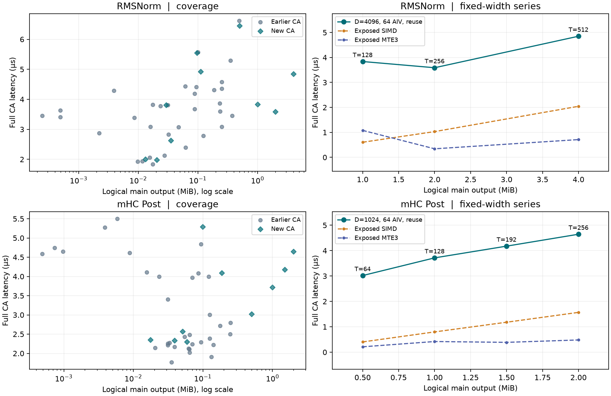

# 数据量增加时，两类 Vector 算子的 CA 耗时如何变化

## 实测范围

| 算子 | 数据角色 | shape 数 | token 范围 | 通道范围 | 主输出最大的 shape | 该点输入 MiB | 主输出 MiB | 总读写 MiB | CA µs |
|---|---|---:|---:|---:|---|---:|---:|---:|---:|
| RMSNorm | 历史开发回放 | 33 | 1–128 | 128–8192 | [36, 7168] | 0.5059 | 0.4922 | 0.9982 | 6.614 |
| RMSNorm | 本轮冻结独立 | 10 | 1–512 | 1536–6912 | [512, 4096] | 4.0078 | 4.0000 | 8.0098 | 4.851 |
| mHC Post | 历史开发回放 | 33 | 1–72 | 64–8192 | [4, 4, 8192] | 0.3128 | 0.2500 | 0.5628 | 2.794 |
| mHC Post | 本轮冻结独立 | 10 | 1–256 | 640–7680 | [256, 4, 1024] | 2.5195 | 2.0000 | 4.5195 | 4.646 |

每个案例按张量元素计算逻辑数据量，MiB＝2²⁰ 字节。T 是 token 数，D 是通道宽度，N 是 mHC 流数。CA 时间取完整 kernel 的跨核指令区间。
RMSNorm 的输入是 BF16 x 和 gamma，合计 2TD＋2D 字节。主输出 y 占 2TD 字节，输出 rstd 另占 4T 字节。mHC Post 的 BF16 x、h 和 FP32 res、post 共占 2TND＋2TD＋4TN²＋4TN 字节，主输出占 2TND 字节。总读写是上述各输入与输出字节的和。缓存复用、多核重复读取及搬运对齐会改变物理流量，本表没有 HBM 计数。

RMSNorm 每行需要处理 D 个通道的平方归约和归一化。Post 每个输出元素需要 N＋1 个乘法和 N 个加法，N=4 时逻辑乘加工作随 TND 增长。两个算子在固定 D 与 N 时，加 token 会同时增加访存和计算工作。

## 固定宽度的多轮区间

冻结计划使用 RMSNorm D=4096 和 mHC Post D=1024 的 T≥64 序列。按 N、安装包 kernel、实测活跃 AIV 数、启动前高水位分组，只有同组内计算斜率。状态由同进程此前启动的 AIV 高水位与本次活跃数划分，reuse 表示当前核数未超过已有高水位。该字段不测量缓存命中。每核行数取分核规则 ⌈T/64⌉，表示最忙 AIV 分配的 token 行数；每轮 UB 能处理的行数仍取决于库实现。暴露 MTE3 取最后完成核的区间分解，SIMD 与 MTE3 同时活动的时间归到 SIMD。它是可见的写流水时间，并非原始指令时长之和。

### RMSNorm

每点均取新留出 CA。固定 D=4096，N=1，包内 kernel `entry_kernel_1388`。

| T | 主输出 MiB | 总读写 MiB | AIV 高水位→活跃 | 每核行数 | CA µs | 暴露 SIMD / MTE3 µs | SIMD 事件数 | 数据量/上点 | 耗时/上点 | 相邻增量 µs/MiB |
|---:|---:|---:|---|---:|---:|---|---:|---:|---:|---:|
| 128 | 1 | 2.0083 | 64→64 | 2 | 3.838 | 0.605 / 1.079 | 1877 | — | — | — |
| 256 | 2 | 4.0088 | 64→64 | 4 | 3.589 | 1.031 / 0.342 | 3691 | 2.00× | 0.94× | -0.248 |
| 512 | 4 | 8.0098 | 64→64 | 8 | 4.851 | 2.045 / 0.711 | 7380 | 2.00× | 1.35× | 0.631 |

[64, 4096] 同宽度点 CA 6.457 µs，启动前高水位 0，活跃核 64。该点计入全量覆盖，与上表分开统计。

用相同 3 点描述时间随主输出 B（MiB）的变化。过原点的最小二乘解为 t=1.449B，组内 WAPE 32.8%。允许固定项后的解为 t=3.207+0.380B，组内 WAPE 6.1%。t 的单位为 µs。两项 WAPE 均为线性趋势描述的同点残差，不代表新模型对留出集的预测误差。固定项是外推到零数据量的截距。

只用前 2 点拟合，将最大一点留给趋势检验。过原点给出 8.813 µs，带截距给出 3.092 µs，该点 CA 为 4.851 µs。

从 T=128 到 256，关键核 SIMD 事件从 1877 增至 3691，其暴露时间增加 0.426 µs；同期暴露写回减少 0.738 µs，整核完成时间反而缩短。再增至 T=512 时，SIMD 事件达到 7380，两段相邻总时延的斜率异号。计算工作随行数增长已经可见，总时延还没有表现出稳定的单位字节增量。

### mHC Post

每点均取新留出 CA。固定 D=1024，N=4，包内 kernel `entry_kernel_6`。

| T | 主输出 MiB | 总读写 MiB | AIV 高水位→活跃 | 每核行数 | CA µs | 暴露 SIMD / MTE3 µs | SIMD 事件数 | 数据量/上点 | 耗时/上点 | 相邻增量 µs/MiB |
|---:|---:|---:|---|---:|---:|---|---:|---:|---:|---:|
| 64 | 0.5 | 1.1299 | 64→64 | 1 | 3.019 | 0.404 / 0.212 | 1392 | — | — | — |
| 128 | 1 | 2.2598 | 64→64 | 2 | 3.715 | 0.799 / 0.420 | 2782 | 2.00× | 1.23× | 1.393 |
| 192 | 1.5 | 3.3896 | 64→64 | 3 | 4.177 | 1.180 / 0.387 | 4172 | 1.50× | 1.12× | 0.924 |
| 256 | 2 | 4.5195 | 64→64 | 4 | 4.646 | 1.568 / 0.482 | 5562 | 1.33× | 1.11× | 0.938 |

用相同 4 点描述时间随主输出 B（MiB）的变化。过原点的最小二乘解为 t=2.771B，组内 WAPE 22.5%。允许固定项后的解为 t=2.553+1.069B，组内 WAPE 1.5%。t 的单位为 µs。两项 WAPE 均为线性趋势描述的同点残差，不代表新模型对留出集的预测误差。固定项是外推到零数据量的截距。

本组结合不同 CA 进程，同一高水位只控制了此前启用的核数。不同的热身操作、缓存及运行间差异仍会影响相邻时间差，表中斜率含这些差异。每点进程及启动编号见逐点数据。

只用前 3 点拟合，将最大一点留给趋势检验。过原点给出 6.566 µs，带截距给出 4.795 µs，该点 CA 为 4.646 µs。

主输出 1 到 2 MiB 的三点来自相同热身协议，两个相邻增量斜率相差 1.6%，关键核每新增 64 个 token 的 SIMD 事件增量依次为 1390、1390。这些点支持用固定开销加单位工作开销描述这一个区间。起始半 MiB 区间的斜率较高，首点在含其它算子的原批次中执行，无法由此区分状态差异和服务节奏变化。

## 解释边界

相邻增量比较额外 1 MiB 主输出对应的时间。若同一实现已进入稳态，核数和每核服务节奏保持稳定时，连续多个区间的增量应接近。两点总能确定直线；引入固定项也会降低拟合同点残差。这些单次 CA 观测缺少同 shape 重复测量，不能只凭较小的组内误差认定已经达到稳态或定位拐点。对于不同 D、通道切分、核数或启动状态，图左保留单点，连成统一直线会混合不同执行条件。图右连线只连接相邻实测点，没有把趋势外推到更大 shape 或其它代际。斜率同时含计算、发起与写回等开销，不能直接换算 HBM 峰值利用率。

## 原始记录归属与重采

对本轮每个 launch，将 helper 的 flush 状态、invalid、mismatched、write_failed、written 与 SQLite 行数、逆序区间核对。helper 有 start/end_overwrites、start_only 与 end_only 回调计数，没有独立的 DROP 总计；这些计数与落库指令行分别记录。再从 MOV_SRC_TO_DST_ALIGNv2 的 OUT 写提取目的地址、burst 次数、长度与步长，每个 burst 展开为一个半开字节区间。对每个输出要求实际写入字节数、地址去重并集和连续跨度都与期望张量字节数相同。RMSNorm 分别核对 y、rstd。检查的是 CA 输出地址记录，每个张量分配的数值正确性另由 CPU 参考验证。全量审计见 [逐 launch 地址与计数](trace-audit.csv)。

RMSNorm 原十条均通过。固定 D=4096 时，T=64/128/256 每核各发一笔主输出 copy，每笔覆盖 1/2/4 行；T=512 每核把 8 行拆成 7 行和 1 行分两笔写出，rstd 对应拆分。后者来自 OUT 参数中每核的 burst 个数与长度，证明写回组织改变，不能仅按每核 token 行数推定 UB 轮数。

Post 原前七条通过，原 T=128、192 各有 1144、1163 个 invalid 区间，落库 0 条。原 T=256 虽然 flush 成功，单个 2 MiB 输出却记录 408 笔 8192-B OUT 写和 311 个唯一行地址，其写入总量 3342336 B、并集 2547712 B、跨度 2744320 B，全超过预期 2097152 B。在物理核 0 的 AIV0，前段写地址 0x9154d4f800 与 0x9154d51800，后段的四笔从 0x9154ded800 开始连续。相邻 AIV 前段按三行偏移，后段按四行偏移，符合前一 T=192 与当前 T=256 的每核任务量。三个原点均剔除。三个隔离进程各先用 [4,4,6144] 激活 64 个 AIV；只计第二次启动的目标 shape。控制样本和原失败点均未重复计入留出集。

每个有效点的角色、逻辑字节、核数、CA 与原始记录路径见 [逐点数据](points.csv)。
