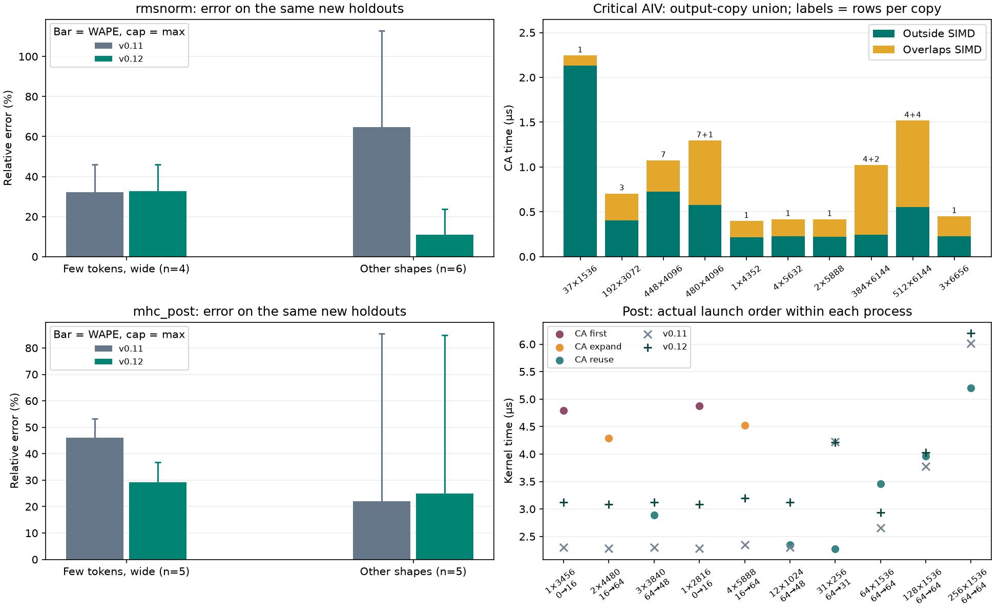

### RMSNorm 的写回与向量计算怎样重叠

`[512,4096]` 是开发回放。CA 的关键核分两轮处理 7 行和 1 行，四笔写操作依次为 28、57,344、4、8,192 B。先对所有 MTE3 区间求并集，再减去并集与 SIMD 忙区的交集，得到实际暴露的写回时间：(2230−1057)/1650 = **0.711 µs**。同一核的 SIMD 占 2.045 µs。v0.11 把按全片输出字节增加的成本投到该点，仅写回就估了 5.825 µs，整例估 10.163 µs，CA 为 4.851 µs。当前并集预测为 1788 tick，覆盖预测为 1371 tick，合起来低估了写回暴露时间，预测为 **0.253 µs**。整例预测 **4.969 µs**，其中 SCALAR 高估约 0.584 µs、发射偏移高估约 0.493 µs，部分抵消了写回与读阶段的低估。这 43 个旧 shape 在本次开发中使用，独立误差只来自采集前冻结的十个新点。[分轮与覆盖模型](rms/method.md) · [独立写回核查](rms/diagnosis.md)

独立集中有五个主输出超过 1 MiB 的 RMSNorm 输入。对三个真正跨 UB 轮次的目标，v0.11 → v0.12 的默认 WAPE 为 **86.23% → 13.40%**。下表列出的 CA 由完整数据库求得；每核分块来自实际写回字节。输出字节超过 16 KiB 时，单笔固有服务仍有辨识限制。

| 独立 shape | 最忙核每轮行数 | CA µs | v0.11 → 当前 µs | MTE3 暴露预测 / 实测 µs |
|---|---|---:|---:|---:|
| [448,4096] | 7（单轮边界） | 4.968 | 9.337 → 4.904 | 0.408 / 0.727 |
| [480,4096] | 7+1 | 5.175 | 9.599 → 4.743 | 0.253 / 0.577 |
| [384,6144] | 4+2 | 6.838 | 11.074 → 5.214 | 0.279 / 0.246 |
| [512,6144] | 4+4 | 6.374 | 13.569 → 5.967 | 0.376 / 0.552 |

`[384,6144]` 是首次发射，`[512,6144]` 发射前已有 64 核覆盖。两点各自的 CA 不能直接用来求宽度 6144 的稳态单位行耗时。普通组共 6 例显著改善；小宽组 4 例多为单轮，默认 WAPE 从 32.31% 变为 32.60%，未知启动历史仍是主要误差之一。

### mHC Post 默认估计在哪些状态起作用

分通道时，用三种条件时间中最快和最慢值的调和平均平衡相对误差。五个小宽新样例是两次首次、两次扩核、一次热态。这个抽样比例用于验证状态差异，不代表用户业务分布。新点 `[1,4,3456]` 首次发射，v0.11 估 2.302 µs，当前估 3.120 µs，CA 为 4.797 µs；`[3,4,3840]` 已有覆盖，旧估 2.302 µs，当前估 3.120 µs，CA 为 2.892 µs。默认输入仍不可能区分相同 shape 的不同历史。旧的同形配对 `[2,4,6144]` 在批首/批尾分别为 4.838/2.905 µs，任何只返回一个值的模型对其中至少一次的相对误差约为 25% 或更高。

普通组的 `[31,4,256]` 没有切通道，采用开发状态分布的加权中位数。该次实际是热态，预测仍接近扩核条件的时间。它与 `[12,4,1024]` 这样的切通道热态应分别看待。固定宽度 D=1536 且已有 64 核覆盖的 T=64、128、256 三例，主输出 0.75、1.5、3 MiB，CA 为 3.459、3.959、5.201 µs。该组默认 WAPE 从 14.21% 降到 12.64%，最大点仍高估 19.31%。逐次输出、条件时间和前序覆盖数均在明细中。[方法与算例](post/method.md) · [误差和状态明细](post/diagnosis.md)

### 大 shape、正确性与计时资格

RMSNorm 同时核对 BF16 主输出与 FP32 行统计量，Post 核对所有残差流的输出。数值 golden 通过后，再按本次 launch 核对设备指令窗口、DB 记录数、活跃 AIV、输出写入量及地址覆盖。相同 CA 进程中的前序核覆盖只用于分组和显式历史预测。各算子的主要方法使用 shape 和冻结参数，不读验证 trace。[按状态、分块及输出字节的独立审计](audit/summary.md)

本轮 RMSNorm 原批拒收四次计时。两个目标的 helper 报负时长且数据库为空，紧随其后的两个目标虽然有指令，实际写入字节分别为 7,604,320 和 10,963,528 B，超出相应的 3,934,080 和 6,293,504 B。四例按原预测和前序核覆盖条件隔离重采，保留其他合格点。mHC Post 的十个新点全部首采合格。两族共 **29 次发射、20 个独立 shape**：五次额外发射用于预热/重建前序覆盖，四次用于替代不合格计时。RMSNorm 与 Post 各自的 CA 进程累计墙钟分别为 1080.7 s 和 450.6 s；进程存在并行。采集开销含不合格尝试和预热，在线查询不启动 CA。[RMSNorm 采集成本](rms/costs.json) · [mHC Post 采集成本](post/costs.json)

### 其他算子的覆盖边界

| 路线 | 已有完整 CA 示例 | 扩大到系统负载时还缺什么 |
|---|---|---|
| DynamicMXQuant | `[1024,7168]`，9.332 µs | 已有宽行、多轮 UB 实测。放大行数跨分块边界时仍需重新确定尾轮。 |
| Matmul / Addmm | `[512,512,256]` 分别为 4.799 / 4.479 µs | 现有集合对大型投影 K 维的多段归约和大输出块覆盖有限。 |
| 普通 FA / Lightning Indexer | FA `[9,131072,64,1,1]` 为 274.821 µs，Indexer `[1,1,8192,8,128]` 为 22.709 µs | FA 的 128k 点是 B=H=1 的非因果路线，256k、512k 仍属外推。Indexer 的大 L 不能套用普通 FA 的斜率。 |
| mHC Pre / Sinkhorn / 组链 | Pre `[24,4,1536]` 为 12.201 µs，融合 PreSinkhorn `[32,4,4096]` 为 11.114 µs | Pre 投影、逐 token 小矩阵归约及串行链各有不同扩展规律。 |
| KDA / MoE | 递推 `[1,8,1,1,128,128]` 为 35.396 µs，GMM1 / GMM2 在 `[64,128,256,4]` 为 8.355 / 4.142 µs | 长序列、生产规模专家数及倾斜负载缺少覆盖；KDA chunk 缺少合格计时。 |

Addmm 的小输出块仍受 FIXP 尾部影响。拆分 mHC 链中，Pre 低估和后续阶段高估可以抵消。Indexer 的 L=8192 例分段数与 64 条 MMAD 一致，时间模板仍高估约 32%。MoE 的两次 GMM 分别受本地专家负载和尾块影响。这些路线沿用原模型的冻结独立数据，本轮无新增 CA。
