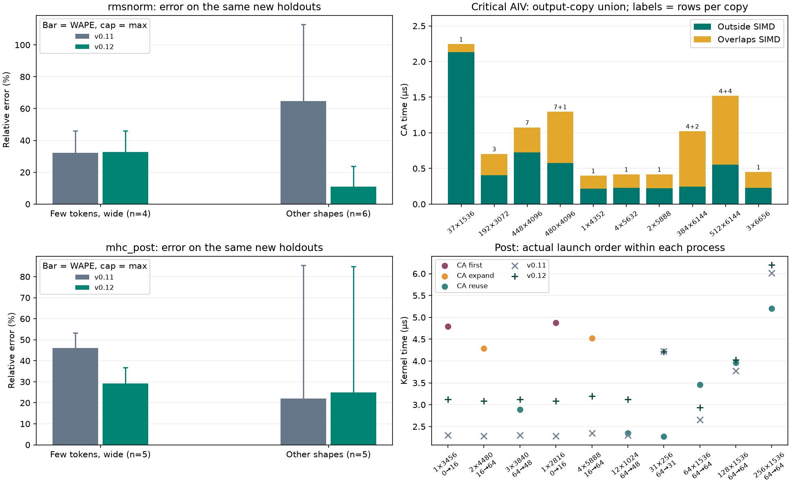

# v0.12 独立样本：计时审计与大 shape 对照

| 算子 / 组 | 新 shape | v0.11 WAPE / 最大 | v0.12 WAPE / 最大 |
|---|---:|---:|---:|
| rmsnorm / 全部 | 10 | 55.54% / 112.89% | 17.04% / 45.96% |
| rmsnorm / 小 token、宽通道 | 4 | 32.31% / 46.04% | 32.60% / 45.96% |
| rmsnorm / 普通 | 6 | 64.75% / 112.89% | 10.88% / 23.75% |
| mhc_post / 全部 | 10 | 35.34% / 85.49% | 27.28% / 84.91% |
| mhc_post / 小 token、宽通道 | 5 | 46.15% / 53.25% | 29.17% / 36.81% |
| mhc_post / 普通 | 5 | 21.95% / 85.49% | 24.95% / 84.91% |

两栏都是新冻结清单上的默认预测，不传 `resident_aiv`。小宽组为 T≤4 且 D≥2048；WAPE=Σ|预测−实测|/Σ实测，最大误差=max(|预测−实测|/实测)。旧留出已转开发，本表不计入。

## 采集是否可用于计时

在原始输入和 DB 中核对 29 条记录（其中 29 条有 launch 证据）；20 个独立留出，5 个通过审计但未纳入独立误差，4 个失败或未完成。每个 launch 的原始相对路径、核、golden、helper 回调计数和失败原因见 [launches.csv](launches.csv)。

从输入文件及分段日志独立核对 shape、唯一 runtime task、ACLNN、950DT、进程成功标志；BF16 主输出与独立 CPU 参考比较，RMSNorm 还检查每个 token 的 FP32 rstd。helper 的 flush 必须成功、invalid/mismatched/write_failed 为零、written 等于 DB 记录数；检查 KernelInfo、1.65 GHz 下全核指令区间首尾、有效 AIV、RV 指令与零逆序。helper 的 overwrite/start_only/end_only 是回调分类，不等于 DB 丢失指令数。

把每条输出 MOV 的 burst 展开为半开字节区间；单张量的原始字节、去重并集、连续跨度都必须等于理论大小。每一 AIV 都须写输出。RMSNorm 分别审计 y 与 rstd 的地址范围，要求两输出分配不重叠、同核写回行集合相符。[per-core.csv](per-core.csv) 给每核每笔的字节范围（相对各自缓冲区最低写地址）与写次数。此门禁可捕捉重复和跨 launch 污染；它不能证明模拟器记录了所有内部微操作。

| 原进程 / launch | shape | 被剔除的实证 | 独立进程重采（launch，CA µs） |
|---|---|---|---|
| rmsnorm-5-8 / 1 | [448, 4096] | helper invalid=1242，落库 0 条 | recover-6 / 1，4.968 |
| rmsnorm-5-8 / 2 | [480, 4096] | 主输出实写/应写 7,602,176/3,932,160 B | recover-7 / 1，5.175 |
| rmsnorm-8-10 / 0 | [384, 6144] | helper invalid=1098，落库 0 条 | recover-8 / 0，6.838 |
| rmsnorm-8-10 / 1 | [512, 6144] | 主输出实写/应写 10,960,896/6,291,456 B | recover-9 / 1，6.374 |

## RMSNorm：输出分块与重叠

最后完成的 AIV 上分别对主输出、rstd 的 MTE3 时间段求并，并与 SIMD 并集取交。末两列是两输出先取并，再与 SIMD 求交；同一周期不会重复计入；逐 shape 核对未重叠时间与完整流水独占 MTE3 之差小于 10⁻⁷ µs。分块列按写主输出字节最多的一核列出了指令实际覆盖行数，与最后完成核可以不同。

| [T,D] | 最忙核 y 分块（行） | y 忙 / ∩SIMD (µs) | rstd 忙 / ∩SIMD (µs) | 写出并集 / ∩SIMD (µs) | 写出未与 SIMD 重叠 (µs) |
|---|---|---:|---:|---:|---:|
| [37, 1536] | 1 | 2.129 / 0.000 | 2.242 / 0.112 | 2.244 / 0.112 | 2.132 |
| [192, 3072] | 3 | 0.402 / 0.000 | 0.704 / 0.300 | 0.705 / 0.300 | 0.405 |
| [448, 4096] | 7 | 0.727 / 0.000 | 0.348 / 0.348 | 1.075 / 0.348 | 0.727 |
| [480, 4096] | 7+1 | 0.946 / 0.369 | 1.077 / 0.501 | 1.296 / 0.719 | 0.577 |
| [1, 4352] | 1 | 0.218 / 0.000 | 0.180 / 0.180 | 0.398 / 0.180 | 0.218 |
| [4, 5632] | 1 | 0.222 / 0.000 | 0.227 / 0.194 | 0.419 / 0.194 | 0.225 |
| [2, 5888] | 1 | 0.224 / 0.000 | 0.195 / 0.195 | 0.418 / 0.195 | 0.224 |
| [384, 6144] | 4+2 | 0.829 / 0.583 | 0.373 / 0.373 | 1.023 / 0.777 | 0.246 |
| [512, 6144] | 4+4 | 1.218 / 0.667 | 0.301 / 0.301 | 1.519 / 0.967 | 0.552 |
| [3, 6656] | 1 | 0.224 / 0.000 | 0.286 / 0.224 | 0.451 / 0.224 | 0.227 |

## Post：首次、扩核、热态

状态由同一进程内前面所有 launch 的实际最大 AIV 数重建，包括控制 launch。首次 = 此进程还没有前序，扩核 = 当前活跃核数超过该高水位，热态 = 此次不必超过该高水位。这是调用历史分类，不等于直接测得芯片 cache 命中。

| 进程 / launch | [T,N,D] | 先前→当前 AIV | 状态 | 完整 CA (µs) | v0.11 / v0.12 默认 (µs) |
|---|---|---|---|---:|---:|
| batch-v12_post_0_2 / 0 | [1, 4, 3456] | 0→16 | first | 4.797 | 2.302 / 3.120 |
| batch-v12_post_0_2 / 1 | [2, 4, 4480] | 16→64 | expand | 4.292 | 2.280 / 3.082 |
| batch-v12_post_0_2 / 2 | [3, 4, 3840] | 64→48 | reuse | 2.892 | 2.302 / 3.120 |
| batch-v12_post_1_4 / 0 | [1, 4, 2816] | 0→16 | first | 4.877 | 2.280 / 3.082 |
| batch-v12_post_1_4 / 1 | [4, 4, 5888] | 16→64 | expand | 4.520 | 2.347 / 3.195 |
| batch-v12_post_1_4 / 2 | [12, 4, 1024] | 64→48 | reuse | 2.346 | 2.302 / 3.120 |
| batch-v12_post_1_4 / 3 | [31, 4, 256] | 64→31 | reuse | 2.278 | 4.225 / 4.211 |
| batch-v12_post_1_4 / 4 | [64, 4, 1536] | 64→64 | reuse | 3.459 | 2.661 / 2.932 |
| batch-v12_post_2_1 / 0 | [4, 4, 6144] | 0→64 | first | 5.388 | control_or_unused |
| batch-v12_post_2_1 / 1 | [128, 4, 1536] | 64→64 | reuse | 3.959 | 3.779 / 4.023 |
| batch-v12_post_3_1 / 0 | [4, 4, 6144] | 0→64 | first | 5.235 | control_or_unused |
| batch-v12_post_3_1 / 1 | [256, 4, 1536] | 64→64 | reuse | 5.201 | 6.015 / 6.205 |

| Post 组 / 实际状态 | 新样例 | v0.11 WAPE / 最大 | v0.12 WAPE / 最大 |
|---|---:|---:|---:|
| few_wide / first | 2 | 52.63% / 53.25% | 35.89% / 36.81% |
| few_wide / expand | 2 | 47.49% / 48.07% | 28.77% / 29.32% |
| few_wide / reuse | 1 | 20.39% / 20.39% | 7.86% / 7.86% |
| ordinary / reuse | 5 | 21.95% / 85.49% | 24.95% / 84.91% |

## 同宽、大工作量的实测趋势

只列 T≥64，且 op、通道宽、流数、kernel、实际活跃 AIV、真实状态相同的相邻新样本。斜率是新增主输出每 MiB 对应的总耗时差（含计算和写回）；若分块或状态改变，不应拿单一斜率外推。

| 条件 | T | 主输出 MiB | 完整 CA (µs) | 相邻 Δus/MiB |
|---|---|---|---|---|
| mhc_post (4, 1536)，entry_kernel_6，64 AIV，reuse | 64, 128, 256 | 0.750, 1.500, 3.000 | 3.459, 3.959, 5.201 | 0.667, 0.827 |
| rmsnorm (3072,)，entry_kernel_1388，64 AIV，first | 192 | 1.125 | 4.850 | N/A |
| rmsnorm (4096,)，entry_kernel_1388，60 AIV，reuse | 480 | 3.750 | 5.175 | N/A |
| rmsnorm (4096,)，entry_kernel_1388，64 AIV，reuse | 448 | 3.500 | 4.968 | N/A |
| rmsnorm (6144,)，entry_kernel_1388，64 AIV，first | 384 | 4.500 | 6.838 | N/A |
| rmsnorm (6144,)，entry_kernel_1388，64 AIV，reuse | 512 | 6.000 | 6.374 | N/A |

这些是 950DT CA 有限区间的观测；组内仅一个点不能判定线性，两个点不能验证直线；即使三个点接近，也不能据此外推跨分支或跨代。图中的模型误差和对照都不使用旧 shape 充作新点。

复现：在仓库根目录执行 `python development/validation/audit_v12.py`（需要保留本轮原始 DB、日志及已发布的两份冻结记录和逐 shape 结果；绘图需要 matplotlib）。该命令只重读数据，不启动 CA。
