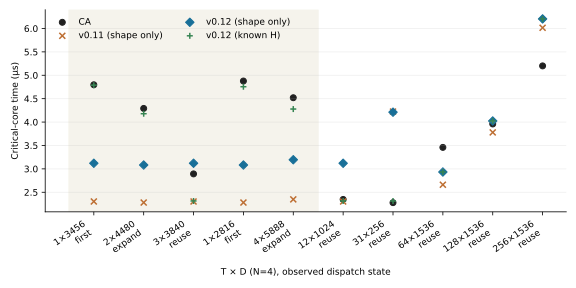

# mHC Post：冻结后独立验证

| 组别 | 新 shape 数 | v0.11 默认 WAPE / 最大 | v0.12 默认 WAPE / 最大 | v0.12 已知 H WAPE / 最大 | 固定耗时 WAPE / 最大 |
|---|---:|---:|---:|---:|---:|
| 全部 | 10 | 35.34% / 85.49% | 27.28% / 84.91% | 7.06% / 20.01% | 33.82% / 47.72% |
| 少 token 宽通道 | 5 | 46.15% / 53.25% | 29.17% / 36.81% | 4.98% / 20.01% | 36.41% / 44.25% |
| 普通 | 5 | 21.95% / 85.49% | 24.95% / 84.91% | 9.64% / 19.31% | 30.60% / 47.72% |
| 其中 D=1536 大小阶梯 | 3 | 14.21% / 23.08% | 12.64% / 19.31% | 12.64% / 19.31% | 35.36% / 47.72% |
| 小宽 / 首次 | 2 | 52.63% / 53.25% | 35.89% / 36.81% | 1.35% / 2.50% | 43.79% / 44.25% |
| 小宽 / 扩核 | 2 | 47.49% / 48.07% | 28.77% / 29.32% | 4.03% / 5.34% | 38.29% / 39.85% |
| 小宽 / 热态 | 1 | 20.39% / 20.39% | 7.86% / 7.86% | 20.01% / 20.01% | 5.99% / 5.99% |

WAPE=Σ|预测−CA|/ΣCA；最大误差为最大的 |预测−CA|/CA。两条默认曲线都只用 shape 和算子属性；显式 H 列仅用采集前已知的同流规划。小宽定义为 T≤4、D≥2048。固定耗时取 43 个开发点中位数。原有 43 个 shape 是开发回放，10 个新 shape、预测和预算在采集前冻结。样本包含有意构造的首次/扩核场景，汇总不代表部署状态占比。

| 新 shape [T,4,D] | H / 状态 | CA µs | v0.11 | v0.12 | 有符号误差 | 已知 H | 实际入口 / AIV | SCALAR / MTE2 / MTE3 / SIMD 指令 | 已审计输出 B |
|---|---|---:|---:|---:|---:|---:|---|---|---:|
| [1,4,3456] | 0 / first | 4.797 | 2.302 | 3.120 | -35.0% | 4.788 | entry_kernel_5 / 16 | 1578/5/5/705 | 27,648 |
| [2,4,4480] | 16 / expand | 4.292 | 2.280 | 3.082 | -28.2% | 4.178 | entry_kernel_5 / 64 | 1578/5/5/569 | 71,680 |
| [3,4,3840] | 64 / reuse | 2.892 | 2.302 | 3.120 | +7.9% | 2.313 | entry_kernel_5 / 48 | 1578/5/5/709 | 92,160 |
| [1,4,2816] | 0 / first | 4.877 | 2.280 | 3.082 | -36.8% | 4.755 | entry_kernel_5 / 16 | 1578/5/5/577 | 22,528 |
| [4,4,5888] | 16 / expand | 4.520 | 2.347 | 3.195 | -29.3% | 4.278 | entry_kernel_5 / 64 | 1578/5/5/973 | 188,416 |
| [12,4,1024] | 64 / reuse | 2.346 | 2.302 | 3.120 | +33.0% | 2.313 | entry_kernel_5 / 48 | 1578/5/5/713 | 98,304 |
| [31,4,256] | 64 / reuse | 2.278 | 4.225 | 4.211 | +84.9% | 2.313 | entry_kernel_5 / 31 | 1578/5/5/713 | 63,488 |
| [64,4,1536] | 64 / reuse | 3.459 | 2.661 | 2.932 | -15.2% | 2.932 | entry_kernel_6 / 64 | 1116/7/2/2064 | 786,432 |
| [128,4,1536] | 64 / reuse | 3.959 | 3.779 | 4.023 | +1.6% | 4.023 | entry_kernel_6 / 64 | 1767/11/3/4126 | 1,572,864 |
| [256,4,1536] | 64 / reuse | 5.201 | 6.015 | 6.205 | +19.3% | 6.205 | entry_kernel_6 / 64 | 3069/19/5/8250 | 3,145,728 |

## 如何解释误差

复用历史同形对照 `[2,4,6144]`：首发与批尾分别 4.838、2.905 µs。关键核两次都是 1578 条 SCALAR、5 条 MTE2、5 条 MTE3、581 条 SIMD；MTE2 暴露时间却从 1.202 降到 0.623 µs，SIMD 从 1.384 到 0.670 µs，arrival 从 0.545 到 0.050 µs。这说明仅凭指令数量和 shape 无法区分两次；不能由这些计数证明某个 cache 是根因。若只允许给这两次一个数，即使提前知道两次实测，最大相对误差也至少 (4.838−2.905)/(4.838+2.905)≈25.0%。这条重复控制没有重复加入 43 个校准点。

按 10 个旧 CA 进程逐个整进程留出，每折重新拟合阶段参数与缺省状态数；用相同折内阶段预测换两种状态选择法，以免把新训练数据的影响误算成选择法收益。43 个历史 shape 的 WAPE 为硬选 28.0%、折衷 22.9%；12 个历史小宽点为 38.3%→33.7%，小宽最大 89.8%→47.0%。两次历史小宽首发平均仍差，首发 WAPE 从 36.4% 到 39.1%；不能承诺每个进程或每个状态都变好。三态 H 已知的历史小宽 WAPE 4.8%。[整进程留出明细](process-crosscheck.json)

新集中 5 个小宽点有两次首发、两次扩核、一次热态；旧默认因预测复用而系统性低估前两态。新版对首发、扩核上调预测，代价是高估热态。一个热态不足以外推真实 decode 流命中率。普通组 `[31,4,256]` 无需切通道；该组旧进程序列首次/扩核/复用=4/2/2，缺省中位选了扩核。本次实际 H=64、A=31，是热态。此点的偏差主要来自未观测的状态；即使新版本折衷修复切通道分支，该组仍应优先传入 `resident_aiv`。

固定 D=1536、H=64 时，T=64/128/256 各有 1/2/4 行每核，CA 为 3.459/3.959/5.201 µs，默认预测 2.932/4.023/6.205 µs。每多一行的实测斜率分段为 0.501、0.621 µs；模型对应 1.091 µs/行。只有三个同宽点、无重复测量，不能据此确认饱和转折点或更大工作量下的全局线性。逐核阶段、指令数和冻结前工作量可在 JSON 复核。

T=256 的误差可以从阶段定位：MTE2 估 2.328、实测暴露 1.550 µs；MTE3 估 0.538、实测 0.210 µs；SIMD 估 2.219、实测 2.150 µs。固定单位字节、每额外行的可见搬运成本偏大；这支持下一轮检查 MTE 与 SIMD 遮盖以及逐行发起间隔，不能由单点认定 DRAM 带宽变化。

## 实测资格和成本

全部 10 个独立点实测为 CANN 9.2.1 / 950DT 的 `aclnnMhcPost`（ops-transformer 家族）；每条确认 CPU 全输出 `bad=0`、helper `status=ok` 且无无效时序、matched launch_id、1 个任务完成标记，核数和入口逐点对照。展开每条 MTE3 的目标 burst，要求总传输长度、地址并集和跨度均等于唯一 BF16 输出 2TND 字节。没有把零记录或混入其他 launch 的 DB 当作有效计时。两次预热不计入独立 shape。上轮被污染的原批数据库未用于本轮训练。

四个 CA 进程最多两路并发，包括预热共 12 次发射，总进程墙钟 450.6 s，生成数据库 763.1 MiB，计时失败 0 次。在线三态/六阶段计算（已加载参数、无 shape 结果缓存）每点重复 100 次，合并中位 15.76 µs、最慢 84.01 µs；上下文列和设备微秒均不是 Python 墙钟。这些数字不构成任意系统负载的硬实时保证。

[逐 shape 开发与验证记录](rows.json) · [模型/预算/两版预测冻结](freeze.json) · [按组指标](summary.json) · [进程和开销](costs.json)
