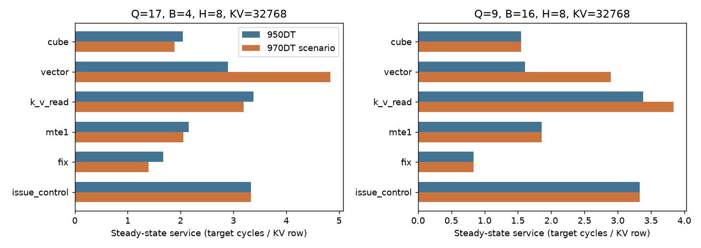

# FA 在 950DT 与 970DT 情景上的瓶颈

单卡 BF16、非因果 SBH、D64，Q/K/V 等头；使用同一套资源估时。按每个 shape 贡献稳态周期最多的一类 wave，选取其满 KV 块的最长资源需求。首发和排空仍计入总时间。表中两端均为模型预测，970DT 全部为外推。B/H 已是本卡值。

| 场景 | [Q,KV,D,B,H] | DT → 970 核 (C,V) | KV 块长 DT → 970 | 波数 DT → 970 | DT → 970 稳态瓶颈 | DT / 970 µs | DT/970 | 970 池化假设 µs |
|---|---|---|---:|---:|---|---:|---:|---:|
| 单头校验，32k | (9, 32768, 64, 1, 1) | [1, 2] → [1, 1] | 256 → 256 | 1 → 1 | K/V 发起节拍 → K/V 发起节拍 | 76.377 / 70.033 | 1.091× | 70.012 |
| 单头校验，128k | (9, 131072, 64, 1, 1) | [1, 2] → [1, 1] | 256 → 256 | 1 → 1 | K/V 发起节拍 → K/V 发起节拍 | 274.987 / 252.093 | 1.091× | 252.071 |
| 单头校验，256k | (9, 262144, 64, 1, 1) | [1, 2] → [1, 1] | 256 → 256 | 1 → 1 | K/V 发起节拍 → K/V 发起节拍 | 539.801 / 494.839 | 1.091× | 494.818 |
| 单头校验，512k | (9, 524288, 64, 1, 1) | [1, 2] → [1, 1] | 256 → 256 | 1 → 1 | K/V 发起节拍 → K/V 发起节拍 | 1069.429 / 980.331 | 1.091× | 980.310 |
| 校验 Q17，B4 H8 | (17, 32768, 64, 4, 8) | [32, 64] → [32, 32] | 128 → 256 | 1 → 1 | K/V 读取 → Vector | 75.631 / 97.270 | 0.778× | 70.079 |
| 校验 Q9，B4 H8 | (9, 32768, 64, 4, 8) | [32, 64] → [32, 32] | 128 → 256 | 1 → 1 | K/V 读取 → K/V 发起节拍 | 75.577 / 70.033 | 1.079× | 70.012 |
| 并发校验，B16 H8 | (9, 32768, 64, 16, 8) | [32, 64] → [120, 120] | 128 → 128 | 4 → 2 | K/V 读取 → K/V 读取 | 282.964 / 140.229 | 2.018× | 140.208 |
| 并发校验，B32 H8 | (9, 32768, 64, 32, 8) | [32, 64] → [120, 120] | 128 → 128 | 8 → 3 | K/V 读取 → K/V 读取 | 559.481 / 211.993 | 2.639× | 211.972 |
| 并发校验，B256 H8 | (9, 32768, 64, 256, 8) | [32, 64] → [120, 120] | 128 → 128 | 64 → 18 | K/V 读取 → K/V 读取 | 4430.721 / 1288.445 | 3.439× | 1288.424 |
| prefill，B1 H8 | (512, 32768, 64, 1, 8) | [32, 64] → [64, 64] | 256 → 256 | 1 → 1 | Vector → Vector | 372.490 / 340.644 | 1.093× | 190.443 |
| 并发校验，B128 H8 | (9, 32768, 64, 128, 8) | [32, 64] → [120, 120] | 128 → 128 | 32 → 9 | K/V 读取 → K/V 读取 | 2218.584 / 642.574 | 3.453× | 642.553 |
| prefill，B4 H8 | (512, 32768, 64, 4, 8) | [32, 64] → [120, 120] | 256 → 256 | 4 → 2 | Vector → Vector | 1470.524 / 1339.122 | 1.098× | 1007.645 |
| prefill，B16 H8 | (512, 32768, 64, 16, 8) | [32, 64] → [120, 120] | 256 → 256 | 16 → 5 | Vector → Vector | 5862.660 / 3339.017 | 1.756× | 3007.540 |
| 单波向量工作，32头 | (32, 8192, 64, 1, 32) | [32, 64] → [32, 32] | 128 → 256 | 1 → 1 | Vector → Vector | 34.029 / 50.416 | 0.675× | 29.993 |

默认 970 情景给每个繁忙 AIC 配一个 AIV；池化情景允许从空闲 AIV 借至最多两个。在高并发且 AIC、AIV 均满时，两种假设通常接近。单头 Q9 的 KV 长度只增加串行块数，核数增加很难缩短它；相同 shape 若库新增 split-KV 则应显式改变任务图。每波核数、每个瓶颈候选的周期、K/V 字节占情景 HBM 峰值比例见[逐场景数据](fa-scenarios.json)。该带宽利用率按模型冷读需求计算，不是物理计数器。

两图将每个完整 KV 块的服务周期除以该芯片的 KV 块长以便比较。每个芯片最长一项决定稳态发起间隔。Q17、B4、H8 时，DT 选 128 个 KV 行且每 AIC 配两个 AIV，970 选 256 个 KV 行且每 AIC 配一个 AIV，两端的分块和绑定均发生变化。启动和尾部另计；970 曲线均为情景外推。Q=9 表示验证 8 个推测 token 加 1 个主模型 token。表中的 prefill 是单个 512 行块；生成 1k 输出的整网时间还需累加各校验步，并按实际接受长度及批量调度更新 KV。
