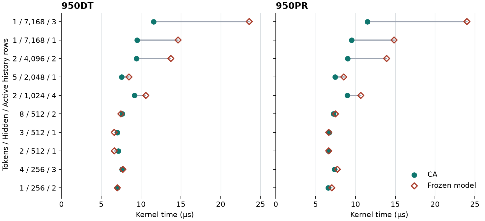

# Kimi K3 的融合 Attention Residual

Kimi K3 的 decoder 源码假跑在 93 层内遇到 186 次 `torch.ops._C_ascend.attn_res_fwd`。它每个 token 读取历史残差 bank 的前 N 行和当前 prefix，执行归一化、分数投影、跨 bank 行 softmax 和加权，再按属性选择输出归一化、原始前缀写回和中间结果物化。真实部署路径属于 vLLM Ascend 自定义 ops 包，元数据与 950 RegBase 内核源可追溯到同一个提交。[decoder 假跑](decoder-probe.json) · [上游接口、合同与术语](https://github.com/vllm-project/vllm-ascend/blob/c09d3e20b9c45c80b34ae3781440d90904a44023/csrc/attention/attn_res_fwd/README.md) · [精确 ACLNN 入口](https://github.com/vllm-project/vllm-ascend/blob/c09d3e20b9c45c80b34ae3781440d90904a44023/csrc/attention/attn_res_fwd/op_host/op_api/aclnn_attn_res_fwd.cpp)

## 输入与分核

`prefix[T,H]`、可选 `addend[T,H]`、`bank[T,S,H]`、`projection[1,H]` 和两种 gamma 都是 BF16。Kimi K3 取 H=7168，S=8。每次调用另给有效行数 N、是否混合 mix、可选写回行号 write_idx、是否物化中间结果、是否含输出 RMSNorm、是否请求 prefill 优化。写入行不得覆盖本次读取的有效区。全网当步 token 数需经过当前 TP/SP 或 DP 布局换算到本卡实际调用。两次层内调用的属性和 bank 深度可不同。

令 A 为配置的 AIV 数。对于 T>0，host 发起 G=min(T,A) 个 block，每核分 q=⌈T/G⌉ 个 token。kernel 内有载荷的核数为 A′=⌈T/q⌉，尾块裁短。令 B=N+1，U 为目标 UB 的字节数。FusedChain 在 host 阶段保留 prefix 的额外缓冲，允许全部 B 行驻留的上限为

```text
Bmax = floor(max(0, U − 22H − 32768) / (2H+4))
```

当 B≤Bmax 时 tiling key 为 40020（驻留），同一 token 的数据在打分和加权阶段复用。否则 key 为 40010（重读），历史 bank 行要再读一遍。两个 key 都复用已在 UB 的 prefix。若 optimize_prefill、启用输出归一化、q>1，并且完整缓冲预算加一行 gamma 仍可放入 UB，host 选择 40021 或 40011 并在同核多 token 间缓存 gamma。精确预算包含 FP32 向量、按 32B 对齐的 BF16 和 softmax 临时量及 32KiB 余量，公开函数直接按 host 源算。只要 N=0 或 mix=false 即跳过混合，无需历史 bank 和投影载荷。[host 选择条件](https://github.com/vllm-project/vllm-ascend/blob/c09d3e20b9c45c80b34ae3781440d90904a44023/csrc/attention/attn_res_fwd/op_host/attn_res_fwd_tiling.cpp) · [RESIDENT kernel](https://github.com/vllm-project/vllm-ascend/blob/c09d3e20b9c45c80b34ae3781440d90904a44023/csrc/attention/attn_res_fwd/op_kernel/arch35/attn_res_fwd_resident.h) · [RELOAD kernel](https://github.com/vllm-project/vllm-ascend/blob/c09d3e20b9c45c80b34ae3781440d90904a44023/csrc/attention/attn_res_fwd/op_kernel/arch35/attn_res_fwd_reload.h)

## 统计和使用

每行读写 2H B。prefix 每 token 必读，启用 addend 再读一行。混合时历史 bank 每 token 读 N 或 2N 行，投影和 norm 两行权重只在每个有载荷的核上读一次并相乘。若需要输出 RMSNorm，再读 T 行 gamma，预取时为 A′ 行。最终结果每 token 写一行，融合加法产生的 raw prefix、明确物化和有效的 bank 写回各额外写一行。函数分别报告 **MTE 逻辑字节** 和 **所有 tensor 首次冷读所需的不同输入字节**；缓存在不同核之间的共享会改变它们与 HBM 计数的关系。

打分一行包括 H 次平方、H−1 次规约加、均值系数与 epsilon 的两步、一次 rsqrt，再做两个 H 长乘法和一次 H 长规约。每一行参与一次 softmax 的 exp 和一个 H 长的加权累加。输出 RMSNorm 另有平方归约、rsqrt 与缩放，前缀融合需要 BF16 边界舍入。结果按 FP32 基本加乘与比较、前缀 addition、exp、rsqrt 和 reciprocal 分项返回。按有载荷核的 FP32 峰值，以及目标 GB/s，提供 FP32 算术峰值下界与冷输入 HBM 下界。缺少发射和特殊函数服务、同步和 MTE 响应的完整校准，`latency_us` 保留 N/A；这两个下界不能直接代入系统当作完整设备时间。[结构模型](../../../operator_model/attention_residual.py)

```python
from operator_model.attention_residual import attention_residual_work

case = attention_residual_work(9, 7168, 8, 6, chip="Ascend950PR_957b",
                              addend=True, write_idx=6, materialize=True)
```

取上例时，B=7 超过 UB=253952 B 对应的 Bmax=4。9 个核各做 1 个 token，使用 RELOAD。读前缀和 addend 各 9 行、bank 108 行、两种 score 权重 18 行、输出 gamma 9 行，合计 153 行、2,193,408 B。输出、raw prefix、materialized 和 bank 共 36 行、516,096 B。FP32 基本工作 3,483,891，exp 63 个，rsqrt 72 个，softmax 的 reciprocal 9 个。PR 对应的冷输入/FP32 下界分别为 0.768/0.943 µs。970DT 上分别为 0.075/0.840 µs，均为工作量驱动外推。[两条分支及三芯片冻结数据](attn-res-registration.json)

## 原版 kernel 的构建和观测口径

将 vLLM Ascend v0.30.0 的算子目录逐文件与固定提交的 Git blob 摘要核对，在隔离 CANN 9.2.1 环境使用上游 `csrc/build.sh --pkg --ops=attn_res_fwd --soc=ascend950` 生成 host、tiling 和 OPC 编译命令。全量打包会编译公共 protobuf 依赖；本例在公共编译同时用生成的原始命令单独完成该算子的 tiling 和 kernel 链接，并按 install 清单放入局部 vendor OPP。实际加载 libcust_opapi.so，经 aclnnAttnResFwd、原版 host tiling、RegBase 设备镜像；OPC 通用 950 目标标识为 Ascend950PR_9599，CA 到运行时再指定精确 DT/PR SKU。重复实验可用同提交单算子包及随仓 C++ smoke，给 `attn_res_ca.py` 提供本地 vendor 目录。构建和 CA 阶段独立计时。[上游源码及编译产物摘要](attn-res-build.json) · [CPU golden 与原生调用方](../../../development/workloads/attention_residual_smoke.cpp) · [CA 核验程序](../../../development/workloads/attn_res_ca.py)

## 有阶段定价的 RESIDENT 子集

公开系统接口 `estimate('attn_res_fwd',(T,H,S,N),dtype='bf16',chip=...,attrs=...)` 针对以下条件返回设备耗时：每个有载荷的核仅处理一个 token、bank 可驻留、N>0、执行混合、融合 addend、写回一个未参与本次混合的 slot、物化混合输出并执行输出归一化。属性可写为 `dict(addend=True,write_idx=N,materialize=True,output_norm=True)`。结构函数 `attention_residual_work` 的时间字段适用于工作量/资源下界口径；条件满足时请从公共 `estimate` 取完整预测。RELOAD、多 token/核和其他属性组合只提供所选分块、工作量和访存估计。

对 arch35 的首核，将 trace 的事件区间按可观测有效读分为五段。端点依次为全核起点、第一笔投影读、prefix 读、第一笔 bank 读、gamma 读、全核终点。即使某段已有在途写，它也只计该段两端的差。设 L=⌈H/64⌉ 为 64 路 FP32 数据块数，C 是总核周期，n、r、k 分别是该段固定准备次数、顺序读行数与等效向量块数。模型逐段计算

```text
C_phase = n·a + k·b·p_ref/p_target + 2H·r / β_MTE2
t_kernel = max(ΣC_phase/(1000f), Xdistinct/B_HBM, Xdma/B_L2, Ydma/(A′·B_MTE3))
```

带宽项按统一的字节/微秒单位换算。p 为每核 FP32 每周期峰值。β 默认 48.36 B/cycle/核，取已归档 950 的 DMA 服务率，可用目标 mte2_bandwidth_gbs/频率替换。整片和输出端口约束在该资源已知时启用。a 是每准备动作的固定周期，b 是每等效向量块的有效周期，可含控制依赖、归约和仍暴露的 MTE3 等待。

| 阶段 | n | r | k | a，cycles | b，cycles/块 |
|---|---:|---:|---:|---:|---:|
| 启动 | 1 | 0 | 0 | 4527.00 | 0 |
| 读两种权重并组合 | 1 | 2 | L | 1746.59 | 4.31 |
| 读 prefix/addend、加法和发起写回 | 1 | 2 | L | 1249.04 | 2.70 |
| N 次 bank 行 RMS 和打分 | N | N | NL | 918.05 | 5.84 |
| gamma 发行至混合、输出归一化和写完成 | 1 | 1 | (N+1)L | 1486.71 | 49.21 |

启动取 DT 完整 [1,256,8,1] 的首权重发起。中间三段结合该完整窗口与 DT [1,7168,8,2] 部分 trace 中已完整出现的起止读描述符，分别扣除 r 行 payload 的传输周期，再按 k/n 的变化估计非负斜率与固定项。最后一段在该大输入上缺少终点，用 PR 完整 [1,512,8,2] 与 DT 完整 [1,256,8,1] 的尾部窗口同法估计。**尾部斜率混合了 SKU、N、H 三个差异**，不能把 49.21 解释为单发特定指令的价格。改变目标后从芯片配置重算核数、每核峰值、频率和流量界，继承 DT 阶段的假设需随证据替换。未来芯片的预测为外推。[价格与 DMA 事件](attn-res-prices.json) · [阶段提取与约束估计](../../../development/workloads/attn_res_fit.py)

## 首轮冻结后双端验证

| [T,H,S,N] | DT 预测 / CA µs | PR 预测 / CA µs | DT/PR 预测 / CA | 970DT 外推 µs |
|---|---:|---:|---:|---:|
| [1,7168,8,1] | 14.648 / 9.505 | 14.853 / 9.499 | 0.986 / 1.001 | 13.418 |
| [2,512,8,1] | 6.633 / 7.122 | 6.648 / 6.598 | 0.998 / 1.079 | 6.080 |

两个新 shape 在两颗芯片的有效 AIV 数均命中，分别 1 核和 2 核。按相同形状加权绝对误差计算，DT 33.87%（最大 54.11%）、PR 33.57%（最大 56.36%），DT/PR 倍速 4.62%（最大 7.57%）。四次运行的输出、raw prefix、materialized、bank 均通过 CPU 参照校验，CA 实际入口均为 `AttnResFwd_9dfad72fc51beb0819dd59ab91fb1abf_40020`。H=7168 的尾窗预测 DT/PR 为 7.762/7.943 µs，实测 3.168/3.246 µs，构成宽通道主要误差。独立数据仍保留冻结预测。校准的 H=256/512 微案例验证接口执行，Kimi 的实际 hidden=7168 需单看上表第一例。[双端误差、完整时间与分段观测](attn-res-evaluation.json) · [逐例输出与核窗口](attn-res-holdout.json)

截至首轮两对留出，共启动 11 次 CA，6 次通过数值、精确 SKU 以及整 kernel 窗口检查，5 次达到墙钟预算停止。原始输出累计 627.64 MiB，单次墙钟求和 1356.65 秒，累计值包含并行时段。最初真实 H 的 4 次 [T,N]=[1,2]/[9,6] 双端尝试各 180 s 超时，确认分支 40020/40010 和已发起指令，均无完整时间标签；小 H 校准 3 次中 2 次合格。后续 2 对独立均达标。隔离 wheel 在源码目录外运行 6 次冻结新输入，最慢 4.56 ms，数值与冻结结果吻合（绝对容差 1e-10 µs），另核查了仅有工作量的 RELOAD 返回。[安装包核验](attn-res-wheel.json) · [逐阶段算例和实测图](../../../docs/examples/attn_res_fwd.md)。原结构函数默认芯片修正只影响直接省略 chip 的辅助调用，保留冻结源码并逐条核对了三张登记表内 15 条显式芯片预测，全量字段一致。[最初失败记录](attn-res-ca.json) · [微案例及成本](attn-res-micro-ca.json) · [独立预测冻结记录](attn-res-holdout-freeze.json)

## 同一冻结模型的两次独立验证

首轮 2 个输入完成后，再选择 8 个此前未测的 [T,H,S,N]。这批扩展了 hidden、bank 深度和同时有载荷的 AIV 数。每个输入预登记 DT、PR 和 970DT 的预测，再启动两张 950 的原生 CA。两批共 10 个不同输入、20 个完整 950 核窗口，使用相同的阶段价格和调度。T=1～8、H=256～7168、N=1～4，最宽两例使用 Kimi 配置的真实 H=7168。各例每核一 token，实际 AIV 数均为 T，均通过归一化输出、加法 prefix、物化及 bank 的 CPU golden。多 token/核与 RELOAD 分支仍缺少整段时延验证。[补充预测及源码摘要](attn-res-extension-freeze.json) · [逐例正确性、核窗口、指令数与成本](attn-res-extension-holdout.json)

| 输入 [T,H,S,N] | 组 | 950DT 预测 / CA µs | 950PR 预测 / CA µs | DT/PR 预测 / CA | 970DT 外推 µs |
|---|---|---:|---:|---:|---:|
| [1, 7168, 8, 1] | 首轮 | 14.648 / 9.505 | 14.853 / 9.499 | 0.986 / 1.001 | 13.418 |
| [2, 512, 8, 1] | 首轮 | 6.633 / 7.122 | 6.648 / 6.598 | 0.998 / 1.079 | 6.080 |
| [1, 7168, 8, 3] | 补充 | 23.593 / 11.572 | 24.002 / 11.488 | 0.983 / 1.007 | 21.610 |
| [2, 4096, 8, 2] | 补充 | 13.743 / 9.398 | 13.918 / 9.007 | 0.987 / 1.043 | 12.590 |
| [5, 2048, 8, 1] | 补充 | 8.483 / 7.574 | 8.541 / 7.433 | 0.993 / 1.019 | 7.773 |
| [2, 1024, 8, 4] | 补充 | 10.597 / 9.178 | 10.670 / 8.973 | 0.993 / 1.023 | 9.711 |
| [8, 512, 8, 2] | 补充 | 7.469 / 7.652 | 7.491 / 7.223 | 0.997 / 1.059 | 6.846 |
| [3, 512, 8, 1] | 补充 | 6.633 / 7.010 | 6.648 / 6.697 | 0.998 / 1.047 | 6.080 |
| [4, 256, 8, 3] | 补充 | 7.717 / 7.585 | 7.732 / 7.368 | 0.998 / 1.030 | 7.074 |
| [1, 256, 8, 2] | 补充 | 7.021 / 7.004 | 7.032 / 6.583 | 0.998 / 1.064 | 6.436 |



| 双端输入组 | 输入数 | DT WAPE / 最大 APE | PR WAPE / 最大 APE | DT/PR 倍速 WAPE / 最大 APE |
|---|---:|---:|---:|---:|
| 首轮 2 对 | 2 | 33.87% / 54.11% | 33.57% / 56.36% | 4.62% / 7.57% |
| 补充 8 对 | 8 | 28.97% / 103.89% | 32.98% / 108.93% | 4.15% / 6.15% |
| 合并 10 对 | 10 | 29.95% / 103.89% | 33.10% / 108.93% | 4.24% / 7.57% |

WAPE 是所有样本的绝对时延残差总和除以 CA 总时延。最大 APE 是单个样本的最大相对误差。倍速对预测和实测分别取同 shape 的 DT/PR，再用实测倍速作为分母。每个输入只计一次。直接把 DT 的预测当作 PR 时，PR WAPE 为 31.90%。始终预测 1× 的倍速 WAPE 为 3.59%。10 例中本模型判对快慢方向 0 例（按 1× 比较，不设容差）。因此双端耗时相近时，倍速 WAPE 本身不足以证明方向可靠。

**最宽输入的偏差可定位到尾段。** H=7168 固定、N 从 1 增至 3 时，DT 的尾段预测从 7.762 增至 14.443 µs，而 CA 从 3.168 增至 3.482 µs。PR 的预测从 7.943 增至 14.806 µs，CA 从 3.246 增至 3.576 µs。观察 gamma 发起至核结束的实际队列，在 DT 上，SIMD 可见活动区间的并集 2.622→2.936 µs，MTE2 0.475→0.470 µs，MTE3 0.452→0.439 µs。PR 的 SIMD 为 2.620→2.936 µs。各队列的墙钟有重叠。模型把整个 (N+1)H/64 的加权工作计入尾段，且 49.21 cycle/块的斜率来自两条小 H、不同 SKU 的观测。源码中驻留行的加权先于 WriteHiddenStates 中的输出 gamma 拷入，MTE/Vector 又能异步发起，因此尾段并不与该全部工作等比例增长。现有两端测量足以认出偏差所在，精确的指令归因仍需要把 DMA 发起与 SIMD 消费端对齐。这里保留预登记预测。[五段与队列并集、全部原始 SHA](attn-res-extension-evaluation.json) · [上游阶段顺序](https://github.com/vllm-project/vllm-ascend/blob/c09d3e20b9c45c80b34ae3781440d90904a44023/csrc/attention/attn_res_fwd/op_kernel/arch35/attn_res_fwd_resident.h)

补充批最多同时运行两例，启动 16 次，合格 16 次。原始数据 881.46 MiB，单例峰值 91.46 MiB，单次墙钟求和 1161.9 秒，两路同时运行的时间只算一次为 584.8 秒。合并开发和两批独立采集，累计 27 次启动、22 次合格、1509.09 MiB，单次墙钟求和 2518.6 秒，采集活动时间并集 1332.1 秒，已知 CPU 消耗不少于 6.83 核时（5 次超时缺 CPU 计数）。离线 CA 之外，隔离 wheel 在源码目录外复现补充的 24 条三端预测，单次公共 API 查询最大 2.996 ms。[安装验证](attn-res-extension-wheel.json)
