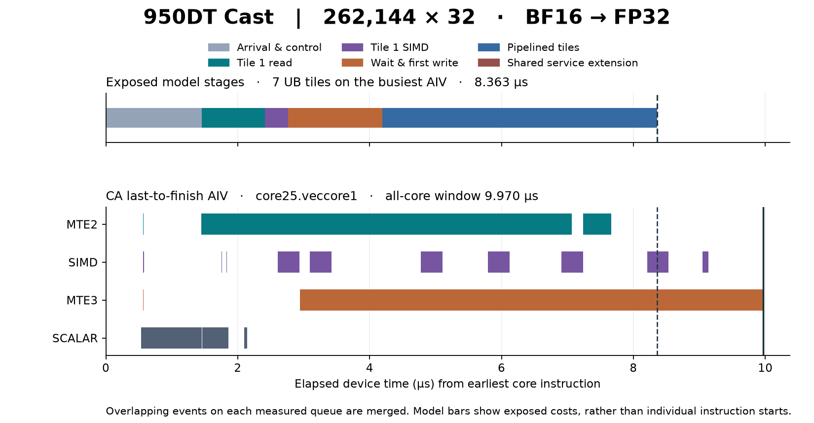

# 大 prefill 的单次 Cast 验证

32k、128k 和 256k 均按 1024 的倍数计，单卡有 8 个请求。下表前三行把完整 prefill 全部放入一次 launch。Flash indexer 的 `weights_proj` 是输出 32 个系数的复制线性层，Attention TP 不切这 32 个系数。测量 `.float()` 对应的连续 BF16→FP32 `aclnnCast`，每端逐元素和精确 FP32 位模式比对。此测量只覆盖未融合的类型转换，模型前后各有计算，部署能否融合取决于后端。[Flash indexer 源码](https://github.com/vllm-project/vllm-ascend/blob/c09d3e20b9c45c80b34ae3781440d90904a44023/vllm_ascend/models/deepseek_v41/indexer.py#L167-L176)

两个宽通道样例取 Flash 和 Pro 的完整 hidden 维度，以 8192 / 4096 个单卡已调度 token 测 post-norm 向 FP32 升精度的 eager 路径。二者是宽通道 chunk。Kimi 的模型层结构单独列于场景清单，这里没有把相同 kernel 当成 Kimi 的执行证据。[Flash 回退路径](https://github.com/vllm-project/vllm-ascend/blob/c09d3e20b9c45c80b34ae3781440d90904a44023/vllm_ascend/models/deepseek_v41/model.py#L843-L852) · [Pro 回退路径](https://github.com/vllm-project/vllm-ascend/blob/c09d3e20b9c45c80b34ae3781440d90904a44023/vllm_ascend/models/deepseek_v4/model.py#L735-L743)

Pro 在 C4 indexer 的 30 层中用复制线性层保留 64 个系数。乘标量后，A5 的 prepare_dsa_indexer_weights 显式调用 weights.float()，表中单列真实完整 [262144,64]。这一条件调用没有计入 Flash 三种上下文的曲线。[Pro 索引算子](https://github.com/vllm-project/vllm-ascend/blob/c09d3e20b9c45c80b34ae3781440d90904a44023/vllm_ascend/models/deepseek_v4/indexer.py#L238-L246) · [950 设备分支](https://github.com/vllm-project/vllm-ascend/blob/c09d3e20b9c45c80b34ae3781440d90904a44023/vllm_ascend/device/device_op.py#L1588-L1590)

## 冻结预测与实测

所有设备耗时单位为 µs，误差为（预测 / CA − 1）×100%。时间窗从最早一核首条指令到最晚一核最后指令结束；每核均核对官方 duration 表。DT/PR 均调用 CANN 9.2.1 ops-math Cast，完整 kernel 名、二进制哈希和 trace 哈希见分 SKU 的 JSON。970DT 仅有资源模型外推。同集比较 v0.19 的全量外存定价和 v0.20 的 L2 写接收模型。独立性按 v0.20 第二次冻结时的进程状态判定。

|单卡 shape / 角色|逻辑读+写 MiB|DT 旧 → 新 / CA / 新误差|PR 旧 → 新 / CA / 新误差|DT耗时/PR耗时 新 / CA|970DT 外推|
|---|---:|---|---|---|---:|
|262144 × 32 · 开发|48|13.65 → 8.36 / [9.97](cast_262144_32_Ascend950DT_9582.json) / -16.1%|37.01 → 13.05 / [14.08](cast_262144_32_Ascend950PR_957b.json) / -7.3%|0.64 / 0.71|6.05|
|1048576 × 32 · 并行回放|192|51.39 → 23.27 / 运行中 / —|144.87 → 64.36 / 运行中 / —|0.36 / —|13.34|
|2097152 × 32 · 独立|384|101.73 → 69.52 / 已排队 / —|288.67 → 208.16 / 已排队 / —|0.33 / —|23.06|
|8192 × 5120 · 独立|240|63.98 → 31.77 / 已排队 / —|180.82 → 100.31 / 已排队 / —|0.32 / —|15.77|
|4096 × 7168 · 独立|168|45.10 → 20.79 / 已排队 / —|126.89 → 46.38 / 已排队 / —|0.45 / —|12.13|
|262144 × 64 · 独立|96|26.23 → 13.33 / 已排队 / —|72.96 → 25.03 / 已排队 / —|0.53 / —|8.48|

同集汇总保留每个样本的首次官方窗口。WAPE 为绝对误差之和除以 CA 耗时之和，跨芯片比值单独计算。
|角色|DT 数量 / WAPE 旧→新|PR 数量 / WAPE 旧→新|比值数量 / WAPE 旧→新|
|---|---:|---:|---:|
|v0.19 十个小样例回放|10 / 5.0% → 5.0%|10 / 9.8% → 6.0%|10 / 7.0% → 7.0%|
|开发|1 / 36.9% → 16.1%|1 / 162.9% → 7.3%|1 / 47.9% → 9.5%|
|冻结时已运行|0 / N/A|0 / N/A|0 / N/A|
|冻结后启动|0 / N/A|0 / N/A|0 / N/A|

[逐 shape 的旧版/新版误差、最大误差和加速比](paired-comparison.json)

## 瓶颈、分块和采集开销

逻辑流量包含每元素 2 B 读和 4 B 写。下表的等效带宽用该流量除以完整 CA 耗时，描述算子的吞吐。它可以高于外存带宽，因为入参可在缓存中、输出也可能尚未全部从 L2 回写到外存。队列可见率是 profiler 的 DMA 描述符 `processed_bytes` 之和除以张量语义字节量；即使全部可见，OUT↔UB 仍无法确定 LPDDR/HBM 实际流量。

|shape|SKU|核数 模型/CA|每核 UB 轮数预测|DT/PR 等效带宽 TB/s|MTE2/MTE3 可见字节 %|宿主墙钟 min|单例采集峰值 GiB|
|---|---|---:|---:|---:|---:|---:|---:|
|262144 × 32|DT|64 / 64|7|5.05|100.0 / 98.9|5.9|1.71|
|262144 × 32|PR|56 / 56|8|3.57|100.0 / 100.0|6.0|2.13|

首个整批点的 48 MiB 总逻辑数据可装入 DT 的 128 MiB 或 PR 的 112 MiB L2。按所有字节走 4.0 / 1.4 TB/s 外存计算，光数据项便是 12.58 / 35.95 µs，已经超过两端完整 CA。旧模型强制该项构成设备时间下界，因此高估；仅按核数判断不会发现问题。DT 的 DRAM 交易证据见下表。更大的点逐渐超过 L2，能检验小点上观察到的现象能否延续。

## 低采集量的 950DT 全宽实验

额外单次派发 [262144,5120]，对应 8 × 32ki 的完整 hidden。含 1,342,177,280 个元素，输入 2.5 GiB，输出 5 GiB。为它单独登记 4 小时 / 8 GiB 原始日志预算。在同一物理 CA 上直接调用 `aclnnCast`，保留所有核的 wrapper start/done 时间戳和金标。wrapper 包含指令执行前的启动等待，下面以相同 shape 的规范指令窗校验时钟和边界。此实验只提供 wrapper 口径的独立观测，不纳入上表误差。

|对照 shape|原生 wrapper µs|正式指令窗 µs|原生 / 正式墙钟 s|原生 / 正式峰值 MiB|
|---|---:|---:|---:|---:|
|32 × 4096|4.899|2.771|54 / 78|23 / 83|
|262144 × 32|12.267|9.970|153 / 355|54 / 1748|

原生 DT CA 在 128 个 HBM 控制器的每个采样区间分别给出 DMC 与 DDR 字节和累计读写命令。下表汇总整个进程，因此包含可能的取指、元数据和窗口边界外事务；DRAM 事务的实际大小会变化。

|DT shape|张量逻辑读 / 写 MiB|控制器 DMC / DDR 总 MiB|外存读 / 写命令|
|---|---:|---:|---:|
|32 × 4096|0.25 / 0.5|[0.293 / 0.293](cast_32_4096_native-dram.json)|1,365 / 0|
|262144 × 32|16 / 32|[16.043 / 16.043](cast_262144_32_native-dram.json)|65,879 / 0|

[262144,32] 的模拟 HBM 在全部通道上合计 0 个写命令，16,822,272 B 的实际流量比 16 MiB 输入只多 45,056 B；即使通过金标校验，输出 32 MiB 也没有在这次 CA 的 HBM 事务中出现。PR 还缺少同类物理通道计数。

同一正式 dispatch 的 64 核同时有 wrapper 和指令两组时标。在 1650 tick/µs 时，各核 wrapper start 到首条指令相差 [3535, 4579] tick，最后一条指令到 wrapper done 相差 [1, 1552] tick。该差值不能作为跨 shape 的固定校正。

全宽任务已启动；通过全部输出和逐核结束门槛后会单独列出设备窗口。

[v0.20 冻结预测与角色](cast-v20-freeze.json) · [原始预测与预算](registration.json) · [原生对照登记](native-freeze.json) · [机器可读指标](evaluation.json)
