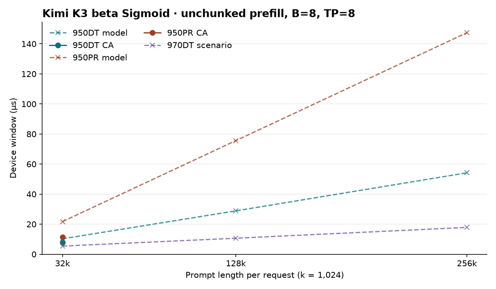

# Kimi K3 beta Sigmoid 在未切 chunk 的长 prefill 上的增长

固定单卡 B=8、TP=8、局部 head=12，全部 shape 都提交到原生 FP32 `aclnnSigmoid`。计时覆盖所有核；每个元素与 FP64 参考比较。表中设备时间单位 µs，最后的 min 是单次离线 CA 的墙钟。

| 场景与 shape | 预测关键核 UB 轮数 DT / PR | DT 模型 / 实测（误差），CA 成本 | PR 模型 / 实测（误差），CA 成本 | 970DT 外推 µs |
|---|---:|---|---|---:|
| B8 × 32k `[262144, 12]` | 4 / 4 | 10.279 / 7.759 (+32.5%), 5.2 min | 21.728 / 11.428 (+90.1%), 3.9 min | 5.427 |
| B8 × 128k `[1048576, 12]` | 13 / 15 | 28.858 / 等待 | 75.597 / 等待 | 10.656 |
| B8 × 256k `[2097152, 12]` | 25 / 29 | 54.185 / 等待 | 147.417 / 等待 | 17.849 |

三个点的逻辑读写总量为 24、96、192 MiB。图中实线点为已经通过校验的 CA，虚线为解析模型。模型中稳定满 tile 的循环量随 token 数成比例，启动、尾块、首个读依赖独立计入，有限长度的增长倍数因此可能偏离工作量倍数。

[10 个冻结 shape 的逐项记录](measurements.md) · [为何上线模型与 L2 驻留敏感性分列](../../../docs/examples/sigmoid_fp32.md)
