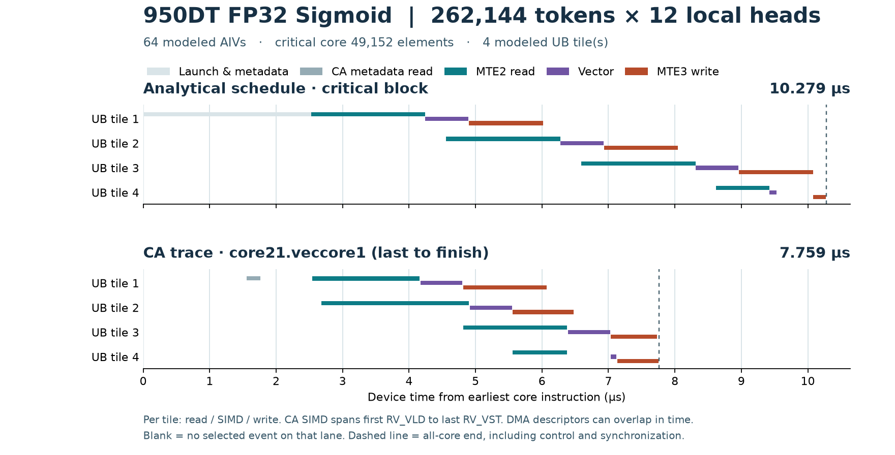
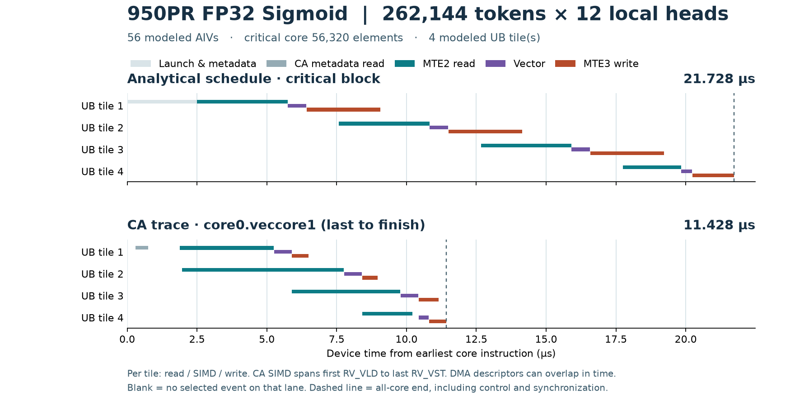
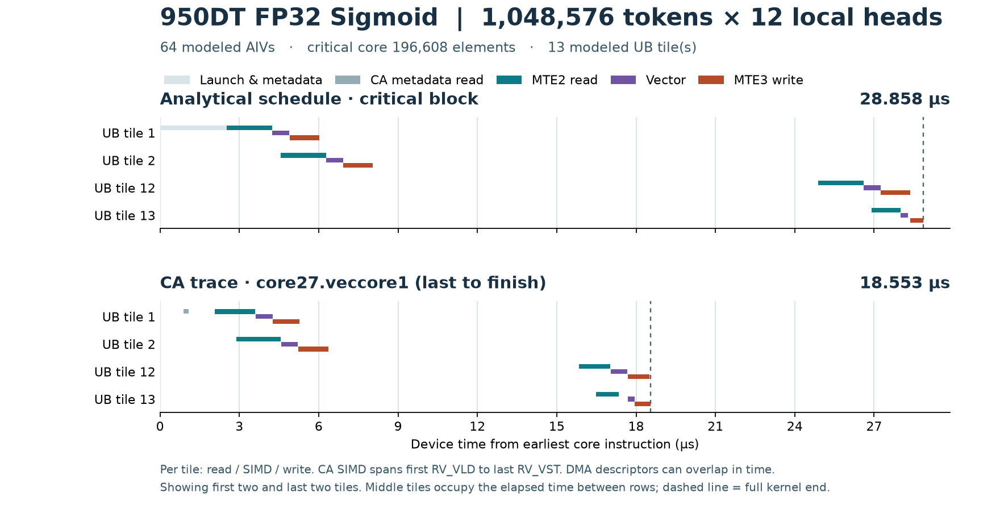
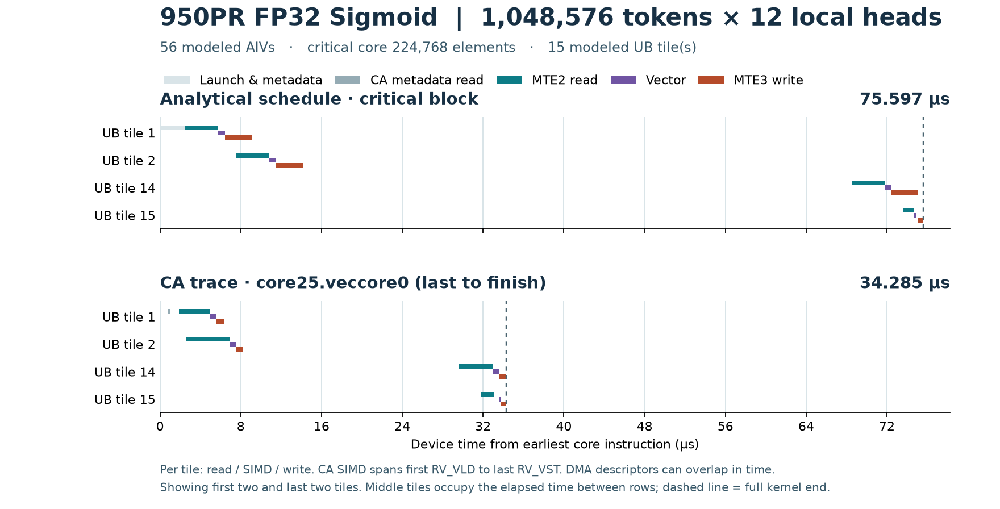
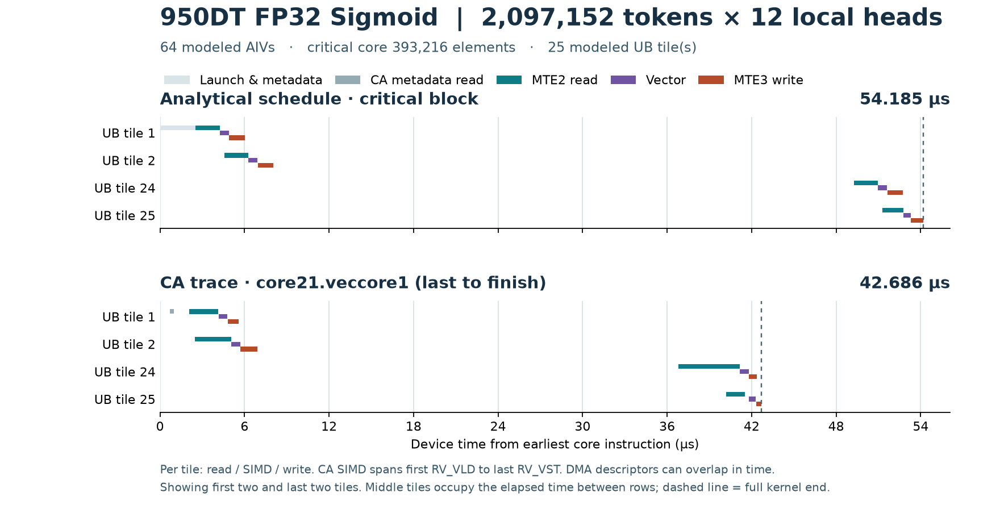
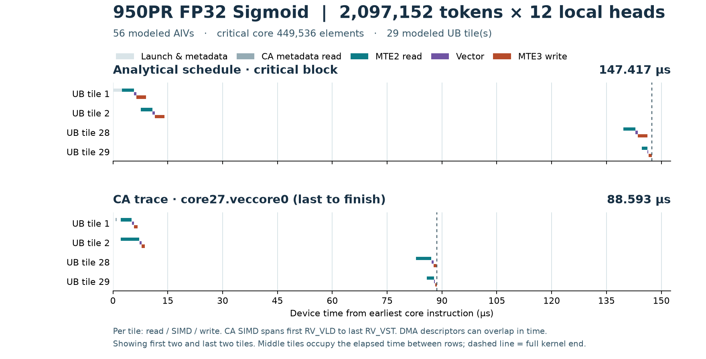

# Kimi K3 长 prefill 的终止核流水

横轴保留整个 kernel。每图上半是事前冻结的模型，下半来自 CA 中结束最晚的 AIV。每个选中的 tile 展示 MTE2、首个 RV_VLD 至最后 RV_VST 的 SIMD 时间窗和 MTE3。四轮时全部展示；超过六轮时选择首两轮和末两轮，中间工作仍计入总时间。输入均为 B8、TP8 的一次未分 chunk 提交。

## 950DT · B8 × 32k

实际 64 个 AIV，每核典型满 tile 搬入 63,488 B。终止核 `core21.veccore1` 有 4 个 tile；模型 10.279 µs，CA 7.759 µs（+32.5%）。离线 CA 5.2 分钟。

[完整分块时间戳与校验哈希](timeline-prefill32k.json)

## 950PR · B8 × 32k

实际 56 个 AIV，每核典型满 tile 搬入 63,488 B。终止核 `core0.veccore1` 有 4 个 tile；模型 21.728 µs，CA 11.428 µs（+90.1%）。离线 CA 3.9 分钟。

[完整分块时间戳与校验哈希](timeline-prefill32k-pr.json)

## 950DT · B8 × 128k

实际 64 个 AIV，每核典型满 tile 搬入 63,488 B。终止核 `core27.veccore1` 有 13 个 tile；模型 28.858 µs，CA 18.553 µs（+55.5%）。离线 CA 25.1 分钟。

[完整分块时间戳与校验哈希](timeline-prefill128k.json)

## 950PR · B8 × 128k

实际 56 个 AIV，每核典型满 tile 搬入 63,488 B。终止核 `core25.veccore0` 有 15 个 tile；模型 75.597 µs，CA 34.285 µs（+120.5%）。离线 CA 16.3 分钟。

[完整分块时间戳与校验哈希](timeline-prefill128k-pr.json)

## 950DT · B8 × 256k

实际 64 个 AIV，每核典型满 tile 搬入 63,488 B。终止核 `core21.veccore1` 有 25 个 tile；模型 54.185 µs，CA 42.686 µs（+26.9%）。离线 CA 26.1 分钟。

[完整分块时间戳与校验哈希](timeline-prefill256k.json)

## 950PR · B8 × 256k

实际 56 个 AIV，每核典型满 tile 搬入 63,488 B。终止核 `core27.veccore0` 有 29 个 tile；模型 147.417 µs，CA 88.593 µs（+66.4%）。离线 CA 37.8 分钟。

[完整分块时间戳与校验哈希](timeline-prefill256k-pr.json)

[场景增长曲线与实测比值](long-context.md) · [计价方法、工作量和参数](../../../docs/examples/sigmoid_fp32.md)
