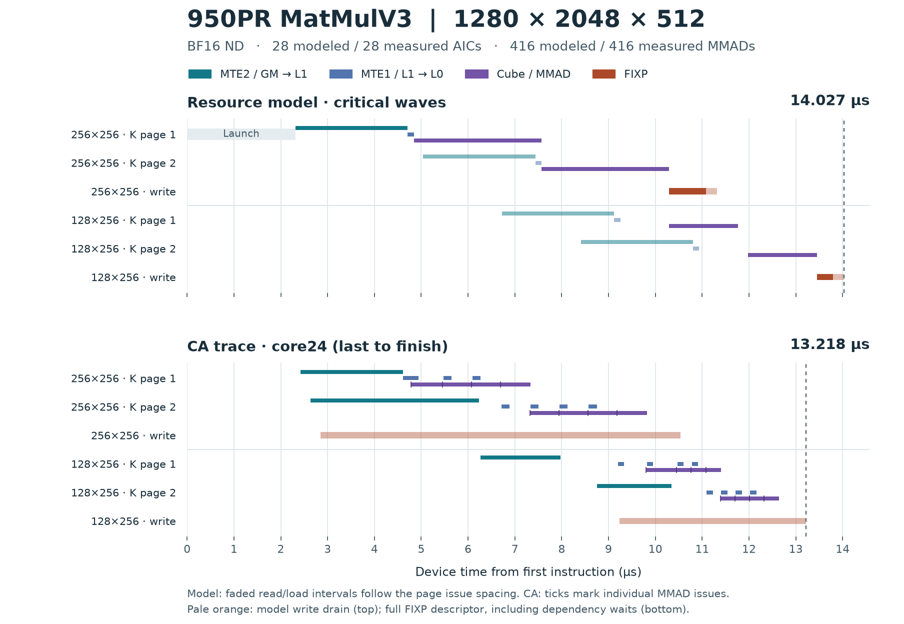

# 950PR Matmul 两波流水与逐页 CA

BF16 ND 上的 `aclnnMatmul`，轴顺序 [M,N,K] = [1280, 2048, 512]。同一份可执行文件用于 950DT 和 950PR。PR 预测 **14.027 µs**，完整 CA **13.218 µs**，有符号误差 **+6.12%**。模型与 CA 均从各自全核窗口的首条指令起算。采集前已冻结全部模型页、活动 AIC 与 MMAD 数。[冻结记录](freeze.json) · [数值及全核窗口](observation.json)



|项目|模型|完整 CA|
|---|---:|---:|
|AIC / AIV|28 / 0|28 / 0|
|输出块|52|52|
|MMAD 总数|416|416|
|有用 Cube 运算|2,684,354,560|2,684,354,560|
|图中首个 MMAD 发起 µs|4.842|4.783|

模型把 40 个 256×256 母块映射到 28 个 AIC。第一轮 28 个整块，余下 12 个沿 M 各一分为二，第二轮是 24 个 128×256 矩形，各块分两页 K=256。每页用四个 K=64 的 MMAD。在确认的 PR trace 中，写出的几何直方图为 **24 个 128×256、28 个 256×256**，每核分工为 **4 核各 1 块、24 核各 2 块**，读描述符覆盖的 K 页深度为 [256]。下栏按最后退休的 **core24.cubecore0** 的实际输出块标注。模型尾部取资源关键路径，下栏是实测末核；“首次 MMAD”比较的范围也据此确定。

| 所在关键路径 | 预测 µs | CA µs | 预测−CA µs |
|---|---:|---:|---:|
| 第 1 块 · 首笔 GM→L1 发起 | 2.315 | 2.418 | -0.103 |
| 第 1 块 · 第 1 页首条 MMAD 发起 | 4.842 | 4.783 | +0.059 |
| 第 1 块 · 第 2 页首条 MMAD 发起 | 7.566 | 7.318 | +0.248 |
| 第 1 块 · FIXP 阶段结束 | 11.316 | 10.542 | +0.774 |
| 第 2 块 · 首笔 GM→L1 发起 | 6.724 | 6.267 | +0.457 |
| 第 2 块 · 第 1 页首条 MMAD 发起 | 10.289 | 9.802 | +0.486 |
| 第 2 块 · 第 2 页首条 MMAD 发起 | 11.973 | 11.387 | +0.586 |
| 第 2 块 · FIXP 阶段结束 | 14.027 | 13.218 | +0.808 |

模型的 MTE2 窗口表示两操作数到达本页预算，CA 首笔取同一页较早的 DMA 发起；FIXP 的总窗终点计入实际依赖等待。判断页间差异时还可以对比上表中相邻两行 MMAD 首发之差。

从原始 `FIX_L0C_TO_DST` 目的地址还原每个输出矩形的行、列起点，并验证整个 M×N 输出恰覆盖一次。每一页的 A/B 全局地址和实际字节按该矩形的两条边分别核对；L0A 与 L0B 的搬运大小随 M、N 各自变化，非整 16 边按寄存矩阵块粒度补齐。按矩阵 C 初始化和末条 unit flag 划分 MMAD 累加链，逐链验证累计 K、操作数和页内 MMAD 数；图中每个紫色竖刻度来自实际指令。图上 FIXP 浅色实际条包含依赖等待，不能将整条直接解释为纯传输。模型浅色读条是用页发起间隔重建的预算。[全部核的矩形与末核逐指令区间](page-audit.json) · [非整 16 边在真实矩形上的解码对照](decoder-controls.json)

950DT 同形窗口为 12.449 / 12.219 µs（模型 / CA），32 核、32 个 256×256 整块和 32 个 128×128 尾块，实测 512 MMAD。DT/PR 耗时比实测 0.9244，预测 0.8875，相对偏差 -3.99%。970DT 的 6.350 µs 为假定实现下的外推。[同形 DT 图](../../../docs/examples/figures/matmul-tile-pages.png)

实际库 kernel 为 `MatMulV3_ND_ND_ND_ND_BF16_BF16_BF16_BF16_high_performance_2`。宿主校验全部 2,621,440 个输出；每核指令跨度也与官方 duration 表核对。一次 PR CA 墙钟 7.7 min，保留 134.4 MiB 原始文件。上述数据是该 shape 在 PR 的单次实测，不能单独估计其他形状的 WAPE。[原始 trace 指纹与计费](observation.json) · [三组解码器回归](decoder-controls.json) · [独立解码器](../../../development/validation/matmul_pages_pr/extract.py)

可从已提交的逐页 JSON 重画，不需要 CANN 或原始 trace。

```bash
python development/validation/matmul_pages_pr/publish.py --replot
```
